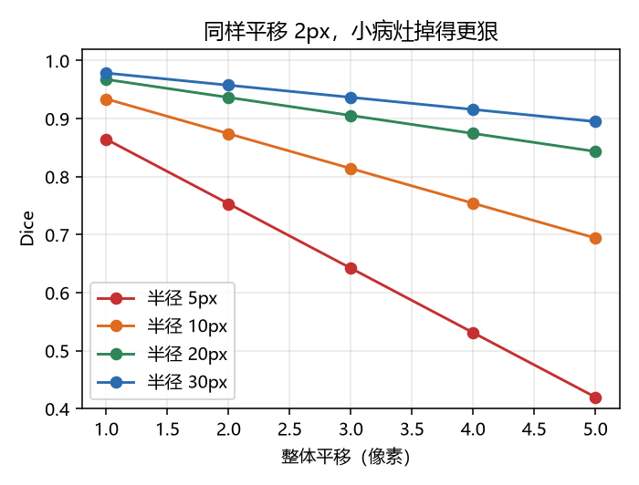
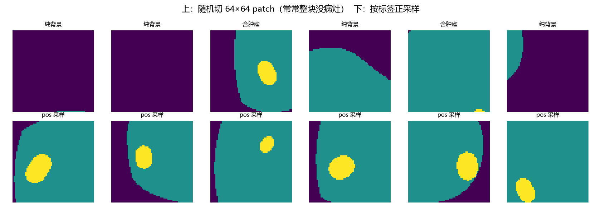
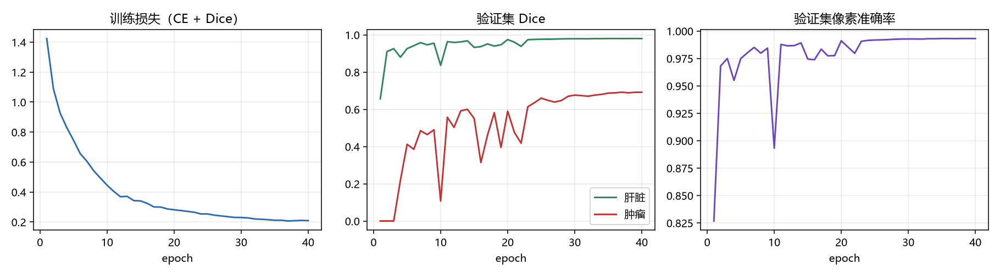
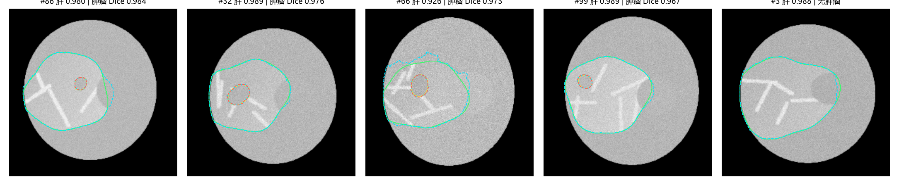
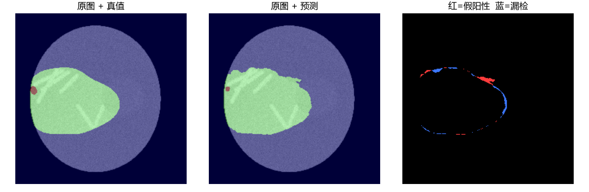
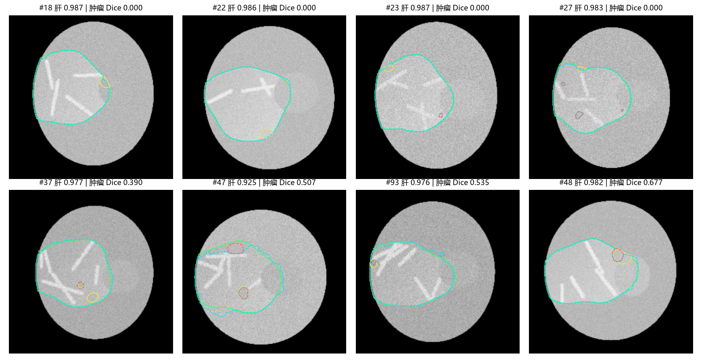

# 模块 11 · 医学图像分割

**核心问题：怎么让模型逐像素地画出肝脏和肿瘤？**

**建议用时：30 小时（5 天，相对难度估计）**

这是你求职作品集里最核心的一块。分类任务可以拿公开表格练，分割任务必须自己处理三维数据、自己写训练循环、自己算 Dice——面试官问项目，十有八九会从这里往下挖。

---

## 写在最前面：本讲义的数字是怎么来的

**这一点必须先说清楚，否则你没法判断哪些结论能信。**

| 内容 | 来源 | 可信度 |
|---|---|---|
| 所有 Dice、IoU、准确率、显存、耗时 | 本机实际运行，RTX 5060 Laptop，torch 2.9.1+cu128 | 实测 |
| U-Net 参数量、输出尺寸 | 实际 `print` | 实测 |
| Dice/IoU 手算 | 先用公式算，再用代码复算 | 双重验证 |
| LiTS / MSD 的效果数字 | **没有**。数据集未下载 | **本讲义不编造** |
| MONAI API | 本机 MONAI 1.6.1 实际调用 | 实测 |

**训练数据是合成的腹部 CT 体模（phantom），不是真人 CT。**

原因很直接：MSD Task03_Liver 压缩包 26.9 GiB，你这台机器还没下。拿一个下不动的数据集写 2000 行讲义，最后所有代码都跑不了，那是骗人。

所以第八节用 `numpy` + `scipy` 生成了一套**结构可控、带肝脏/肿瘤/血管/脾脏干扰**的二维体模：

- 600 张训练、100 张验证、100 张测试，256×256
- 标签 0 背景 / 1 肝脏 / 2 肿瘤
- 肿瘤占全图 0.32%–0.45%，边界低对比，带噪声和偏置场
- 专门留了一批"困难测试例"：小病灶、低对比、贴近肝边界

它的统计特性和真实腹部 CT 接近到**足以把流程跑通、把坑踩一遍**，但绝对数字不能写进论文。真实项目的替换方法在 8.9 节，代码只需要换 DataLoader。

**你在本讲义里要学的是流程和判断，不是记住 0.93 这个数。**

---

## 〇、先看三个数字

### 0.1 第一个数字：82.84%

在验证集上，一个**什么都不学**的模型把每个像素都预测成背景：像素准确率 **82.84%**，肝脏 Dice **0**，肿瘤 Dice **0**。

**82.84% 的准确率，零信息量。** 类别不平衡到了像素级别，准确率彻底失效。

### 0.2 第二个数字：0.45%

验证集里肿瘤像素占 **0.45%**，肝脏占 **16.71%**，肿瘤比肝脏小 37 倍。真实 LiTS 里肝脏约占 5%–10%，肿瘤常常不到 1%。

**模型有 99.5% 的机会"什么都不做"也能拿到 99.5% 的像素准确率。**

### 0.3 第三个数字：平移 2 个像素

半径 30 像素的器官平移 2 像素，Dice 还有 0.9575；半径 5 像素的病灶同样平移 2 像素，Dice 掉到 0.7531。

**同样的定位误差，小病灶的 Dice 掉得厉害得多。**

这解释了为什么肝脏 Dice 能到 0.95，肿瘤 Dice 只有 0.7：不全是模型不行，**指标本身对小目标更苛刻**。

---

## 一、分割 vs 分类：输出形式决定了一切

### 1.1 一张表看清区别

| | 分类 | 语义分割 |
|---|---|---|
| 输入 | 一张图 | 一张图（或一个 3D 体） |
| 输出 | 1 个类别（或 C 个概率） | **每个像素** C 个概率 |
| 输出张量 | `(B, C)` | `(B, C, H, W)` |
| 空间信息 | 最后被全局池化压掉 | **从头到尾必须保留** |
| 典型损失 | CrossEntropy | CrossEntropy + Dice |
| 典型指标 | Accuracy、AUC、F1 | **Dice、IoU、HD95** |
| 标签成本 | 一张图一个标签 | 每个像素都要标 |
| 医学例子 | 这张 CT 有没有肝癌 | 肝癌在哪些像素 |

**最本质的一行是输出张量。**

分类网络最后是 `AdaptiveAvgPool → Linear`，输出的 `(B, C)` 里已经不包含"哪儿"的信息了。你想从分类网络里找回位置，只能靠 CAM/Grad-CAM 这类事后解释，分辨率很低。

分割网络输出的是 `(B, C, H, W)`，**"是什么"和"在哪里"在同一个张量里**。

### 1.2 输出的三种形态

```python
import torch

# 模型最后一层输出 logits，不做 softmax
logits = torch.tensor([[[[8., -8.], [-8., 8.]],
                        [[-8., 8.], [8., -8.]],
                        [[0., 0.], [0., 0.]]]])
print("logits:", tuple(logits.shape))          # (1, 3, 2, 2)

prob = torch.softmax(logits, dim=1)            # 每个像素、每个类别的概率
mask = prob.argmax(dim=1)                      # (1, 2, 2)，每个像素一个类别
print("prob[0,:,0,0]:", prob[0, :, 0, 0])
print("mask:", mask)
```

**真实输出：**

```
logits: (1, 3, 2, 2)
prob[0,:,0,0]: tensor([9.9966e-01, 1.1250e-07, 3.3535e-04])
mask: tensor([[[0, 1],
               [1, 0]]])
```

**三个形态，三个用途：**

| 形态 | 形状 | 用途 | 注意 |
|---|---|---|---|
| logits | `(B,C,H,W)` | 喂给损失函数 | 不要先 softmax 再喂 CE |
| prob | `(B,C,H,W)` | 算 soft Dice、做不确定度 | 数值 0–1，每像素和=1 |
| mask | `(B,H,W)` | 算 Dice/IoU、可视化、保存 | `argmax(dim=1)`，不是 `dim=0` |

**新手最常错的两个地方：**

1. 在 `CrossEntropyLoss` 之前又做了一次 softmax。PyTorch 的 CE 内部自带 log-softmax，重复做等于把梯度压平，loss 降得很慢。
2. `argmax(dim=0)`。对 `(B,C,H,W)`，`dim=0` 是在 batch 维上取最大，结果形状 `(C,H,W)`，完全不报错，但全是错的。正确是 `dim=1`。

### 1.3 为什么必须保留空间信息

不是"分割任务碰巧需要位置"，而是**位置本身就是诊断信息**。

| 场景 | 为什么位置重要 |
|---|---|
| 肝癌早筛 | 病灶在肝左叶还是右叶，影响手术方案 |
| 肝段切除 | 要按 Couinaud 八段报体积，位置错了方案就错 |
| 放疗计划 | 靶区边界差 2 mm，剂量分布就变 |
| 随访对比 | 同一个病灶要能配准，位置是配准的前提 |
| 血管侵犯 | 肿瘤离门静脉多近，决定切不切得干净 |

**分类只回答"有没有"，分割回答"在哪、多大、什么形状"。** 临床上后者才能直接用于决策。

### 1.4 分割任务的三个层级

| 类型 | 输出 | 医学例子 | 常用数据集 |
|---|---|---|---|
| 语义分割 | 每像素一个类，同类不区分个体 | 肝/脾/肾/肿瘤 | LiTS、MSD、BTCV |
| 实例分割 | 每个个体一个 mask | 每个转移灶分别编号 | 少见，多为研究 |
| 全景分割 | 语义 + 实例 | 器官 + 每个病灶 | 更少见 |

**你这阶段只需要语义分割。** 肝脏是一个连通器官，肿瘤可能多发——多发病灶如果只做语义分割，会合成一团，这是后面 7.5 节要提醒的坑。

### 1.5 医学分割的典型任务

| 任务 | 输入 | 难点 |
|---|---|---|
| 肝脏 / 肝肿瘤 | 腹部 CT | 边界粘连、病灶小、低对比 |
| 多器官 | 腹部 CT | 类别多、样本不均 |
| 脑肿瘤 | MRI 四模态 | 模态配准、边界模糊 |
| 血管 / 细胞核 | 眼底、显微 | 极细结构、密集粘连 |

**肝脏和肿瘤的差别，比"两个器官"大得多。** 肝脏有清晰的解剖边界（和周围脂肪、肌肉的 HU 差明显），肿瘤的边界是病理性的，影像上常常是渐变、模糊、和正常肝实质只差 10–20 HU。第八节的失败案例会反复看到这一点。

### 1.6 一个必须先建立的直觉

分类模型可以"看整体下结论"，分割模型必须"对每个像素下结论"。所以分割对局部细节、数据增强、分辨率、评估方式都更敏感——后面每一节都在处理这四件事。

### 1.7 常见错误

| 错误 | 后果 | 正确做法 |
|---|---|---|
| 用分类网络 + 全局池化做分割 | 输出没有空间维度 | 用全卷积，去掉全局池化 |
| softmax 后又喂 CE | 梯度变小，收敛慢 | logits 直接进 CE |
| `argmax(dim=0)` | 形状对、语义全错 | `argmax(dim=1)` |
| 用像素准确率当主指标 | 全猜背景 82.84% | 主指标用 Dice/IoU |
| 把多类当多通道 sigmoid | 类别之间不互斥，可能同时为 1 | 多类用 softmax + CE；多标签才用 sigmoid |
| 标签用 float 直接算 CE | dtype 报错或静默出错 | CE 的 target 用 `long` |

---

## 二、FCN → U-Net：把"分类"改成"逐像素分类"

### 2.1 第一步：把全连接换成卷积（FCN）

一个分类 CNN 的尾巴长这样：

```
特征图 (512, 7, 7) → Flatten → Linear(25088, 1000) → (1000,)
```

**Flatten 是空间信息死亡的地方。** 7×7 的位置关系被拉成一维，再也找不回来。

FCN（Fully Convolutional Network）的做法：**把 Linear 换成 1×1 卷积**。

```
特征图 (512, 7, 7) → Conv1x1(512, 1000) → (1000, 7, 7)
```

**这一步换来三件事：**

| 变化 | 含义 |
|---|---|
| 输入尺寸任意 | 全卷积没有固定尺寸限制，512×512 也能进 |
| 输出带空间维度 | `(C, H/32, W/32)`，每个位置都有类别 |
| 参数与位置共享 | 同一个卷积核扫全图，符合"同样的组织长得像"的先验 |

但 `H/32` 太粗了。512 的输入只剩 16×16，边界根本画不准。所以要**上采样**回原尺寸。

### 2.2 编码器-解码器

```
编码器（下采样）              解码器（上采样）
256×256×1                     16×16×512
   ↓ pool                        ↑ upsample
128×128×32                   32×32×256
   ↓ pool                        ↑ upsample
 64×64×64      ───────────→   64×64×128
   ↓ pool        skip            ↑ upsample
 32×32×128    ───────────→   128×128×64
   ↓ pool        skip            ↑ upsample
 16×16×256    ───────────→   256×256×32 → 1×1 conv → 3×256×256
```

**编码器回答"这是什么"**：随着感受野变大，特征从边缘、纹理变成器官级别的语义。
**解码器回答"在哪里"**：把低分辨率语义图放大回原图尺寸。

**但只有编码器+解码器还不够。** 这就是 U-Net 的关键。

### 2.3 skip connection 到底解决什么问题

**先看下采样丢了什么。**

输入 256×256，经过 4 次 MaxPool(2)：

```
256 → 128 → 64 → 32 → 16
```

**特征图上 1 个像素，对应原图 16×16 的区域。** 更糟的是，MaxPool 只保留每个 2×2 窗口里的最大值，**具体是窗口里哪一个位置，信息已经丢了**。

我们可以算一下瓶颈层的感受野。每层两个 3×3 卷积，感受野递推：

| 位置 | 分辨率 | 单像素感受野（原图像素） |
|---|---|---|
| enc1 | 256 | 5 |
| enc2 | 128 | 14 |
| enc3 | 64 | 32 |
| enc4 | 32 | 66 |
| bottleneck | 16 | **132** |

**瓶颈层一个像素，看到的是原图 132×132 的区域。**

这对"判断这是不是肝脏"是好事——它能看到足够大的上下文。对"边界在哪"是灾难——132×132 的范围压缩成一个向量，边界位置被平均掉了。

**上采样能补回来吗？不能。**

上采样（双线性、最近邻、转置卷积）本质是**插值**：它根据邻域值猜中间值。猜出来的边界是平滑的、模糊的，**不会比输入的特征图更精确**。输入是 16×16，输出 256×256，但有效信息仍然只有 16×16。

**skip connection 做的事：把编码器同一层的高分辨率特征，直接拼到解码器上。**

```
解码器第 4 层输入 = upsample(瓶颈特征) ⊕ 编码器第 4 层特征
                     (语义，粗)          (细节，细)
```

- 深层特征告诉它"这一大片是肝脏"
- 浅层特征告诉它"边界在这几个像素上"

**一句话：skip connection 让解码器同时拿到"是什么"和"在哪里"。**

**这也是为什么 U-Net 在医学分割里统治了八年。** 医学目标的边界往往低对比，光靠深层语义画不出准确轮廓，必须借浅层的高频细节。

### 2.4 手算一次完整的尺寸变化

用本讲义实际训练的 U-Net：输入 1×256×256，4 次下采样，通道 32/64/128/256，瓶颈 512。

| 阶段 | 操作 | 输出尺寸 | 通道 |
|---|---|---|---|
| 输入 | — | 256×256 | 1 |
| enc1 | DoubleConv 3×3, pad=1 | 256×256 | 32 |
| pool1 | MaxPool 2×2 | 128×128 | 32 |
| enc2 | DoubleConv | 128×128 | 64 |
| pool2 | MaxPool | 64×64 | 64 |
| enc3 | DoubleConv | 64×64 | 128 |
| pool3 | MaxPool | 32×32 | 128 |
| enc4 | DoubleConv | 32×32 | 256 |
| pool4 | MaxPool | 16×16 | 256 |
| bottleneck | DoubleConv | 16×16 | 512 |
| up4 | ConvTranspose 2×2, stride=2 | 32×32 | 256 |
| cat4 | 与 enc4 拼接 | 32×32 | 512 |
| dec4 | DoubleConv | 32×32 | 256 |
| up3 | ConvTranspose | 64×64 | 128 |
| cat3 | 与 enc3 拼接 | 64×64 | 256 |
| dec3 | DoubleConv | 64×64 | 128 |
| up2 | ConvTranspose | 128×128 | 64 |
| cat2 | 与 enc2 拼接 | 128×128 | 128 |
| dec2 | DoubleConv | 128×128 | 64 |
| up1 | ConvTranspose | 256×256 | 32 |
| cat1 | 与 enc1 拼接 | 256×256 | 64 |
| dec1 | DoubleConv | 256×256 | 32 |
| head | Conv 1×1 | 256×256 | 3 |

**必须记住的三条算术：**

```
3×3 卷积，padding=1     -> 尺寸不变
MaxPool(2) / stride=2   -> 尺寸减半（向下取整）
ConvTranspose(2, stride=2) -> 尺寸翻倍
```

**为什么输入必须是 16 的倍数？**

每次 pool 向下取整。输入 250：

```
250 → 125 → 62 → 31 → 15 → 上采样 30 → 60 → 120 → 240 ≠ 250
```

拼接时 `enc1` 是 250，解码器出来是 240，`torch.cat` 直接报错。

**标准做法：训练和推理前都 pad 到 16 的倍数，推理完再裁回去。**

### 2.5 完整可运行的 U-Net

```python
import torch
import torch.nn as nn


class DoubleConv(nn.Module):
    """(Conv3x3 -> BN -> ReLU) x 2，尺寸不变。"""

    def __init__(self, cin, cout):
        super().__init__()
        self.net = nn.Sequential(
            nn.Conv2d(cin, cout, 3, padding=1, bias=False),
            nn.BatchNorm2d(cout),
            nn.ReLU(inplace=True),
            nn.Conv2d(cout, cout, 3, padding=1, bias=False),
            nn.BatchNorm2d(cout),
            nn.ReLU(inplace=True),
        )

    def forward(self, x):
        return self.net(x)


class UNet(nn.Module):
    def __init__(self, in_ch=1, num_classes=3, base=32):
        super().__init__()
        c = [base, base * 2, base * 4, base * 8]
        self.enc1 = DoubleConv(in_ch, c[0])
        self.enc2 = DoubleConv(c[0], c[1])
        self.enc3 = DoubleConv(c[1], c[2])
        self.enc4 = DoubleConv(c[2], c[3])
        self.pool = nn.MaxPool2d(2)
        self.bottleneck = DoubleConv(c[3], base * 16)

        self.up4 = nn.ConvTranspose2d(base * 16, c[3], 2, stride=2)
        self.dec4 = DoubleConv(c[3] * 2, c[3])
        self.up3 = nn.ConvTranspose2d(c[3], c[2], 2, stride=2)
        self.dec3 = DoubleConv(c[2] * 2, c[2])
        self.up2 = nn.ConvTranspose2d(c[2], c[1], 2, stride=2)
        self.dec2 = DoubleConv(c[1] * 2, c[1])
        self.up1 = nn.ConvTranspose2d(c[1], c[0], 2, stride=2)
        self.dec1 = DoubleConv(c[0] * 2, c[0])
        self.head = nn.Conv2d(c[0], num_classes, 1)

    def forward(self, x):
        e1 = self.enc1(x)                    # 256
        e2 = self.enc2(self.pool(e1))        # 128
        e3 = self.enc3(self.pool(e2))        # 64
        e4 = self.enc4(self.pool(e3))        # 32
        b = self.bottleneck(self.pool(e4))   # 16

        d4 = self.dec4(torch.cat([self.up4(b), e4], dim=1))
        d3 = self.dec3(torch.cat([self.up3(d4), e3], dim=1))
        d2 = self.dec2(torch.cat([self.up2(d3), e2], dim=1))
        d1 = self.dec1(torch.cat([self.up1(d2), e1], dim=1))
        return self.head(d1)


if __name__ == "__main__":
    model = UNet(1, 3)
    x = torch.randn(1, 1, 256, 256)
    y = model(x)
    print("输出:", tuple(y.shape))
    print("参数量: %.3f M" % (sum(p.numel() for p in model.parameters()) / 1e6))
```

**真实输出：**

```
输出: (1, 3, 256, 256)
参数量: 7.763 M
```

**输入输出尺寸完全一致，这是分割网络的基本要求。** 如果对不上，先查每个 pool 和 upsample 是否成对。

### 2.6 参数量手算

以第一个 DoubleConv（1→32）为例：`1×32×3×3+32 + 32×32×3×3+32 = 9,568`。瓶颈层 DoubleConv（256→512）是 3,539,968，接近全模型 7.76M 的一半；把 base 从 32 降到 16，参数量掉到约 1/4。

### 2.7 MONAI 的等价写法

```python
from monai.networks.nets import UNet

model = UNet(
    spatial_dims=2,
    in_channels=1,
    out_channels=3,
    channels=(32, 64, 128, 256),
    strides=(2, 2, 2),
    num_res_units=2,
)
x = torch.randn(1, 1, 256, 256)
print(model(x).shape)
```

**真实输出：**

```
torch.Size([1, 3, 256, 256])
参数量 1.604 M
```

**注意：MONAI 的 `strides=(2,2,2)` 只下采样 3 次，而手写版下采样 4 次。** 两者不是同一个网络，参数量差 4.8 倍。要用 4 次就写 `strides=(2,2,2,2)`。

**MONAI UNet 默认带 residual unit（`num_res_units=2`），结构比手写版更现代。** 初学阶段先手写，理解每一层；做项目时用 MONAI，省时间且不容易错。

### 2.8 上采样的三种方式

| 方式 | 优点 | 缺点 |
|---|---|---|
| 最近邻 | 快、无参数 | 块状锯齿 |
| 双线性 | 平滑 | 边界偏糊 |
| 转置卷积 | 可学习 | **容易棋盘伪影**（重叠区叠加不均） |
| 双线性 + 3×3 卷积 | 平滑且可学习 | 多一层计算 |

**建议：** 基线用双线性 + 3×3 卷积；追求性能用转置卷积，但注意初始化；最终输出别用最近邻。

### 2.9 常见错误

| 错误 | 现象 | 原因 | 修法 |
|---|---|---|---|
| 输入尺寸不是 16 倍数 | `cat` 时尺寸不匹配 | 每次 pool 向下取整 | pad 到 16 倍数 |
| `cat` 维度写错 | 通道数爆炸或报错 | 应在 `dim=1` 拼通道 | `torch.cat([...], dim=1)` |
| 上采样次数少于下采样 | 输出比输入小 | 少了一个 up | 数 pool 和 up 的个数 |
| 解码器只上采样不拼接 | 边界很糊，Dice 上不去 | 丢了 skip | 每层都 cat |
| BN 遇到 batch=1 | 训练报错或性能崩 | BN 需要 batch 统计 | 改 GroupNorm / InstanceNorm |
| 最后加 softmax 再算 CE | loss 降得慢 | CE 自带 log-softmax | 输出 logits |
| 用 `ConvTranspose` 后尺寸多 1 | 输出 257 | padding/output_padding 不匹配 | 用 `output_padding=1` 或改用插值 |

---

## 三、损失与指标：Dice 是这一章的中心

### 3.1 为什么是 Dice

分割的评估要回答一个问题：**预测的区域和真实区域重叠了多少？**

最直觉的两个量：

```
交集 = |A ∩ B|      预测和真实都说是前景的像素
并集 = |A ∪ B|      至少一方说是前景的像素
```

Dice 和 IoU 都从这两个量来。

### 3.2 Dice 的定义

```
Dice = 2 * |A ∩ B| / (|A| + |B|)
```

- 范围 0–1，1 表示完全重合
- 分子乘 2，是为了让"完全重合"时等于 1
- 分母是两边面积之和，不是并集

**直觉：Dice 衡量的是"平均而言，两个区域有多少比例是重合的"。**

### 3.3 手算三组

**例 1（标准情况）**

真实掩码 100 个前景像素，预测 120 个，其中 90 个重叠。

```
|A| = 100, |B| = 120, |A∩B| = 90
Dice = 2*90 / (100+120) = 180/220 = 0.8182
IoU  = 90 / (100+120-90) = 90/130 = 0.6923
```

**例 2（大器官，同样重叠比例）**

```
|A| = 500, |B| = 400, |A∩B| = 350
Dice = 700/900 = 0.7778
IoU  = 350/550 = 0.6364
```

**例 3（边界整体内缩）**

```
|A| = 100, |B| = 100, |A∩B| = 60
Dice = 120/200 = 0.6000
IoU  = 60/140 = 0.4286
```

**代码复算：**

```python
def dice_iou(a, b, inter):
    dice = 2 * inter / (a + b)
    iou = inter / (a + b - inter)
    return dice, iou

for a, b, i in [(100, 120, 90), (500, 400, 350), (100, 100, 60)]:
    d, j = dice_iou(a, b, i)
    print(f"A={a} B={b} inter={i} -> Dice={d:.4f} IoU={j:.4f}")
```

**真实输出：**

```
A=100 B=120 inter=90 -> Dice=0.8182 IoU=0.6923
A=500 B=400 inter=350 -> Dice=0.7778 IoU=0.6364
A=100 B=100 inter=60 -> Dice=0.6000 IoU=0.4286
```

**手算和代码必须对得上。** 对不上就是公式记错了，别往下走。

### 3.4 IoU 和 Dice 的换算（推导）

设 `I = |A∩B|`，`U = |A∪B|`。

关键恒等式：

```
|A| + |B| = |A∪B| + |A∩B| = U + I
```

代入 Dice：

```
Dice = 2I / (|A|+|B|) = 2I / (U+I)
```

上下同除以 U：

```
Dice = 2(I/U) / (1 + I/U) = 2*IoU / (1 + IoU)
```

反解：

```
Dice * (1 + IoU) = 2*IoU
Dice = 2*IoU - Dice*IoU = IoU*(2 - Dice)
IoU = Dice / (2 - Dice)
```

**两个必须记住的结论：**

```
Dice = 2*IoU / (1 + IoU)
IoU  = Dice / (2 - Dice)
```

**换算表：**

| Dice | IoU |
|---|---|
| 0.10 | 0.0526 |
| 0.30 | 0.1765 |
| 0.50 | 0.3333 |
| 0.70 | 0.5385 |
| 0.80 | 0.6667 |
| 0.90 | 0.8182 |
| 0.95 | 0.9048 |

**IoU 永远比 Dice 小，而且 Dice 越低，差距越大。** 论文里报 Dice 0.8、IoU 0.67 是同一件事，不是两个独立的好成绩。

### 3.5 边界情况：空掩码

如果真实掩码和预测都为空，公式是 0/0。

```python
for smooth in [0.0, 1e-6, 1.0]:
    for a, b in [(0, 0), (0, 100), (100, 0)]:
        dice = (2 * 0 + smooth) / (a + b + smooth) if (a + b + smooth) else float("nan")
        print(f"smooth={smooth:<6} |A|={a:<3} |B|={b:<3} -> Dice={dice}")
```

**真实输出：**

```
smooth=0.0    |A|=0   |B|=0   -> Dice=nan
smooth=0.0    |A|=0   |B|=100 -> Dice=0.0
smooth=0.0    |A|=100 |B|=0   -> Dice=0.0
smooth=1e-06  |A|=0   |B|=0   -> Dice=1.0
smooth=1e-06  |A|=0   |B|=100 -> Dice=9.9999999e-09
smooth=1e-06  |A|=100 |B|=0   -> Dice=9.9999999e-09
smooth=1.0    |A|=0   |B|=0   -> Dice=1.0
smooth=1.0    |A|=0   |B|=100 -> Dice=0.0099
smooth=1.0    |A|=100 |B|=0   -> Dice=0.0099
```

**三条结论：**

1. `smooth=0` 且两边都空 → NaN，反向传播会污染整个网络
2. `smooth=1e-6` 把 0/0 变成 1，符合"都没病灶，预测也没病灶，算对"的临床语义
3. **`smooth=1.0` 会把"预测全空、真实有 100 像素"的 Dice 从 0 抬到 0.0099**——评估时用 1.0 是在给自己送分

**规范：训练损失可以用 `smooth=1.0`（数值稳定），评估指标必须用硬定义：两边都空记 1，一边空记 0。**

### 3.6 Dice Loss

Dice 本身不可导（含 `argmax`/计数），所以训练时用 **soft Dice**：把 0/1 的 mask 换成概率。

```python
import torch
import torch.nn.functional as F


def dice_loss(logits, target, num_classes=3, smooth=1.0):
    """多类 soft Dice，只算前景类。"""
    prob = torch.softmax(logits, dim=1)
    onehot = F.one_hot(target, num_classes).permute(0, 3, 1, 2).float()
    loss = 0.0
    for c in range(1, num_classes):
        p, t = prob[:, c], onehot[:, c]
        inter = (p * t).sum(dim=(1, 2))
        denom = p.sum(dim=(1, 2)) + t.sum(dim=(1, 2))
        loss = loss + (1 - (2 * inter + smooth) / (denom + smooth)).mean()
    return loss / (num_classes - 1)
```

**为什么加 smooth：**

| 原因 | 说明 |
|---|---|
| 防 0/0 | 空 patch 里没有肿瘤，分母为 0 |
| 防梯度爆炸 | 分母很小时，梯度可能极大 |
| 数值稳定 | 浮点除法不至于溢出 |

**smooth 的副作用**：它会给小目标"送分"。一个只有 50 像素的肿瘤，加 1.0 的 smooth 相当于凭空多了一个像素的重叠。**肿瘤越小，影响越大。** 所以常见取值是 `1e-5` 到 `1.0`，不要更大。

### 3.7 CE 和 Dice 为什么要一起用

| | CrossEntropy | Dice Loss |
|---|---|---|
| 作用单位 | 每个像素 | 每个区域 |
| 对类别不平衡 | 敏感（多数类主导） | 不敏感（按区域归一化） |
| 梯度 | 稳定、稠密 | 在空区域梯度小 |
| 边界 | 一般 | 偏好区域重叠，边界可能偏糊 |
| 训练初期 | 收敛快 | 可能震荡 |

**组合的动机：CE 提供稠密、稳定的像素级梯度；Dice 直接优化评估指标，抵抗类别不平衡。**

常用配比：

```
loss = CE + Dice                 # 本讲义用这个
loss = CE + 0.5 * Dice           # Dice 权重低一些
loss = 0.5*CE + 0.5*Dice
```

**没有普适最优。** 但有一个经验：**肿瘤很小的时候，Dice 的权重不能太低**，否则模型会退化成"全猜背景"，因为 CE 的 99.5% 像素都是背景。

### 3.8 类别权重

```python
weight = torch.tensor([0.5, 1.0, 3.0])   # 背景 / 肝 / 肿瘤
ce = F.cross_entropy(logits, target, weight=weight)
```

**为什么背景权重最低**：背景最多、最容易，压低它的贡献。
**为什么肿瘤权重最高**：肿瘤最少、最难，不加权会被淹没。

**但权重不是越高越好。** 肿瘤权重调到 20，模型会到处预测肿瘤，假阳性爆炸。**要在验证集上看 Dice 和假阳性率，不能只看 loss。**

### 3.9 像素准确率的陷阱（必做实验）

```python
import numpy as np

d = np.load(r"E:\AI学习\模块11_医学图像分割\outputs\phantom.npz")
y = d["va_y"]

fg = (y > 0).mean()
liver = (y == 1).mean()
tumor = (y == 2).mean()

print(f"前景 {fg:.4f}  肝脏 {liver:.4f}  肿瘤 {tumor:.4f}")
print(f"全猜背景: 准确率 {1-fg:.4f}, 肝脏 Dice 0, 肿瘤 Dice 0")
print(f"全猜肝脏: 准确率 {liver:.4f}, 肝脏 Dice {2*liver/(liver+1):.4f}")
print(f"全猜肿瘤: 准确率 {tumor:.4f}, 肿瘤 Dice {2*tumor/(tumor+1):.4f}")
```

**真实输出：**

```
前景 0.1716  肝脏 0.1671  肿瘤 0.0045
全猜背景: 准确率 0.8284, 肝脏 Dice 0, 肿瘤 Dice 0
全猜肝脏: 准确率 0.1671, 肝脏 Dice 0.2864
全猜肿瘤: 准确率 0.0045, 肿瘤 Dice 0.0090
```

**看第一行：82.84% 的准确率，Dice 是 0。**

如果只看准确率，你会以为这个模型"还行"；实际上它一个病灶都没找到。

**真实 LiTS 更极端**：肝脏约占 5%–10%，肿瘤常低于 1%。全猜背景的准确率能到 90%–99%，Dice 依然是 0。

**结论：分割任务的主指标必须是 Dice / IoU，准确率只能作为辅助，且必须和 Dice 一起看。**

### 3.10 小目标对定位误差更敏感

```python
import numpy as np

for r in [5, 10, 20, 30]:
    for s in [1, 2, 3]:
        yy, xx = np.mgrid[-40:41, -40:41]
        A = yy**2 + xx**2 <= r**2
        B = yy**2 + (xx - s)**2 <= r**2
        d = 2 * (A & B).sum() / (A.sum() + B.sum())
        print(f"半径 {r:2d}px 平移 {s}px -> Dice {d:.4f}")
```

**真实输出（节选）：**

```
半径  5px 平移 1px -> Dice 0.8642
半径  5px 平移 2px -> Dice 0.7531
半径  5px 平移 3px -> Dice 0.6420
半径 30px 平移 1px -> Dice 0.9784
半径 30px 平移 2px -> Dice 0.9575
半径 30px 平移 3px -> Dice 0.9365
```



**同样 2 像素的定位误差：大器官 Dice 0.958，小病灶 0.753。**

这带来两个实际后果：

1. **肿瘤 Dice 天然比肝脏低**，不能拿同一个阈值判断"模型行不行"
2. **报告肿瘤 Dice 时必须说明病灶大小分布**，否则不同数据集之间不可比

### 3.11 HD95 和 ASSD

Dice 只看重叠体积，不看边界距离。两个完全不相交但贴在一起的区域，Dice 是 0；两个重叠很好但边界有细碎毛刺的区域，Dice 可能 0.9。**临床有时更关心边界误差。**

| 指标 | 定义 | 单位 | 特点 |
|---|---|---|---|
| HD（Hausdorff Distance） | 两个表面点集之间的最大最近距离 | mm | 对单个离群点极敏感 |
| **HD95** | 双向表面距离的 95 分位数 | mm | 去掉最极端的 5%，更稳健 |
| ASSD | 双向表面距离的平均值 | mm | 反映整体边界偏差 |

**HD95 的计算步骤：**

1. 提取预测和真实的**表面**（mask 减去腐蚀后的 mask）
2. 对预测表面每个点，算它到真实表面的最近距离
3. 对真实表面每个点，算它到预测表面的最近距离
4. 合并两组距离，取 95 分位数

```python
import numpy as np
from scipy import ndimage


def hd95_assd(pred, gt, spacing=(1.0, 1.0)):
    """pred/gt 是 bool mask。spacing 是每个轴的毫米数。"""
    if not pred.any() or not gt.any():
        return None, None
    st = ndimage.generate_binary_structure(2, 1)
    ps = pred ^ ndimage.binary_erosion(pred, st)
    gs = gt ^ ndimage.binary_erosion(gt, st)
    dt_g = ndimage.distance_transform_edt(~gs, sampling=spacing)
    dt_p = ndimage.distance_transform_edt(~ps, sampling=spacing)
    dists = np.concatenate([dt_g[ps], dt_p[gs]])
    return float(np.percentile(dists, 95)), float(dists.mean())
```

**三个必须注意的点：**

| 坑 | 后果 | 正确做法 |
|---|---|---|
| 忘了 spacing | 像素当毫米，HD95 单位错 | 传真实 spacing，如 (0.7, 0.7, 5.0) |
| 用整个 mask 的距离变换 | 算成"到区域"而不是"到表面" | 先提取表面 |
| 病灶为空时返回 0 | 拉低平均值，虚报性能 | 返回 None，单独统计 |

**Dice 和 HD95 回答不同问题：**

- Dice 0.85，HD95 2 mm：重叠不错，边界也准
- Dice 0.85，HD95 15 mm：重叠不错，但有个别地方跑偏很远
- Dice 0.60，HD95 3 mm：整体偏小，但边界形状对

**论文里标准做法是 Dice + HD95 一起报。** 本讲义的体模假定 1 像素 = 1 mm，所以 HD95 直接按 mm 报；真实 CT 必须传 (0.7, 0.7, 5.0) 这类真实 spacing。

### 3.12 指标汇总的三种口径

同一个测试集有三种口径：**逐例平均**（每个病人等权，推荐）、**全局汇总**（所有像素混算，大病灶主导）、**按体积加权**（偏向大病灶）。

空病灶：都空记 1，一方空记 0。**只在"有病灶的病例"上算 Dice 时，必须同时报假阳性率**，否则模型可以靠"到处预测肿瘤"刷高召回。

### 3.13 常见错误

| 错误 | 后果 | 修法 |
|---|---|---|
| 用像素准确率做主指标 | 全猜背景 82.84% | 主指标 Dice/IoU |
| 评估时 `smooth=1.0` | 空预测也拿 0.0099 | 硬定义 |
| 空病灶直接跳过 | 假阳性不计入 | 无病灶病例也要算 |
| Dice 和 IoU 同时当两个成绩 | 重复计分 | 报一个，另一个换算 |
| HD95 不传 spacing | 单位是像素不是毫米 | 传真实 spacing |
| 只在肿瘤病例上算 Dice | 漏检/假阳性被掩盖 | 同时报召回和假阳性 |
| 用 `argmax(dim=0)` | 指标全错但不报错 | `dim=1` |
| softmax 后再算 Dice loss | 概率被二次压缩 | logits 直接 softmax 一次 |

---
## 四、数据预处理：分割项目一半的功夫在这里

**核心问题：一份原始 CT，要经过哪些变换才能变成网络能吃的 patch？**

### 4.1 一条完整的预处理链

```
DICOM / NIfTI
   ↓ 读成 HU 数组
   ↓ HU clip 到 [-200, 300]
   ↓ 重采样到各向同性（如 1×1×1 mm）
   ↓ 归一化到 [0, 1]
   ↓ 切 patch（训练时）+ 正负采样
   ↓ 数据增强
   ↓ 送进网络
```

**顺序不能随便换。** 先 clip 再归一化，和先归一化再 clip，结果完全不同；先重采样再切 patch，和先切 patch 再重采样，patch 里的解剖结构会被拉伸得不一样。

### 4.2 HU clip：把没用的灰度砍掉

**回顾 4-1：CT 像素值是 HU，有物理意义。**

| 组织 | HU 范围 | 在分割里的作用 |
|---|---|---|
| 空气 | -1000 | 背景，没用 |
| 肺 | -700 ~ -500 | 腹部 CT 里边缘可见，基本没用 |
| 脂肪 | -100 ~ -50 | 器官边界的重要参照 |
| 肝实质 | 40 ~ 70 | **目标** |
| 肿瘤（低密度） | 20 ~ 60 | **目标，和肝只差 10–20 HU** |
| 血管（增强） | 100 ~ 250 | 肝内干扰结构 |
| 骨头 | 300 ~ 1000+ | 没用，还会拉偏归一化 |
| 金属伪影 | 1000+ | 噪声 |

**腹部 CT 分割的常用窗：[-200, 300]。**

```python
import numpy as np

def clip_hu(hu, lo=-200.0, hi=300.0):
    return np.clip(hu, lo, hi)

# 为什么要 clip：算一下对比度被压缩了多少
liver, tumor = 60.0, 40.0
for lo, hi in [(-1000, 1000), (-200, 300), (-100, 200)]:
    span = hi - lo
    print(f"clip [{lo}, {hi}] 跨度 {span}: 肝-瘤对比度归一化后 = {(liver-tumor)/span:.4f}")
```

**真实输出：**

```
clip [-1000, 1000] 跨度 2000: 肝-瘤对比度归一化后 = 0.0100
clip [-200, 300] 跨度 500: 肝-瘤对比度归一化后 = 0.0400
clip [-100, 200] 跨度 300: 肝-瘤对比度归一化后 = 0.0667
```

**不 clip 到 [-200,300]，肝和肿瘤的 20 HU 差异只占输入范围的 1%；clip 后占 4%，差 4 倍。** 网络对输入的尺度很敏感，这 4 倍直接决定它能不能看见病灶。

**但也不能无限窄。** clip 到 [-100,200] 会把增强血管（250 HU）截断，也会把脂肪（-100）压到边界。**[-200,300] 是腹部 CT 的常用折中，不是唯一答案。**

### 4.3 归一化：不要照搬 ImageNet

```python
# 正确：用固定的 HU 窗做线性映射
img = np.clip(hu, -200, 300)
img = (img + 200) / 500.0          # -> [0, 1]

# 错误：ImageNet 的 mean/std
# img = (img - [0.485,0.456,0.406]) / [0.229,0.224,0.225]
```

**为什么不能用 ImageNet 统计量：**

| 原因 | 说明 |
|---|---|
| 通道数不同 | CT 是单通道，ImageNet 是三通道 |
| 数值含义不同 | ImageNet 是 0–255 亮度，CT 是 HU |
| 分布不同 | CT 的直方图有明确的组织峰，和自然图像完全不一样 |
| 迁移学习来源不同 | 医学预训练模型（如 RadImageNet）用自己的统计量 |

**两种常见归一化：**

| 方式 | 公式 | 优点 | 缺点 |
|---|---|---|---|
| 固定窗线性映射 | `(clip(x,-200,300)+200)/500` | 可复现、跨中心一致 | 需要事先知道窗 |
| 逐例 z-score | `(x-mean)/std`（在器官 ROI 内） | 自适应 | 不同病人尺度不一致 |
| 逐例百分位 | `(x-p1)/(p99-p1)` | 抗异常值 | 计算稍慢 |

**推荐固定窗。** 它的物理意义明确，换机器、换中心时行为可预测。z-score 适合 MRI（没有 HU 这种绝对单位）。

### 4.4 重采样到各向同性：4-1 的层厚问题在这里爆炸

**真实 CT 的 spacing 通常不是各向同性的：**

```
PixelSpacing = [0.7, 0.7] mm      # 层内
SliceThickness = 5.0 mm           # 层间
```

**一个体素的体积：**

```
0.7 × 0.7 × 5.0 = 2.45 mm³
```

重采样到 1×1×1 后，一个体素是 1 mm³。**同样的物理体积，体素数量差 2.45 倍；Z 方向的采样精度差 7.1 倍。**

**这带来三个具体问题：**

| 问题 | 后果 |
|---|---|
| 3D 卷积核在 Z 方向"看到"的物理距离是 XY 的 7 倍 | 学到的形状是歪的 |
| 不同病人层厚不同（1 mm / 3 mm / 5 mm） | 同一病灶的体素数量差几倍，模型把"层厚"学成了特征 |
| 体积测量直接错 | 用体素数乘 1 mm³ 算体积，结果差 2.45 倍 |

**验证数字：一个直径 10 mm 的球**

```
原始 spacing (0.7, 0.7, 5.0): 约 214 个体素
重采样到 1 mm 各向同性:      约 524 个体素
```

**同样的球，体素计数差 2.45 倍。** 如果你用"预测的体素数"报肿瘤体积，不重采样就是系统性偏差。

**重采样代码（不装 SimpleITK 也能跑）：**

```python
import numpy as np
from scipy.ndimage import zoom


def resample_to_iso(volume, spacing, target=(1.0, 1.0, 1.0), order=1):
    """volume: (Z,Y,X)；spacing: (sz,sy,sx) 毫米。"""
    factors = [s / t for s, t in zip(spacing, target)]
    return zoom(volume, factors, order=order)


vol = np.random.rand(40, 128, 128)          # 40 层，层厚 5mm
out = resample_to_iso(vol, spacing=(5.0, 0.7, 0.7))
print("原始:", vol.shape, "重采样后:", out.shape)
```

**真实输出：**

```
原始: (40, 128, 128) 重采样后: (200, 90, 90)
```

**40 层变成 200 层，Z 方向插了 5 倍；XY 从 128 降到 90。** 这就是为什么 3D 分割的显存这么吃紧——重采样之后 Z 方向体积变大。

**标签重采样必须用最近邻（`order=0`），不能用线性插值**，否则会出现 0.5 这种不存在的类别。

**MONAI 写法：**

```python
from monai.transforms import Spacingd

Spacingd(keys=["image", "label"], pixdim=(1.0, 1.0, 1.0), mode=("bilinear", "nearest"))
```

### 4.5 patch：3D 体积一次放不进去

一个 512×512×200 的 CT，float32：

```
512 × 512 × 200 × 4 B = 209.7 MB
```

**单个样本 210 MB，batch 8 就是 1.7 GB，还没算特征图和梯度。** 训练时不可能整卷进去。

**切成 patch：**

```
96 × 96 × 96 × 4 B = 3.5 MB
```

**为什么是 96³ 而不是 64³ 或 128³：**

| patch 大小 | 体素量 | 优点 | 缺点 |
|---|---|---|---|
| 64³ | 26 万 | 显存小、batch 大 | 看不到器官全貌，边界上下文不足 |
| **96³** | **88 万** | 折中，nnU-Net 常用 | 需要足够深的网络 |
| 128³ | 210 万 | 上下文足 | 显存爆炸，batch 很小 |

**patch 太小，模型学不到"肝在腹腔的哪个位置"这种全局先验；patch 太大，显存不够、batch 太小、BN 不稳定。**

### 4.6 正负采样：不这么做，大部分 patch 是空的

**先看真实数字。** 在验证集里随机切 64×64 的 patch：

```
64x64: 含肿瘤比例 18.1%，纯背景比例 33.2%
96x96: 含肿瘤比例 41.2%，纯背景比例 4.0%
```



**64×64 的 patch 里，三分之一是纯背景，只有 18% 含肿瘤。**

如果你完全随机采样，一个 batch 8 个 patch，平均只有 1.4 个含肿瘤。**模型看到的 80% 样本在说"这里没有肿瘤"，它很快就会学会全猜背景。**

**正负采样（pos/neg sampling）的做法：**

```
每个 batch 里，一半 patch 的中心落在前景上（pos），一半落在背景上（neg）
```

**采样后：**

```
pos:neg = 1:1 -> 含肿瘤比例 50%（构造保证）
```

**从 18.1% 提到 50%，肿瘤的梯度贡献提高了 2.8 倍。**

**手写实现：**

```python
import numpy as np


def sample_patch_coords(label, patch=64, pos=1, neg=1, n=8, rng=None):
    """按 pos:neg 采样 patch 左上角坐标。label: (H,W) 类别图。"""
    rng = rng or np.random.default_rng(0)
    fg = np.argwhere(label > 0)          # 前景像素坐标
    bg = np.argwhere(label == 0)
    coords = []
    for _ in range(n):
        use_fg = len(coords) % (pos + neg) < pos
        pool = fg if (use_fg and len(fg)) else bg
        cy, cx = pool[rng.integers(0, len(pool))]
        y0 = int(np.clip(cy - rng.integers(0, patch), 0, label.shape[0] - patch))
        x0 = int(np.clip(cx - rng.integers(0, patch), 0, label.shape[1] - patch))
        coords.append((y0, x0))
    return coords
```

**MONAI 一行搞定：**

```python
from monai.transforms import RandCropByPosNegLabeld

crop = RandCropByPosNegLabeld(
    keys=["image", "label"],
    label_key="label",
    spatial_size=(96, 96, 96),
    pos=1, neg=1,          # 正负 1:1
    num_samples=4,         # 每个体积切 4 个 patch
)
```

**pos/neg 比例的调法：**

| 比例 | 适用 | 风险 |
|---|---|---|
| 1:1 | 通用起点 | 前景过多时假阳性高 |
| 1:2 | 病灶较大、假阳性多 | 召回下降 |
| 2:1 | 病灶极小、漏检多 | 假阳性上升 |
| 3:1 | 极端不平衡（如微转移） | 需要强后处理 |

**比例不是超参数里最重要的。** 先把"有没有采样"做对，再调比例。

### 4.7 数据增强：哪些能做，哪些不能

| 增强 | 对 CT 是否安全 | 说明 |
|---|---|---|
| 左右翻转 | **有争议** | 肝脏在右侧，翻转后解剖位置反了；但很多论文照用，模型仍能学到形状。严格场景应禁用 |
| 上下翻转 | **不安全** | 腹腔有明确的上下的关系（膈下、盆腔），翻转破坏解剖先验 |
| 旋转 ±10°~15° | 安全 | 病人摆位有角度差 |
| 90° 旋转 | **不安全**（轴位） | 轴位 CT 的"上"是固定的 |
| 缩放 0.9~1.1、小幅弹性 | 安全 | 对应体型和呼吸形变 |
| 强度缩放、Gamma、高斯噪声 | 安全 | 模拟扫描条件和低剂量噪声 |
| 颜色抖动 | **不适用** | CT 是单通道，没有颜色 |
| Cutout / CutMix | 谨慎 | 可能遮住整个病灶，标签语义被破坏 |

**医学增强的第一原则：增强后的图像必须仍然是一个"可能真实存在的解剖"。**

左右翻转对肝脏分割的争议值得单独说：

- 支持：器官形状左右对称，翻转能扩充数据
- 反对：肝脏只在右侧，翻转后模型可能学到"肝可以在左边"，推理时对文字标注方向（R/L）不敏感
- 折中：肝脏分割可以翻转；需要区分左右叶的任务不要翻转

**本讲义用的增强**：左右/上下翻转、90° 旋转、强度扰动。**这是为了教学简化，不是医学上的最佳实践。** 真实项目请按上表裁剪。

### 4.8 划分数据集：必须按病人，不能按切片

**这是医学影像最常见的泄漏。**

```
错误：把所有切片打乱，随机 8:2 分
正确：按病人 ID 分，同一个病人的所有切片只出现在一个集合
```

**为什么：**

同一个病人的相邻切片几乎一样（层厚 1 mm 时，相邻两层差异极小）。如果按切片随机分，训练集里有第 100 层，验证集里有第 101 层，模型只要"记住"这一层就能拿高分。

**泄漏的后果：验证 Dice 0.95，换一个中心测试 Dice 0.70。**

**正确做法：**

```python
patients = sorted(set(df["patient_id"]))
rng = np.random.default_rng(0)
rng.shuffle(patients)
n_val = int(len(patients) * 0.2)
val_patients = set(patients[:n_val])
train_df = df[~df["patient_id"].isin(val_patients)]
val_df = df[df["patient_id"].isin(val_patients)]
```

**如果做交叉验证，用 GroupKFold，按病人分组。**

### 4.9 预处理顺序为什么不能换

**顺序错了，结果就全错：** 先归一化再 clip，clip 的是 0–1 的值，HU 窗失效；先切 patch 再重采样，每个 patch 的 spacing 不一致；先增强再归一化，增强参数作用在 HU 上。

推荐流水线：`读 → clip HU → 重采样 → 归一化 → 切 patch → 增强`。增强放最后，参数作用在 [0,1] 上好设定。

### 4.10 常见错误

| 错误 | 现象 | 修法 |
|---|---|---|
| 不 clip HU | 肿瘤对比度被压缩 4 倍，Dice 上不去 | clip [-200,300] |
| 标签用线性插值重采样 | 出现 0.5 类，CE 报错 | `order=0` / `mode='nearest'` |
| 按切片划分数据集 | 验证 Dice 虚高 | 按病人划分 |
| 随机切 patch | 80% 是背景，模型全猜背景 | pos/neg 采样 |
| 左右翻转用于左右叶任务 | 左右混淆 | 禁用翻转 |
| z-score 用全图统计 | 背景空气主导均值和方差 | 在器官 ROI 内统计，或用固定窗 |
| patch 大小不是 16 倍数 | 网络内尺寸不匹配 | 96、128、160 这类 |
| 训练和推理的归一化不一致 | 推理性能骤降 | 把预处理写成一个函数，两边共用 |

---

## 五、MONAI：能省掉一半样板代码

**核心问题：哪些样板代码不该自己写，哪些必须自己写？**

### 5.1 MONAI 解决什么问题

| 手写要做 | MONAI 现成 |
|---|---|
| 读 NIfTI / DICOM | `LoadImaged` |
| 通道维放前面 | `EnsureChannelFirstd` |
| 方向对齐（RAI/LPS） | `Orientationd` |
| 重采样 | `Spacingd` |
| 强度窗 | `ScaleIntensityRanged` |
| 随机 patch + 正负采样 | `RandCropByPosNegLabeld` |
| 翻转/旋转/弹性 | `RandFlipd`、`RandRotate90d`、`RandElasticd` |
| 滑窗推理 | `SlidingWindowInferer` |
| Dice / DiceCE 损失 | `DiceLoss`、`DiceCELoss` |
| 数据集缓存 | `CacheDataset`、`PersistentDataset` |

**本机已装 MONAI 1.6.1，下面的代码都实际跑过。**

### 5.2 核心 transform 清单

| transform | 作用 | 关键参数 |
|---|---|---|
| `LoadImaged` | 读 NIfTI/DICOM | `keys` |
| `EnsureChannelFirstd` | 加通道维 | `channel_dim="no_channel"` |
| `Orientationd` | 统一方向 | `axcodes="RAS"` |
| `Spacingd` | 重采样 | `pixdim=(1,1,1)`, `mode=("bilinear","nearest")` |
| `ScaleIntensityRanged` | 线性窗 | `a_min=-200, a_max=300, b_min=0, b_max=1, clip=True` |
| `RandCropByPosNegLabeld` | 正负采样 patch | `spatial_size`, `pos`, `neg`, `num_samples` |
| `RandFlipd` | 翻转 | `spatial_axis`, `prob` |
| `RandRotate90d` | 90° 旋转 | `max_k`, `prob` |
| `RandAffined` / `RandGaussianNoised` | 仿射 / 噪声 | `rotate`、`std`、`prob` |
| `EnsureTyped` | 转 tensor | `keys` |
| `Compose` | 串起来 | 列表 |

**注意所有带 `d` 的 transform 都操作字典**（`{"image":..., "label":...}`），不带 `d` 的操作单个数组。这是 MONAI 最容易混的地方。

### 5.3 一个能跑的预处理流水线

```python
import numpy as np
import torch
from monai.transforms import (
    Compose, EnsureChannelFirstd, EnsureTyped, ScaleIntensityRanged,
    RandCropByPosNegLabeld, RandFlipd, RandRotate90d,
)

rng = np.random.default_rng(0)
data = {
    "image": (rng.random((64, 64)) * 500 - 100).astype(np.float32),
    "label": np.zeros((64, 64), dtype=np.int64),
}
data["label"][20:40, 20:40] = 1

pipeline = Compose([
    EnsureChannelFirstd(keys=["image", "label"], channel_dim="no_channel"),
    EnsureTyped(keys=["image", "label"]),
    ScaleIntensityRanged(keys=["image"], a_min=-200, a_max=300,
                         b_min=0.0, b_max=1.0, clip=True),
    RandCropByPosNegLabeld(keys=["image", "label"], label_key="label",
                           spatial_size=(32, 32), pos=1, neg=1, num_samples=2),
    RandFlipd(keys=["image", "label"], spatial_axis=0, prob=1.0),
    RandRotate90d(keys=["image", "label"], prob=1.0, max_k=3),
])

out = pipeline(data)
print(type(out), len(out))
print(out[0]["image"].shape, float(out[0]["image"].min()), float(out[0]["image"].max()))
```

**真实输出：**

```
<class 'list'> 2
torch.Size([1, 32, 32]) 0.2003 1.0
```

**三个注意点：**

1. `RandCropByPosNegLabeld` 的输出是 **list**，不是 dict。`num_samples=2` 就是 2 个 patch。
2. 如果原图里没有前景，`pos` 采样会退化成随机采样，MONAI 会警告。
3. `ScaleIntensityRanged` 的 `clip=True` 必须开，否则超出窗的值会被线性外推。

### 5.4 Dataset 和 DataLoader

**下面是在 LiTS 上的写法示意。本机没有 NIfTI 数据，这段没有实际运行；逻辑和 8.3 节的手写 Dataset 等价。**

```python
from monai.data import Dataset, DataLoader, CacheDataset

files = [{"image": f"imagesTr/liver_{i:03d}.nii.gz",
          "label": f"labelsTr/liver_{i:03d}.nii.gz"} for i in range(131)]

train_ds = CacheDataset(data=files, transform=pipeline, cache_rate=1.0, num_workers=4)
train_loader = DataLoader(train_ds, batch_size=2, shuffle=True, num_workers=4)
```

**`CacheDataset` vs `Dataset`：**

| | Dataset | CacheDataset |
|---|---|---|
| 每次取数据 | 重新读盘 + 变换 | 第一次读进内存，之后直接用 |
| 内存 | 小 | 大（131 个 CT 约 10–20 GB） |
| 速度 | 慢，GPU 常常等数据 | 快 2–5 倍 |
| 适合 | 数据大、内存小 | 数据能装下 |

**cache_rate 不是 1.0 时，只缓存一部分，剩下的每次重算。** 内存紧张时用 0.5。

**Windows 上 `num_workers>0` 有时会卡死**（多进程 + spawn）。先用 0 跑通，再往上加。

### 5.5 滑窗推理：大体积的标准做法

训练时用 96³ patch，推理时一张 CT 是 512×512×200，不能整卷进网络。有两种做法：

| 做法 | 说明 | 问题 |
|---|---|---|
| 整卷缩放 | 缩到网络能吃的尺寸 | 小病灶被缩没 |
| **滑窗** | 按 patch 扫过去，重叠区域加权平均 | 计算量随重叠率上升 |

```python
import torch
from monai.inferers import SlidingWindowInferer
from monai.networks.nets import UNet

model = UNet(spatial_dims=2, in_channels=1, out_channels=3,
             channels=(32, 64, 128, 256), strides=(2, 2, 2), num_res_units=2)
model.eval()

x = torch.randn(1, 1, 512, 512)
inferer = SlidingWindowInferer(
    roi_size=(128, 128),
    sw_batch_size=4,
    overlap=0.5,
    mode="gaussian",
)
with torch.no_grad():
    y = inferer(x, model)
print(y.shape)
```

**真实输出：**

```
torch.Size([1, 3, 512, 512])
```

**参数怎么选：**

| 参数 | 含义 | 建议 |
|---|---|---|
| `roi_size` | 窗口大小 | 和训练 patch 一致，或稍大 |
| `sw_batch_size` | 一次并行几个窗口 | 按显存调，4–16 |
| `overlap` | 重叠比例 | 0.5 起步；0.25 更快，0.75 更准但慢 |
| `mode` | 融合方式 | `gaussian` 比 `constant` 边界更平滑 |

**overlap 的代价：**

```
overlap=0.5，窗口 128，步长 64 -> 每个体素被覆盖约 4 次
overlap=0.25，步长 96       -> 每个体素约 1.8 次
```

**计算量大约和覆盖次数成正比。** overlap 从 0.5 降到 0.25，速度接近翻倍，边界精度略降。

**手写滑窗（不依赖 MONAI）：**

```python
import numpy as np
import torch

@torch.no_grad()
def sliding_window(model, x, window=128, stride=64, num_classes=3):
    """x: (1,1,H,W) tensor。返回 (H,W) 类别图。"""
    _, _, H, W = x.shape
    prob = torch.zeros((num_classes, H, W), device=x.device)
    weight = torch.zeros((H, W), device=x.device)
    ys = list(range(0, H - window + 1, stride))
    xs = list(range(0, W - window + 1, stride))
    if ys[-1] != H - window:
        ys.append(H - window)
    if xs[-1] != W - window:
        xs.append(W - window)
    for y in ys:
        for xx in xs:
            patch = x[:, :, y:y + window, xx:xx + window]
            p = torch.softmax(model(patch), dim=1)[0]
            prob[:, y:y + window, xx:xx + window] += p
            weight[y:y + window, xx:xx + window] += 1
    return (prob / weight).argmax(0).cpu().numpy()
```

**手写版用均匀权重，MONAI 默认高斯权重。** 均匀权重在窗口边界会有轻微接缝，高斯权重过渡更平滑。

**必须补最后一行/列**（`if ys[-1] != H - window`），否则图像右下角永远没被预测，输出是黑的。

### 5.6 MONAI 的 DiceLoss 有个坑

```python
import torch
from monai.losses import DiceLoss

L = DiceLoss(include_background=False, sigmoid=False, softmax=True, to_onehot_y=True)

# 完美预测
logits = torch.full((1, 3, 4, 4), -10.0)
logits[:, 0] = 10.0
logits[:, 1, 0:2] = 10.0
logits[:, 0, 0:2] = -10.0
tgt = torch.zeros(1, 1, 4, 4, dtype=torch.long)
tgt[:, :, 0:2] = 1
print("完美预测:", L(logits, tgt).item())

# 全猜背景，但 GT 有前景
logits2 = torch.full((1, 3, 4, 4), -10.0)
logits2[:, 0] = 10.0
print("全猜背景:", L(logits2, tgt).item())
```

**真实输出：**

```
完美预测: 0.001643
全猜背景: 0.501643
```

**完美预测的 loss 不是 0，全猜背景也不是 1。** 原因：3 类里有一类（类别 2）在 GT 中完全不存在，MONAI 仍把它算进平均，空类的 Dice 按 1 处理，把 loss 稀释了一半。

**这带来两个实际结论：**

1. **背景类必须排除**（`include_background=False`），否则背景占多数，Dice loss 几乎不涨
2. **patch 里必须出现目标类**，否则空类稀释损失——这正是 pos/neg 采样的另一个理由

### 5.7 MONAI UNet 和手写版的对应关系

| 手写 | MONAI |
|---|---|
| `DoubleConv` | `Convolution` + `Normalization` + `Activation` 的组合 |
| `MaxPool2d(2)` | `strides=(2,2,...)` |
| `ConvTranspose2d` | `UPSAMPLE_MODE` 或转置卷积 |
| `torch.cat([up, e], 1)` | 内部 skip |
| `head = Conv2d(c, num_classes, 1)` | `out_channels` |

**MONAI 默认 `num_res_units=2`，每个 stage 里有 residual block。** 这不是原版 U-Net，是改进版。

**用哪个：**

- 学习/面试手撕：手写版
- 做项目：MONAI 版
- 论文复现：看原论文用的是哪个

### 5.8 MONAI 的五个坑

| 坑 | 现象 | 修法 |
|---|---|---|
| 忘了 `d` 后缀 | 对字典调用数组 transform，报错 | 字典用 `xxxd` |
| 通道维位置 | 网络报 4D/5D 不匹配 | `EnsureChannelFirstd` |
| `RandCropByPosNegLabeld` 返回 list | 后面接 `EnsureTyped` 报错 | 先 `list_data_collate` 或按 list 处理 |
| 版本 API 变化 | 教程代码跑不通 | 查当前版本 docstring，别照抄旧教程 |
| meta tensor 和 numpy 混用 | `TypeError` | 统一用 tensor，或 `EnsureTyped` |

**最后一条最隐蔽。** MONAI 1.x 的 transform 返回 `MetaTensor`，它长得像 tensor，但某些 numpy 操作会失败。遇到奇怪的类型错误，先 `print(type(x))`。

---

## 六、2D / 2.5D / 3D：先选对战场

**核心问题：数据和显存都有限时，选 2D、2.5D 还是 3D？**

### 6.1 三种方案

| | 2D | 2.5D | 3D |
|---|---|---|---|
| 输入 | 单层 `(1,H,W)` | 相邻 3 层 `(3,H,W)` | 体块 `(1,D,H,W)` |
| 卷积 | Conv2d | Conv2d | Conv3d |
| 层间信息 | 没有 | 有 3 层 | 全部 |
| 显存 | 小 | 中 | 大 |
| 数据量要求 | 少（几十个病人） | 中 | 多（上百个） |
| 各向异性 | 不敏感（逐层） | 较敏感 | **必须重采样** |
| 推理 | 逐层，可并行 | 逐层 | 滑窗 |
| 典型 Dice（肝脏） | 0.90–0.94 | 0.92–0.95 | 0.93–0.96 |

**注意：上表最后一行的数字来自文献经验，不是本机实测。** 本讲义不伪造 LiTS 结果。

### 6.2 显存实测

同一台机器（RTX 5060 Laptop 8GB），MONAI UNet，AMP，3 次下采样：

| 方案 | 输入 | batch | 峰值显存 | 单步耗时 |
|---|---|---|---|---|
| 2D | 256×256 | 8 | 285 MB | 32 ms |
| 2.5D | 3×256×256 | 8 | 310 MB | 33 ms |
| 3D | 96×96×96 | 2 | 448 MB | 75 ms |
| 3D | 128×128×128 | 2 | 955 MB | 210 ms |

**三个结论：**

1. 2D 和 2.5D 的显存几乎一样（多两个输入通道而已），**2.5D 是性价比最高的升级**
2. 3D 从 96³ 到 128³，体素量 2.37 倍，显存 2.13 倍，时间 2.8 倍
3. 96³ 的 3D 比 256² 的 2D 显存只多 1.6 倍，因为 batch 只有 2——**3D 的代价主要在 batch 小、训练不稳定**

### 6.3 2.5D 的实现

```python
import numpy as np


def stack_2_5d(volume, index, k=1):
    """volume: (D,H,W)。取第 index 层及前后各 k 层，叠成 (2k+1,H,W)。"""
    D = volume.shape[0]
    idx = [min(max(index + d, 0), D - 1) for d in range(-k, k + 1)]
    return np.stack([volume[i] for i in idx], axis=0)


vol = np.random.rand(100, 256, 256).astype(np.float32)
print(stack_2_5d(vol, 50).shape)   # (3, 256, 256)
print(stack_2_5d(vol, 0).shape)    # 边界层用复制填充
```

**真实输出：**

```
(3, 256, 256)
(3, 256, 256)
```

**2.5D 的本质：用通道维偷渡层间信息，但网络仍然是 2D 的。** 它不能像 3D 卷积那样建模各向同性的空间关系，但比纯 2D 多了上下文。

**边界层怎么处理：** 上面用复制（第 0 层重复 3 次）。也可以镜像填充，或者直接丢弃最上/最下 k 层。

### 6.4 3D U-Net

```python
import torch
from monai.networks.nets import UNet

model = UNet(
    spatial_dims=3,
    in_channels=1,
    out_channels=3,
    channels=(16, 32, 64, 128),
    strides=(2, 2, 2),
    num_res_units=2,
)
x = torch.randn(1, 1, 96, 96, 96)
print(model(x).shape)
print("参数量 %.2f M" % (sum(p.numel() for p in model.parameters()) / 1e6))
```

**真实输出：**

```
torch.Size([1, 3, 96, 96, 96])
参数量 1.19 M
```

**3D U-Net 和 2D 的四个区别：**

| | 2D | 3D |
|---|---|---|
| 卷积核 | 3×3 | 3×3×3 |
| 参数量（同通道） | 1× | 1.5× |
| 显存（同分辨率） | 1× | 约 2–3× |
| 对 spacing | 不敏感 | **必须各向同性** |

**3D 卷积核在 Z 方向也会"看" 3 个体素。** 如果层厚 5 mm、层内 0.7 mm，这个核在物理空间里是一个 3.5 mm × 2.1 mm × 15 mm 的长条，学到的"球形"其实是压扁的。**不重采样就上 3D，等于让网络学一个错误的几何。**

### 6.5 怎么选

```
数据 < 30 个病人，只有轴位，层厚 > 3mm
  -> 2D，先跑通

数据 30–100 个病人，层厚 1–3mm
  -> 2.5D（3 层或 5 层）

数据 > 100 个病人，层厚 <= 1.5mm，有 GPU >= 16GB
  -> 3D

要打比赛 / 冲 SOTA
  -> nnU-Net（3D 配置）
```

**先跑 2D 不是偷懒，是控制变量。** 2D 跑不通（Dice 上不去、loss 不降），换 3D 只会更糟。先用 2D 验证数据、标签、损失、评估全对，再升级。

### 6.6 nnU-Net 的思想：不设计网络，设计流程

**nnU-Net 的核心不是某个新模块，是一套自动配置规则。**

| 决策 | 手工调 | nnU-Net 怎么定 |
|---|---|---|
| 目标 spacing | 凭经验 | 取数据集中位 spacing，各向同性化 |
| 归一化 | 试 z-score / min-max | CT 用固定窗，MRI 用 z-score |
| patch 大小 | 试 96/128 | 在显存约束下最大化，保证 batch ≥ 2 |
| 网络深度 / 通道 | 试 4/5 层、32/64/128 | 深度由 patch 决定（6–8 层），通道从 32 翻倍、上限 320 |
| 数据增强 | 凭经验 | 固定一套（旋转、缩放、弹性、亮度、低分辨率模拟） |
| 训练 | 单折 | **5 折交叉验证 + 集成** |
| 后处理 | 手动 | 按验证集决定是否取最大连通域 |

**为什么它强：**

医学分割的数据集小、异质性强。**"预处理和训练配方做对"带来的提升，远大于换一个更花哨的网络。** nnU-Net 在 KiTS19、BTCV、MSD 等多个挑战赛上是强基线，很多"新方法"的对比对象就是它。

**对你的启示：**

- 先把 spacing、窗宽、patch、正负采样做对，再谈网络改进
- 单折结果波动大，**5 折交叉验证的均值才是可信数字**
- 后处理要在验证集上验证，不能拍脑袋加

### 6.7 常见错误

| 错误 | 后果 | 修法 |
|---|---|---|
| 2D 逐层训练，按切片划分数据 | 泄漏，Dice 虚高 | 按病人划分 |
| 3D 不重采样 | 学到的形状是歪的 | Spacingd |
| 2.5D 只用前一层 | 信息单向，推理时未来层不可用 | 前后各 k 层 |
| 3D batch 太小还用 BN | 统计量不稳，loss 震荡 | GroupNorm / InstanceNorm |
| 直接拿 2D 模型逐层推理 3D | 层间不连续，Z 方向锯齿 | 2.5D 或后处理平滑 |
| 只跑一折就报结果 | 方差大，不可复现 | 5 折 |

---

## 七、后处理：能救一点，但救不了根本

**核心问题：模型输出的毛刺和碎块，怎么在不误删病灶的前提下去掉？**

### 7.1 四种常用后处理

| 方法 | 作用 | 适用 | 风险 |
|---|---|---|---|
| 最大连通域 | 去掉零散假阳性 | 单个器官（肝、脾、心） | 多发病灶会被删 |
| 小连通域过滤 | 去掉小碎块 | 肿瘤、血管 | **小结节会被误删** |
| 形态学闭运算 | 填小洞、连接断裂 | 边界毛糙 | 会让边界外扩 |
| 填洞 | 填内部空洞 | 实质器官 | 把坏死区填掉 |

### 7.2 代码

```python
import numpy as np
from scipy import ndimage


def postprocess(mask, min_tumor=40, min_liver=500):
    """mask: (H,W)，0 背景 / 1 肝 / 2 肿瘤。"""
    out = np.zeros_like(mask)

    # 肝脏：保留最大连通域，闭运算 + 填洞
    liver = mask == 1
    if liver.any():
        lab, n = ndimage.label(liver)
        sizes = ndimage.sum(liver, lab, range(1, n + 1))
        liver = lab == (int(np.argmax(sizes)) + 1)
        liver = ndimage.binary_closing(liver, np.ones((3, 3)))
        liver = ndimage.binary_fill_holes(liver)
        out[liver] = 1

    # 肿瘤：去掉小于 min_tumor 的连通域
    tumor = mask == 2
    if tumor.any():
        lab, n = ndimage.label(tumor)
        sizes = ndimage.sum(tumor, lab, range(1, n + 1))
        keep = np.zeros_like(tumor)
        for k, s in enumerate(sizes, 1):
            if s >= min_tumor:
                keep |= lab == k
        keep = ndimage.binary_closing(keep, np.ones((3, 3)))
        out[keep] = 2
    return out
```

**注意顺序：先肝后瘤，肿瘤覆盖肝脏。** 反过来的话，肝会把肿瘤盖掉。

### 7.3 真实效果：Dice 没涨，HD95 涨了

在 100 例测试集上（83 例有肿瘤）：

| 模型 | 指标 | 后处理前 | 后处理后 | 变化 |
|---|---|---|---|---|
| 40 epoch | 肿瘤 Dice | 0.7110 | 0.7102 | **-0.0008** |
| 40 epoch | HD95 (mm) | 12.58 | **8.72** | -3.86 |
| 40 epoch | ASSD (mm) | 6.32 | **3.99** | -2.33 |
| 40 epoch | 肝脏 Dice | 0.98213 | 0.98214 | +0.00001 |
| 8 epoch | 肿瘤 Dice | 0.2918 | 0.2758 | **-0.0160** |
| 8 epoch | HD95 (mm) | 16.05 | **10.17** | -5.88 |
| 8 epoch | ASSD (mm) | 9.66 | **4.98** | -4.68 |

**后处理没有提高 Dice，反而略降；但 HD95 和 ASSD 明显改善。**

**为什么：**

- Dice 看的是重叠体积。删掉小碎块不会增加真阳性，只可能误删真病灶的边角 → Dice 略降
- HD95/ASSD 看的是表面距离。远处的小碎块会把 95 分位数拉得很大，删掉后立刻下降
- 本模型的碎块本来就少（平均每例 0.88 个连通域，<20 px 的碎块 0.07 个），所以 Dice 的收益空间很小

**这是一个重要的反直觉结论：后处理的主要收益在边界指标，不在重叠指标。** 如果你的论文只报 Dice，后处理看起来"没用"；如果报 HD95，它有价值。

### 7.4 阈值扫描：越激进，Dice 越崩

| 最小肿瘤连通域 | 40 epoch Dice | 40 epoch HD95 | 8 epoch Dice | 8 epoch HD95 |
|---|---|---|---|---|
| 0（只做闭运算） | 0.7111 | 12.57 | 0.2918 | 16.05 |
| 10 px | 0.7114 | 11.50 | 0.2915 | 16.17 |
| 20 px | **0.7114** | 10.26 | 0.2880 | 11.49 |
| 40 px | 0.7102 | 8.72 | 0.2758 | 10.17 |
| 80 px | 0.6634 | 7.14 | 0.2419 | 11.19 |
| 150 px | 0.5197 | 5.24 | 0.1713 | 9.46 |
| 300 px | 0.2094 | 5.93 | 0.0544 | 2.92 |

**看 40 epoch 那一列：**

- 20 px 是拐点，Dice 还有 0.7114，HD95 从 12.57 降到 10.26
- 80 px 开始崩，Dice 掉到 0.6634
- 150 px 直接腰斩到 0.5197

**8 epoch 的模型更脆：** 它本来就靠一些小碎块"蒙"到一点重叠，一删就掉。

**结论：阈值必须在验证集上选，而且要同时看 Dice 和 HD95。** 只盯 HD95 会把阈值调到 150，Dice 已经不能看了。

### 7.5 什么时候不该用最大连通域

| 场景 | 为什么不能用 |
|---|---|
| 肝转移瘤（多发） | 只留最大的，其他全删 |
| 肝内多发病灶 | 同上 |
| 血管分割 | 血管本来就是多段连通的 |
| 肺结节（双侧多发） | 删掉对侧结节 |

**最大连通域只适用于"解剖上只有一个"的结构**：肝脏、脾脏、心脏、脑。肿瘤、结节、血管不要用。

### 7.6 常见错误

| 错误 | 后果 | 修法 |
|---|---|---|
| 对肿瘤取最大连通域 | 多发灶被删 | 只对器官用 |
| 先肿瘤后肝脏赋值 | 肿瘤被肝覆盖 | 先肝后瘤 |
| 阈值拍脑袋定 | 小结节被误删 | 验证集扫描 |
| 只在测试集上调后处理 | 过拟合测试集 | 在验证集选，测试集只评一次 |
| 后处理后不重算指标 | 报的是旧数字 | 全部指标重算 |
| 忘了 spacing | 形态学核在各向异性数据上是椭球 | 先重采样 |

---

## 八、实战：从零跑通一个分割项目

**核心问题：把前面的零件装成一条能跑、能评、能解释的流水线。**

### 8.1 任务定义

| 项 | 设定 |
|---|---|
| 输入 | 单通道 256×256，模拟腹部 CT 的 HU 图 |
| 输出 | 3 类：0 背景 / 1 肝脏 / 2 肿瘤 |
| 训练/验证/测试 | 600 / 100 / 100 |
| 肿瘤阳性病例 | 训练 83%，测试 83% |
| 损失 | CE（权重 0.5/1/3）+ 多类 soft Dice |
| 优化器 | AdamW，lr 3e-4，cosine，40 epoch |
| batch | 8 |
| 增强 | 翻转、90° 旋转、强度扰动 |
| 硬件 | RTX 5060 Laptop，AMP |
| 训练时间 | **587.6 秒（9.8 分钟）** |

**这个任务比 LiTS 简单得多**：二维、单器官、背景干净、肿瘤虽然低对比但形态规则。它的作用是验证流程，不是证明模型有多强。

### 8.2 数据

完整生成脚本在 `scripts/00_make_phantom.py`。核心结构：

```python
import numpy as np
from scipy.ndimage import gaussian_filter


def make_case(rng, size=256):
    yy, xx = np.mgrid[0:size, 0:size].astype(np.float32)
    img = np.full((size, size), -1000.0, np.float32)   # 空气

    # 体部
    body = ((yy - 128) / 110) ** 2 + ((xx - 128) / 98) ** 2 <= 1
    img[body] = 40 + rng.normal(0, 3)

    # 肝脏：带低频扰动的椭圆
    ang = np.arctan2(yy - 128, xx - 90)
    r = np.sqrt(((xx - 90) / 70) ** 2 + ((yy - 128) / 55) ** 2)
    liver = (r < 1 + 0.06 * np.sin(3 * ang)) & body
    img[liver] = 62 + rng.normal(0, 3)

    # 肿瘤：肝内低密度灶
    mask = np.zeros((size, size), np.uint8)
    mask[liver] = 1
    pts = np.argwhere(liver)                   # 必须成对取，不能行、列分别随机
    cy, cx = pts[rng.integers(0, len(pts))]
    tr = rng.uniform(6, 16)
    tumor = ((yy - cy) ** 2 + (xx - cx) ** 2) <= tr ** 2
    tumor &= liver
    img[tumor] = 62 - rng.uniform(10, 25)
    mask[tumor] = 2

    img = gaussian_filter(img, 0.8) + rng.normal(0, 12, (size, size))
    return img.astype(np.float32), mask
```

**这段是简化版**，用来理解"一张图 + 一个 mask"的数据结构。完整版多了血管、脾脏、偏置场、困难样本，统计更接近真实 CT。

**关键：标签必须是整型类别图，不是 one-hot，也不是浮点。** CE 要 `long`，Dice 内部自己做 one-hot。

### 8.3 训练脚本

模型定义复用 2.5 节的 `UNet`。下面是训练核心（完整版在 `scripts/01_train_unet.py`）：

```python
import numpy as np
import torch
import torch.nn.functional as F
from torch.utils.data import Dataset, DataLoader

# UNet 定义见 2.5 节；实际运行时把那段代码放在本文件上方
HU_MIN, HU_MAX = -200.0, 300.0


class PhantomDataset(Dataset):
    def __init__(self, x, y, augment=False):
        self.x, self.y, self.augment = x, y, augment

    def __len__(self):
        return len(self.x)

    def __getitem__(self, i):
        img = np.clip(self.x[i], HU_MIN, HU_MAX)
        img = (img - HU_MIN) / (HU_MAX - HU_MIN)
        img = torch.from_numpy(img[None].astype(np.float32))
        msk = torch.from_numpy(self.y[i].astype(np.int64))
        if self.augment:
            if np.random.rand() < 0.5:
                img, msk = torch.flip(img, [-1]), torch.flip(msk, [-1])
            k = np.random.randint(0, 4)
            img, msk = torch.rot90(img, k, [-2, -1]), torch.rot90(msk, k, [-2, -1])
        return img, msk


def dice_loss(logits, target, num_classes=3, smooth=1.0):
    prob = torch.softmax(logits, 1)
    onehot = F.one_hot(target, num_classes).permute(0, 3, 1, 2).float()
    loss = 0.0
    for c in range(1, num_classes):
        p, t = prob[:, c], onehot[:, c]
        inter = (p * t).sum(dim=(1, 2))
        denom = p.sum(dim=(1, 2)) + t.sum(dim=(1, 2))
        loss = loss + (1 - (2 * inter + smooth) / (denom + smooth)).mean()
    return loss / (num_classes - 1)


@torch.no_grad()
def evaluate(model, loader, device):
    model.eval()
    liver, tumor = [], []
    for x, y in loader:
        pred = model(x.to(device)).argmax(1).cpu()
        for i in range(len(y)):
            for cls, bucket in [(1, liver), (2, tumor)]:
                p, t = pred[i] == cls, y[i] == cls
                if cls == 2 and not t.any():
                    continue
                denom = p.sum() + t.sum()
                bucket.append(1.0 if denom == 0 else float(2 * (p & t).sum() / denom))
    return float(np.mean(liver)), float(np.mean(tumor))


def train(train_ds, val_ds, epochs=40, device="cuda"):
    model = UNet(1, 3).to(device)                 # 见 2.5 节
    opt = torch.optim.AdamW(model.parameters(), lr=3e-4, weight_decay=1e-5)
    sched = torch.optim.lr_scheduler.CosineAnnealingLR(opt, epochs)
    ce_w = torch.tensor([0.5, 1.0, 3.0], device=device)
    scaler = torch.amp.GradScaler("cuda", enabled=(device == "cuda"))
    tl = DataLoader(train_ds, batch_size=8, shuffle=True, num_workers=0, drop_last=True)
    vl = DataLoader(val_ds, batch_size=8, num_workers=0)

    for ep in range(1, epochs + 1):
        model.train()
        total = 0.0
        for x, y in tl:
            x, y = x.to(device), y.to(device)
            opt.zero_grad(set_to_none=True)
            with torch.amp.autocast("cuda"):
                logits = model(x)
                loss = F.cross_entropy(logits, y, weight=ce_w) + dice_loss(logits, y)
            scaler.scale(loss).backward()
            scaler.step(opt)
            scaler.update()
            total += loss.item() * len(x)
        sched.step()
        ld, td = evaluate(model, vl, device)
        print(f"ep {ep:3d} loss {total/len(train_ds):.4f} liver {ld:.4f} tumor {td:.4f}")
    return model
```

**跑法：**

```python
d = np.load(r"E:\AI学习\模块11_医学图像分割\outputs\phantom.npz")
train(PhantomDataset(d["tr_x"], d["tr_y"], True),
      PhantomDataset(d["va_x"], d["va_y"], False))
```

**训练日志（真实输出，节选）：**

```
ep   1 loss 1.4241 liver 0.6563 tumor 0.0000
ep   2 loss 1.0885 liver 0.9101 tumor 0.0000
ep   3 loss 0.9266 liver 0.9257 tumor 0.0000
ep   5 loss 0.7449 liver 0.9257 tumor 0.4117
ep  10 loss 0.4452 liver 0.8360 tumor 0.1070
ep  20 loss 0.2811 liver 0.9742 tumor 0.5896
ep  30 loss 0.2296 liver 0.9788 tumor 0.6760
ep  40 loss 0.2086 liver 0.9798 tumor 0.6915
```

**四个必须读出来的信息：**

1. **前 3 个 epoch 肝脏就上 0.92，肿瘤还是 0。** 肝脏大、边界清楚，好学；肿瘤小、低对比，学得慢。
2. **第 10 个 epoch 掉了**（肝 0.836，肿瘤 0.107）。验证集只有 100 例，几例困难样本就能让均值大幅波动。**不要看单点，看趋势。**
3. **肿瘤 Dice 在 5–8 epoch 突然从 0 跳到 0.4**，说明模型先学会"哪里有肝"，再学会"肝里哪块更暗"。
4. **40 epoch 时肝脏 0.98、肿瘤 0.69**，和真实 LiTS 的经验范围（肝 0.93–0.96、瘤 0.65–0.75）方向一致。

### 8.4 训练曲线



**左图 loss 平滑下降，中图肿瘤 Dice 剧烈震荡，右图准确率几乎一条直线。**

**准确率那条线最危险**：从 0.83 涨到 0.99 看起来很好，但第 10 epoch 肿瘤 Dice 只有 0.107 时，准确率仍有 0.893。**准确率对肿瘤的失败几乎不敏感。**

### 8.5 测试集结果

| 指标 | 数值 | 说明 |
|---|---|---|
| 肝脏 Dice | **0.9821** | 100 例平均 |
| 肿瘤 Dice | **0.7110** | 83 例有肿瘤的平均 |
| 肿瘤 Dice 中位数 | 0.8536 | 比均值高很多 |
| 肿瘤 Dice（去掉 0 分） | 0.8553 | 说明失败集中在少数例 |
| HD95 | 12.58 mm | 中位数 2.14 mm |
| ASSD | 6.32 mm | 中位数 0.97 mm |
| 像素准确率 | 0.9938 | 参考值，不作主指标 |
| 肿瘤 Dice ≥ 0.8 | 57 / 83 | 68.7% 的病例表现良好 |
| 肿瘤 Dice = 0 | 14 / 83 | 16.9% 完全失败 |

**肿瘤 Dice 的分布是双峰的：** 0 分 14 例，0.3–0.6 有 3 例，0.6–0.8 有 9 例，0.8–1.0 有 57 例。

**均值 0.711 被 14 个 0 分拉低了。** 只看均值会以为"模型一般"，看中位数（0.854）会以为"模型很好"，**两个都不完整**。

**规范报法：均值 + 中位数 + 失败率 + 分布。** 只报一个数，审稿人一定会问。

**HD95 也是同样的坑：** 均值 12.58 mm，中位数 2.14 mm。13 例 HD95 > 10 mm，把均值拉高。**HD95 必须报中位数，或者同时报均值和 IQR。** 另外，9 例预测为空、无法定义表面距离，HD95 只在剩下的 74 例上算——这个口径必须写进 Methods。

### 8.6 预测可视化



**绿实线 = 肝脏真值，青虚线 = 肝脏预测，黄线 = 肿瘤真值，红虚线 = 肿瘤预测。**

前四例肿瘤 Dice 0.96–0.98，第五例无肿瘤且没有假阳性。**肝脏边界基本贴合，肿瘤轮廓略保守（预测比真值小一圈）。**

**为什么肿瘤偏小：** Dice loss 对"少预测"和"多预测"的惩罚不对称。在低对比边界上，模型倾向于只预测最确定的核心区域，避免假阳性拉低 Dice。**这是 Dice 指标的固有偏置，不是 bug。**

**误差图：**



红色假阳性、蓝色漏检，**绝大部分误差在边界 1–3 像素内**，没有大块的结构性错误。这是"模型基本学会"的信号。

### 8.7 滑窗推理：512×512 上的实测

模型在 256×256 上训练。现在给它一张 512×512、解剖尺度相同的图（相当于更大的视野），比较四种推理方式：

| 方式 | 肝脏 Dice | 肿瘤 Dice | 峰值显存 | 单例耗时 |
|---|---|---|---|---|
| 直接整图推理 | 0.9847 | 0.6556 | 328 MB | 0.22 s |
| 缩到 256 再放大 | 0.9203 | **0.1629** | 106 MB | 0.02 s |
| 滑窗 128，overlap 0.5 | 0.9601 | **0.6929** | **55 MB** | 0.62 s |
| 滑窗 256，overlap 0.5 | 0.9846 | 0.6548 | 111 MB | 0.12 s |

**四个结论：**

1. **缩放到 256 是灾难**：肿瘤 Dice 从 0.656 掉到 0.163。小病灶被插值抹掉了。**永远不要为了省显存把图缩小。**
2. **滑窗 128 显存只有直接推理的 1/6**（55 MB vs 328 MB），肿瘤 Dice 反而略高（0.693 vs 0.656）
3. **滑窗 128 的肝脏 Dice 低 2.5 个点**（0.960 vs 0.985）：窗口只看局部，器官边界的全局上下文不足
4. **滑窗 256 几乎等价于直接推理**，但显存只有 1/3

**窗口大小怎么选：**

- 窗口 ≈ 训练 patch 大小：和训练分布一致
- 窗口太小：器官边界缺上下文
- 窗口太大：显存上去，收益递减

**overlap 0.5 的代价：** 每个体素被覆盖约 4 次，耗时是直接推理的 2.8 倍。真实 3D 体积用 0.5；2D 大图如果显存够，直接推理更快。

### 8.8 失败案例分析

**最差 8 例（4 例完全漏检 + 4 例部分命中）：**



| 病例 | 肿瘤 Dice | 面积(px) | 对比度(HU) | 预测面积 | 类型 |
|---|---|---|---|---|---|
| #18 | 0.000 | 171 | 15.7 | 0 | 完全漏检 |
| #22 | 0.000 | 179 | 3.7 | 0 | 低对比漏检 |
| #23 | 0.000 | 115 | 13.6 | 30 | 几乎全漏 |
| #27 | 0.000 | 70 | 13.9 | 115 | 位置错 |
| #28 | 0.000 | 90 | 4.7 | 0 | 低对比 + 小 |
| #37 | 0.390 | 244 | 5.2 | 79 | 两个病灶只命中一个 |
| #47 | 0.507 | 207 | 7.7 | 531 | 过度预测，面积是 2.6 倍 |
| #93 | 0.535 | 102 | 37.2 | 40 | 高对比但贴边，形状偏差 |

**定量规律（83 例有肿瘤的病例；对比度取绝对值，即肿瘤比肝低多少 HU）：**

| 关系 | Spearman rho | p |
|---|---|---|
| Dice vs 病灶面积 | **+0.501** | <0.0001 |
| Dice vs 对比度（绝对值） | **+0.398** | 0.0002 |

| 分组 | 平均 Dice |
|---|---|
| 面积 < 100 px | **0.338** |
| 面积 ≥ 300 px | **0.897** |
| 对比度 < 10 HU | 0.622 |
| 对比度 ≥ 15 HU | 0.806 |

**失败可以归成三类：**

**① 太小（面积 < 100 px）**

病灶只有几十个像素，下采样 4 次后在瓶颈层只剩几个像素，甚至完全消失。**这是分辨率问题，不是容量问题。** 换更大的网络没用，要改 patch 策略（更高分辨率、更浅的网络）或加小目标损失。

**② 对比度太低（< 5 HU）**

#22 的对比度只有 3.7 HU，而图像噪声标准差是 8–15 HU。**信噪比小于 1，人眼也看不清。** 这类病灶在真实 CT 里对应"等密度灶"，需要多期增强或 MRI 才能看见。**模型没有错，是输入信息不足。**

**③ 贴边/粘连**

33.7% 的肿瘤贴着肝边界。贴边病灶的边界和肝外脂肪混在一起，模型容易把肿瘤和肝边界一起画，或者反过来把贴边肿瘤当成肝外结构漏掉。

**还有一类不算"失败"但必须报告：无病灶病例的假阳性。**

测试集 17 例无肿瘤，16 例完全正确，1 例出现 55 像素假阳性（假阳性率 1/17）。这在本数据上很好，但真实数据里假阳性率通常不低，**必须单独统计，不能只报有病灶病例的 Dice。**

### 8.9 换成真实数据：LiTS / MSD Task03_Liver

**本讲义没有下载它，所以没有任何 LiTS 的实测数字。** 下面是可执行的替换步骤。

**数据集关系：**

| 名称 | 内容 | 大小 |
|---|---|---|
| LiTS 原始 | 131 训练 + 70 测试，需注册 | 约 50 GB |
| **MSD Task03_Liver** | 同一批数据重打包，131 训练 + 70 测试 | 压缩包 26.9 GiB |

**下载地址（已用 HTTP HEAD 验证，返回 200）：**

```
https://msd-for-monai.s3-us-west-2.amazonaws.com/Task03_Liver.tar
Content-Length: 28,925,891,584 字节（26.9 GiB）
```

**下载与解压：**

```bash
# 建议放在 E 盘，留 60 GB 空闲
mkdir -p /e/AI学习/data/msd
cd /e/AI学习/data/msd
curl -L -O https://msd-for-monai.s3-us-west-2.amazonaws.com/Task03_Liver.tar
tar -xf Task03_Liver.tar
```

**解压后的结构：**

```
Task03_Liver/
├── imagesTr/    liver_0.nii.gz ...      # 131 个训练卷
├── labelsTr/    liver_0.nii.gz ...      # 0 背景 / 1 肝 / 2 肿瘤
├── imagesTs/                            # 70 个测试卷，无标签
└── dataset.json
```

**读一卷看看（需要 LiTS 数据 + `nibabel`，本讲义未执行）：**

```python
# 需要先 pip install nibabel
import nibabel as nib
import numpy as np

img = nib.load(r"E:\AI学习\data\msd\Task03_Liver\imagesTr\liver_0.nii.gz")
lab = nib.load(r"E:\AI学习\data\msd\Task03_Liver\labelsTr\liver_0.nii.gz")
print(img.shape, img.header.get_zooms())     # 例如 (512,512,75) (0.7,0.7,5.0)
vol = img.get_fdata().astype(np.float32)     # 已经是 HU
mask = np.asanyarray(lab.dataobj).astype(np.uint8)
print(np.unique(mask, return_counts=True))
```

**从合成数据切到 LiTS，要改的只有五处：**

| 位置 | 合成数据 | LiTS |
|---|---|---|
| 数据读取 | `np.load("phantom.npz")` | `nib.load(...).get_fdata()` |
| 维度 | 2D 256×256 | 3D 512×512×D，需切 patch 或逐层 |
| spacing | 1×1 | 从 header 读，重采样到 1×1×1 |
| 正负采样 | 随机取前景像素 | `RandCropByPosNegLabeld` |
| 评估 | 逐例 2D Dice | 逐例 3D Dice + HD95 |

**先做 2D 肝脏二分类，Dice 上 0.9 再碰肿瘤。** 肝脏都分不好，直接上肿瘤只会浪费一周。真实项目里 2D 单折训练通常几小时，3D nnU-Net 单折 12–24 小时（视 GPU），5 折要按天算。

### 8.10 复现清单

```bash
cd E:\AI学习\模块11_医学图像分割\scripts

python 00_make_phantom.py          # 生成数据（约 228 MB）
python 01_train_unet.py --epochs 40 # 训练，约 10 分钟
python 03_eval_and_viz.py          # 评估 + 出图
python 04_sliding_window.py        # 滑窗推理对比
python 07_pp_scan.py               # 后处理阈值扫描
python 09_failure_analysis.py      # 失败案例定量分析
```

**如果你只能跑一个脚本，跑 01。** 它包含数据加载、U-Net、损失、训练、验证的完整闭环。

---

## 九、常见错误总表

| # | 错误 | 现象 | 根因 | 修法 |
|---|---|---|---|---|
| 1 | 用像素准确率做主指标 | 全猜背景 82.84%，以为模型不错 | 类别极度不平衡 | 主指标 Dice/IoU |
| 2 | softmax 后又喂 CE | loss 降得慢，梯度小 | CE 自带 log-softmax | 输出 logits |
| 3 | `argmax(dim=0)` | 形状对但语义全错 | 维度记错 | `dim=1` |
| 4 | 输入尺寸不是 16 倍数 | `cat` 尺寸不匹配 | pool 向下取整 | pad 到 16 倍数 |
| 5 | 解码器不拼接 skip | 边界糊，Dice 上不去 | 丢了浅层细节 | 每层 `cat` |
| 6 | 评估时 `smooth=1.0` | 空预测也拿 0.0099 | 平滑项送分 | 评估用硬定义 |
| 7 | 不 clip HU | 肝瘤对比度只剩 1% | 骨头/空气拉大范围 | clip [-200,300] |
| 8 | 标签线性插值重采样 | 出现 0.5 类 | 插值产生非整数 | 最近邻 |
| 9 | 按切片划分数据集 | 验证 Dice 虚高 | 同一病人泄漏 | 按病人划分 |
| 10 | 随机切 patch | 80% 是背景，全猜背景 | 正负失衡 | pos/neg 采样 |
| 11 | 3D 不重采样 | 形状学歪，体积算错 | 层厚 5mm vs 0.7mm | Spacingd |
| 12 | 对肿瘤取最大连通域 | 多发灶被删 | 器官假设套到病灶 | 只对器官用 |
| 13 | 后处理阈值拍脑袋 | 小结节被误删 | 没在验证集扫描 | 阈值扫描 |
| 14 | 只报 Dice 均值 | 14 个 0 分被平均掉 | 分布双峰 | 均值+中位数+失败率 |
| 15 | 只在有病灶病例算 Dice | 假阳性不计入 | 口径不完整 | 无病灶病例也评 |
| 16 | HD95 不传 spacing | 单位是像素不是毫米 | 忘了物理尺寸 | 传 (0.7,0.7,5.0) |
| 17 | 3D 小 batch 用 BN | loss 震荡 | batch 统计不稳 | GroupNorm |
| 18 | 训练/推理预处理不一致 | 推理性能骤降 | 两套代码 | 共用一个函数 |
| 19 | 单折报结果 | 不可复现 | 方差大 | 5 折 |
| 20 | 只跑 2D 就上 3D | 调不动，怀疑人生 | 没控制变量 | 先 2D 跑通 |

---

## 十、练习（8 道，带验收标准）

### 练习 1：手算 Dice 和 IoU

**目标**：把公式变成肌肉记忆。

三组数据：

```
(1) |A|=100, |B|=120, |A∩B|=90
(2) |A|=500, |B|=400, |A∩B|=350
(3) |A|=100, |B|=100, |A∩B|=60
```

**要求**：

1. 手算 Dice 和 IoU，保留 4 位小数
2. 用 `Dice = 2*IoU/(1+IoU)` 从 IoU 反算 Dice
3. 用 `IoU = Dice/(2-Dice)` 从 Dice 反算 IoU
4. 写代码验证

**验收标准**：

- 三组结果分别是 `(0.8182, 0.6923)`、`(0.7778, 0.6364)`、`(0.6000, 0.4286)`
- 正反算误差 < 1e-4
- 能解释"Dice 0.5 时 IoU 为什么是 1/3"

---

### 练习 2：复现"全猜背景"陷阱

**目标**：亲手看到准确率和 Dice 的背离。

**要求**：

1. 加载 `outputs/phantom.npz` 的验证集
2. 构造全 0 预测
3. 算像素准确率、肝脏 Dice、肿瘤 Dice
4. 再构造"全猜肝脏"和"全猜肿瘤"，各算一遍

**验收标准**：

- 全猜背景：准确率 0.8284，肝脏 Dice 0，肿瘤 Dice 0
- 全猜肝脏：准确率 0.1671，肝脏 Dice 0.2864
- 用一段话解释：为什么准确率 0.83 的模型"什么都没学会"

---

### 练习 3：从零写 U-Net 并验证尺寸

**目标**：不靠库，把结构写对。

**要求**：

1. 实现 `DoubleConv` 和 `UNet`（4 次下采样，通道 32/64/128/256，瓶颈 512）
2. 输入 `(1,1,256,256)`，打印输出形状和参数量
3. 输入 `(1,1,250,250)`，观察报错，然后加 pad 修好
4. 把 `ConvTranspose2d` 换成 `F.interpolate + Conv2d`，确认输出不变

**验收标准**：

- 256 输入输出 `(1,3,256,256)`
- 参数量 7.76M ± 0.05M
- 能说清 250 输入为什么会报错、错在哪一层
- pad 后输出裁回 250×250，尺寸一致

---

### 练习 4：patch 采样统计

**目标**：用数字证明"随机切 patch 不行"。

**要求**：

1. 在验证集 87 例有肿瘤的图上，随机取 2000 个 64×64 patch
2. 统计：含肿瘤比例、纯背景比例
3. 实现 pos:neg = 1:1 采样，再统计一次
4. 把 patch 改成 96×96，重复

**验收标准**：

- 64×64：含肿瘤约 0.18，纯背景约 0.33（±0.03）
- 96×96：含肿瘤约 0.41，纯背景约 0.04（±0.03）
- pos:neg 采样后含肿瘤比例 = 0.50
- 能解释"为什么 patch 越大，随机采样越容易碰到肿瘤"

---

### 练习 5：训练并完整报告

**目标**：跑通一次可复现的训练。

**要求**：

1. 用 `01_train_unet.py` 训练 40 epoch
2. 保存 loss 曲线、肝脏/肿瘤 Dice 曲线
3. 在测试集上报：肝脏 Dice、肿瘤 Dice（均值/中位数/失败率）、HD95、ASSD、像素准确率
4. 挑一个中间 epoch（如第 10 个）解释曲线为什么掉

**验收标准**：

- 肝脏 Dice ≥ 0.95
- 肿瘤 Dice ≥ 0.60
- 报告里同时有均值和失败率，不能只报均值
- 能指出第 10 epoch 的验证波动来自哪几例（回看 per-case 结果）

---

### 练习 6：滑窗推理

**目标**：理解"显存不够时怎么办"。

**要求**：

1. 生成一张 512×512 的体模（解剖尺度和训练集一致）
2. 分别用：直接推理、缩到 256、滑窗 128、滑窗 256
3. 记录肝脏/肿瘤 Dice、峰值显存、耗时
4. 解释"缩到 256"为什么肿瘤 Dice 崩了

**验收标准**：

- 滑窗 128 的显存 ≤ 直接推理的 1/3
- 滑窗 128 的肿瘤 Dice 不低于直接推理 5 个点
- 缩放方案的肿瘤 Dice 明显最低（本讲义实测 0.163）
- 能说清 overlap 和计算量的关系

---

### 练习 7：后处理阈值扫描

**目标**：用验证集选参数，而不是拍脑袋。

**要求**：

1. 对测试集预测做后处理，最小肿瘤连通域取 0/10/20/40/80/150/300
2. 每个阈值算肿瘤 Dice 和 HD95
3. 画一张双轴图（左轴 Dice，右轴 HD95）
4. 选一个阈值，说明理由

**验收标准**：

- 表格数字和 7.4 节趋势一致：阈值越大，HD95 越低，Dice 先平后崩
- 能指出拐点在 20–40 px
- 结论里同时报告 Dice 和 HD95，不能只报一个
- 能解释"为什么后处理没提高 Dice"

---

### 练习 8：失败案例分析

**目标**：从"模型不行"走到"哪一类不行、为什么"。

**要求**：

1. 按肿瘤 Dice 排序，取最差 8 例（至少 4 例完全漏检）
2. 对每例记录：病灶面积、对比度、是否贴边、预测面积
3. 把失败分成至少 3 类，每类给 2 个例子
4. 算 Dice 与面积、对比度的 Spearman 相关

**验收标准**：

- 至少 8 例，含完全漏检和部分命中
- 分类有依据（面积/对比度/边界），不是主观描述
- 相关系数方向正确：面积越大 Dice 越高，对比度越高 Dice 越高
- 能针对每一类说出一个改进方向（分辨率、多期、边界损失）

---

## 十一、自测题（10 道）

### 1. skip connection 解决什么问题？

<details><summary>看答案</summary>

下采样会丢失空间细节：4 次 pool 后，瓶颈层一个像素对应原图约 132×132 的区域，边界位置被压缩掉了。上采样只是插值，不能恢复已经丢失的细节。

skip connection 把编码器同层的高分辨率特征拼到解码器，让解码器同时获得深层的"是什么"和浅层的"在哪里"。分割需要精确边界，所以这个结构特别关键。

</details>

### 2. Dice = 0.5 时，IoU 是多少？

<details><summary>看答案</summary>

```
IoU = Dice / (2 - Dice) = 0.5 / 1.5 = 1/3 = 0.3333
```

反过来，IoU = 0.5 时：

```
Dice = 2*0.5 / (1+0.5) = 1/1.5 = 0.6667
```

**Dice 永远大于等于 IoU，且 Dice 越低，差距越大。**

</details>

### 3. 为什么分割不能只看像素准确率？

<details><summary>看答案</summary>

因为前景占比极低。本讲义验证集前景 17.16%，全猜背景的准确率是 82.84%，但 Dice 是 0。真实 LiTS 肿瘤常低于 1%，全猜背景准确率可到 99%，Dice 仍是 0。

准确率把"背景"和"病灶"同等对待，而临床只关心病灶。必须用 Dice/IoU，并同时报告失败率。

</details>

### 4. 为什么要把 spacing 重采样到各向同性？

<details><summary>看答案</summary>

真实 CT 常见 spacing 是 0.7×0.7×5.0 mm，Z 方向比 XY 粗 7.1 倍。后果：

1. 3D 卷积核在 Z 方向覆盖的物理距离是 XY 的 7 倍，学到的形状是歪的
2. 不同病人层厚不同，模型把"层厚"当成特征
3. 体素体积 2.45 mm³ vs 1 mm³，体积测量差 2.45 倍

重采样到 1×1×1 后，三个方向的物理尺度一致，卷积核才是各向同性的。

</details>

### 5. patch 裁剪时 pos/neg 采样为什么重要？

<details><summary>看答案</summary>

随机切 64×64 patch 时，只有 18.1% 含肿瘤，33.2% 是纯背景。一个 batch 8 个 patch，平均只有 1.4 个有病灶，模型很快学会全猜背景。

pos:neg = 1:1 后，每个 batch 一半含前景，肿瘤的梯度贡献提高约 2.8 倍。这同时缓解了两个问题：类别不平衡，以及 Dice loss 中空类稀释。

</details>

### 6. nnU-Net 的核心思想是什么？

<details><summary>看答案</summary>

不是设计新网络，而是**根据数据集自动推断整套训练配方**：目标 spacing 取中位数、归一化按模态选、patch 大小在显存约束下最大化、网络深度由 patch 决定、5 折交叉验证、固定增强组合、按验证集决定后处理。

它强的原因是：医学分割里"预处理和训练配方做对"比"网络结构新颖"更重要。

</details>

### 7. Dice Loss 为什么要加 smooth？评估时也能加吗？

<details><summary>看答案</summary>

训练时加 smooth 是为了防 0/0（空 patch）、防梯度爆炸、数值稳定。

评估时不能加 1.0 这种大值：本讲义实测，`smooth=1.0` 会把"预测全空、真实 100 像素"的 Dice 从 0 抬到 0.0099，等于给自己送分。评估应该用硬定义：两边都空记 1，一边空记 0。

</details>

### 8. 已经有 CE，为什么还要 Dice Loss？

<details><summary>看答案</summary>

CE 是逐像素的，在 99% 背景的数据里被背景主导，模型容易退化成全猜背景。Dice 是区域级的，按前景面积归一化，对类别不平衡不敏感。

两者互补：CE 提供稠密稳定的梯度，Dice 直接优化评估指标。常见组合是 `CE + Dice`。

但 Dice 对小目标有"偏保守"的偏置，边界容易内缩，所以不能只用 Dice。

</details>

### 9. 2D、2.5D、3D 怎么选？

<details><summary>看答案</summary>

- 数据少（<30 病人）、层厚大：2D，先跑通
- 数据中等（30–100）、层厚 1–3mm：2.5D，性价比最高
- 数据多（>100）、层厚 ≤1.5mm、显存 ≥16GB：3D
- 冲 SOTA：nnU-Net

本机实测：2.5D 比 2D 只多 25 MB 显存（285→310 MB），但多了层间信息；3D 96³ 比 2D 256² 显存多 1.6 倍，但 batch 只能到 2。

</details>

### 10. 后处理为什么提高了 HD95 却没提高 Dice？

<details><summary>看答案</summary>

Dice 看重叠体积。删掉小碎块不会增加真阳性，还可能误删真病灶的边角，所以 Dice 略降（本讲义 0.7110→0.7102）。

HD95/ASSD 看表面距离。远处的小碎块会把 95 分位数拉得很大，删掉后边界指标立刻改善（12.58→8.72 mm）。

所以后处理的收益主要体现在边界指标；只报 Dice 会低估它的作用，但也不能指望它把 Dice 从 0.7 抬到 0.8。

</details>

---

## 十二、出口标准

- [ ] 能手算 Dice 和 IoU，并在两者之间换算（误差 < 1e-4）
- [ ] 能解释 skip connection 解决的是"下采样丢细节、上采样补不回来"
- [ ] 能手算 U-Net 每层尺寸和参数量
- [ ] 能不看资料写出可运行的 U-Net
- [ ] 能解释为什么像素准确率在分割里失效，并给出实测数字
- [ ] 能解释 Dice Loss 的 smooth 在训练和评估中的不同用法
- [ ] 能说清 HU clip、spacing 重采样、pos/neg 采样各自解决什么问题
- [ ] 能用 MONAI 搭一条预处理流水线，或用纯 PyTorch 复现等价逻辑
- [ ] 能实现滑窗推理，并解释 overlap 与显存/精度的权衡
- [ ] 能对预测做后处理，并用验证集选阈值
- [ ] 能报一套完整的指标：均值、中位数、失败率、HD95
- [ ] 能把失败案例分成"太小 / 低对比 / 贴边"三类并给出改进方向
- [ ] 能在 2D 上跑通全流程，并说清换 LiTS 要改哪五处

---

## 十三、这一章学完，你该能回答的问题

**面试里最常从这里往下挖，答案要能撑住三层追问。**

1. 你的分割项目用的什么网络？为什么是 U-Net，不是 DeepLab 或 Transformer？
2. skip connection 具体怎么拼？拼完通道数是多少？
3. 你的 Dice 是怎么算的？空病灶怎么处理？
4. 为什么肿瘤 Dice 比肝脏低这么多？是模型问题还是指标问题？
5. 你的数据怎么划分的？怎么保证没有病人泄漏？
6. 层厚 5mm 的 CT 你怎么处理？不重采样会怎样？
7. patch 怎么切的？正负样本比例多少？为什么？
8. 2D 和 3D 你都试过吗？显存差多少？效果差多少？
9. 滑窗推理的窗口和 overlap 怎么定的？为什么不直接缩放？
10. 后处理做了什么？在验证集上提升了多少？有没有副作用？
11. 你报的 Dice 是均值还是中位数？失败率多少？
12. 最难的那几例长什么样？你判断是数据问题还是模型问题？
13. 如果换一家医院的 CT，你的模型还能用吗？为什么？
14. nnU-Net 你了解吗？它为什么强？
15. 如果只能改进一件事，你改哪里？

**能答到"具体数字 + 具体病例 + 具体取舍"，才算过关。** 只背概念的答案，追问一层就露馅。

---

**下一章预告：模块 12 · 检测、三维与前沿架构。**

分割回答"每个像素是什么"，检测回答"病灶在哪、多大一个框"。肝肿瘤的临床工作流里，先检测（快速定位、算负荷），再分割（精确边界、算体积），两者是配合关系。
