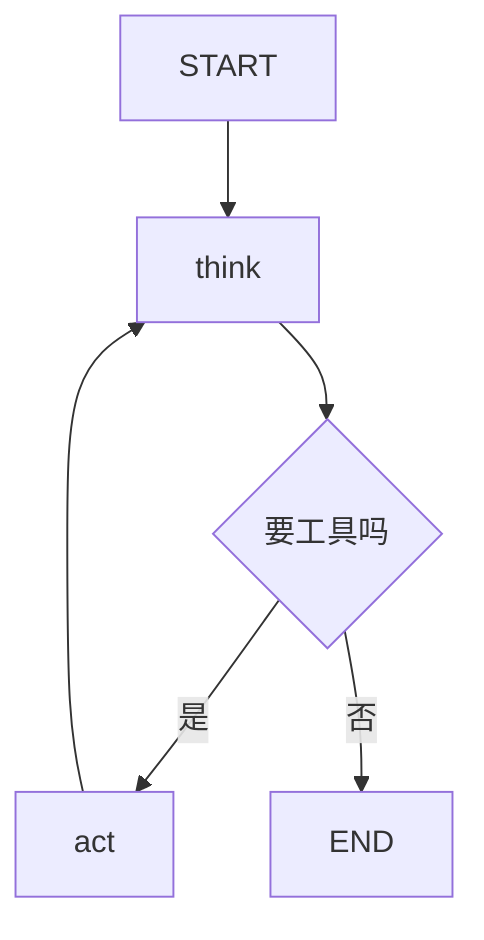

# 16-6 LangGraph 与工作流编排

**建议用时：10 小时**

**出口标准：能用状态图把一个多步 Agent 画出来，能在中间插入人工确认，能中断后接着跑。**

---

## 〇、环境已就绪

**2026-11-10 已装好并实测通过：**

```
langgraph                    1.2.20
langgraph-checkpoint-sqlite  3.1.3
langchain-core               1.7.6
```

**已验证三样：**

```
最小示例: {'question': '什么是肝癌', 'answer': '关于「什么是肝癌」的回答', 'steps': ['已规划']}
interrupt 触发: True | 停在: ('confirm',)
恢复后: 已发送
```

**本节所有代码都在这套环境里跑过。** 跑不通就是你的写法和我给的代码有出入，不要怀疑环境。

---

## 〇之二、这一节在解决什么

16-5 你的 Agent 长这样：

```python
for step in range(max_steps):
    resp = 调模型()
    if 没要工具: break
    执行工具()
```

**这段代码有三个死结：**

| 死结 | 现象 |
|---|---|
| **加不了人工确认** | 想让它「发邮件前问我一下」，只能改代码 |
| **流程管不住** | 想加「失败走 A、成功走 B」，`if/else` 越套越深 |
| **断了不能续** | 程序崩了、关电脑了，从头再来 |

**LangGraph 的答案：把流程画成「图」，而不是写成「循环」。**

---

## 一、图是什么

### 三个东西

| 概念 | 是什么 | 类比 |
|---|---|---|
| **State** | 一个字典，全流程共享的数据 | 一份传阅的病历夹 |
| **Node** | 一个函数，读 State、改 State | 一个处理环节 |
| **Edge** | 从哪个节点去哪个节点 | 流程箭头 |

### 画出来长这样

```
        ┌──────────┐
        │  START   │
        └────┬─────┘
             ▼
        ┌──────────┐
        │  规划     │
        └────┬─────┘
             ▼
     ┌───────────────┐
     │  要调工具吗？  │  ← 条件路由
     └───┬───────┬───┘
      是 │       │ 否
         ▼       ▼
    ┌────────┐  ┌────────┐
    │ 执行工具│  │ 生成答案│
    └───┬────┘  └───┬────┘
        │           ▼
        │        ┌─────┐
        └───────▶│ END │
                 └─────┘
        （回到规划）
```

**和 `for` 循环的区别：**

- 循环是**一条线**，图是**一张网**
- 图上可以有很多分支，每个分支走哪条是**函数决定的**，不是 `if` 写死的
- 图可以**在任何节点暂停**，等外部输入

---

## 二、第一个图

### 最小可运行示例

```python
from typing import TypedDict
from langgraph.graph import START, END, StateGraph

# ---------- 1. 定义 State ----------
class State(TypedDict):
    question: str
    answer: str
    steps: list[str]

# ---------- 2. 定义节点 ----------
def node_plan(state: State) -> dict:
    """读 state，返回要更新的字段"""
    return {"steps": state.get("steps", []) + ["已规划"]}

def node_answer(state: State) -> dict:
    return {"answer": f"关于「{state['question']}」的回答"}

# ---------- 3. 建图 ----------
builder = StateGraph(State)

builder.add_node("plan", node_plan)
builder.add_node("answer", node_answer)

builder.add_edge(START, "plan")
builder.add_edge("plan", "answer")
builder.add_edge("answer", END)

# ---------- 4. 编译 ----------
graph = builder.compile()

# ---------- 5. 跑 ----------
result = graph.invoke({"question": "什么是肝癌", "steps": []})
print(result)
```

### 三条必须记住的规则

**① 节点函数的签名固定**

```python
def node_name(state: State) -> dict:
```

**输入是整个 State，输出是「要更新的字段」**，不是返回完整的新 State。

**LangGraph 会自动合并：** 你返回 `{"answer": "x"}`，它就把 `state["answer"]` 改成 `"x"`，其他字段不动。

**② 返回 `dict`，不要返回 `State`**

写成 `return State(...)` 也能跑，但不合规范，而且类型检查会报警。

**③ `add_edge` 是单向的**

`add_edge("plan", "answer")` 表示 plan 执行完就去 answer。**不会自动回来。**

**要循环，得自己加一条回去的边：**

```python
builder.add_edge("tools", "plan")     # 工具执行完，回到规划
```

---

## 三、条件路由：让图自己选路

**这是 LangGraph 最核心的能力。**

```python
from langgraph.graph import START, END, StateGraph

def route_after_plan(state: State) -> str:
    """返回值必须是节点名（或 END）"""
    if state.get("need_tool"):
        return "tools"
    return "answer"

builder.add_conditional_edges(
    "plan",              # 从哪个节点出发
    route_after_plan,    # 用哪个函数判断
    {
        "tools": "tools",     # 返回值 -> 实际节点
        "answer": "answer",
    },
)
```

### 和 `if/else` 的区别在哪

**表面上看，条件路由就是一个 `if`。** 那为什么不直接写 `if`？

**四个真实的差别：**

| | `if/else` | 条件路由 |
|---|---|---|
| 加分支 | 改主函数 | 加节点 + 加一条 route 规则 |
| 看流程 | 读代码，跳来跳去 | **一张图，一眼看完** |
| 暂停 | 做不到 | **任意节点可暂停** |
| 恢复 | 做不到 | **从检查点恢复** |

**最后两条是真正的价值。** 前两条只是可读性。

---

## 四、人工介入：interrupt

**这是 LangGraph 最实用的功能，也是面试里最有区分度的一点。**

### 场景

```
Agent 要发一封邮件给医生 → 发送前必须有人看一眼
Agent 要写一个文件 → 写之前确认
Agent 要调一个昂贵的 API → 调之前确认
```

### 写法

```python
from langgraph.types import interrupt, Command
from langgraph.checkpoint.memory import InMemorySaver

def node_send_email(state: State) -> dict:
    draft = state["draft"]

    # 停在这里，把 draft 交给外面
    decision = interrupt({"action": "send_email", "draft": draft})

    if decision == "approve":
        # 真的发
        return {"status": "已发送"}
    return {"status": "已取消", "feedback": decision}

builder.add_node("send_email", node_send_email)
graph = builder.compile(checkpointer=InMemorySaver())    # ← 必须有 checkpointer
```

### 外面怎么用

```python
config = {"configurable": {"thread_id": "任务1"}}

# 第一次调用 —— 会停在 interrupt 那里
result = graph.invoke({"draft": "尊敬的王医生……"}, config=config)
print(graph.get_state(config).interrupts)
# 能看到停在哪个节点、interrupt 传出来的数据是什么

# 人工看了，决定批准 —— 从断点继续
result = graph.invoke(Command(resume="approve"), config=config)
print(result)
```

### 两个必须知道的点

**① 必须用 `checkpointer`**

```python
graph = builder.compile(checkpointer=InMemorySaver())
```

**没有 checkpointer，`interrupt` 效果等于「程序崩了」。** 因为暂停之后，内存里的状态没人保存，恢复不了。

**② `thread_id` 是「哪一次对话」的标识**

```python
config = {"configurable": {"thread_id": "任务1"}}
```

**同一个 `thread_id` 才能接着上一次跑。** 换个 id 就是全新的开始。

### 另一种写法：`interrupt_before`

```python
graph = builder.compile(
    checkpointer=InMemorySaver(),
    interrupt_before=["send_email"],      # 执行这个节点之前停
)
```

**区别：**

| | `interrupt()` 函数 | `interrupt_before` 参数 |
|---|---|---|
| 在哪停 | 节点**内部**任意位置 | 节点**开始之前** |
| 能传数据出来吗 | **能** | 只能靠 state |
| 灵活度 | 高 | 低 |
| 适合 | 需要给人看细节 | 简单审批 |

**先用 `interrupt_before`，够用就用它。** 需要把草稿内容传出来给人看时再用 `interrupt()`。

---

## 五、把你的 Agent 改成图

**用 16-5 的 Agent 做例子。**

### 原来的循环

```python
for step in range(max_steps):
    resp = 调模型()
    if 没要工具: break
    执行工具()
```

### 改成图

```python
from typing import TypedDict, Annotated
from langgraph.graph import START, END, StateGraph
from langgraph.checkpoint.memory import InMemorySaver

class AgentState(TypedDict):
    messages: list
    step: int
    facts: dict          # 工作记忆

def node_think(state: AgentState) -> dict:
    """调模型，决定下一步"""
    resp = 调模型(state["messages"], tools=TOOLS)
    return {
        "messages": state["messages"] + [{"role": "assistant", "content": resp["content"]}],
        "step": state["step"] + 1,
        "_stop_reason": resp.get("stop_reason"),     # 供路由用
    }

def node_act(state: AgentState) -> dict:
    """执行工具"""
    out = 执行所有工具(state["messages"][-1]["content"])
    # 顺便更新工作记忆
    facts = dict(state.get("facts", {}))
    facts.update(抽取事实(out))
    return {
        "messages": state["messages"] + [{"role": "user", "content": out}],
        "facts": facts,
    }

def route(state: AgentState) -> str:
    if state["step"] >= 8:
        return "give_up"
    if state.get("_stop_reason") != "tool_use":
        return "done"
    return "act"          # 回互循环

builder = StateGraph(AgentState)
builder.add_node("think", node_think)
builder.add_node("act", node_act)
builder.add_node("give_up", lambda s: {"messages": s["messages"] + [
    {"role": "user", "content": "达到步数上限，请直接总结已有信息"}]})

builder.add_edge(START, "think")
builder.add_conditional_edges("think", route, {
    "act": "act",
    "done": END,
    "give_up": "give_up",
})
builder.add_edge("act", "think")        # ← 循环就是这条边
builder.add_edge("give_up", END)

graph = builder.compile(checkpointer=InMemorySaver())

result = graph.invoke(
    {"messages": [{"role": "user", "content": "..."}], "step": 0, "facts": {}},
    config={"configurable": {"thread_id": "t1"}},
)
```

### 对照着看，多出来的东西

| 原来 | 图里 |
|---|---|
| `for step in range(8)` | `route()` 里判断 `step >= 8` |
| `if 没要工具: break` | `route()` 返回 `"done"` |
| `执行工具()` | `node_act` |
| 无 | **`add_edge("act", "think")` 就是循环** |

**「循环」在 LangGraph 里不是语法，是「一条指回去的边」。**

---

## 六、持久化：断了能续

### 三种 checkpointer

| 类型 | 用在哪 | 适合 |
|---|---|---|
| `InMemorySaver` | 进程内内存 | 教学、测试 |
| `SqliteSaver` | 本地文件 | **单机项目** |
| `PostgresSaver` | 数据库 | 多人、生产 |

**你的项目用 `SqliteSaver` 就够。**

```python
import sqlite3
from langgraph.checkpoint.sqlite import SqliteSaver

conn = sqlite3.connect("agent_state.db", check_same_thread=False)
graph = builder.compile(checkpointer=SqliteSaver(conn))
```

**需要 `pip install langgraph-checkpoint-sqlite`。**

### 断了之后怎么续

```python
config = {"configurable": {"thread_id": "t1"}}

# 上次跑到一半，进程被杀
state = graph.get_state(config)
print("最后停在:", state.next)      # 下一个要执行的节点

# 直接继续 —— 不用重跑前面的
graph.invoke(None, config=config)
```

**这是图相比循环最大的价值：循环崩了从头来，图能接着跑。**

---

## 七、什么时候不该用 LangGraph

**不是所有 Agent 都需要上图。**

| 情况 | 建议 |
|---|---|
| 一问一答 + 一次工具调用 | **不用**，16-3 的代码就够 |
| 多轮决策，但没有人工确认、不需要恢复 | **不用**，16-5 的循环够 |
| 有固定分支流程 | **可以不用**，写 `if` 更直白 |
| 需要人工确认 / 需要断点恢复 / 流程超过 5 个节点 | **用** |

**一句话：它的价值在「暂停」和「恢复」。** 不需要这两样，就别引入这层抽象。

**这也是面试可以答的点**——很多候选人背了 LangGraph，但说不出什么时候不该用。

---

## 八、跟着做

### 前置

```
pip install langgraph langgraph-checkpoint-sqlite
```

**装完先跑第二节那个最小示例，确认能出结果，再往下。**

### 任务

**把 16-5 你写的 Agent 改成图，加两个东西：**

1. **人工确认**：任何工具执行之前，`interrupt_before=["act"]`，让人看一眼再放行
2. **持久化**：用 `SqliteSaver`，中断后关掉程序，重新打开能接着跑

**验收：**

- [ ] 能画出你这个 Agent 的流程图（用纸笔或 mermaid）
- [ ] 断点停住时，`graph.get_state(config).next` 能告诉你下一步是谁
- [ ] 关掉 Python 重新打开，用同一个 `thread_id` 能续上
- [ ] 能说清「这条边为什么是循环」

---

## 九、练习

### 练习 16-6-A（必做）：画图

用 mermaid 语法画出你的 Agent：

````

````

**贴在 `学习笔记与心得.md` 里。以后面试可以直接拿出来讲。**

### 练习 16-6-B（必做）：三处人工介入

在下面三个位置各加一个 `interrupt`，体会区别：

1. 节点**之前**（`interrupt_before`）
2. 节点**内部**，执行到一半（`interrupt()`）
3. 节点**之后**

**回答：哪一种能把中间数据传给人看？**

### 练习 16-6-C（必做）：断点恢复实验

1. 跑到 interrupt 停住
2. **杀掉 Python 进程**
3. 重新打开，用同一个 `thread_id` 调 `graph.invoke(None, config)`

**观察：它是从头跑还是接着跑？**

**再换一个 `thread_id` 试一次，看有什么不同。**

### 练习 16-6-D（选做）：失败重试

加一个 `node_act_with_retry`：

```
工具失败 → 记一次 → 回到 think 换思路
连续 3 次失败 → 走 give_up 分支
```

**这一题把 16-5 的「杀手三」用图的方式重新实现一遍。**

---

## 十、自测题

1. State、Node、Edge 各是什么？节点函数必须满足什么签名？
2. 节点返回完整 State 和返回部分 dict，有什么区别？
3. 为什么说「循环在 LangGraph 里是一条边」？
4. `interrupt()` 和 `interrupt_before` 的区别是什么？各适合什么？
5. 为什么用 `interrupt` 必须配 checkpointer？
6. `thread_id` 是干什么的？
7. 什么情况下**不该**用 LangGraph？
8. 条件路由和 `if/else` 的四个实质区别是什么？

---

## 十一、出口标准

- [ ] 能独立写出一个带条件路由的两分支图
- [ ] 能把循环式 Agent 改写成图
- [ ] 能用 `interrupt_before` 加人工确认
- [ ] 能用 `SqliteSaver` 实现断点恢复
- [ ] 能说清什么情况下不该用 LangGraph
- [ ] 能画出自己项目的流程图

---

## 十二、常见错误

| 错误 | 表现 | 改法 |
|---|---|---|
| 节点返回完整 State | 能跑但类型乱 | 返回 `dict`，只放要更新的字段 |
| 忘了加回边的边 | 只走一遍就结束 | `add_edge("act", "think")` |
| 用 interrupt 没配 checkpointer | 暂停后就回不来了 | `compile(checkpointer=...)` |
| 换了 thread_id 找不回 | 状态是空的 | 用同一个 id |
| 路由函数返回了不存在的节点名 | 报错 | 名字必须和 `add_node` 对得上 |
| 简单场景硬上 LangGraph | 代码反而更长 | 先问「需不需要暂停和恢复」 |

---

## 十三、下一节要干什么

你现在能把 Agent 画成图了。但每个工具还是**你写在这个项目里的函数**。

**下一个项目要用怎么办？复制粘贴。**

**能不能把「查 HU 值」封装成一个标准件，任何支持这个标准的客户端都能用？**

**下一节 16-7 讲 MCP——你已经写过一次了（`study_mcp.py`），这次要把原理讲透。**
