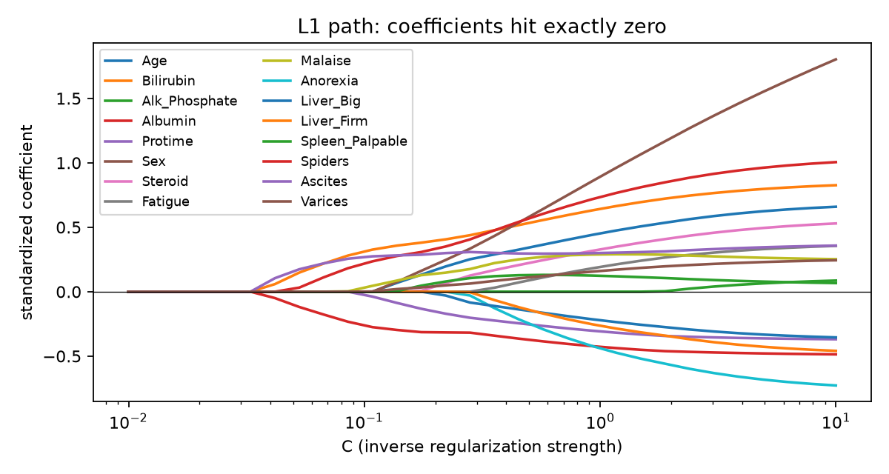
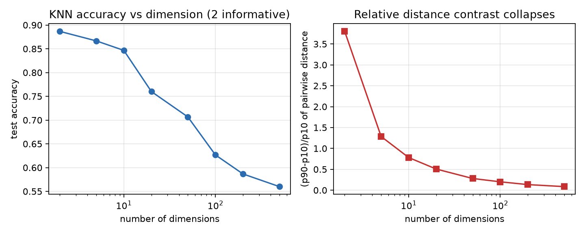
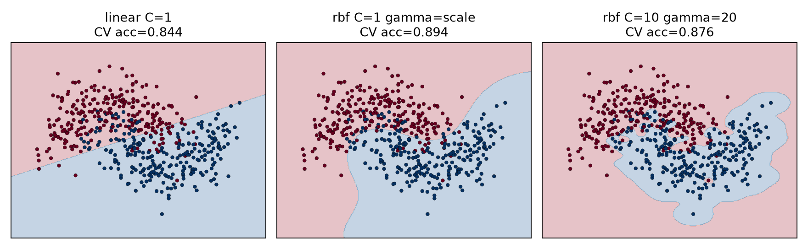
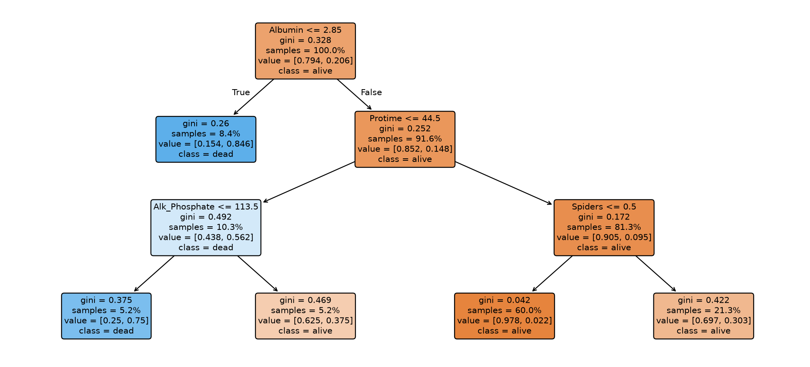

# 模块 6 · 经典分类算法

**核心问题：除了神经网络，还有哪些分类算法？拿到一个任务，先试哪个、为什么、它什么时候会失效？**

**建议用时：18 小时（4 天）**

---

## 〇、先定位：你为什么还要学这些"老算法"

你已经在 MNIST 上把 CNN 跑到 98%。但医院给你的数据是这样的：

```
155 行，20 列，32 个死亡事件，167 个缺失值
```

这时候上 CNN，等于拿锤子找钉子。样本量撑不起几万个参数，而且审稿人要的是"胆红素每升高 1 mg/dL，死亡 odds 变成几倍"，不是一张 98% 的准确率截图。

**这一节讲五个在表格数据上仍然能打的算法。** 它们加起来不到 200 行代码，但在小样本医学数据上，经常和深度学习打平甚至更好。

| 算法 | 一句话 | 医学里什么时候用 | 最大软肋 |
|---|---|---|---|
| **逻辑回归** | 线性打分 + sigmoid | 要发论文、要 OR、要基线 | 只能学线性边界 |
| **KNN** | 看邻居投票 | 低维、小样本、快速基线 | 高维失效、必须缩放 |
| **朴素贝叶斯** | 条件独立 + 贝叶斯公式 | 文本、高维稀疏、极小样本 | 概率不可信 |
| **SVM** | 找最宽的分界面 | 中小样本、边界复杂 | 调参、慢、不可解释 |
| **决策树** | 一连串 if-else | 要给医生看规则 | 单棵树极不稳定 |

**先记住一句：任何新任务，第一个跑的永远是逻辑回归。** 它不是最强的，但它是最容易解释、最不容易出错、最能给你一个"这份数据到底有没有信号"的答案的模型。

### 0.1 本节的数据和评测口径

用模块 5 的 Hepatitis 数据。**所有数字都是本机实测**，环境：Python 3.x，scikit-learn 1.9.1，numpy 2.4.6，pandas 3.0.6。

| 项目 | 值 |
|---|---|
| 样本 | 155 |
| 死亡（Class=1） | 32 |
| 存活（Class=2） | 123 |
| 死亡率 | 20.6% |
| 数值特征 | Age、Bilirubin、Alk_Phosphate、Sgot、Albumin、Protime |
| 缺失 | 167 个，`?` 编码 |

**评测协议固定：**

- 5 折分层交叉验证（`StratifiedKFold(5, shuffle=True, random_state=0)`）
- 主指标 AUC（不受阈值和类别不平衡影响）
- 辅指标 recall、specificity（阈值 0.5）
- 报告 mean ± std，不报单个数字
- 所有预处理（插补、标准化）放在 Pipeline 里，折内 fit

**为什么不用准确率：** 全猜"存活"就有 79.4%。准确率 0.81 的模型可能一个死者都没抓到。

### 0.2 环境准备

```python
import numpy as np
import pandas as pd
import warnings
warnings.filterwarnings('ignore')

from sklearn.model_selection import StratifiedKFold, cross_val_score

DATA = r'E:\AI学习\练习代码\data\uci\Hepatitis.csv'

def load_hepatitis():
    """读入 + 列名清洗 + 目标编码。"""
    h = pd.read_csv(DATA, na_values=['?'])
    h.columns = h.columns.str.strip().str.replace(' ', '_')
    y = (h['Class'] == 1).astype(int).values    # 1 = 死亡
    return h, y

h, y = load_hepatitis()
cols = ['Age', 'Bilirubin', 'Alk_Phosphate', 'Sgot', 'Albumin', 'Protime']

cv = StratifiedKFold(n_splits=5, shuffle=True, random_state=0)

print(h.shape)
print(f'死亡 {y.sum()} 例，存活 {(1-y).sum()} 例，死亡率 {y.mean():.1%}')
```

**真实输出：**

```
(155, 20)
死亡 32 例，存活 123 例，死亡率 20.6%
```

**约定：本节代码按顺序执行。** 后面每节开头会重新声明用到的变量，你从任意一节开始复制也能跑。

---

## 一、逻辑回归：医学论文的默认武器

**核心问题：155 个病人、32 个死亡事件，怎么得到一个既能预测、又能说出"每个变量影响多大"的模型？**

### 1.1 从线性回归到 sigmoid

线性回归输出 `z = b0 + b1*x1 + ... + bp*xp`，取值是负无穷到正无穷。但我们要的是"死亡概率"，必须在 0 到 1 之间。

**最直接的办法：把 z 塞进 sigmoid。**

```
p = sigmoid(z) = 1 / (1 + exp(-z))
```

sigmoid 把任意实数压到 (0, 1)，且单调递增。z=0 时 p=0.5，z 越大 p 越接近 1。

**关键的一步变形：**

```
odds = p / (1 - p) = exp(z)
log(odds) = z = b0 + b1*x1 + ... + bp*xp
```

**这就是逻辑回归名字的来源：它对 log-odds（对数几率）做线性回归。**

| 概念 | 公式 | 医学说法 |
|---|---|---|
| 概率 p | `1 / (1 + exp(-z))` | 死亡风险 30% |
| odds | `p / (1 - p)` | "死亡:存活 = 3:7" |
| log-odds（logit） | `log(p / (1 - p))` | 线性模型的输出 |

```python
def sigmoid(z):
    return 1 / (1 + np.exp(-z))

for z in [-4, -2, 0, 2, 4]:
    p = sigmoid(z)
    print(f'z={z:+d}  p={p:.4f}  odds={p/(1-p):.4f}')
```

**真实输出：**

```
z=-4  p=0.0180  odds=0.0183
z=-2  p=0.1192  odds=0.1353
z=+0  p=0.5000  odds=1.0000
z=+2  p=0.8808  odds=7.3891
z=+4  p=0.9820  odds=54.5982
```

**注意 z=2 到 z=4，概率只从 0.88 涨到 0.98，odds 却从 7.4 涨到 54.6。** 线性模型在 log-odds 尺度上是等距的，在概率尺度上不是。这解释了一个常见现象：**同一个 OR，在低风险和高风险人群里对应的绝对风险变化完全不同。**

### 1.2 损失函数：为什么是交叉熵，不是 MSE

对单个样本：

```
L = -[ y*log(p) + (1-y)*log(1-p) ]
```

- 真实 y=1，模型预测 p=0.9：损失 `-log(0.9) = 0.105`
- 真实 y=1，模型预测 p=0.1：损失 `-log(0.1) = 2.303`

**预测得越自信且越错，惩罚增长得越快。** MSE 配 sigmoid 会得到一个非凸的损失曲面，而且梯度里多一个 `p*(1-p)` 因子，预测接近 0 或 1 时梯度消失，学得极慢。

**梯度很干净：**

```
dL/dw = (1/n) * sum( (p_i - y_i) * x_i )
```

就是"预测减真实，乘特征，求平均"。模块 2 手推过，这里不重复。

```python
from sklearn.linear_model import LogisticRegression

# C 是正则化强度的倒数；C=np.inf 表示不正则
model = LogisticRegression(C=np.inf, max_iter=5000)
```

**注意：sklearn 1.8 之后 `penalty=None` 已弃用，用 `C=np.inf` 代替。** 老教程里的写法会报 FutureWarning。

### 1.3 优势比 OR：beta 怎么变成医生看得懂的话

模型给出的是 beta（log-odds 的斜率）。医学论文报告的是 OR：

```
OR = exp(beta)
```

**含义：该变量每增加 1 个单位，结局的 odds 变为原来的 OR 倍。**

- OR = 2：odds 翻倍
- OR = 0.5：odds 减半
- OR = 1：没有关联

**95% 置信区间：**

```
SE(beta) = sqrt( diag( inverse(X' W X) ) )
W = diag( p_i * (1 - p_i) )
CI = exp( beta ± 1.96 * SE )
```

这就是 Wald 区间。`X' W X` 是 Fisher 信息矩阵，它的逆的对角线是 beta 的方差。**sklearn 不直接给 SE，所以下面的代码自己算。** 这不是黑魔法，就是最大似然估计的协方差矩阵。

**手算一个：** Albumin 的 beta = -1.513，SE = 0.461。

```
OR = exp(-1.513) = 0.220
下限 = exp(-1.513 - 1.96*0.461) = exp(-2.417) = 0.089
上限 = exp(-1.513 + 1.96*0.461) = exp(-0.609) = 0.544
```

**解读：白蛋白每升高 1 g/dL，死亡的 odds 变为原来的 0.22 倍，即下降 78%，95% CI 为 0.089 到 0.544。** 区间不包含 1，p < 0.05。

**OR 不是 RR。** 结局常见时，OR 会夸大相对风险。这份数据死亡率 20.6%：

```
基线 odds = 0.206 / 0.794 = 0.259
OR = 2 时，暴露组 odds = 0.519，风险 = 0.519 / 1.519 = 0.342
RR = 0.342 / 0.206 = 1.66
```

**OR = 2 在这一队列里大约等于 RR = 1.66。** 如果死亡率只有 1%，OR=2 几乎等于 RR=2；死亡率 20% 时，两者已经差 20%。写论文时如果编辑问"为什么不报 RR"，这就是答案：**病例对照设计算不了 RR，只能算 OR；队列研究可以报 RR，但 OR 仍是 logistic 模型的自然输出。**

**两个必须警惕的坑：**

**① 每 1 单位 vs 每 1 SD。**

Alk_Phosphate 的 OR = 0.997，看起来"完全没影响"。但它的单位是 U/L，范围 26 到 295，1 U/L 的变化本来就微不足道。换成每 1 SD（47.08 U/L）：

```
OR per SD = exp(-0.0033 * 47.08) = 0.855
```

**同一个变量，换单位，OR 从 0.997 变成 0.855。** 连续变量报 OR 时必须写清楚"per 1 unit"还是"per 1 SD"，否则读者无法判断效应大小。

**② 单变量 OR 和多变量 OR 不是一回事。**

多变量 OR 是"调整了其他变量之后"的效应。如果两个变量高度相关，多变量模型会把效应在它们之间重新分配，甚至出现方向相反。**报告多变量 OR 时，必须同时给出调整了哪些变量。**

### 1.4 实操：一张能直接贴进论文的 OR 表

```python
from sklearn.impute import SimpleImputer
from scipy.stats import norm

imp = SimpleImputer(strategy='median')
X = imp.fit_transform(h[cols])

model = LogisticRegression(C=np.inf, max_iter=5000).fit(X, y)

# ---- 用 Fisher 信息矩阵算 SE ----
p_hat = model.predict_proba(X)[:, 1]
Xd = np.column_stack([np.ones(len(X)), X])
W = p_hat * (1 - p_hat)
cov = np.linalg.inv(Xd.T @ (Xd * W[:, None]))
se = np.sqrt(np.diag(cov))

beta = np.r_[model.intercept_, model.coef_[0]]
z975 = norm.ppf(0.975)

rows = []
for i, name in enumerate(['(Intercept)'] + cols):
    pval = 2 * (1 - norm.cdf(abs(beta[i] / se[i])))
    rows.append({
        '变量': name,
        'beta': round(beta[i], 3),
        'OR': round(np.exp(beta[i]), 3),
        'CI下限': round(np.exp(beta[i] - z975 * se[i]), 3),
        'CI上限': round(np.exp(beta[i] + z975 * se[i]), 3),
        'p': round(pval, 3),
    })

print(pd.DataFrame(rows).to_string(index=False))
```

**跑出来是这张表。论文里只放这 6 行，不放截距**（截距是"所有变量为 0 时的 log-odds"，没有临床意义）：

| 变量 | beta | OR | 95% CI | p |
|---|---|---|---|---|
| Age（每岁） | 0.029 | 1.030 | 0.991 - 1.070 | 0.134 |
| Bilirubin（每 mg/dL） | 0.697 | 2.009 | 1.263 - 3.193 | 0.003 |
| Alk_Phosphate（每 U/L） | -0.003 | 0.997 | 0.986 - 1.007 | 0.535 |
| Sgot（每 U/L） | -0.001 | 0.999 | 0.993 - 1.004 | 0.589 |
| Albumin（每 g/dL） | -1.513 | 0.220 | 0.089 - 0.544 | 0.001 |
| Protime（每单位） | -0.034 | 0.966 | 0.935 - 0.998 | 0.039 |

**这张表能读出什么：**

1. **胆红素是独立危险因素。** 每升高 1 mg/dL，死亡 odds 翻倍（OR 2.01，CI 1.26-3.19）。
2. **白蛋白是独立保护因素。** 每升高 1 g/dL，死亡 odds 下降 78%（OR 0.22，CI 0.09-0.54）。
3. **ALP 和 SGOT 在多变量模型里没有独立贡献。** 它们和胆红素、白蛋白相关，信息被吸收了。
4. **Age 不显著**（CI 跨 1）。单变量时 Age OR 1.044 是显著的（CI 1.011-1.078），调整后不显著——年龄的效应部分被肝功能指标解释了。
5. **Protime 方向可疑。** 它的单变量 OR 是 0.950（CI 0.923-0.977），多变量 0.966，都小于 1。但临床上凝血酶原时间越长，肝合成功能越差，风险应该更高。**这份数据的 Protime 取值 0 到 100，不是常见的秒数，编码存疑。** 遇到这种"方向和临床相反"的系数，第一反应是查单位和编码，不是硬解释。

**每 SD 的 OR（连续变量更公平的比较）：**

| 变量 | 每 SD OR | 95% CI | SD |
|---|---|---|---|
| Age | 1.448 | 0.892 - 2.351 | 12.57 |
| Bilirubin | 2.295 | 1.321 - 3.986 | 1.19 |
| Alk_Phosphate | 0.855 | 0.522 - 1.402 | 47.08 |
| Sgot | 0.876 | 0.543 - 1.414 | 88.59 |
| Albumin | 0.392 | 0.224 - 0.686 | 0.62 |
| Protime | 0.554 | 0.316 - 0.970 | 17.20 |

**换到每 SD 之后，ALP 的 OR 从 0.997 变成 0.855**，Sgot 从 0.999 变成 0.876。虽然仍不显著，但至少数字量级可读了。**以后看到连续变量的 OR 精确等于 1.00，先想单位，不要想"这个变量没用"。**

**EPV 警告：** 32 个事件，6 个变量，EPV = 32/6 = 5.3，低于经验阈值 10。**这个模型的 CI 偏窄、系数偏大，换一批病人可能就变了。** 严谨做法是只用 2-3 个预设变量，或者做 bootstrap 内部验证。这也是为什么上面的 CI 有的很宽。

**OR 表的代码可以直接复用，但要改三处：** 数据路径、`cols`、目标编码。其他不用动。

### 1.5 正则化：L1 把系数压成 0，L2 只把它压小

**问题：** 155 个样本，18 个特征（6 个数值 + 12 个二值），逻辑回归可以拟合，但系数会很大、方向不稳。尤其当两个特征高度相关时，模型可以把系数一个给 +5、一个给 -5，预测不变，解释全废。

**解法：在损失函数里加惩罚项。**

```
L2：L = 交叉熵 + lambda * sum(beta²)
L1：L = 交叉熵 + lambda * sum(abs(beta))
ElasticNet：L = 交叉熵 + lambda * [ rho * sum(abs(beta)) + (1-rho)/2 * sum(beta²) ]
```

sklearn 的参数是 `C`，**C 越大正则越弱**（C 约等于 1/lambda）：

| 参数 | 含义 | 效果 |
|---|---|---|
| `C` 小 | 强正则 | 系数被压得很狠，甚至全 0 |
| `C` 大 | 弱正则 | 接近不加正则的 MLE |
| `penalty='l1'` | 绝对值惩罚 | 部分系数**精确等于 0** |
| `penalty='l2'` | 平方惩罚 | 所有系数变小，**但不为 0** |
| `penalty='elasticnet'` | 两者混合 | 相关特征成组进出 |

**为什么 L1 会产生 0：** 几何上，L1 的约束区域是菱形，顶点在坐标轴上；损失函数的等高线最容易先碰到顶点，而顶点意味着某些坐标为 0。L2 的约束区域是圆，碰到的地方一般不在坐标轴上，所以系数只是变小。

**先做 18 个特征的表：**

```python
num_cols = ['Age', 'Bilirubin', 'Alk_Phosphate', 'Sgot', 'Albumin', 'Protime']
bin_cols = ['Sex', 'Steroid', 'Antivirals', 'Fatigue', 'Malaise', 'Anorexia',
            'Liver_Big', 'Liver_Firm', 'Spleen_Palpable', 'Spiders',
            'Ascites', 'Varices']

Xall = pd.DataFrame(index=h.index)
for c in num_cols:
    Xall[c] = h[c]
for c in bin_cols:
    Xall[c] = (h[c] == 1).astype(float).where(h[c].notna())   # 1=有, 0=无
Xall = Xall.fillna(Xall.median())
print(Xall.shape)
```

**真实输出：**

```
(155, 18)
```

**注意 `Sex` 原始编码 1=男、2=女。** `(Sex == 1)` 之后，1 代表男性。二值变量这样转是安全的；三分类以上必须 one-hot，不能直接减 1。

```python
from sklearn.preprocessing import StandardScaler
from sklearn.pipeline import Pipeline

def fit_penalty(kind, C, l1_ratio=None):
    if kind == 'l1':
        clf = LogisticRegression(penalty='l1', solver='liblinear',
                                 C=C, max_iter=5000)
    elif kind == 'l2':
        clf = LogisticRegression(penalty='l2', C=C, max_iter=5000)
    else:
        clf = LogisticRegression(penalty='elasticnet', solver='saga',
                                 l1_ratio=l1_ratio, C=C, max_iter=50000)
    pipe = Pipeline([('scale', StandardScaler()), ('clf', clf)])
    return pipe.fit(Xall, y).named_steps['clf'].coef_[0]

```

扫 C 的结果：

| C | L1 非零系数 | L2 非零系数 |
|---|---|---|
| 0.02 | 0/18 | 18/18 |
| 0.05 | 4/18 | 18/18 |
| 0.1 | 6/18 | 18/18 |
| 0.3 | 14/18 | 18/18 |
| 1.0 | 15/18 | 18/18 |

**这张表就是本节的核心结论：**

- **L1 从 0 个到 15 个，随 C 增大逐个"解冻"。** C=0.02 时全部压成 0，模型退化成只输出先验概率。
- **L2 在任何 C 下都是 18/18。** 最小的系数只有 0.015（Sgot），但它不是 0。

**C=0.1 时的系数对比：**

```python
tab = pd.DataFrame({
    '变量': Xall.columns,
    'L1_C0.1': fit_penalty('l1', 0.1).round(3),
    'L2_C0.1': fit_penalty('l2', 0.1).round(3),
})
print(tab.to_string(index=False))
```

**真实输出：**

```
           变量  L1_C0.1  L2_C0.1
          Age     0.000    0.292
    Bilirubin     0.312    0.385
Alk_Phosphate     0.000   -0.017
         Sgot     0.000    0.015
      Albumin    -0.263   -0.334
      Protime    -0.020   -0.252
          Sex     0.000    0.391
      Steroid     0.000    0.217
   Antivirals     0.000   -0.036
      Fatigue     0.000    0.200
      Malaise     0.032    0.263
     Anorexia     0.000   -0.183
    Liver_Big     0.000   -0.147
   Liver_Firm     0.000   -0.140
Spleen_Palpable   0.000    0.184
      Spiders     0.219    0.426
      Ascites     0.269    0.286
      Varices     0.000    0.188
```

**图 1-1：L1 的系数路径。** 横轴是 C（对数刻度），每条线是一个标准化系数。C 小于 0.05 时全部被压在 0；C 增大，系数逐个离开 0。



**怎么读：**

- L1 只留下 6 个：Bilirubin、Albumin、Protime、Malaise、Spiders、Ascites。前三个是肝合成/排泄功能，中间一个是全身症状，后两个是门脉高压体征。
- L2 把 Age、Sex、Steroid 都留着，只是系数小。**"系数小"不等于"没影响"，只是被罚了。**
- **L1 的 0 不能解释成"这个变量不重要"。** Sgot 被压成 0，但它和 Bilirubin 相关 0.23；在已经有 Bilirubin 的模型里，它的增量信息接近 0。换一份数据，被选中的可能是 Sgot 而不是 Bilirubin。**相关特征之间，L1 是随机挑一个，不是挑"更对的"那个。**

**C 怎么选：交叉验证。** 18 个特征、32 个事件，正则化强度对结果影响很大：

| C | L1 AUC | L2 AUC |
|---|---|---|
| 0.02 | 0.500 ± 0.000 | 0.890 ± 0.054 |
| 0.05 | 0.767 ± 0.116 | 0.874 ± 0.058 |
| 0.1 | 0.864 ± 0.049 | 0.865 ± 0.064 |
| 0.3 | 0.859 ± 0.071 | 0.857 ± 0.070 |
| 1.0 | 0.857 ± 0.074 | 0.849 ± 0.079 |

**三个结论：**

1. **C=0.02 的 L1 AUC 正好 0.500**，因为所有系数为 0，模型对每个人都输出同一个概率。正则化太强 = 模型什么都没学。
2. **L1 在 C=0.1 达到 0.864**，和 L2 的 0.890 差 0.026，而标准差 0.05 左右，**这个差距不显著**。
3. **不要凭"L1 能做特征选择"就选 L1。** 用 CV 选 C，用 CV 比较 L1/L2/ElasticNet，谁高用谁；如果一样高，选更简单的那个。

**ElasticNet 什么时候用：** 特征多且成组相关（比如一组化验指标、一组症状）。`l1_ratio=0.5` 是常用起点。本数据 18 个特征，ElasticNet 在 C=0.1、l1_ratio=0.5 时保留 12 个，介于 L1 的 6 个和 L2 的 18 个之间。

**三个必须遵守的规则：**

- **先标准化再惩罚。** 否则 ALP（范围 26-295）和 Albumin（2.1-6.4）的系数不在同一尺度，惩罚不公平。
- **在 Pipeline 里做。** 标准化参数只能从训练折算，否则泄露（模块 5 讲过）。
- **L1 的变量选择要报告稳定性。** 换一个随机种子、换一个 C，选中的变量可能变。严谨研究用 bootstrap 统计每个变量被选中的频率。

### 1.6 多分类：softmax

二分类用 sigmoid，K 分类用 softmax：

```
z_k = w_k · x + b_k          （每个类别一套权重）
p_k = exp(z_k) / sum_j exp(z_j)
```

**性质：所有 p_k 相加等于 1，且最大的 z_k 对应最大的 p_k。**

**手算一行：** 某样本的三个 logits 是 `[1.818, -7.067, 5.249]`。

```
减去最大值 5.249：[-3.431, -12.316, 0]
exp：[0.0323, 0.0000045, 1.0000]
求和：1.0323
softmax：[0.031, 0.000, 0.969]
```

预测第 3 类。**减去最大值是为了数值稳定**，数学上等价，但直接 exp(5.249) 在某些语言里会溢出。

```python
from sklearn.datasets import make_classification
from sklearn.multiclass import OneVsRestClassifier

Xm, ym = make_classification(n_samples=600, n_features=8, n_informative=5,
                             n_classes=3, n_clusters_per_class=1,
                             class_sep=0.9, flip_y=0.05, random_state=7)

multi = Pipeline([('sc', StandardScaler()),
                  ('m', LogisticRegression(max_iter=5000))])
ovr = Pipeline([('sc', StandardScaler()),
                ('m', OneVsRestClassifier(LogisticRegression(max_iter=5000)))])

print('multinomial', cross_val_score(multi, Xm, ym, cv=cv).mean().round(4))
print('one-vs-rest', cross_val_score(ovr, Xm, ym, cv=cv).mean().round(4))
```

**真实输出：**

```
multinomial 0.8917
one-vs-rest 0.88
```

**两者区别：**

| 方式 | 训练几个模型 | 输出 | 什么时候用 |
|---|---|---|---|
| multinomial（softmax） | 1 个，K 套权重联合训练 | 概率和为 1 | 类别互斥（绝大多数情况） |
| one-vs-rest | K 个二分类器 | K 个独立概率，和不一定为 1 | 多标签、或想要"每类 vs 其余"的解释 |

**sklearn 1.9 的坑：** 老教程写 `LogisticRegression(multi_class='multinomial')`，在 1.9 里会直接报 `TypeError: unexpected keyword argument 'multi_class'`。**现在默认就是 multinomial（lbfgs 求解器），不用写这个参数。** 如果看到报错，删掉它。

**验证方法：** `predict_proba` 的每一行相加必须是 1.000；用 `coef_ @ x + intercept_` 算 logits，再按上面的公式手算，结果和 sklearn 一致。

### 1.7 逻辑回归的常见错误

| 错误 | 现象 | 正确做法 |
|---|---|---|
| 报 OR 不写单位 | 读者不知道是 per 1 unit 还是 per SD | 表注写清楚，连续变量建议同时给 per SD |
| 把 OR 当 RR | 高发病率时夸大效应 | 死亡率高时说明 OR 与 RR 的差异，或改用 log-binomial |
| 只看 OR 不看 CI | OR 2.0 但 CI 0.8-5.0 被说成"有效" | CI 跨 1 就是不显著 |
| 18 个变量全塞进 OR 表 | 32 个事件，EPV=1.8，系数爆炸 | 预设 3-5 个临床变量，其余做敏感性分析 |
| 不标准化就做 L1/L2 | 大尺度变量惩罚更重 | Pipeline 里先 StandardScaler |
| 说"L1 选中的变量更重要" | 相关特征间选择随机 | 报告 bootstrap 选择频率，或用 ElasticNet |
| 用 `penalty=None` | sklearn 1.8+ 报 FutureWarning | 用 `C=np.inf` |
| 用 `multi_class=` | sklearn 1.9 直接 TypeError | 删掉，默认 multinomial |
| 拿 predict 的 0/1 当风险 | 阈值 0.5 在 20% 死亡率下极保守 | 用 predict_proba，按临床需求调阈值 |
| 不做外部验证 | 内部 AUC 0.83，换医院掉到 0.7 | 至少做 bootstrap 或时间/中心外部验证 |

---

## 二、KNN：最简单的算法，最诚实的失效

**核心问题：不训练参数，只靠"像不像"，凭什么能预测？这种"像"在什么维度下会失效？**

### 2.1 它到底在做什么

KNN（K-Nearest Neighbors）没有"训练"这一步。它把训练集原封不动存下来，来一个新样本时：

1. 算新样本到所有训练样本的距离
2. 取最近的 k 个
3. 这 k 个里哪类多，就判哪类

**它唯一的假设是：特征空间里离得近的样本，标签也相似。** 这个假设在低维、特征都有意义时成立；在高维、大部分特征是噪声时彻底崩塌——这就是 2.4 要讲的维度灾难。

| 特点 | 说明 |
|---|---|
| 训练 | O(1)，只存数据 |
| 预测 | O(n*d)，每次都要算全部距离 |
| 参数 | 只有 k 和距离度量 |
| 可解释 | 可以说"最像的 5 个病人里 4 个死亡" |
| 输出概率 | 是邻居里正类的比例，粗糙 |

### 2.2 距离度量：欧氏不是唯一选择

```
欧氏（Euclidean）：sqrt( sum( (x_j - z_j)² ) )
曼哈顿（Manhattan）：sum( abs(x_j - z_j) )
切比雪夫（Chebyshev）：max( abs(x_j - z_j) )
```

| 度量 | 几何形状 | 什么时候好 | 什么时候差 |
|---|---|---|---|
| 欧氏 | 圆形 | 特征尺度一致、连续、低维 | 高维、有离群点 |
| 曼哈顿 | 菱形 | 高维、稀疏、离群点多 | 特征强相关 |
| 切比雪夫 | 方形 | 只看最大差异的那个特征 | 很少用 |

**同一份合成数据（600 样本，只有 2 个有用特征）上的实测：**

| 维度 | 欧氏准确率 | 曼哈顿准确率 |
|---|---|---|
| 2 | 0.887 | 0.887 |
| 10 | 0.847 | 0.873 |
| 50 | 0.707 | 0.740 |
| 200 | 0.587 | 0.580 |

**曼哈顿在 10 维和 50 维略好（0.873 vs 0.847，0.740 vs 0.707），到 200 维就一样烂了。** 距离度量救不了维度灾难。

**但缩放能救很多。** 同一份 Hepatitis 数据，6 个特征，k=15：

```python
from sklearn.neighbors import KNeighborsClassifier
from sklearn.pipeline import Pipeline
from sklearn.preprocessing import StandardScaler
from sklearn.impute import SimpleImputer

scaled = Pipeline([('imp', SimpleImputer(strategy='median')),
                   ('sc', StandardScaler()),
                   ('knn', KNeighborsClassifier(15))])
raw = Pipeline([('imp', SimpleImputer(strategy='median')),
                ('knn', KNeighborsClassifier(15))])

for name, pipe in [('标准化', scaled), ('不标准化', raw)]:
    s = cross_val_score(pipe, h[cols], y, cv=cv, scoring='roc_auc')
    print(f'{name:6s} AUC={s.mean():.3f}+-{s.std():.3f}')
```

**真实输出：**

```
标准化   AUC=0.830+-0.021
不标准化 AUC=0.548+-0.050
```

**不标准化，KNN 直接退化到随机猜测。** 原因很简单：Alk_Phosphate 的跨度是 26-295，Age 的跨度是 7-78，前者的差值在欧氏距离里占绝对主导，后 5 个特征等于没参与。**KNN 对尺度敏感，比逻辑回归严重得多。**

### 2.3 k 怎么选

| k | 偏差 | 方差 | 现象 |
|---|---|---|---|
| k=1 | 最低 | 最高 | 训练集 100% 正确，测试集抖动大，边界锯齿 |
| k 增大 | 升高 | 降低 | 边界平滑，但会吞掉小类别 |
| k=n | 最高 | 最低 | 永远预测多数类 |

**没有公式能直接算出最优 k。** 经验起点是 `k ≈ sqrt(n)`，155 个样本约等于 12；然后交叉验证扫一遍。

```python
for k in [1, 3, 5, 7, 9, 11, 15, 21, 31]:
    pipe = Pipeline([('imp', SimpleImputer(strategy='median')),
                     ('sc', StandardScaler()),
                     ('knn', KNeighborsClassifier(k))])
    s = cross_val_score(pipe, h[cols], y, cv=cv, scoring='roc_auc')
    print(f'k={k:<3} AUC={s.mean():.3f}+-{s.std():.3f}')
```

**真实输出：**

```
k=1   AUC=0.693+-0.033
k=3   AUC=0.701+-0.061
k=5   AUC=0.767+-0.067
k=7   AUC=0.816+-0.031
k=9   AUC=0.821+-0.010
k=11  AUC=0.825+-0.008
k=15  AUC=0.830+-0.021
k=21  AUC=0.808+-0.016
k=31  AUC=0.828+-0.046
```

**三个观察：**

1. **k=1 的 AUC 只有 0.693**，但训练准确率是 **1.000**。每个训练点都是自己的最近邻，当然全对。**这是最纯粹的过拟合演示。**
2. **k=15 最好（0.830），但不是单调的**：k=21 掉到 0.808，k=31 又回到 0.828。155 个样本、32 个事件，CV 曲线本来就会抖。
3. **k 再大也不会崩到 0.5**，因为这份数据里多数类占 79%，KNN 会慢慢滑向"全猜存活"，AUC 仍可能 >0.5，但 recall 会掉到 0。**所以看 k 的时候要同时看 recall，不能只看 AUC。**

**加权 KNN：** 距离近的邻居票数更重。

```python
KNeighborsClassifier(n_neighbors=15, weights='distance')
```

**什么时候有用：** 邻居密度不均匀（有的区域样本挤，有的区域稀）。**什么时候没用：** 数据本身噪声大，加权只会放大最近那个噪声点的权重。

**手算一个（k=5）：** 标准化后的二维空间，新病人的 5 个最近邻距离分别是 0.30、0.42、0.55、0.61、0.80，标签依次是 死、死、活、死、活。

- 多数投票：3 死 2 活，判死亡，概率 3/5 = 0.600。
- 距离加权（权重 = 1/d）：死亡侧 1/0.30 + 1/0.42 + 1/0.61 = 3.333 + 2.381 + 1.639 = 7.353；存活侧 1/0.55 + 1/0.80 = 1.818 + 1.250 = 3.068。归一化 7.353 / (7.353 + 3.068) = 0.706，判死亡。

**加权把概率从 0.600 推到 0.706，因为最近的两个邻居都是死亡。** 这就是它放大局部结构的方式，也是它被单个噪声点带偏的方式。

### 2.4 维度灾难：KNN 的死因

**先看现象。** 固定 600 个样本、只有 2 个特征有信息，其余全是噪声，逐步加维度：

```python
from scipy.spatial.distance import pdist
from sklearn.datasets import make_classification
from sklearn.model_selection import train_test_split

for d in [2, 10, 50, 200, 500]:
    Xd, yd = make_classification(n_samples=600, n_features=d, n_informative=2,
                                 n_redundant=0, class_sep=1.0, flip_y=0.03,
                                 random_state=42)
    Xtr, Xte, ytr, yte = train_test_split(Xd, yd, test_size=0.25,
                                          stratify=yd, random_state=0)
    pipe = Pipeline([('sc', StandardScaler()),
                     ('knn', KNeighborsClassifier(5))]).fit(Xtr, ytr)

    D = pdist(StandardScaler().fit_transform(Xte))
    p10, p90 = np.percentile(D, [10, 90])
    print(f'd={d:<4} test={pipe.score(Xte, yte):.3f}  '
          f'距离对比度={(p90-p10)/p10:.3f}')
```

**真实输出：**

```
d=2    test=0.887  距离对比度=3.802
d=10   test=0.847  距离对比度=0.781
d=50   test=0.707  距离对比度=0.280
d=200  test=0.587  距离对比度=0.134
d=500  test=0.560  距离对比度=0.086
```

**再看"最近"和"最远"的比值：**

| 维度 | 最近/最远 | 最近距离 | 最远距离 |
|---|---|---|---|
| 2 | 0.039 | 0.14 | 3.45 |
| 10 | 0.369 | 2.33 | 6.31 |
| 50 | 0.643 | 7.91 | 12.31 |
| 200 | 0.812 | 17.84 | 21.98 |
| 500 | 0.871 | 29.60 | 33.97 |

**这两张表说的是同一件事：**

- 2 维时，最近邻距离只有最远邻的 **3.9%**，"近"和"远"差别巨大，邻居有意义。
- 500 维时，最近邻是最远邻的 **87.1%**，所有点几乎一样远。**"最近邻"这个词失去了意义。**

**为什么会这样：**

d 维球的体积正比于 r^d。维度越高，球的体积越集中在表面一层薄壳里；同时任意两个随机点的距离都趋近于 `sqrt(2d)`，相对波动按 `1/sqrt(d)` 缩小。结果就是：

```
(E[最远距离] - E[最近距离]) / E[最近距离] → 0
```

**这不是"数据不够"，是几何本身的性质。** 加样本只能让最近邻距离按 `n^(-1/d)` 缓慢下降；d=200 时，n 翻 10 倍，距离只降 1.2%。

**后果不止 KNN：**

| 方法 | 为什么受害 |
|---|---|
| KNN | 邻居不再"近" |
| RBF 核 SVM | 核宽度 gamma 在高维下难调，所有点核值趋同 |
| K-means / 层次聚类 | 距离失效，簇变球形 |
| SMOTE | 在"最近邻"之间插值，高维下插出的是随机点 |
| 密度估计 | 局部密度估计需要邻域里有足够点，高维下邻域空 |

**图 6-1：维度灾难的两个视角**



**怎么缓解：**

1. **特征选择。** 200 维里只有 2 维有信息，先选出这 2 维，问题立刻消失。这是最有效的手段。
2. **PCA / 降维。** 如果信息分散在很多相关特征里，PCA 能压到 10-20 维。
3. **换模型。** 树模型、线性模型对无关维度不敏感（树只看单变量阈值，线性模型有系数可以压到 0）。
4. **度量学习。** 学一个马氏距离，让有信息的维度权重更大。复杂，样本少时不可靠。

**"特征超过 20 维别用 KNN"这句话对一半。** 准确说法是：**当样本量 n 不能随维度 d 指数增长时，距离-based 方法都会退化。** 20 维、2000 个样本、特征全有用，KNN 仍然能打；200 维、200 个样本，趁早换模型。

### 2.5 KNN 的适用边界

| 适合 | 不适合 |
|---|---|
| 样本少（几十到几千） | 样本量大（百万级，每次预测都要扫全表） |
| 维度低（小于 20，且特征都有意义） | 高维稀疏（文本、基因表达） |
| 边界不规则、非线性的小数据 | 需要外推（KNN 永远预测不出训练集之外的区域） |
| 快速基线、看看数据有没有结构 | 需要可解释的系数或规则 |
| 多分类天然支持 | 类别极不平衡（多数类邻居会淹没少数类） |

**KNN 做医学基线的一个实际用途：** 拿它和逻辑回归比。如果 KNN 明显不如 LR，说明决策边界接近线性；如果 KNN 明显更好，说明有非线性/交互，值得上树模型或核方法。**它是一个探针，不一定当最终模型。**

### 2.6 KNN 常见错误

| 错误 | 现象 | 正确做法 |
|---|---|---|
| 不标准化 | AUC 0.548，和随机一样 | Pipeline 里加 StandardScaler |
| k=1 看训练准确率 | 训练 100%，以为模型很好 | 看交叉验证 |
| 用 KNN 做 200 维数据 | 准确率随维度单调下降 | 先特征选择或换模型 |
| 用默认 k=5 不调 | 可能过拟合或欠拟合 | CV 扫 k |
| 在测试集上 fit scaler | 指标虚高 | Pipeline 全包 |
| 用 KNN 输出概率做临床决策 | 概率是邻居比例，粒度粗（k=15 只有 16 档） | 要校准概率用 LR，或做 isotonic 校准 |
| 类别不平衡不处理 | 全判多数类，recall=0 | 加权投票或先处理不平衡 |

---

## 三、朴素贝叶斯：假设明显是错的，为什么还能用

**核心问题：临床特征明明互相相关，"条件独立"这个假设明显不成立，为什么 NB 还能给出可用的排序？**

### 3.1 从贝叶斯公式到"朴素"

贝叶斯公式：

```
P(y | x) = P(x | y) * P(y) / P(x)
```

分类时 `P(x)` 对所有类别都一样，可以忽略：

```
P(y | x) 正比于 P(x | y) * P(y)
```

**问题：** x 有 p 个特征，`P(x1, x2, ..., xp | y)` 的联合分布需要估计组合爆炸。p=20 个二值特征，每个类别要估 2^20 个参数。

**朴素假设：给定类别，特征条件独立。**

```
P(x1, ..., xp | y) = P(x1|y) * P(x2|y) * ... * P(xp|y)
```

参数从指数级降到 `K * p`。**"朴素"两个字就是嘲笑这个假设太强。**

**判别规则：**

```
y_hat = argmax_y [ log P(y) + sum_j log P(x_j | y) ]
```

用 log 是为了防止连乘下溢：20 个 0.01 连乘就是 1e-40，float32 直接变 0。

### 3.2 三种变体：连续、计数、0/1

| 变体 | 假设的 P(x_j \| y) | 输入 | 典型场景 |
|---|---|---|---|
| **GaussianNB** | 正态分布，每个类别每个特征一套均值和方差 | 连续值 | 化验指标、生命体征 |
| **MultinomialNB** | 多项分布，特征是计数 | 非负计数 | 词频、文本、像素计数 |
| **BernoulliNB** | 伯努利分布，特征 0/1 | 二值 | 症状有无、词出现与否 |

**同一份手写数字数据（1797 张 8x8 图，10 类），三种变体的表现：**

```python
from sklearn.datasets import load_digits
from sklearn.naive_bayes import GaussianNB, MultinomialNB, BernoulliNB

Xd, yd = load_digits(return_X_y=True)

for name, nb in [('GaussianNB', GaussianNB()),
                 ('MultinomialNB', MultinomialNB(alpha=1.0)),
                 ('BernoulliNB(binarize=8)', BernoulliNB(binarize=8.0, alpha=1.0))]:
    s = cross_val_score(nb, Xd, yd, cv=cv, scoring='accuracy')
    print(f'{name:26s} acc={s.mean():.4f}+-{s.std():.4f}')
```

**真实输出：**

```
GaussianNB                 acc=0.8508+-0.0247
MultinomialNB              acc=0.9009+-0.0114
BernoulliNB(binarize=8)    acc=0.8820+-0.0062
```

**为什么 Multinomial 最好：** 像素值是 0-16 的整数，更像"计数"而不是连续测量。GaussianNB 强行假设正态，对偏态的像素分布拟合差。

**为什么 Bernoulli 也不差：** 它只看"这个像素亮不亮"，丢掉了强度信息，但 8x8 的低分辨率图像里，"亮不亮"已经足够分类。

**选型口诀：**

- 连续、近似正态、样本量小：GaussianNB
- 计数、文本词频：MultinomialNB
- 明确的 0/1、症状清单：BernoulliNB
- **不确定就先跑三个，看 CV。** 三个都只要一行代码。

### 3.3 假设不成立时，为什么还能用

这是本节最反直觉、也最值钱的一节。

**先证明假设确实不成立。** 手写数字的 64 个像素高度相关（相邻像素一起亮）：在有方差的 1830 个像素对里，平均 |相关| = 0.124，9.5% 的 |相关| > 0.3，最高 0.938。条件独立假设明显不成立。但 MultinomialNB 仍然做到 90%。

**做一个更极端的实验：把同一个特征复制 6 份，加一点噪声。** 这等于告诉 NB"有 7 个独立证据"，实际上只有 1 个。结果：

**这张表是本节的核心：**

| 指标 | 2 个特征 | 8 个相关特征 | 变化 |
|---|---|---|---|
| AUC（排序能力） | 0.956 | 0.954 | **几乎不变** |
| logloss（概率质量） | 0.272 | 0.981 | **变差 3.6 倍** |
| Brier（概率误差） | 0.080 | 0.100 | 变差 25% |

**解释：**

NB 把 7 份相关特征当成 7 份独立证据，每个证据都把概率往同一个方向推。于是：

- **排序没坏：** 正类样本的分数仍然比负类高，AUC 不变。
- **概率坏了：** 分数被推到 0 或 1，过度自信。真实死亡率 20%，模型敢输出 0.999。

**所以：**

> **朴素贝叶斯是一个排序器，不是一个概率模型。**
> 你可以用它排优先级、做基线、做文本分类。
> **不要拿它的 predict_proba 去跟病人说"你有 99.9% 的概率会死"。**

**为什么排序能保持：** 分类只需要 `argmax` 对。即使每个 `P(x_j|y)` 都有偏差，只要这些偏差对各个类别的影响大致同向，`argmax` 就不变。这是"偏差抵消"的直观解释，严格证明需要看具体分布，但经验上在文本、图像、小样本表格里反复成立。

**反过来说：** 如果某个特征只在某一类里出现（比如某个罕见症状），NB 会把它当成"决定性证据"，概率直接饱和。这时候连排序都可能坏。**小样本 + 稀有类别时，NB 要慎用。**

### 3.4 手算一次 BernoulliNB（含平滑）

**6 个病人，2 个二值特征：腹水（A）、蜘蛛痣（B）。**

| 病人 | A | B | 结局 y |
|---|---|---|---|
| 1 | 1 | 1 | 死亡 1 |
| 2 | 1 | 0 | 死亡 1 |
| 3 | 0 | 0 | 死亡 1 |
| 4 | 0 | 0 | 存活 0 |
| 5 | 0 | 1 | 存活 0 |
| 6 | 0 | 0 | 存活 0 |

**先验：** 两类各 3 个，`P(y=1) = P(y=0) = 0.5`。

**条件概率（Laplace 平滑，alpha=1）：**

```
P(A=1 | y=1) = (2 + 1) / (3 + 2) = 0.6
P(B=1 | y=1) = (1 + 1) / (3 + 2) = 0.4
P(A=1 | y=0) = (0 + 1) / (3 + 2) = 0.2
P(B=1 | y=0) = (1 + 1) / (3 + 2) = 0.4
```

**新病人 A=1, B=1：**

```
score(y=1) = 0.5 * 0.6 * 0.4 = 0.12
score(y=0) = 0.5 * 0.2 * 0.4 = 0.04
P(y=1 | x) = 0.12 / (0.12 + 0.04) = 0.75
```

**预测死亡，概率 0.75。**

**如果不做平滑：** `P(A=1|y=0) = 0/3 = 0`，`score(y=0) = 0`，`P(y=1|x) = 1.0`。**一个没见过的组合，模型就敢说 100%。** 这就是为什么 `alpha` 不能设 0。

```python
X_nb = np.array([[1, 1], [1, 0], [0, 0],
                 [0, 0], [0, 1], [0, 0]])
y_nb = np.array([1, 1, 1, 0, 0, 0])

for alpha in [1.0, 0.0]:
    nb = BernoulliNB(alpha=alpha, binarize=0.0).fit(X_nb, y_nb)
    print(f'alpha={alpha}: {nb.predict_proba([[1, 1]]).round(3)}')
```

**真实输出：**

```
alpha=1.0: [[0.25 0.75]]
alpha=0.0: [[0.  1. ]]
```

**平滑的公式：**

```
P(x_j = v | y = c) = (count(x_j=v, y=c) + alpha) / (count(y=c) + alpha * K_j)
```

K_j 是该特征取值个数（Bernoulli 是 2，Multinomial 是词表大小）。**alpha=1 就是最常见的 Laplace 平滑；alpha 小于 1 是 Lidstone 平滑。**

**alpha 怎么选：** 交叉验证。文本分类里 alpha=0.1-1.0 常见；小样本表格里 alpha=1 起步。

### 3.5 在 Hepatitis 上：排序还行，概率很差

用 5 折交叉验证的合并预测（`cross_val_predict`），比较 GaussianNB 和逻辑回归：

| 模型 | AUC | logloss | Brier | 结论 |
|---|---|---|---|---|
| GaussianNB | 0.772 | 0.919 | 0.160 | 排序勉强，概率差 |
| 逻辑回归 | 0.819 | 0.401 | 0.125 | 排序更好，概率可用 |

**NB 比 LR 低 0.047 的 AUC，logloss 差 2.3 倍。** 这份数据的特征之间有相关性（Albumin 和 Protime 相关 0.42，Bilirubin 和 Albumin 相关 -0.38），独立假设不成立，NB 的概率被推得太极端。

**但注意：NB 只用了 6 个特征的均值和方差，训练时间近乎 0，没有超参。** 在一份 155 行的数据上，它作为"5 秒钟基线"是合格的。**如果 NB 的 AUC 已经 0.77，而你调了三天的神经网络只有 0.80，先怀疑数据，不要怀疑自己。**

### 3.6 朴素贝叶斯常见错误

| 错误 | 现象 | 正确做法 |
|---|---|---|
| 对连续变量用 MultinomialNB | 报错或结果很差 | 连续用 GaussianNB，或先分箱 |
| 对计数用 GaussianNB | 忽略了"计数"的偏态 | 文本/词频用 Multinomial |
| alpha=0 | 未见组合概率为 0，过度自信 | 至少 alpha=1 |
| 拿 NB 概率做临床决策 | 输出 0.999，实际死亡率 20% | 只把它当排序器，或做校准 |
| 特征高度相关还硬用 NB | 概率极端，AUC 也可能掉 | 先去相关，或用 LR |
| 不做特征缩放就上 GaussianNB | 其实不影响（GaussianNB 对尺度不变） | 不用缩放，但要知道为什么 |
| 在高维文本上做特征选择再 NB | 可能删掉稀有但有用的词 | 文本先试全量词表 + Multinomial |

---

## 四、SVM：把"最宽的分界线"找出来

**核心问题：能分开两类的线有无数条，选哪条最稳？线性分不开时，怎么升维而不爆炸？**

### 4.1 最大间隔：为什么不是随便一条线

两类点线性可分时，能分开的线有无数条。SVM 选的是**离两边最近点都尽可能远**的那条。

```
分界面：w·x + b = 0
点 x 到分界面的距离：abs(w·x + b) / ||w||
```

把最近点的距离归一化为 1，则两类之间的间隔（margin）是：

```
margin = 2 / ||w||
```

**最大化 margin 等价于最小化 `0.5 * ||w||²`，约束是 `y_i * (w·x_i + b) >= 1`。**

**手算一个二维例子：** `w = (1, 0)`，`b = 0`，分界面是 x1=0，margin = 2/1 = 2。如果把 w 缩放到 `(0.5, 0)`，margin = 4，但约束 `y*(0.5*x1) >= 1` 要求 x1 >= 2，最近点也跟着移动。**所以 margin 的大小是相对于 w 的尺度定义的，真正优化的是方向。**

**支持向量（support vector）：** 恰好落在 margin 边界上的点，满足 `y*(w·x+b) = 1`。**只有这些点决定分界面，其他点删掉不影响结果。** 这是 SVM 的一个漂亮性质，也是它在小样本上稳的原因之一。

| 概念 | 含义 | 医学直觉 |
|---|---|---|
| 最大间隔 | 分界线两边留出最宽的缓冲带 | 诊断阈值不要贴着病人，留余量 |
| 支持向量 | 决定边界的少数样本 | 最难判的那几个病例 |
| margin | 缓冲带宽度 | 对新病人的容错空间 |

### 4.2 软间隔：现实数据不可能完全分开

硬间隔要求所有点都分对。医学数据有重叠、有噪声、有标签错误，硬间隔会：

1. 无解（数据线性不可分）
2. 或者为了分对一个离群点，把 margin 压得极窄，过拟合

**软间隔引入松弛变量 xi_i >= 0：**

```
min 0.5*||w||² + C * sum(xi_i)
约束：y_i*(w·x_i + b) >= 1 - xi_i
```

等价于最小化 **hinge loss**：

```
loss_i = max(0, 1 - y_i * f(x_i))
```

- 分对且离边界足够远：loss = 0
- 分对但在 margin 内：0 < loss < 1
- 分错：loss > 1

**C 的作用：**

| C | 对错分的容忍 | margin | 偏差/方差 | 现象 |
|---|---|---|---|---|
| 很小 | 很高 | 很宽 | 高偏差 | 欠拟合，可能全判多数类 |
| 中等 | 适中 | 适中 | 平衡 | 通常最好 |
| 很大 | 很低 | 很窄 | 高方差 | 过拟合，支持向量变少 |

**在 500 个带噪声的线性数据上实测：**

| C | 训练准确率 | 测试准确率 | 支持向量数 | margin |
|---|---|---|---|---|
| 0.001 | 0.517 | 0.513 | 338 | 4.910 |
| 0.01 | 0.834 | 0.800 | 260 | 1.056 |
| 0.1 | 0.834 | 0.807 | 169 | 0.686 |
| 1 | 0.840 | 0.827 | 148 | 0.571 |
| 100 | 0.840 | 0.827 | 145 | 0.564 |

**读这张表：**

- **C=0.001：margin 宽到 4.91，支持向量 338 个（几乎全部样本），模型退化成"全判一类"，准确率 0.517。** 正则太强，什么都没学。
- **C 从 0.01 到 1：margin 从 1.06 收到 0.57，支持向量从 260 降到 148，测试准确率从 0.800 升到 0.827。**
- **C=100：和 C=1 几乎一样。** 数据本身有重叠，再增大 C 只会把少数点硬塞进去，测试不升。

**注意：支持向量数量随 C 增大而减少，这和直觉相反。** 直觉是"C 大 = 更严格 = 更多点被违反约束"，但那些被违反的点已经不在 margin 上了，真正的支持向量是"卡在边界附近"的点。C 大时边界收紧，卡住的点变少。

**C 怎么选：** 对 `C` 和 `gamma`（RBF）做网格搜索，用交叉验证。范围常用 `10^-3` 到 `10^3`，每次乘 10。

### 4.3 核技巧：升维，但不用真算高维坐标

**问题：** 数据线性不可分时，能不能映射到高维，在高维里线性可分？

```
x -> phi(x)
分界面：w·phi(x) + b = 0
```

**但 phi(x) 可能几千维，显式计算会爆炸。**

**关键观察：** SVM 的对偶形式里，样本只以**内积** `phi(x_i)·phi(x_j)` 的形式出现。所以只要有一个函数 K，能直接算出这个内积，就不需要知道 phi 长什么样。

```
K(x, z) = phi(x) · phi(z)
```

**这就是核技巧（kernel trick）：用低维的 K，代替高维的 phi。**

**数值验证。** 取 `x = (1, 2)`，`z = (3, 1)`，二次多项式核：

```
K(x, z) = (1 + x·z)² = (1 + 1*3 + 2*1)² = 6² = 36
```

对应的显式映射是 6 维：

```
phi(v) = [1, sqrt(2)*v1, sqrt(2)*v2, v1², sqrt(2)*v1*v2, v2²]
```

```python
x = np.array([1., 2.])
z = np.array([3., 1.])

def phi(v):
    return np.array([1,
                     np.sqrt(2) * v[0],
                     np.sqrt(2) * v[1],
                     v[0] ** 2,
                     np.sqrt(2) * v[0] * v[1],
                     v[1] ** 2])

print('K =', (1 + x @ z) ** 2)
print('phi(x) =', phi(x).round(3))
print('phi(z) =', phi(z).round(3))
print('phi(x)·phi(z) =', phi(x) @ phi(z))
```

**真实输出：**

```
K = 36.0
phi(x) = [1.    1.414 2.828 1.    2.828 4.   ]
phi(z) = [1.    4.243 1.414 9.    4.243 1.   ]
phi(x)·phi(z) = 36.0
```

**两条路算出同一个 36。** 2 维输入映射到 6 维，核函数只用了 2 维的内积。维度越高，省得越多：RBF 核对应无穷维，显式映射根本写不出来，但 `K` 仍然是一个简单的指数函数。

**RBF 核：**

```
K(x, z) = exp(-gamma * ||x - z||²)
```

**手算：** `x=(0,0)`，`z=(1,1)`，`gamma=0.5`：

```
||x-z||² = 1² + 1² = 2
K = exp(-0.5 * 2) = exp(-1) = 0.3679
```

```python
x = np.array([0., 0.])
z = np.array([1., 1.])
gamma = 0.5
print(np.exp(-gamma * np.sum((x - z) ** 2)))
```

**真实输出：**

```
0.36787944117144233
```

**gamma 的作用：**

| gamma | 核的影响范围 | 边界 | 现象 |
|---|---|---|---|
| 很小 | 每个点影响很远 | 接近线性 | 欠拟合 |
| 适中 | 局部 | 平滑曲线 | 通常最好 |
| 很大 | 只影响自己 | 每个点一个小岛 | 过拟合 |

**核函数选择：**

| 核 | 公式 | 适用 | 不适用 |
|---|---|---|---|
| linear | `x·z` | 高维稀疏（文本）、特征数远大于样本数 | 明显非线性 |
| rbf | `exp(-gamma*||x-z||²)` | 通用，中小样本 | 高维、需要外推 |
| poly | `(gamma*x·z + coef0)^d` | 特征有交互、d=2/3 | d 大时数值不稳 |
| sigmoid | `tanh(gamma*x·z + coef0)` | 少见，等价于两层神经网络 | 多数情况不如 rbf |

**"核 = 显式映射"的验证：** 在 moons 数据上，显式构造二次多项式特征 + 线性 SVM，CV 准确率 0.840；直接用二次核（`coef0=1`）是 0.830；`coef0=0` 只有 0.523。**两条路结果接近，说明核确实在做显式映射；`coef0=0` 丢了偏置项，掉得很惨，说明核的参数不能随便设。**

**显式和核的结果接近（0.840 vs 0.830），差距来自正则化的尺度不同。** `coef0=0` 时没有常数项，等价于只映射交叉项和平方项，丢了偏置，掉到 0.523。**这说明核的参数不是随便设的，`coef0`、`degree`、`gamma` 都要调。**

### 4.4 实操：moons 数据和 Hepatitis

**moons 数据（500 个点，噪声 0.30），5 折 CV：**

```python
from sklearn.datasets import make_moons
from sklearn.svm import SVC

Xmo, ymo = make_moons(n_samples=500, noise=0.30, random_state=0)

models = {
    'LogisticRegression': LogisticRegression(max_iter=2000),
    'SVM linear C=1': SVC(kernel='linear', C=1.0),
    'SVM rbf C=1': SVC(kernel='rbf', C=1.0, gamma='scale'),
    'SVM poly3': SVC(kernel='poly', degree=3, C=1.0, coef0=1.0),
}

for name, clf in models.items():
    pipe = Pipeline([('sc', StandardScaler()), ('m', clf)])
    s = cross_val_score(pipe, Xmo, ymo, cv=cv)
    print(f'{name:20s} acc={s.mean():.3f}+-{s.std():.3f}')
```

**真实输出：**

```
LogisticRegression   acc=0.844+-0.029
SVM linear C=1       acc=0.844+-0.024
SVM rbf C=1          acc=0.894+-0.046
SVM poly3            acc=0.894+-0.043
```

**线性模型 0.844，RBF 0.894，差 0.05。** moons 是典型的"线性分不开、弯一下就行"的数据，核方法的价值在这里体现。

**如果噪声降到 0.15，差距更大：LR 0.872，linear 0.876，rbf 0.982，poly3 0.988。** 数据越干净，非线性边界的优势越明显。

**图 6-2：三种 SVM 的决策边界**



**左：线性核，一条直线，切不开两个月牙。中：RBF，C=1，gamma=scale，边界跟着月牙弯。右：RBF，C=10，gamma=20，边界碎成小岛，训练集几乎全对，CV 掉到 0.876。**

**gamma 扫描（moons noise=0.30，C=10）：**

| gamma | CV 准确率 | 训练准确率 |
|---|---|---|
| 0.01 | 0.842 | 0.846 |
| 0.05 | 0.868 | 0.876 |
| 0.2 | 0.896 | 0.902 |
| 1 | 0.900 | 0.914 |
| 5 | 0.902 | 0.916 |
| 20 | 0.876 | 0.960 |

**gamma=20 时训练 0.960、CV 0.876，过拟合开始出现。** 这就是右图的"小岛边界"。

**在 Hepatitis 上：**

```python
for name, clf in [('SVM linear', SVC(kernel='linear', C=1.0)),
                  ('SVM rbf', SVC(kernel='rbf', C=1.0)),
                  ('LR', LogisticRegression(max_iter=5000))]:
    pipe = Pipeline([('imp', SimpleImputer(strategy='median')),
                     ('sc', StandardScaler()), ('m', clf)])
    s = cross_val_score(pipe, h[cols], y, cv=cv, scoring='roc_auc')
    print(f'{name:12s} AUC={s.mean():.3f}+-{s.std():.3f}')
```

**真实输出：**

```
SVM linear   AUC=0.824+-0.064
SVM rbf      AUC=0.798+-0.096
LR           AUC=0.828+-0.051
```

**RBF 反而最差。** 原因：

- 155 个样本、6 个特征，决策边界本来就接近线性。
- RBF 多了 gamma 一个超参，默认 `gamma='scale'` 在这份数据上不是最优。
- 小样本下，RBF 的方差更大（std 0.096，是 linear 的 1.5 倍）。

**结论：核方法不是"更高级"，是"更灵活"。灵活意味着更容易过拟合。** 小样本表格数据，先跑 linear SVM 或 LR，RBF 只在 CV 明显更好时才用。

**SVM 的三个工程坑：**

**① 必须标准化。** SVM 基于距离，和 KNN 一样对尺度敏感。不标准化，Alk_Phosphate 会主导整个核。

**② `probability=True` 很贵。** 它内部做 5 折 Platt scaling，训练时间乘 5，而且概率仍然不是校准的。如果只要排序（AUC），用 `decision_function`，不要概率。

**③ 样本量大了换 `LinearSVC` 或 `SGDClassifier`。** `SVC` 的训练复杂度在 O(n²) 到 O(n³) 之间，10 万样本就跑不动了。线性核用 `LinearSVC`，O(n)。

### 4.5 SVM 常见错误

| 错误 | 现象 | 正确做法 |
|---|---|---|
| 不标准化 | 结果和随机差不多 | Pipeline 里 StandardScaler |
| C 用默认 1.0 不调 | 可能欠拟合或过拟合 | 网格搜索 10^-3 到 10^3 |
| gamma 不调 | RBF 过拟合或欠拟合 | 和 C 一起网格搜索 |
| 小样本直接上 RBF | 比 LR 还差 | 先跑 linear，再试 RBF |
| `probability=True` | 训练慢 5 倍，概率仍不准 | 用 decision_function 排序 |
| 用 SVC 跑 10 万样本 | 跑不动 | LinearSVC / SGDClassifier |
| 解释支持向量的系数 | 非线性核没有原始特征系数 | 用 SHAP 或换线性模型 |
| 类别不平衡不设 `class_weight` | 全判多数类 | `class_weight='balanced'` |

---

## 五、决策树：医生唯一愿意看的模型

**核心问题：怎么把"胆红素高→风险高"变成一串 if-else，既让医生读懂，又不把每个病人背下来？**

### 5.1 它在做什么

决策树把特征空间切成一个个矩形：

```
IF Albumin <= 2.85 THEN 死亡风险高
ELSE IF Protime <= 44.5 THEN ...
```

每次分裂选一个特征、一个阈值，把样本分成两半，让两半"纯度"尽可能高。递归下去，直到满足停止条件。

**它的三个特点：**

- **轴对齐：** 每次只切一个特征，边界是横平竖直的。斜的边界要用很多台阶逼近。
- **不假设分布：** 不需要正态、不需要线性、不需要缩放。
- **贪心：** 每一步只看当前最优，不保证全局最优。这是它不稳定、也容易错过强变量的根源。

### 5.2 三个划分准则：熵、信息增益、基尼

**熵（entropy）：衡量一堆标签有多"混"。**

```
H = - sum( p_k * log2(p_k) )
```

- 全是同一类：p=1，H=0（最纯）
- 两类各一半：p=0.5，H=1（最混）

**信息增益（information gain）：分完之后，熵降了多少。**

```
IG = H(parent) - sum( (n_child / n) * H(child) )
```

**信息增益的问题：** 它偏爱取值多的特征。用"病人 ID"分裂，每个叶子一个样本，熵直接降到 0，IG 最大，但毫无意义。

**增益率（gain ratio）：用分裂信息惩罚多分支。**

```
splitinfo = - sum( (n_child / n) * log2(n_child / n) )
gain_ratio = IG / splitinfo
```

**基尼系数（Gini）：另一种纯度度量。**

```
Gini = 1 - sum( p_k² )
```

- 全是同一类：Gini=0
- 两类各一半：Gini=0.5

**sklearn 默认用 Gini**，因为它不用算 log，快；而且和熵的结果通常很接近。ID3 用信息增益，C4.5 用增益率，CART 用 Gini。

### 5.3 手算一次：10 个病人的信息增益和基尼

| 病人 | 肝硬化（Cirrhosis） | AFP 高（AFP_high） | 结局 y |
|---|---|---|---|
| 1 | 1 | 1 | 死亡 1 |
| 2 | 1 | 1 | 死亡 1 |
| 3 | 1 | 1 | 死亡 1 |
| 4 | 1 | 0 | 死亡 1 |
| 5 | 1 | 0 | 存活 0 |
| 6 | 0 | 1 | 存活 0 |
| 7 | 0 | 0 | 存活 0 |
| 8 | 0 | 0 | 存活 0 |
| 9 | 0 | 0 | 存活 0 |
| 10 | 0 | 0 | 死亡 1 |

**根节点：5 死 5 活。**

```
H(root) = -0.5*log2(0.5) - 0.5*log2(0.5) = 1.0000
Gini(root) = 1 - (0.5² + 0.5²) = 0.5000
```

**按 AFP 分：**

```
AFP=1：4 人，3 死 1 活
  H = -0.75*log2(0.75) - 0.25*log2(0.25) = 0.8113
  Gini = 1 - (0.75² + 0.25²) = 0.3750
AFP=0：6 人，2 死 4 活
  H = -0.3333*log2(0.3333) - 0.6667*log2(0.6667) = 0.9183
  Gini = 1 - (0.3333² + 0.6667²) = 0.4444

IG(AFP) = 1 - (4/10)*0.8113 - (6/10)*0.9183 = 0.1245
Gini gain(AFP) = 0.5 - (0.4*0.375 + 0.6*0.4444) = 0.0833
```

**按 Cirrhosis 分：**

```
Cirrhosis=1：5 人，4 死 1 活
  H = -0.8*log2(0.8) - 0.2*log2(0.2) = 0.7219
  Gini = 1 - (0.8² + 0.2²) = 0.3200
Cirrhosis=0：5 人，1 死 4 活
  H = 0.7219
  Gini = 0.3200

IG(Cirrhosis) = 1 - 0.5*0.7219 - 0.5*0.7219 = 0.2781
Gini gain(Cirrhosis) = 0.5 - 0.5*0.32 - 0.5*0.32 = 0.1800
```

**增益率：**

```
splitinfo(AFP) = -(0.4*log2(0.4) + 0.6*log2(0.6)) = 0.9710
gain_ratio(AFP) = 0.1245 / 0.9710 = 0.1282

splitinfo(Cirrhosis) = -(0.5*log2(0.5) + 0.5*log2(0.5)) = 1.0000
gain_ratio(Cirrhosis) = 0.2781 / 1.0000 = 0.2781
```

**三种准则都选 Cirrhosis。**

| 准则 | AFP | Cirrhosis | 胜者 |
|---|---|---|---|
| 信息增益 | 0.1245 | 0.2781 | Cirrhosis |
| 增益率 | 0.1282 | 0.2781 | Cirrhosis |
| Gini gain | 0.0833 | 0.1800 | Cirrhosis |

**代码验证：**

```python
from sklearn.tree import DecisionTreeClassifier, export_text

df_tree = pd.DataFrame({
    'Cirrhosis': [1, 1, 1, 1, 1, 0, 0, 0, 0, 0],
    'AFP_high':  [1, 1, 1, 0, 0, 1, 0, 0, 0, 0],
    'y':         [1, 1, 1, 1, 0, 0, 0, 0, 0, 1],
})

for crit in ['entropy', 'gini']:
    t = DecisionTreeClassifier(criterion=crit, max_depth=1, random_state=0)
    t.fit(df_tree[['Cirrhosis', 'AFP_high']], df_tree['y'])
    feat = df_tree.columns[t.tree_.feature[0]]
    print(f'{crit:8s} 选中的分裂变量: {feat}   '
          f'根节点不纯度: {t.tree_.impurity[0]:.4f}')
    print(export_text(t, feature_names=['Cirrhosis', 'AFP_high']))
```

**真实输出：**

```
entropy  选中的分裂变量: Cirrhosis   根节点不纯度: 1.0000
|--- Cirrhosis <= 0.50
|   |--- class: 0
|--- Cirrhosis >  0.50
|   |--- class: 1

gini     选中的分裂变量: Cirrhosis   根节点不纯度: 0.5000
|--- Cirrhosis <= 0.50
|   |--- class: 0
|--- Cirrhosis >  0.50
|   |--- class: 1
```

**手算和代码对上了：两种准则都先分 Cirrhosis。**

### 5.4 在 Hepatitis 上画一棵树

用 18 个特征，限制深度 3、叶子最少 8 个样本：

```python
Xtree = Xall.copy()

tree = DecisionTreeClassifier(max_depth=3, min_samples_leaf=8, random_state=0)
tree.fit(Xtree, y)

print(export_text(tree, feature_names=list(Xtree.columns),
                  decimals=2, show_weights=True))
```

**真实输出：**

```
|--- Albumin <= 2.85
|   |--- weights: [2.00, 11.00] class: 1
|--- Albumin >  2.85
|   |--- Protime <= 44.50
|   |   |--- Alk_Phosphate <= 113.50
|   |   |   |--- weights: [2.00, 6.00] class: 1
|   |   |--- Alk_Phosphate >  113.50
|   |   |   |--- weights: [5.00, 3.00] class: 0
|   |--- Protime >  44.50
|   |   |--- Spiders <= 0.50
|   |   |   |--- weights: [91.00, 2.00] class: 0
|   |   |--- Spiders >  0.50
|   |   |   |--- weights: [23.00, 10.00] class: 0
```

`weights: [存活数, 死亡数]`。**5 个叶子，每个叶子的样本数和死亡率：**

| 叶子规则 | n | 死亡 | 死亡率 | 预测 |
|---|---|---|---|---|
| Albumin <= 2.85 | 13 | 11 | 84.6% | 死亡 |
| Albumin > 2.85，Protime <= 44.5，ALP <= 113.5 | 8 | 6 | 75.0% | 死亡 |
| Albumin > 2.85，Protime <= 44.5，ALP > 113.5 | 8 | 3 | 37.5% | 存活 |
| Albumin > 2.85，Protime > 44.5，无蜘蛛痣 | 93 | 2 | 2.2% | 存活 |
| Albumin > 2.85，Protime > 44.5，有蜘蛛痣 | 33 | 10 | 30.3% | 存活 |

**画图代码：**

```python
import matplotlib.pyplot as plt
from sklearn.tree import plot_tree

plt.figure(figsize=(13, 6))
plot_tree(tree,
          feature_names=list(Xtree.columns),
          class_names=['alive', 'dead'],
          filled=True, rounded=True, proportion=True, fontsize=9)
plt.tight_layout()
plt.show()
```

**图 6-3：Hepatitis 死亡预测树（深度 3）**



### 5.5 找出两条临床上说不通的规则

**规则 1：Albumin > 2.85 且 Protime <= 44.5 且 ALP <= 113.5，预测死亡（n=8，6 死）。**

为什么说不通：

- **Protime 44.5 在这份数据里是偏短的一侧**（中位数 61）。凝血酶原时间短，通常意味着凝血功能好，不该是死亡信号。
- **ALP 113.5 在正常范围附近**（常用上限约 120 U/L）。用一个"正常"的碱性磷酸酶去预测死亡，临床上没有对应的病理机制。
- **只有 8 个病人支撑这条规则。** 6 死 2 活，换一个病人，规则就可能翻掉。这是典型的"小样本把噪声学成了规则"。

**规则 2：Protime > 44.5 且有蜘蛛痣，预测存活（n=33，10 死，死亡率 30.3%）。**

为什么说不通：

- **这个叶子的死亡率 30.3%，高于全队列的 20.6%，却预测"存活"。** 从统计上，这个叶子应该偏向死亡，而不是存活。
- **蜘蛛痣是慢性肝病、肝硬化的体征**，临床上应该增加风险，不是降低风险。
- **更尴尬的是：** 这个节点的两个孩子（有蜘蛛痣 / 无蜘蛛痣）都预测存活。也就是说，这次分裂**没有改变任何一个病人的预测类别**，只是把 Gini 降低了一点。树的贪心准则允许这种"无效分裂"。

**还有一条更值得注意：整棵树一次都没用 Bilirubin。**

在多变量逻辑回归里，Bilirubin 是最强的独立预测因子（OR 2.009，p=0.003）。树的特征重要性却是：

```python
print(pd.Series(tree.feature_importances_,
                index=Xtree.columns).sort_values(ascending=False).head(6).round(3))
```

**真实输出：**

```
Albumin          0.509
Protime          0.272
Spiders          0.169
Alk_Phosphate    0.049
Bilirubin        0.000
Age              0.000
```

**为什么：** 树的每一次分裂只看"当前哪个特征能把 Gini 降最多"。Albumin 先被选了，Bilirubin 和 Albumin 相关 -0.38，被 Albumin 解释掉一部分，后面就没有机会再进来。**树不会再回头检查"换一个变量组合是不是更好"。**

**结论：**

> **树的特征重要性不是因果重要性，也不是"这个变量没用"。**
> 一张树图能给你规则，不能给你"哪个变量最重要"的可靠答案。
> 要 inference（OR、置信区间、变量重要性），用逻辑回归；要 prediction，树/集成模型更合适。

### 5.6 剪枝：单棵树为什么会过拟合

**不限制的树会一直分到每个叶子只剩一个样本。** 训练集 100% 正确，因为它把每个病人的特殊情况都记住了。

```python
full = DecisionTreeClassifier(random_state=0).fit(Xtree, y)
print('深度', full.get_depth(), '叶子数', full.get_n_leaves(),
      '训练准确率', round(full.score(Xtree, y), 3))
```

**真实输出：**

```
深度 7 叶子数 19 训练准确率 1.0
```

19 个叶子、155 个样本，平均每个叶子 8 个人。**训练集全对，交叉验证 AUC 只有 0.702。** 对比深度 3 的树：训练准确率 0.877，CV AUC 0.834。

**剪枝参数：**

| 参数 | 作用 | 调大 | 调小 |
|---|---|---|---|
| `max_depth` | 最大深度 | 更复杂，易过拟合 | 更简单 |
| `min_samples_split` | 分裂所需最少样本 | 更保守 | 更激进 |
| `min_samples_leaf` | 叶子最少样本 | 更平滑，防过拟合 | 更容易记住噪声 |
| `min_impurity_decrease` | 分裂至少降低多少不纯度 | 更保守 | 更激进 |
| `ccp_alpha` | 代价复杂度剪枝强度 | 剪得更狠 | 不剪 |
| `max_leaf_nodes` | 最多叶子数 | 更复杂 | 更简单 |

**深度扫描（min_samples_leaf=8）：**

```python
for d in [1, 2, 3, 4, 5, 6, None]:
    t = DecisionTreeClassifier(max_depth=d, min_samples_leaf=8, random_state=0)
    pipe = Pipeline([('imp', SimpleImputer(strategy='median')), ('t', t)])
    s = cross_val_score(pipe, Xtree, y, cv=cv, scoring='roc_auc')
    t.fit(Xtree, y)
    print(f'depth={str(d):4s} train={t.score(Xtree, y):.3f} '
          f'CV_AUC={s.mean():.3f}+-{s.std():.3f} leaves={t.get_n_leaves()}')
```

**真实输出：**

```
depth=1    train=0.852 CV_AUC=0.595+-0.034 leaves=2
depth=2    train=0.865 CV_AUC=0.727+-0.088 leaves=3
depth=3    train=0.877 CV_AUC=0.834+-0.053 leaves=5
depth=4    train=0.897 CV_AUC=0.832+-0.051 leaves=7
depth=5    train=0.897 CV_AUC=0.827+-0.050 leaves=9
depth=6    train=0.897 CV_AUC=0.827+-0.050 leaves=9
depth=None train=0.897 CV_AUC=0.827+-0.050 leaves=9
```

**深度 1 只有 2 个叶子，CV AUC 0.595，欠拟合。深度 3 是拐点，0.834。再深没有提升。** 注意 data 只有 155 行，`min_samples_leaf=8` 已经把树限制在 9 个叶子以内，所以 `max_depth=None` 也不会无限长。

**叶子最少样本扫描：**

把 `min_samples_leaf` 从 1 扫到 30，其余不变：

| 叶子最少样本 | 训练准确率 | CV AUC | 叶子数 |
|---|---|---|---|
| 1 | 1.000 | 0.718 ± 0.081 | 19 |
| 3 | 0.955 | 0.748 ± 0.064 | 15 |
| 5 | 0.923 | 0.787 ± 0.083 | 12 |
| 8 | 0.897 | 0.827 ± 0.050 | 9 |
| 12 | 0.877 | 0.749 ± 0.110 | 7 |
| 20 | 0.845 | 0.678 ± 0.048 | 6 |
| 30 | 0.819 | 0.671 ± 0.049 | 4 |

**`min_samples_leaf=8` 最好（0.827），比不剪枝的 0.718 高 0.109。** 但继续增大到 12、20、30 就欠拟合了。**剪枝不是越狠越好，是找一个 CV 最优点。**

**代价复杂度剪枝（ccp_alpha）：**

| ccp_alpha | CV AUC |
|---|---|
| 0.0 | 0.718 ± 0.081 |
| 0.005 | 0.718 ± 0.081 |
| 0.01 | 0.658 ± 0.122 |
| 0.02 | 0.687 ± 0.109 |
| 0.05 | 0.595 ± 0.034 |

**这次 ccp_alpha 没有帮上忙。** 原因是剪枝路径是按"整体不纯度"算的，不是按 AUC；在这份小数据上，路径上的候选树没有一棵比 `min_samples_leaf=8` 更好。**结论不是"ccp_alpha 没用"，而是"任何剪枝参数都必须用 CV 验证，不能照着教程默认值抄"。**

### 5.7 单棵树的另一个问题：不稳定

**同一个病人群体，换一批 bootstrap 样本，树的结构会变。**

做 20 次 bootstrap（有放回抽 155 个病人），每次拟合同样深度的树，统计根节点用了哪个变量：

| 根节点变量 | 次数 |
|---|---|
| Ascites | 7 |
| Bilirubin | 6 |
| Albumin | 4 |
| Protime | 2 |
| Spiders | 1 |

**20 次 bootstrap，根节点用了 5 个不同的变量。** 这就是"单棵树不稳定"的量化：你换一个随机种子，画出来的树可能完全不一样，给医生的规则也跟着变。

**这也是随机森林存在的理由**（模块 7）：训练几百棵树，让它们互相平均，方差就降下来了。**单棵树适合"讲一个故事"，不适合"下最终结论"。**

### 5.8 决策树常见错误

| 错误 | 现象 | 正确做法 |
|---|---|---|
| 不限制深度 | 训练 100%，CV 0.70 | `max_depth` / `min_samples_leaf` |
| 用训练准确率选树 | 越深越好，选到最过拟合的 | 交叉验证 |
| 把 `feature_importances_` 当因果 | Bilirubin 重要性 0，被解读成"胆红素没用" | 用 permutation importance 或 LR |
| 拿树给医生当诊断规则 | 规则随样本变，n=8 的叶子也敢写 | 只报告支持数足够、CV 稳定的规则 |
| 对树做标准化 | 白做 | 树不需要缩放 |
| 用树外推 | 新病人的特征超出训练范围，预测仍是某个叶子的多数类 | 树不能外推，超出范围要标记 |
| 忽略类别不平衡 | 叶子全判多数类 | `class_weight='balanced'` |
| 用单棵树做最终模型 | 方差大，换数据就变 | 随机森林 / GBDT（模块 7） |

---

## 六、算法选择：同一份数据，五个模型

**核心问题：同一个任务，五个模型都能跑，选哪个？差距多大才算真差距？**

### 6.1 先看一张对照表

| 场景 | 首选 | 因为 | 失效条件 |
|---|---|---|---|
| 样本小于 500，要发论文 | **逻辑回归** | 有 OR、有 CI、审稿人认、概率可校准 | 边界强非线性、特征交互复杂 |
| 中小样本，边界复杂 | **SVM (rbf)** | 核技巧，不需要手动造交互 | 样本大于 10 万、需要解释、gamma 难调 |
| 高维稀疏（文本、基因） | **朴素贝叶斯 / 线性 SVM** | 快、不容易过拟合、高维下仍工作 | 特征强相关、需要概率 |
| 需要给医生看规则 | **决策树** | 可视化、if-else 可读 | 单棵树不稳定，规则支持数小 |
| 表格数据追精度 | **XGBoost / LightGBM** | 见模块 7 | 样本极小、需要 inference |
| 低维、小样本、快速基线 | **KNN** | 零训练、天然多分类 | 维度大于 20、必须缩放 |
| **任何新问题的第一个基线** | **逻辑回归** | 10 行代码、失败模式清楚 | 只在确认有强非线性后才换 |

**选择顺序（不要跳步）：**

```
1. 先跑逻辑回归，拿到 AUC 和 OR
        ↓
2. AUC 明显低于 0.7？先查数据和特征，不要换模型
        ↓
3. 画学习曲线：样本不够？加数据/减特征
        ↓
4. 试一个非线性模型（SVM rbf 或 树）
        ↓
5. 如果非线性模型 CV 只高 0.02 以内，回到逻辑回归
        ↓
6. 要精度 → 模块 7 的集成模型；要解释 → 逻辑回归
```

### 6.2 同一份数据，五个模型的完整对比

**统一条件：** Hepatitis 155 例，6 个数值特征，中位数插补，5 折分层 CV，阈值 0.5。

```python
from sklearn.model_selection import cross_validate
from sklearn.metrics import make_scorer, confusion_matrix
from sklearn.neighbors import KNeighborsClassifier
from sklearn.svm import SVC
from sklearn.tree import DecisionTreeClassifier
from sklearn.naive_bayes import GaussianNB

def specificity(y_true, y_pred):
    tn, fp, fn, tp = confusion_matrix(y_true, y_pred, labels=[0, 1]).ravel()
    return tn / (tn + fp)

scoring = {
    'auc': 'roc_auc',
    'acc': 'accuracy',
    'rec': 'recall',
    'spec': make_scorer(specificity),
}

models = {
    'LR': Pipeline([('imp', SimpleImputer(strategy='median')),
                    ('sc', StandardScaler()),
                    ('m', LogisticRegression(max_iter=5000))]),
    'KNN k=15': Pipeline([('imp', SimpleImputer(strategy='median')),
                          ('sc', StandardScaler()),
                          ('m', KNeighborsClassifier(15))]),
    'SVM rbf': Pipeline([('imp', SimpleImputer(strategy='median')),
                         ('sc', StandardScaler()),
                         ('m', SVC(kernel='rbf', C=1.0))]),
    'DT depth=3': Pipeline([('imp', SimpleImputer(strategy='median')),
                            ('m', DecisionTreeClassifier(max_depth=3,
                                                         min_samples_leaf=8,
                                                         random_state=0))]),
    'DT full': Pipeline([('imp', SimpleImputer(strategy='median')),
                         ('m', DecisionTreeClassifier(random_state=0))]),
    'GaussianNB': Pipeline([('imp', SimpleImputer(strategy='median')),
                            ('m', GaussianNB())]),
}

for name, pipe in models.items():
    r = cross_validate(pipe, h[cols], y, cv=cv, scoring=scoring,
                       return_train_score=True)
    print(f'{name:12s} AUC={r["test_auc"].mean():.3f}+-{r["test_auc"].std():.3f} '
          f'acc={r["test_acc"].mean():.3f} rec={r["test_rec"].mean():.3f} '
          f'spec={r["test_spec"].mean():.3f} trainAUC={r["train_auc"].mean():.3f}')
```

**真实输出：**

```
LR           AUC=0.828+-0.051 acc=0.832 rec=0.376 spec=0.952 trainAUC=0.870
KNN k=15     AUC=0.830+-0.021 acc=0.845 rec=0.319 spec=0.984 trainAUC=0.876
SVM rbf      AUC=0.798+-0.096 acc=0.813 rec=0.286 spec=0.952 trainAUC=0.911
DT depth=3   AUC=0.836+-0.056 acc=0.845 rec=0.500 spec=0.935 trainAUC=0.873
DT full      AUC=0.702+-0.068 acc=0.800 rec=0.533 spec=0.870 trainAUC=1.000
GaussianNB   AUC=0.785+-0.074 acc=0.794 rec=0.410 spec=0.895 trainAUC=0.879
```

**这张表的正确读法：**

**第一，AUC 最高的是深度 3 的树（0.836），但它和 LR（0.828）、KNN（0.830）的差距只有 0.006-0.008，而标准差是 0.02-0.06。** 差值远小于标准差，**不能说谁更好**。换一个 CV 种子，排名可能就变。

**第二，全树（DT full）训练 AUC 1.000，测试 0.702。** 这是本节最干净的过拟合证据：训练集完美，泛化掉 0.3。

**第三，所有模型在阈值 0.5 下的 recall 都很低：0.29-0.53。** 死亡率 20.6%，模型默认偏向"存活"。**在筛查场景，漏掉一个死者比多报一个可疑贵得多，0.5 不是合适的阈值。**

**第四，SVM 的训练 AUC（0.911）比测试（0.798）高 0.113，即使 C=1 也过拟合了。** 155 个样本撑不起 RBF 的灵活性。

**第五，GaussianNB 的概率最差（前面 Brier 0.160），但 AUC 0.785 不算离谱。** 它适合当"5 秒钟基线"，不适合当最终模型。

### 6.3 阈值：0.5 是默认值，不是临床决策

把逻辑回归的 5 折预测概率按不同阈值切开：

| 阈值 | recall | specificity | PPV | accuracy |
|---|---|---|---|---|
| 0.5 | 0.375 | 0.951 | 0.667 | 0.832 |
| 0.4 | 0.406 | 0.902 | 0.520 | 0.800 |
| 0.3 | 0.625 | 0.837 | 0.500 | 0.794 |
| 0.25 | 0.656 | 0.805 | 0.467 | 0.774 |
| 0.2 | 0.719 | 0.780 | 0.460 | 0.768 |
| 0.15 | 0.750 | 0.740 | 0.429 | 0.742 |
| 0.1 | 0.875 | 0.626 | 0.378 | 0.677 |

**阈值从 0.5 降到 0.3，recall 从 0.375 升到 0.625，特异度只从 0.951 降到 0.837。** 这就是筛查场景想要的交换。继续降到 0.1，recall 0.875，但特异度只剩 0.626，每 100 个健康人会误报 37 个。

**手算阈值 0.3 的混淆矩阵：** 32 个死者里抓到 20 个（TP=20，FN=12），123 个存活者里误报 20 个（FP=20，TN=103）。

```
recall      = 20 / (20 + 12) = 0.625
specificity = 103 / (103 + 20) = 0.837
PPV         = 20 / (20 + 20) = 0.500
accuracy    = (20 + 103) / 155 = 0.794
cost        = 5*12 + 20 = 80
```

阈值 0.5 时：TP=12，FN=20，FP=6，TN=117，cost = 5*20 + 6 = 106。**同一批预测，只换阈值，期望成本从 106 降到 80。**

**怎么选阈值：**

| 场景 | 目标 | 建议 |
|---|---|---|
| 筛查（宁可误报，不能漏诊） | 高 recall | 0.2-0.3，或按召回率目标反推 |
| 确诊（要避免过度检查） | 高 PPV / 高特异度 | 0.5-0.7 |
| 成本已知 | 最小化期望成本 | 按 FN/FP 成本比算 |

**成本法示例：** 漏一个死亡代价 5，误报一个代价 1。

```
cost = 5 * FN + FP
```

在这份 CV 预测上，最优阈值约 **0.11**，成本 63（FN=4，FP=43）；阈值 0.5 的成本是 106（FN=20，FP=6）。**用 0.5 会多花 68% 的代价。**

**但注意：阈值是在同一批 CV 预测上选的，存在乐观偏差。** 严谨做法是嵌套 CV：外层评估，内层选阈值。小样本论文里至少要在讨论部分承认这一点。

### 6.4 面试/汇报时怎么讲

**如果问"你为什么选这个模型"：**

> 我先跑了逻辑回归作为基线，AUC 0.828。然后试了 KNN、RBF SVM 和决策树，AUC 在 0.785-0.836 之间，差异都在一个标准差以内，没有显著优劣。因为这是要投稿的临床数据，需要报告 OR 和置信区间，所以最终选逻辑回归；决策树只在需要给医生解释规则时作为补充。

**这段话包含了四个信息：** 有基线、有对比、承认不确定性、选择理由和场景绑定。**比"因为 XGBoost 准确率高"强一百倍。**

**如果问"为什么不用深度学习"：**

> 155 个样本、6 个特征。神经网络的参数量远超样本量，必然过拟合。我先用线性模型确认信号（AUC 0.83），再用树模型看非线性，没有明显提升。这个数据量下，简单模型更稳，也能给临床解释。

**不要说"深度学习太复杂"**，要说"样本量不支持"。

### 6.5 选型常见错误

| 错误 | 现象 | 正确做法 |
|---|---|---|
| 只跑一个模型就下结论 | 没有基线，不知道 0.83 是好是坏 | 至少 LR + 一个非线性模型 |
| 选 AUC 高 0.01 的模型 | 差值小于标准差 | 差值小于 1 个 std 时，按解释性/成本选 |
| 用测试集调阈值 | 指标虚高 | 嵌套 CV 或独立验证集 |
| 小样本直接上 RBF/深度模型 | 训练远高于 CV，方差大 | 先线性，确认非线性收益 |
| 只看 AUC 不看 recall/校准 | 筛查漏诊、概率不可用 | 同时报 recall、specificity、Brier |

---

## 七、练习

**规矩：先自己写，卡住 30 分钟再看参考答案。验收标准是"能复现数字"，不是"看懂了"。**

### 练习 6-A：OR 表（必做）

在 Hepatitis 上拟合 6 变量逻辑回归，输出每个变量的 OR 和 95% CI，做成 Markdown 表。

**要求：**

1. 用 Hessian 矩阵算 SE，不许装 statsmodels
2. 额外算一列"每 SD 的 OR"
3. 对比 Age 的单变量 OR 和多变量 OR
4. 在表注里写清楚每个变量的单位

**验收标准：**

- Bilirubin 的 OR 在 1.9-2.1 之间，CI 不跨 1
- Albumin 的 OR 在 0.20-0.24 之间，CI 不跨 1
- Age 单变量显著、多变量不显著（CI 跨 1）
- 代码从读 CSV 到打印表格一次跑通，没有 `penalty=None`

### 练习 6-B：L1 vs L2

用 18 个特征，扫 `C = [0.02, 0.05, 0.1, 0.3, 1.0]`。

**要求：**

1. 打印每个 C 下 L1 和 L2 的非零系数个数
2. 画 L1 的系数路径图（横轴 C 对数刻度，纵轴系数）
3. 回答：C=0.1 时 L1 保留了哪 6 个变量？Sgot 为什么被压成 0？
4. 回答：L2 最小的系数是多少？它能被解释成"没影响"吗？

**验收标准：**

- C=0.02 时 L1 非零数为 0，L2 为 18
- C=0.1 时 L1 非零数为 6
- 路径图里能看到系数从 0 逐个"解冻"
- 能说出"L1 的 0 是给定其他变量后的冗余，不是单变量无效"

### 练习 6-C：维度灾难

**第一组：** 固定 2 个有用特征，维度取 2、10、50、200、500，KNN k=5，记录测试准确率和"最近/最远距离比"。

**第二组：** 固定 200 维，有用特征数取 2、10、50、100，做同样的实验。

**要求：**

1. 两张表 + 一张折线图
2. 回答：为什么加样本救不了 KNN？
3. 回答：有用特征变多，准确率能恢复到 2 维的水平吗？

**验收标准：**

- 第一组准确率从约 0.89 降到约 0.56
- 最近/最远距离比从约 0.04 升到约 0.87
- 第二组 200 维、100 个有用特征时准确率约 0.75，仍低于 2 维的 0.89
- 能说出"距离集中"的几何原因，不是"数据不够"

### 练习 6-D：手算 Gini 和信息增益

8 个病人，两个二值特征：

| 病人 | A | B | y |
|---|---|---|---|
| 1 | 1 | 1 | 1 |
| 2 | 1 | 0 | 1 |
| 3 | 0 | 1 | 1 |
| 4 | 0 | 0 | 1 |
| 5 | 1 | 0 | 0 |
| 6 | 0 | 0 | 0 |
| 7 | 0 | 0 | 0 |
| 8 | 0 | 0 | 0 |

**要求（不许先跑代码）：**

1. 算根节点的熵和 Gini
2. 算按 A 分裂的信息增益和 Gini gain
3. 算按 B 分裂的信息增益和 Gini gain
4. 算两个分裂的增益率
5. 用 sklearn 的 `max_depth=1` 验证选了哪个变量

**验收标准：**

- 根节点 H=1.0000，Gini=0.5000
- IG(A)=0.0488，Gini gain(A)=0.0333
- IG(B)=0.3113，Gini gain(B)=0.1667
- 增益率 A=0.0511，B=0.3837
- sklearn 选 B，与手算一致

### 练习 6-E：读树，找不可靠规则

用 `max_depth=3, min_samples_leaf=8` 在 Hepatitis 上训树。

**要求：**

1. 用 `export_text` 打印规则
2. 画 `plot_tree`
3. 给每个叶子标注 n、死亡数、死亡率
4. 找出一条支持数小于 10 的规则，说明为什么不可靠
5. 检查 Bilirubin 有没有被用到，解释原因

**验收标准：**

- 至少一条规则的叶子 n 小于 10
- 能指出"Protime <= 44.5 + ALP <= 113.5 → 死亡"只有 8 人支撑
- 能说出 Bilirubin 的重要性为 0，但在多变量 LR 里 p=0.003
- 能解释"树的贪心 + 特征相关"导致强变量被漏掉

### 练习 6-F：换一份数据做完整对比

用 `HeartDisease.csv`，目标定义为 `num > 0`（有心脏病 vs 无）。

**要求：**

1. 类别变量 one-hot，数值变量中位数插补
2. 跑 LR、KNN k=15、SVM rbf、DT depth=3
3. 输出 AUC、accuracy、recall、specificity 的 mean ± std
4. 选一个模型，写三句话说明理由

**验收标准：**

- LR 的 AUC 在 0.88-0.93 之间
- DT 的 AUC 明显低于其他三个（约 0.80-0.86）
- 报告了 mean ± std，不是单个数字
- 选择理由和"是否要解释"绑定，不是"谁高选谁"

---

## 八、自测题（带答案）

**先自己答，再看。**

**Q1. 为什么医学论文偏爱逻辑回归，而不是 AUC 更高的 XGBoost？**

<details>
<summary>看答案</summary>

**因为论文要的是解释，不是排名。**

逻辑回归直接给：

- 每个变量的 beta 和 OR
- 95% 置信区间和 p 值
- 可校准的绝对风险
- 一个医生能看懂的方向（"白蛋白每升 1 g/dL，odds 降 78%"）

XGBoost 给不了无偏的 OR 和 CI，特征重要性还有共线性偏差。审稿人问"胆红素调整后的独立效应是多少"，树模型答不上来。

**另外：** 小样本下逻辑回归更稳（参数少），AUC 差距往往在一个标准差内。**AUC 高 0.01 换不来可解释性，这笔账不划算。**

</details>

**Q2. L1 和 L2 正则分别把系数变成什么样？各自什么时候用？**

<details>
<summary>看答案</summary>

| | L1 | L2 |
|---|---|---|
| 惩罚 | `sum(abs(beta))` | `sum(beta²)` |
| 系数 | 部分**精确为 0** | 全部变小，**不为 0** |
| 几何 | 菱形约束，角在坐标轴上 | 圆形约束 |
| 用途 | 自动特征选择、稀疏模型 | 处理共线性、稳定系数 |
| 相关特征 | 随机保留一个，其余压 0 | 一起缩小，成组保留 |

实测（18 个特征，C=0.1）：L1 保留 6 个，L2 保留 18 个，L2 最小系数 0.015。

**选择：** 特征多、想要稀疏 → L1；特征相关、想要稳定 → L2；两者都要 → ElasticNet。**不管选哪个，都用 CV 定 C。**

</details>

**Q3. KNN 为什么在高维会失效？加样本能救吗？**

<details>
<summary>看答案</summary>

**失效原因：距离集中。**

d 维空间中，任意两点距离趋近 `sqrt(2d)`，相对波动按 `1/sqrt(d)` 缩小。实测：

| d | 最近/最远距离比 | 测试准确率 |
|---|---|---|
| 2 | 0.039 | 0.887 |
| 50 | 0.643 | 0.707 |
| 500 | 0.871 | 0.560 |

500 维时，"最近邻"是最远邻的 87%，邻居已经没有"近"的含义。

**加样本救不了：** 最近邻距离按 `n^(-1/d)` 下降。d=200 时，样本翻 10 倍，距离只降约 1.2%。**指数级的维度需要指数级的样本。**

**解法：** 特征选择、PCA、换树/线性模型。**最有效的是特征选择，不是加数据。**

</details>

**Q4. 朴素贝叶斯的条件独立假设明显不成立，为什么还能用？**

<details>
<summary>看答案</summary>

**因为分类只需要 argmax 对，不需要概率准。**

实测：把一个特征复制 6 份（制造 7 份"独立证据"）：

| 指标 | 2 个特征 | 8 个相关特征 |
|---|---|---|
| AUC | 0.956 | 0.954 |
| logloss | 0.272 | 0.981 |
| Brier | 0.080 | 0.100 |

**排序几乎不变，概率差 3.6 倍。**

偏差对各个类别同向作用时，argmax 不变；但概率被推到 0/1，过度自信。

**所以：** 用 NB 做基线、文本分类、排序；**不要拿它的概率跟病人说风险**。要概率，用 LR 或做校准。

</details>

**Q5. 信息增益和基尼系数的区别？为什么 sklearn 默认用 Gini？**

<details>
<summary>看答案</summary>

**公式：**

```
熵 H = -sum(p_k * log2(p_k))
信息增益 IG = H(parent) - sum((n_child/n) * H(child))

Gini = 1 - sum(p_k²)
Gini gain = Gini(parent) - sum((n_child/n) * Gini(child))
```

**区别：**

- 熵有 log，计算贵；Gini 只有平方，快。
- 两者都是"纯度"度量，多数情况下选出的分裂相同。
- 信息增益偏爱多分支特征，C4.5 用增益率修正；Gini 对多分支也有偏好，但没那么强。

**sklearn 默认 Gini：** 快，且实证效果和熵接近。**手算例子：** 10 个病人，IG(Cirrhosis)=0.2781 > IG(AFP)=0.1245；Gini gain 0.1800 > 0.0833，两种准则都选 Cirrhosis。

</details>

**Q6. 单棵决策树为什么会过拟合？**

<details>
<summary>看答案</summary>

**因为它可以一直分，直到每个叶子只剩一个样本。**

Hepatitis 上不限制的树：深度 7、19 个叶子、训练准确率 1.000、训练 AUC 1.000，但 CV AUC 只有 0.702。深度 3 + 叶子最少 8 个样本：训练 0.877，CV 0.834。

**另一个问题是方差大：** 20 次 bootstrap，根节点分别选了 Ascites（7 次）、Bilirubin（6 次）、Albumin（4 次）、Protime（2 次）、Spiders（1 次）。**换一批病人，规则就变。**

**解法：** `max_depth`、`min_samples_leaf`、`ccp_alpha`，全部用 CV 选；最终模型用随机森林/GBDT（模块 7）。

</details>

**Q7. SVM 的 C 调大调小分别会发生什么？**

<details>
<summary>看答案</summary>

C 是错分惩罚的权重：

- **C 很小：** 允许大量错分，margin 很宽，支持向量多，欠拟合。实测 C=0.001 时 margin=4.91，338 个支持向量，准确率 0.517（全判一类）。
- **C 适中：** margin 和错分平衡。C=1 时 margin=0.571，148 个支持向量，测试 0.827。
- **C 很大：** 几乎不容忍错分，margin 很窄，支持向量少，过拟合风险高。C=100 时测试仍是 0.827，因为数据本身有重叠，再严也没用。

**注意：** 支持向量数随 C 增大而减少，不是增多。**C 和 gamma（RBF）要一起调，用 CV。**

</details>

**Q8. OR=2 是什么意思？CI 跨 1 说明什么？OR 和 RR 有什么区别？**

<details>
<summary>看答案</summary>

**OR=2：** 该变量每增加 1 个单位，结局的 odds 变为原来的 2 倍。不是"风险翻倍"。

**CI 跨 1：** 例如 OR=2.0，95% CI 0.8-5.0。在 0.05 水平不显著，不能排除"没有关联"。

**OR vs RR：** 结局常见时，OR 夸大 RR。这份数据死亡率 20.6%：

```
基线 odds = 0.206/0.794 = 0.259
OR=2 → 暴露组 odds=0.519 → 风险=0.342
RR = 0.342/0.206 = 1.66
```

**OR=2 实际对应 RR≈1.66。** 病例对照研究只能算 OR；队列研究可以算 RR，但 logistic 回归的输出仍是 OR。

</details>

---

## 九、出口标准

全部打勾才算学完：

- [ ] 能写出 sigmoid、odds、logit 三个公式，并解释为什么对 log-odds 做线性回归
- [ ] 能手工算出一个变量的 OR 和 95% CI
- [ ] 能解释 OR 和 RR 的区别，并算出 20.6% 死亡率下的换算
- [ ] 能说出 L1/L2/ElasticNet 的系数行为，并用 CV 选 C
- [ ] 能写出 softmax 公式，手算一行三分类概率
- [ ] 能说出欧氏/曼哈顿距离的适用场景，以及 KNN 为什么必须标准化
- [ ] 能用"最近/最远距离比"量化维度灾难
- [ ] 能说出朴素贝叶斯三种变体的适用数据，以及"排序对但概率差"的原因
- [ ] 能手算一次信息增益和 Gini gain，并用 sklearn 验证
- [ ] 能解释最大间隔、软间隔、C、核技巧，并数值验证 `K(x,z)=phi(x)·phi(z)`
- [ ] 能读一棵决策树，指出支持数不足或临床不合理的规则
- [ ] 能在同一份数据上跑 4 个模型，报告 mean±std，并说出选择理由

---

## 十、常见错误更正

| 错误 | 现象 | 正确做法 |
|---|---|---|
| 报 OR 不写单位 | 读者无法判断效应大小 | 表注写 per 1 unit 或 per 1 SD |
| 把 OR 当 RR | 高发病率时夸大 | 用基线风险换算，或改报 RR |
| CI 跨 1 还说"有效" | p 值其实大于 0.05 | 看 CI 是否包含 1 |
| 18 个变量全进 OR 表 | EPV 小于 2，系数爆炸 | 预设 3-5 个变量 |
| 不标准化就做 L1/L2 | 大尺度变量被罚更重 | Pipeline 里 StandardScaler |
| 说"L1 选中的变量更重要" | 相关特征间选择随机 | 报告 bootstrap 选择频率 |
| KNN 不标准化 | AUC 掉到 0.55 | 必须 StandardScaler |
| KNN 用 k=1 看训练准确率 | 训练 100%，测试很差 | 看交叉验证 |
| 高维还用 KNN | 准确率随维度下降 | 特征选择、PCA、换模型 |
| 拿 NB 概率做临床决策 | 输出 0.999，实际 20% | 只当排序器，或做校准 |
| BernoulliNB 的 alpha=0 | 未见组合概率为 0 | alpha 至少 1 |
| SVM 不标准化 | 结果接近随机 | Pipeline 里缩放 |
| 小样本直接上 RBF | 比 LR 还差 | 先跑 linear，再试 RBF |
| `probability=True` 当默认 | 训练慢 5 倍 | 排序用 decision_function |
| 决策树不剪枝 | 训练 100%，CV 0.70 | max_depth / min_samples_leaf |
| 把树的重要性当因果 | Bilirubin 重要性 0 被误读 | 用 permutation importance 或 LR |
| 用单棵树给医生定规则 | 换数据规则就变 | 只报告支持数足够的规则，或用集成 |
| 阈值固定 0.5 | 筛查 recall 只有 0.38 | 按场景/成本调阈值 |
| 只报 AUC 不报校准 | 概率不可用 | 加 Brier / logloss / 校准曲线 |
| 拿测试集选阈值 | 指标虚高 | 嵌套 CV，或独立验证集 |

---

## 十一、这一节学完，你该能回答

1. 拿到一个新的分类任务，第一个跑什么模型？为什么？
2. 什么时候报 OR，什么时候只看 AUC？
3. L1 把系数压成 0，能不能说"这个变量不重要"？
4. KNN 在 200 维为什么失效？加样本为什么救不了？
5. 核技巧到底省了什么？为什么 RBF 对应无穷维却算得动？
6. 一棵树的 CV AUC 0.83，是全场最高，为什么不敢直接给医生用？

**六题都能在 30 秒内答出来，模块 6 才算过关。**

---

**复现环境：** Python 用 `E:\Dowmload\Anaconda3_Dowmload\envs\ai\python.exe`，scikit-learn 1.9.1。所有输出都是本机实跑；差 0.001-0.005 是浮点实现的正常差异，差 0.05 以上先检查 `na_values=['?']`。图在 `figs/` 下。

**下一站：模块 7 · 集成学习与树模型。** 这一节的单棵树 CV 0.83，模块 7 会用随机森林和 XGBoost 把它推到更高，并解释"为什么表格数据上集成树经常打败深度学习"。
