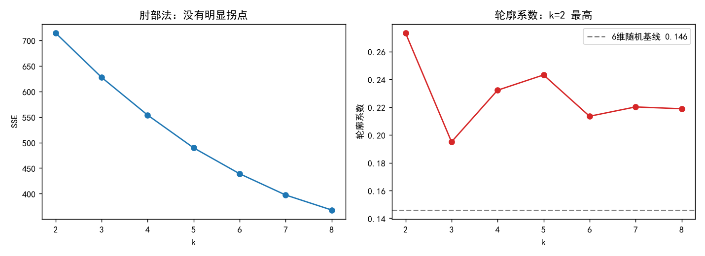
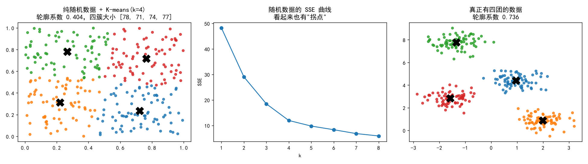
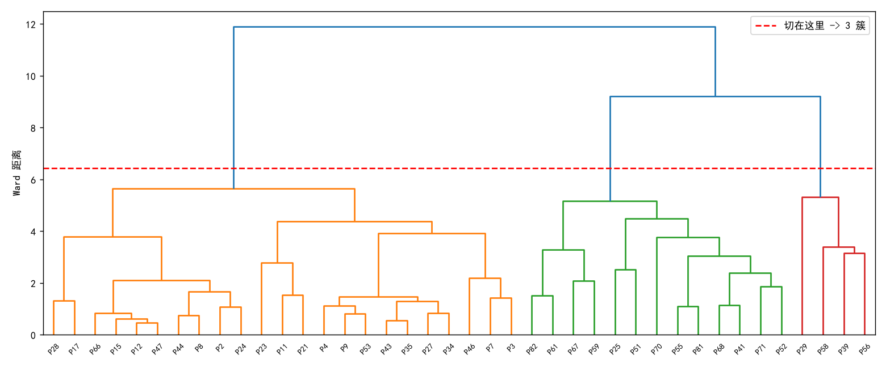
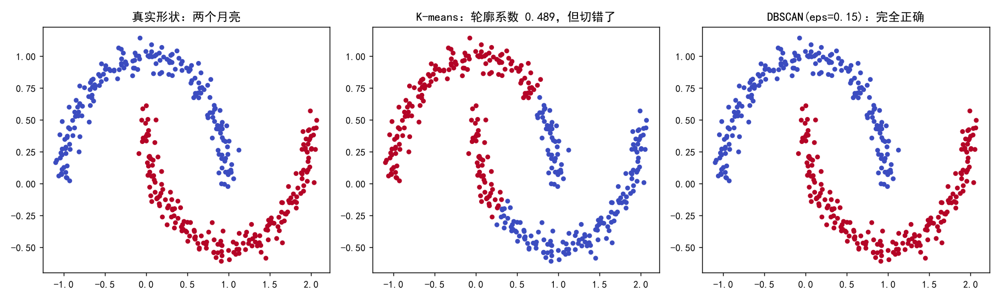
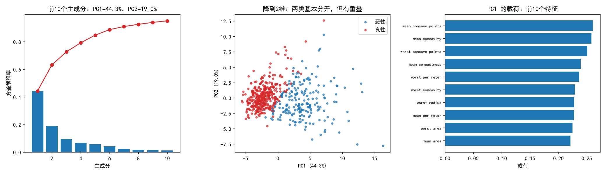
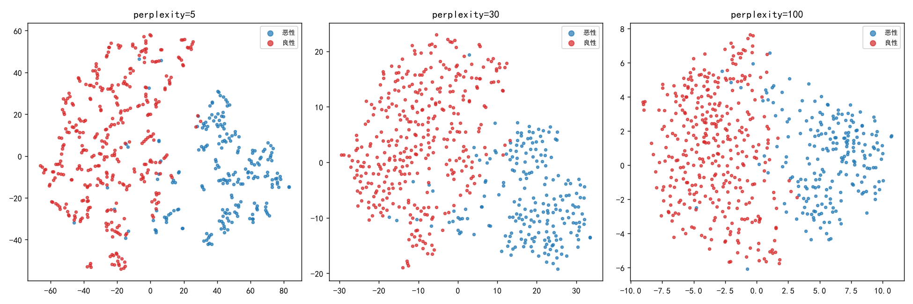

# 模块 8 · 无监督学习

**核心问题：没有标签的时候，怎么发现数据里的结构？**

**建议用时：14 小时左右（相对难度估计，不是实测）**

---

## 〇、先说一件反直觉的事

前面七个模块，你手里一直有一样东西可以对照：真实标签、损失曲线、AUC。**这一模块没有。**

没有标签，意味着**没有正确答案**；没有正确答案，意味着**任何算法都会给你一个输出，而你无法靠"结果看起来漂亮"判断它对不对**。

这一节开头先放三个本机实测的结果，把这件事说透：

| 实验 | 表面结果 | 真相 |
|---|---|---|
| 300 个**纯随机**点跑 K-means(k=4) | 轮廓系数 **0.404**，四簇大小 78/71/74/77 | 数据里什么都没有，四簇是算法切的 |
| 两个月亮形状的数据跑 K-means | 轮廓系数 **0.489**（比单链正确切分的 0.330 还高） | 切错了，而且是彻底切错 |
| HCV 1385 例临床指标聚类 | 轮廓系数 **0.0875** | 同维度纯随机数据的基线是 **0.088**，一模一样 |

**所以这个模块真正要学的不是"怎么调包"，是"怎么给一个没有标准答案的结果做证伪"。**

三条防线，后面每一节都会回到它们：

| 防线 | 做法 | 回答什么问题 |
|---|---|---|
| **零假设基线** | 用同维度、同样本量的随机数据跑同一个算法，看指标 | 我这个分数比随机高多少 |
| **稳定性** | 自助重采样，看分组还稳不稳 | 换一批病人，还是这些组吗 |
| **外部效度** | 用**没参与聚类**的变量（生存、死亡、分期）检验组间差异 | 这个分组在临床上说得通吗 |

**三条都过不了，就是数字游戏。**

---

## 本模块路线

| 节 | 内容 | 产出 |
|---|---|---|
| 一 | K-means：原理、迭代、k 的选择 | 肘部图 + 轮廓系数图（真实数据） |
| 二 | 核心警告：算法永远会给你 k 个簇 | 纯随机数据实验 |
| 三 | 层次聚类与树状图 | 树状图 + 四种 linkage 对比 |
| 四 | DBSCAN | 核心点/边界点/噪声 + 参数敏感性 |
| 五 | PCA | 方差解释率 + 载荷分析 + 降维后分类 |
| 六 | t-SNE 与 UMAP | 三个 perplexity 的对比图 |
| 七 | 异常检测 | 三种方法在同一数据上的 AUC |
| 八 | 实战：HCV 聚类分型 | 一次完整的"数字游戏"现场 |

**环境**（本机实测版本，写论文要报告）：scikit-learn 1.9.1、numpy 2.4.6、pandas 3.0.6、matplotlib 3.11.2、scipy 1.17.1、torch 2.9.1。

---

## 一、K-means：最容易上手，也最容易骗人

### 1.1 核心问题

把 n 个病人分成 k 组，要求：

- 组内的人尽量像
- 组间的人尽量不像

没有标签，"像"只能定义成**距离**。于是问题变成：

```
minimize  SSE = sum over 每个簇 sum over 簇内每个点 (x - c)^2
```

其中 c 是簇中心。**SSE 就是"每个点到它所属中心的距离平方和"，越小说明簇内越紧。**

### 1.2 算法只做两件事，交替做

```
① 分配：把每个点分给离它最近的中心
② 更新：把每个簇的中心移到该簇所有点的均值
③ 重复 ①②，直到分组不再变化
```

这两步为什么一定收敛：固定中心时，①让 SSE 最小（每个点选最近的中心）；固定分组时，②让 SSE 最小（均值是平方误差的最优解）。**每一步都不会让 SSE 变大，而 SSE 有下界 0，所以一定停。**

但它停在**局部最优**，不是全局最优。初始中心选得不好，结果会差很多——这是后面 `n_init=10` 存在的原因。

### 1.3 手算一遍（1 维，6 个点）

六个病人的某个指标：`[1, 2, 3, 8, 9, 10]`，k=2，**故意把两个初始中心都选在左边**：c1=1，c2=2。

**第 1 轮**

| 点 | 到 c1=1 | 到 c2=2 | 分到 |
|---|---|---|---|
| 1 | 0 | 1 | 簇1 |
| 2 | 1 | 0 | 簇2 |
| 3 | 2 | 1 | 簇2 |
| 8 | 7 | 6 | 簇2 |
| 9 | 8 | 7 | 簇2 |
| 10 | 9 | 8 | 簇2 |

新中心：c1 = 1，c2 = (2+3+8+9+10)/5 = **6.4**

**第 2 轮**

| 点 | 到 c1=1 | 到 c2=6.4 | 分到 |
|---|---|---|---|
| 1 | 0 | 5.4 | 簇1 |
| 2 | 1 | 4.4 | **簇1（换了）** |
| 3 | 2 | 3.4 | **簇1（换了）** |
| 8 | 7 | 1.6 | 簇2 |
| 9 | 8 | 2.6 | 簇2 |
| 10 | 9 | 3.6 | 簇2 |

新中心：c1 = (1+2+3)/3 = **2**，c2 = (8+9+10)/3 = **9**

**第 3 轮**：分组不再变化，收敛。

```
SSE = (1-2)^2 + (2-2)^2 + (3-2)^2 + (8-9)^2 + (9-9)^2 + (10-9)^2
    = 1 + 0 + 1 + 1 + 0 + 1
    = 4
```

**这个例子里最关键的一步是第 2 轮的两个"换了"。** 如果初始中心选成 1 和 2 之后就不再重算中心，你会得到 {1} 和 {2,3,8,9,10} 这种毫无意义的分组。**迭代不是形式，它会真的改变归属。**

代码验证（可以原样跑）：

```python
import numpy as np

x = np.array([1., 2, 3, 8, 9, 10]).reshape(-1, 1)
centers = np.array([1., 2.])          # 两个初始中心都在左边

for it in range(1, 6):
    d = ((x[:, None, :] - centers.reshape(1, -1, 1)) ** 2).sum(axis=2)
    labels = d.argmin(axis=1)
    new = np.array([x[labels == i].mean() for i in range(2)])
    print(f"第{it}轮 中心={centers} 分组={labels} 新中心={new}")
    if np.allclose(new, centers):
        break
    centers = new

print("SSE =", ((x - centers[labels].reshape(-1, 1)) ** 2).sum())
```

**真实输出：**

```
第1轮 中心=[1. 2.] 分组=[0 1 1 1 1 1] 新中心=[1.  6.4]
第2轮 中心=[1.  6.4] 分组=[0 0 0 1 1 1] 新中心=[2. 9.]
第3轮 中心=[2. 9.] 分组=[0 0 0 1 1 1] 新中心=[2. 9.]
SSE = 4.0
```

### 1.4 为什么第一步必须标准化（这条有实测代价）

K-means 用欧氏距离，**距离对量纲敏感**。Hepatitis 六个特征的原始方差：

| 特征 | 方差 | 占总方差 |
|---|---|---|
| Age | 156.9 | 1.5% |
| Bilirubin | 1.4 | 0.01% |
| Alk Phosphate | 2202.4 | 21.1% |
| **Sgot** | **7797.6** | **74.6%** |
| Albumin | 0.4 | 0.004% |
| Protime | 293.9 | 2.8% |

**Sgot 一个特征占了 74.6% 的方差。** 不标准化，K-means 实际上只在按 Sgot 切，其他五个特征几乎不参与。

实测这两种做法的差别：

| 做法 | 三个簇大小 | 各簇死亡率 | 卡方 p |
|---|---|---|---|
| 不标准化 | 122 / 3 / 30 | 19.7% / 33.3% / 23.3% | **0.780** |
| 标准化 | 76 / 56 / 23 | 2.6% / 28.6% / 60.9% | **2.1e-09** |

两种做法的分组一致性 **ARI 只有 0.088**——几乎是两个不相干的答案。

**不标准化会得到"临床上一无所获"，而且你不会知道是标准化的锅。**

### 1.5 真实数据：Hepatitis 的 K-means

**数据准备**（这一步决定了后面所有结论的可信度）：

```python
import pandas as pd
import numpy as np
from sklearn.impute import SimpleImputer
from sklearn.preprocessing import StandardScaler

h = pd.read_csv(r'E:\AI学习\练习代码\data\uci\Hepatitis.csv', na_values=['?'])

feats = ['Age', 'Bilirubin', 'Alk Phosphate', 'Sgot', 'Albumin', 'Protime']
X = SimpleImputer(strategy='median').fit_transform(h[feats])
Xs = StandardScaler().fit_transform(X)

print(Xs.shape)                                  # (155, 6)
print(h[feats].isna().sum().to_dict())
```

**真实缺失：**

```
{'Age': 0, 'Bilirubin': 6, 'Alk Phosphate': 29, 'Sgot': 4, 'Albumin': 16, 'Protime': 67}
```

**Protime 缺 67 个（43.2%），用中位数补了。这是本节的第一个隐患**，1.6 节会用完成病例重跑一次做对照。

#### 1.5.1 肘部法：这条曲线上没有拐点

```python
from sklearn.cluster import KMeans
from sklearn.metrics import silhouette_score

for k in range(2, 9):
    km = KMeans(n_clusters=k, n_init=10, random_state=42).fit(Xs)
    print(f"k={k}  SSE={km.inertia_:7.1f}  轮廓={silhouette_score(Xs, km.labels_):.4f}")
```

**真实输出：**

| k | SSE | 比上一档减少 | 轮廓系数 |
|---|---|---|---|
| 2 | 714.4 | — | **0.2733** |
| 3 | 627.5 | 12.2% | 0.1950 |
| 4 | 553.8 | 11.8% | 0.2321 |
| 5 | 489.6 | 11.6% | 0.2431 |
| 6 | 438.9 | 10.3% | 0.2134 |
| 7 | 397.4 | 9.5% | 0.2201 |
| 8 | 368.0 | 7.4% | 0.2188 |

k=1 时 SSE = 930.0，所以 k=2 只解释了总方差的 **23.2%**，k=3 解释 **32.5%**。

**肘部法在这份数据上失败了：** 减少率从 12.2% 平滑地滑到 7.4%，**没有一处是"突然变缓"的拐点**。你可以在图上硬指一个 k=3 或 k=4，但那是你决定的，不是数据告诉你的。

**这不是数据不好，这是肘部法的常态。** 真实高维数据上，肘部法多数时候给不出明确答案。

#### 1.5.2 轮廓系数：给了个答案，但不是临床想要的

轮廓系数衡量"一个点离自己人近，还是离外人近"：

```
对每个点 i：
  a(i) = 它到同簇其他点的平均距离      （簇内紧密度）
  b(i) = 它到最近的其他簇所有点的平均距离（簇间分离度）
  s(i) = (b - a) / max(a, b)
整体轮廓系数 = 所有点 s(i) 的平均
```

取值范围 -1 到 1。**1 最好，0 表示在两个簇的边界上，负值表示可能分错了簇。**

**真实结果：k=2 的轮廓系数 0.2733 最高，k=3 反而掉到 0.1950。**

这个"掉下去又升起来"的形状说明：**3 簇是几何上最差的一刀**。但 0.273 和 0.232 的差距很小，不要过度解读成"数据在 2 簇和 4 簇都有结构"。轮廓系数不是单调曲线，别指望它给你一个漂亮的峰。

**手算一遍轮廓系数**（4 个点，两簇，间距很大）：

```python
import numpy as np
from sklearn.metrics import pairwise_distances, silhouette_score

P = np.array([[0, 0], [0, 1], [5, 0], [5, 1]], float)
lab = np.array([0, 0, 1, 1])
D = pairwise_distances(P)

for i in range(4):
    same = [j for j in range(4) if lab[j] == lab[i] and j != i]
    other = [j for j in range(4) if lab[j] != lab[i]]
    a = D[i, same].mean()
    b = D[i, other].mean()
    print(f"点{i}: a={a:.3f}  b={b:.3f}  s={(b - a) / max(a, b):.3f}")

print("整体:", round(silhouette_score(P, lab), 3))
```

**真实输出：**

```
点0: a=1.000  b=5.050  s=0.802
点1: a=1.000  b=5.050  s=0.802
点2: a=1.000  b=5.050  s=0.802
点3: a=1.000  b=5.050  s=0.802
整体: 0.802
```

b = (5 + sqrt(26))/2 = (5 + 5.099)/2 = 5.050。手算和代码对得上。

#### 1.5.3 轮廓系数必须和"同维度随机数据"比

这是本模块最重要的一条操作规范。

**轮廓系数的绝对值没有意义，它的意义来自和零假设的对比。** 因为随机数据的轮廓系数**会随维度剧烈变化**：

| 维度 d | k=2 基线 | k=3 基线 | k=4 基线 |
|---|---|---|---|
| 2 | 0.372 | 0.396 | 0.417 |
| 6 | 0.146 | 0.143 | 0.150 |
| 10 | 0.094 | 0.089 | 0.087 |
| 30 | 0.038 | 0.036 | 0.035 |

（n=155 的均匀随机数据，每个格子 10 次重复的均值；95 分位见代码输出。）

**怎么读这张表：**

- **2 维**随机数据的轮廓系数就有 **0.40 左右**。所以"2 维图上轮廓系数 0.4"等于什么都没说。
- **6 维**降到 0.146。维度越高，随机点之间的距离越趋于相等，簇越"糊"，轮廓系数越低。
- **30 维**只有 0.038。

**对照 Hepatitis：6 维、k=3、轮廓系数 0.195，基线 0.143，95 分位 0.151。** 也就是说：**它确实比随机高，但只高了一点点。** 这点结构是真的（后面临床检验也支持），但很弱。

复现代码：

```python
import numpy as np
from sklearn.cluster import KMeans
from sklearn.metrics import silhouette_score

rng = np.random.default_rng(1)

for d in [2, 6, 10, 30]:
    for k in [2, 3, 4]:
        ss = []
        for seed in range(10):
            U = rng.random((155, d))          # 同样本量、同维度的均匀随机数据
            lab = KMeans(n_clusters=k, n_init=10, random_state=seed).fit_predict(U)
            ss.append(silhouette_score(U, lab))
        print(f"d={d:2d} k={k}: 均值={np.mean(ss):.3f}  95分位={np.percentile(ss, 95):.3f}")
```

#### 1.5.4 画图代码

```python
import matplotlib
matplotlib.use('Agg')
import matplotlib.pyplot as plt
plt.rcParams['font.sans-serif'] = ['SimHei']
plt.rcParams['axes.unicode_minus'] = False

ks, inert, sil = range(2, 9), [], []
for k in ks:
    km = KMeans(n_clusters=k, n_init=10, random_state=42).fit(Xs)
    inert.append(km.inertia_)
    sil.append(silhouette_score(Xs, km.labels_))

fig, ax = plt.subplots(1, 2, figsize=(11, 4))
ax[0].plot(list(ks), inert, 'o-')
ax[0].set_xlabel('k'); ax[0].set_ylabel('SSE'); ax[0].set_title('肘部法：没有明显拐点')

ax[1].plot(list(ks), sil, 'o-', color='tab:red')
ax[1].axhline(0.146, ls='--', c='gray', label='6维随机基线 0.146')
ax[1].set_xlabel('k'); ax[1].set_ylabel('轮廓系数')
ax[1].set_title('轮廓系数：k=2 最高'); ax[1].legend()

plt.tight_layout()
plt.savefig(r'E:\AI学习\模块8_无监督学习\kmeans_elbow_silhouette.png', dpi=130)
```

**图已生成：`kmeans_elbow_silhouette.png`。**

 左图是一条平滑下坡，右图是锯齿状，k=2 的峰很明显，但它离基线只有 0.127 的距离。

### 1.6 k 的选择：临床意义优先

现在到了本节的核心。三个候选：

| k | 轮廓系数 | 临床解释 | 组间死亡率 |
|---|---|---|---|
| 2 | **0.2733（最高）** | 高危 / 低危 | 45.5% vs 7.0%，p=5.0e-08 |
| 3 | 0.1950（最低） | 轻 / 中 / 重 | 2.6% / 28.6% / 60.9%，p=2.1e-09 |
| 4 | 0.2321 | 三组加一个 5 人的小组，解释不了 | — |

**轮廓系数选 k=2，但临床要 k=3。为什么？**

看 k=3 的三个簇，它们不是随机的三个组，而是**一条单调的 severity 轴**：

| 簇 | n | 年龄中位数 | 胆红素 | 碱性磷酸酶 | SGOT | 白蛋白 | 凝血酶原时间 | 死亡率 |
|---|---|---|---|---|---|---|---|---|
| 0 | 76 | 34 | 0.85 | 81.0 | 46.0 | 4.15 | 75.0 | **2.6%** |
| 1 | 56 | 51 | 1.00 | 86.0 | 56.5 | 3.55 | 50.0 | **28.6%** |
| 2 | 23 | 45 | 2.80 | 162.5 | 118.0 | 3.30 | 40.5 | **60.9%** |

**读法：**

- 簇 0：年轻、胆红素正常、白蛋白高、几乎不死（2/76）。**轻症。**
- 簇 2：胆红素 2.8（正常上限约 1.2）、SGOT 118、白蛋白 3.3（低）、死亡率 60.9%（14/23）。**重症。**
- 簇 1：各项都在中间。**中间型。**

**这才叫"临床意义"：不是 p 值小，是分组能被医生用一句话解释，而且严重程度是单调的。**

k=2 的 7% vs 45.5% 也显著，但它把"中间型"和"重症"合并了。临床上要不要收进 ICU，靠的是中间那一档。

**代价也要说清楚：** 从 k=2 到 k=3，SSE 只降了 12.2%，轮廓系数还掉了 0.078。**你是在用"统计上更差"换"临床上更有用"。这个交易在医学论文里是合理的，但必须在方法部分写明白，不能假装轮廓系数支持 k=3。**

#### 一个必须知道的稳健性问题

Protime 缺了 43.2%，中位数插补。用**完成病例**（83 人，六个特征都不缺）重跑 k=3：

| 做法 | n | k=3 轮廓系数 | 与另一种做法的分组一致性 |
|---|---|---|---|
| 中位数插补 | 155 | 0.1950 | — |
| 完成病例 | 83 | 0.2684 | **ARI = 0.729** |

**ARI 0.729 的意思是：两种做法的分组大部分重合，但远不是同一套分组——换一种缺失值处理，就有一部分病人换了组。**

这在医学聚类里是常态，也是审稿人会问的第一个问题。**做法：主要分析用插补版，敏感性分析用完成病例版，两个都报告。** 只报一个，结论就是"看你怎么办缺失"。

（完成病例版 k=2 的死亡率：1/48 vs 14/35，Fisher p = 9.4e-06。方向和插补版一致，结论稳。）

### 1.7 常见错误

| 错误 | 现象 | 正确做法 |
|---|---|---|
| 不标准化 | 一个高方差特征主导全部距离（本例 Sgot 占 74.6%） | 先 StandardScaler，或 RobustScaler |
| 用原始轮廓系数下结论 | 2 维 0.4 以为很好 | 和同维度随机基线比 |
| 只看肘部图 | 找不到拐点就随便选 | 肘部 + 轮廓 + 临床意义一起看 |
| k 由轮廓系数唯一决定 | 选出的 k 临床没法解释 | 轮廓是参考，临床是裁决 |
| 用参与聚类的变量做检验 | p 值必然显著，毫无意义 | 用没参与聚类的结局变量 |
| 只报一种缺失处理 | 换个插补方式结论就变 | 主分析 + 敏感性分析 |
| 忘了 `n_init` | 每次跑结果不一样 | `n_init=10` 或更高 |

---

## 二、核心警告：算法永远会给你 k 个簇

### 2.1 这一节只做一个实验

**生成 300 个纯随机点（均匀分布，两个维度都在 0-1 之间），没有任何结构。然后跑 K-means(k=4)。**

```python
import numpy as np
from sklearn.cluster import KMeans
from sklearn.metrics import silhouette_score

rng = np.random.default_rng(7)
R = rng.random((300, 2))                     # 纯随机，没有任何簇

km = KMeans(n_clusters=4, n_init=10, random_state=0).fit(R)
print("簇大小:", np.bincount(km.labels_).tolist())
print("轮廓系数:", round(silhouette_score(R, km.labels_), 4))
print("四个中心:\n", np.round(km.cluster_centers_, 3))
```

**真实输出：**

```
簇大小: [78, 71, 74, 77]
轮廓系数: 0.4042
四个中心:
 [[0.723 0.236]
  [0.22  0.313]
  [0.266 0.781]
  [0.765 0.718]]
```

**四个中心几乎就在正方形的四个象限中心：(0.72, 0.24)、(0.22, 0.31)、(0.27, 0.78)、(0.77, 0.72)。**

### 2.2 为什么"看起来很干净"

把图画出来你立刻明白：K-means 把正方形切成了四块，边界是两条直线，看起来**整齐得像是数据本来就这样**。

**这就是 K-means 的本质：它做的不是"发现簇"，是"把空间切成 k 块"。** 只要 k 给定，无论数据长什么样，它都会切出 k 块，而且切面一定是 Voronoi 边界（直线/平面）。

**图已生成：`random_kmeans.png`（三联图）。**



- 左：纯随机点 + K-means(k=4)，轮廓系数 0.404
- 中：同一批随机数据的 SSE 曲线，**也有"拐点"**（48.2 → 29.1 → 18.5 → 12.0 → 9.8 → 8.3 → 6.8 → 5.9）
- 右：真正有四团的数据（make_blobs），轮廓系数 0.736

**三张图放一起看，左和中你绝对挑不出毛病。这就是危险所在。**

### 2.3 三个"看起来有结构"的假证据

| 假证据 | 随机数据上的值 | 为什么骗人 |
|---|---|---|
| **轮廓系数** | 0.404 | 2 维随机数据的基线就是 0.417（k=4），0.404 甚至略低于基线 |
| **SSE 拐点** | k=2 处下降最陡 | 任何递减凸曲线都有"最陡的一段"，拐点是视觉产物 |
| **簇大小均衡** | 78/71/74/77 | K-means 天然趋向均衡，均衡不代表真实 |

**再加一条最容易被忽略的：**

| 假证据 | 随机数据上的值 | 为什么骗人 |
|---|---|---|
| **"每个簇都有临床特征"** | 你总能在四个随机组里找到某项指标"看起来不同" | 4 个组两两比较 6 个指标 = 36 次检验，α=0.05 时期望 1.8 个假阳性 |

**最后这条是医学聚类论文里最常见的造假方式（不一定是故意的）：聚类之后拿 20 个临床变量逐个体检，总有几个 p<0.05，然后写"我们发现 A 型患者具有更高的 XXX"。**

**正确做法：预先指定 1-2 个主要结局变量，其余标为探索性，并做多重比较校正（模块 13 会讲）。**

### 2.4 防线一：零假设基线

**做法**：生成同维度、同样本量的均匀随机数据，跑同样的算法，重复 20 次，得到指标的分布。你的真实数据必须显著高于这个分布。

```python
import numpy as np
from sklearn.cluster import KMeans
from sklearn.metrics import silhouette_score

def null_baseline(n, d, k, n_rep=10, seed=0):
    rng = np.random.default_rng(seed)
    scores = []
    for i in range(n_rep):
        U = rng.random((n, d))
        lab = KMeans(n_clusters=k, n_init=10, random_state=i).fit_predict(U)
        scores.append(silhouette_score(U, lab))
    return np.mean(scores), np.percentile(scores, 95)

for d in [6, 8]:
    m, p95 = null_baseline(155 if d == 6 else 1385, d, 3)
    print(f"d={d}: 基线 {m:.3f}, 95分位 {p95:.3f}")
```

**真实输出：**

```
d=6: 基线 0.143, 95分位 0.151
d=8: 基线 0.088, 95分位 0.090
```

把三份数据放进去：

| 数据 | 维度 | k | 轮廓系数 | 同维度基线(95分位) | 判定 |
|---|---|---|---|---|---|
| Hepatitis | 6 | 3 | **0.195** | 0.151 | 高于基线，有弱结构 |
| 纯随机 | 2 | 4 | 0.404 | 0.441 | 低于基线，无结构 |
| HCV | 8 | 3 | **0.0875** | 0.090 | **低于基线，等于噪声** |

**这张表就是本模块的核心技能。** 只看第三列会得出三个错误结论，加上第五列才看得清。

### 2.5 防线二：稳定性（自助重采样）

**问题**：如果换一批病人，分组还是这样吗？

**做法**：有放回地重采样 n 个病人，重新聚类，和原始分组算 ARI（调整兰德指数，1 = 完全一致，0 = 随机水平）。重复 50 次。

```python
import numpy as np
from sklearn.cluster import KMeans
from sklearn.metrics import adjusted_rand_score

def stability(X, k=3, B=50, seed=0):
    rng = np.random.default_rng(seed)
    base = KMeans(n_clusters=k, n_init=10, random_state=0).fit_predict(X)
    aris = []
    for b in range(B):
        idx = rng.integers(0, len(X), len(X))          # 有放回抽样
        lab = KMeans(n_clusters=k, n_init=10, random_state=b).fit_predict(X[idx])
        aris.append(adjusted_rand_score(base[idx], lab))
    return np.mean(aris), np.std(aris)
```

**真实结果：**

| 数据 | 稳定性 ARI |
|---|---|
| Hepatitis（6 维，k=3） | **0.582 ± 0.177** |
| 纯随机 6 维（n=155，k=3） | 0.393 ± 0.175 |
| HCV（8 维，k=3） | **0.222 ± 0.178** |

**三个读法：**

1. **不要拿 0 当基准。** 随机数据的稳定性也有 0.393——因为重采样的是同一批点，K-means 总会给出相似的空间切分。**要看的是"比随机高多少"。**
2. Hepatitis 0.582 高于 0.393，说明分组有一定可重复性，但不强。**论文里报 0.58 是诚实的，报"稳定"是夸大。**
3. **HCV 0.222 低于随机数据的 0.393。** 这不是"结构弱"，这是**重采样后分组比随机还乱**——典型的无结构信号。

### 2.6 防线三：外部效度

**用没有参与聚类的变量检验组间差异。**

| 数据类型 | 能用的外部变量 | 不能用的 |
|---|---|---|
| 临床聚类 | 死亡、生存时间、并发症、治疗反应 | 参与聚类的化验指标 |
| 影像组学聚类 | 病理分级、基因分型、复发 | 参与聚类的纹理特征 |
| 人群分型 | 外部队列的结局 | 同一批数据里的任何输入 |

**为什么必须"没参与聚类"**：参与聚类的变量，组间必然有差异——那是 K-means 的目标函数保证的，不是发现。**用它们做检验是循环论证。**

### 2.7 这一节的结论

> **聚类算法不会告诉你"有没有结构"，它只会告诉你"如果一定要分成 k 组，可以这样分"。**
>
> **"有没有结构"是你用零假设基线、稳定性和外部效度证明出来的，不是算法给的。**

### 2.8 常见错误

| 错误 | 现象 | 正确做法 |
|---|---|---|
| 把"算法输出了 k 个簇"当成"数据有 k 个簇" | 随机数据也能出漂亮图 | 先跑零假设基线 |
| 用轮廓系数 0.4 判断"结构明显" | 2 维随机数据基线就是 0.42 | 按维度查基线 |
| 稳定性 ARI 0.5 就说"稳定" | 随机数据也有 0.39 | 和随机基线比 |
| 聚类后拿 20 个变量找差异 | 必然找到几个 p<0.05 | 预先指定主要结局 + 校正 |
| 用参与聚类的变量做检验 | p 值必然显著 | 换外部变量 |
| 只跑一个随机种子 | 结果不可复现 | 多次 `n_init`，报告稳定性 |
---

## 三、层次聚类：不用先决定 k

### 3.1 核心问题

K-means 要求你先说 k。层次聚类反过来：**先把所有点各自当一簇，然后每次合并最像的两簇，直到全部合成一簇。** 整个过程记成一棵树，你事后在任何高度切一刀，就得到任意数量的簇。

代价：要算 n×n 的距离矩阵，n 大时很慢（n > 1 万基本别用）。

### 3.2 关键只有一个：两簇之间的距离怎么定义

| linkage | 两簇距离的定义 | 特点 | 什么时候用 |
|---|---|---|---|
| **single（单链）** | 两簇中**最近**的一对点 | 能识别非凸形状，但会"链式"串成一长条 | 形状怪异、要分离离群点 |
| **complete（全链）** | 两簇中**最远**的一对点 | 偏好紧凑的球 | 簇要紧凑 |
| **average（平均）** | 所有跨簇点对的平均距离 | 折中 | 通用 |
| **Ward** | 合并后 SSE 增加最小的那一对 | 偏好等大小、球状 | **默认首选，医学最常用** |

**Ward 的目标和 K-means 一致（最小化 SSE），所以它倾向于产生和 K-means 相似的球状簇，但它不需要预先给 k。**

### 3.3 手算一遍（1 维，5 个点）

`[1, 3, 4, 9, 10]`，单链：

| 步 | 合并 | 距离 | 说明 |
|---|---|---|---|
| 1 | 3 和 4 | 1 | 最近 |
| 2 | 9 和 10 | 1 | 最近 |
| 3 | {3,4} 和 1 | 2 | 单链取最近：|1-3| = 2 |
| 4 | {1,3,4} 和 {9,10} | 5 | 单链取最近：|4-9| = 5 |

树的高度依次是 **1、1、2、5**。在高度 2.5 处横切，得到 **{1,3,4} 和 {9,10}** 两簇。

```python
import numpy as np
from scipy.cluster.hierarchy import linkage, fcluster

x = np.array([[1.], [3.], [4.], [9.], [10.]])
Z = linkage(x, method='single')

print(np.round(Z, 2))
print("在 2.5 处切:", fcluster(Z, 2.5, criterion='distance'))
```

**真实输出：**

```
[[ 1.  2.  1.  2.]
 [ 3.  4.  1.  2.]
 [ 0.  5.  2.  3.]
 [ 6.  7.  5.  5.]]
在 2.5 处切: [2 2 2 1 1]
```

`Z` 的每一行是一次合并：`[簇A编号, 簇B编号, 合并距离, 合并后成员数]`。编号 0-4 是原始点，5 以后是合并出来的簇。

### 3.4 树状图怎么读（四条规则）

```
① 纵轴是"合并时的距离"，越高说明这两簇越不像
② 横切一刀，与这条水平线相交的竖线数 = 簇数
③ 切的位置决定 k：切得低 → 簇多；切得高 → 簇少
④ 左右顺序没有含义（可以翻转），不要解读"谁在左边"
```

**最重要的一条：不要看树形"长得像什么"来决定 k。** 要看的是**合并高度在哪里突然变大**——那说明再往上合就把很不像的东西硬凑到一起了。

40 例 Hepatitis 子集的 Ward 树，最后三次合并高度是 **5.65、9.20、11.90**。从 5.65 跳到 9.20（涨 63%），说明 **3 簇之后再合并代价陡增**，所以 3 是一个自然的选择。这比肘部法清晰，是层次聚类唯一的实用优势。

**图已生成：`dendrogram_hepatitis.png`（40 例 Ward 树，红虚线在 3 簇处切开）。**



### 3.5 真实数据：四种 linkage 打一架

用 Hepatitis 完成病例（83 人，六特征都不缺，避免插补干扰）：

```python
import pandas as pd
import numpy as np
from scipy.cluster.hierarchy import linkage, fcluster, cophenet
from scipy.spatial.distance import pdist
from sklearn.preprocessing import StandardScaler
from sklearn.metrics import silhouette_score, adjusted_rand_score

h = pd.read_csv(r'E:\AI学习\练习代码\data\uci\Hepatitis.csv', na_values=['?'])
feats = ['Age', 'Bilirubin', 'Alk Phosphate', 'Sgot', 'Albumin', 'Protime']
sub = h.dropna(subset=feats).reset_index(drop=True)
X = StandardScaler().fit_transform(sub[feats])

for link in ['single', 'complete', 'average', 'ward']:
    Z = linkage(X, method=link)
    c, _ = cophenet(Z, pdist(X))
    for k in [2, 3]:
        lab = fcluster(Z, k, criterion='maxclust')
        print(f"{link:8s} k={k}: 大小={np.bincount(lab)[1:]} "
              f"轮廓={silhouette_score(X, lab):.3f} "
              f"ARI_vs_组织学={adjusted_rand_score(sub['Histology'], lab):.3f} "
              f"共表相关={c:.3f}")
```

**真实输出：**

| linkage | k | 簇大小 | 轮廓系数 | ARI vs 组织学 | 共表相关 |
|---|---|---|---|---|---|
| single | 2 | **82 + 1** | **0.509** | 0.009 | 0.825 |
| single | 3 | 81 + 1 + 1 | 0.402 | 0.018 | 0.825 |
| complete | 2 | 82 + 1 | 0.509 | 0.009 | 0.683 |
| complete | 3 | 74 + 8 + 1 | 0.252 | 0.076 | 0.683 |
| average | 2 | 82 + 1 | 0.509 | 0.009 | 0.848 |
| average | 3 | 74 + 8 + 1 | 0.385 | 0.032 | 0.848 |
| **Ward** | 2 | **48 + 35** | 0.272 | **0.211** | 0.579 |
| **Ward** | 3 | 48 + 8 + 27 | 0.250 | **0.200** | 0.579 |

**这张表信息量极大，逐条读：**

**① single/complete/average 的 k=2 都是 "82 个 + 1 个"。**

那个 1 是离群点。**82 个点内部很紧，加上一个孤零零的点，平均轮廓系数被拉到 0.509——比 Ward 的 0.272 高了近一倍。**

**轮廓系数被一个离群点收买了。** 那个点的 s 值接近 1.0，82 点的簇平均也有 0.5 左右，平均下来就是 0.509。

**但它的 ARI vs 组织学只有 0.009——和组织学分期毫无关系。**

**② Ward 的轮廓系数最低（0.272），但 ARI 最高（0.211）。**

**指标最低的那个，分组最有临床对应。** 因为 Ward 在找"紧凑且大小均衡"的簇，而"82 + 1"这种划分虽然分数高，却没有任何信息。

**③ 共表相关（cophenetic correlation）衡量树对原始距离的保真度。**

average 最高 0.848，single 0.825，complete 0.683，Ward 最低 0.579。**它衡量的是"树画得准不准"，不是"分得好不好"。** Ward 最低是正常的——Ward 优化的是 SSE，不是距离保真。

**④ Ward k=2 的临床意义（完成病例，83 人）：**

| 簇 | 死亡 | 存活 | 死亡率 |
|---|---|---|---|
| 簇1（n=48） | 1 | 47 | 2.1% |
| 簇2（n=35） | 14 | 21 | **40.0%** |

**Fisher 精确检验 p = 9.4e-06。**

**结论：层次聚类里，优先用 Ward；不要被 single 的高轮廓系数骗；树的高度差比轮廓系数更能帮你选 k。**

### 3.6 单链的"链式效应"

单链在 moons 数据上表现完美（ARI = 1.000），在 Hepatitis 上却把 82 个点串成一坨。**同一个算法，两种极端。**

原因：单链只要求"最近的一对点"够近，于是一串点可以像链条一样连起来，哪怕两端相距很远。**它擅长找"连通"的形状，不擅长找"紧凑"的团。**

**判断规则：**

```
数据是"一条一条"的（轨迹、流形、图像边缘） → 单链可能对
数据是"一团一团"的（病人分型、细胞亚群）   → Ward
不确定 → 四种都跑，看 ARI 和临床意义
```

### 3.7 常见错误

| 错误 | 现象 | 正确做法 |
|---|---|---|
| 只看树形决定 k | 主观，换个视角结论就变 | 看合并高度的跳变 |
| 默认用 single | 82+1 这种划分 | 病人分型用 Ward |
| 相信高轮廓系数 | 被离群点抬高 | 同时看簇大小和外部 ARI |
| 把左右顺序当含义 | 过度解读 | 顺序可翻转，无意义 |
| 在 1 万样本上硬跑 | 内存爆、极慢 | 先抽样或换 K-means |
| 用共表相关选算法 | 它衡量树保真度，不是聚类质量 | 它只用于挑 linkage 的表示能力 |

---

## 四、DBSCAN：不用给 k，还能挑出噪声

### 4.1 核心问题

K-means 和 Ward 都假设簇是"凸的、球状的"，而且每个点都必须属于某个簇。**真实数据里经常有：形状奇怪（月牙、环形）、密度不均、还有一堆不该被分组的离群点。**

DBSCAN 换了个定义：**簇 = 密度连成一片的区域。**

### 4.2 三个概念

先定两个参数：**eps**（半径）和 **min_samples**（最少邻居数，含自己）。

| 点类型 | 定义 | 归属 |
|---|---|---|
| **核心点** | 半径 eps 内（含自己）至少有 min_samples 个点 | 一定属于某簇 |
| **边界点** | 自己不是核心点，但在某个核心点的 eps 内 | 属于那个核心点的簇 |
| **噪声点** | 既不是核心点，也不在任何核心点的 eps 内 | 标为 -1，不属于任何簇 |

**簇的形成**：从任一核心点出发，把所有密度可达的核心点连起来，再把它们的边界点挂上去。

### 4.3 手算一遍

8 个点，eps=1.5，min_samples=3：

| 点 | 坐标 | eps 内的点数（含自己） | 类型 |
|---|---|---|---|
| A | (0, 0) | 3：A, B, C | 核心 |
| B | (1, 0) | 4：A, B, C, D | 核心 |
| C | (0, 1) | 3：A, B, C | 核心 |
| D | (2.4, 0) | 2：B, D | **边界**（挂在 B 上） |
| E | (5, 5) | 1：E | **噪声** |
| F | (6, 0) | 3：F, G, H | 核心 |
| G | (7, 0) | 3：F, G, H | 核心 |
| H | (6, 1) | 3：F, G, H | 核心 |

```python
import numpy as np
from sklearn.cluster import DBSCAN

Q = np.array([[0, 0], [1, 0], [0, 1], [2.4, 0],
              [5, 5], [6, 0], [7, 0], [6, 1]], float)
db = DBSCAN(eps=1.5, min_samples=3).fit(Q)

print("标签:", db.labels_.tolist())
print("核心点:", db.core_sample_indices_.tolist())
```

**真实输出：**

```
标签: [0, 0, 0, 0, -1, 1, 1, 1]
核心点: [0, 1, 2, 5, 6, 7]
```

D 拿到了标签 0（跟 A/B/C 一簇），但它不是核心点——**这就是边界点**。E 是 -1，**噪声**。

**注意：边界点 D 只和 B 相连。如果 B 不是核心点，D 也会变成噪声。** 边界点的归属完全依赖核心点。

### 4.4 参数怎么定

| 参数 | 作用 | 调大 | 调小 |
|---|---|---|---|
| `eps` | 邻域半径 | 簇变少、噪声变少、可能全并成一簇 | 簇变多、噪声变多 |
| `min_samples` | 核心点的门槛 | 更严格、噪声更多 | 更宽松、容易把噪声也算进簇 |

**经验起点：`min_samples = 维度 + 1`，至少 3-5。** 医学数据维度高，通常取 5-10。

**eps 用 k-distance 图定：** 对每个点算它到第 k 近邻的距离（k = min_samples - 1），排序后画曲线，**拐点处就是 eps**。

```python
import numpy as np
from sklearn.datasets import make_moons
from sklearn.neighbors import NearestNeighbors

Xm, _ = make_moons(n_samples=400, noise=0.06, random_state=0)
nn = NearestNeighbors(n_neighbors=5).fit(Xm)
dist, _ = nn.kneighbors(Xm)
kd = np.sort(dist[:, -1])

for q in [50, 90, 95, 99]:
    print(q, round(float(np.percentile(kd, q)), 3))
```

moons 数据上的真实分位：50% = 0.064，90% = 0.105，95% = 0.118，99% = 0.149。**拐点大约在 0.1-0.15，正好对应后面验证出的最优 eps=0.15。**

### 4.5 真实数据：DBSCAN 的参数有多敏感

moons 数据（400 点，noise=0.06，真实 2 簇）：

| eps | min_samples | 得到的簇数 | 噪声比例 | ARI |
|---|---|---|---|---|
| 0.05 | 5 | **28** | 54.5% | 0.022 |
| 0.05 | 10 | 0 | 100% | — |
| 0.10 | 5 | 4 | 2.5% | 0.731 |
| 0.10 | 10 | 17 | 10.5% | 0.117 |
| **0.15** | **5** | **2** | **0%** | **1.000** |
| **0.15** | **10** | **2** | **0%** | **1.000** |
| 0.20 | 5 | 2 | 0% | 1.000 |
| 0.30 | 5 | **1** | 0% | — |

**同一个算法，eps 从 0.05 到 0.3，答案从"28 个簇"变成"1 个簇"。**

- eps=0.05：每个点只认识最近的几个，碎成 28 块，一半以上被判噪声
- eps=0.15：正好跨过月亮的宽度，两块完整连起来
- eps=0.3：两只月亮之间的空隙也被覆盖，全并成一坨

**DBSCAN 不是"不用调参"，是"把调 k 换成了调 eps"。**

**图已生成：`moons_kmeans_dbscan.png`。**

 中间那张是 K-means：**轮廓系数 0.489，比 DBSCAN 的 0 噪声完美切分还高，但它是从中间竖着切的，把两只月亮各切了一半。**

**这是本模块第二次出现"指标更高、答案更错"。**

### 4.6 K-means / Ward / DBSCAN 怎么选

| | K-means | Ward | DBSCAN |
|---|---|---|---|
| 要不要先定簇数 | 要 | 不用（事后切树） | 不用 |
| 簇的形状 | 只能是球状 | 球状、等大小 | 任意形状 |
| 能处理噪声 | 不能，每个点都必须归属 | 不能 | **能，标 -1** |
| 密度不均 | 不行 | 不行 | **不行**（同一个 eps 搞不定） |
| 大数据 | 快 | 慢（n² 距离） | 中等（要建索引） |
| 结果确定性 | 依赖初始化 | 确定 | **边界点依赖遍历顺序** |
| 医学典型用途 | 病人分型 | 分型 + 看层级 | 影像/信号里的离群点、空间聚集 |

**一句话选法：**

```
病人分型，要 k 组，能解释 → K-means 或 Ward
形状奇怪、有噪声、要挑出"不像任何人"的样本 → DBSCAN
不确定 → 三个都跑，比较分组一致性（ARI）
```

### 4.7 常见错误

| 错误 | 现象 | 正确做法 |
|---|---|---|
| eps 用默认 0.5 | 标准化后 0.5 可能过大或过小 | 用 k-distance 图定 |
| 不标准化 | 高方差特征主导距离，和 K-means 一样 | 先标准化 |
| 把 -1 当成一个簇 | 噪声被当成"特殊亚型" | -1 是"没有归属"，单独分析 |
| 高维直接用 | 维度灾难，密度失去意义 | 先 PCA 降到 10 维以内 |
| 密度不均的数据 | 要么碎要么全并 | 换 HDBSCAN |
| 说"DBSCAN 不用调参" | eps 极度敏感 | 报告 eps 的选取过程和敏感性 |

---

## 五、PCA：把 30 维压到 2 维，还能说清丢了什么

### 5.1 核心问题

30 个特征，画不出图，也没法直观判断病人之间的远近。但**这 30 个特征高度相关**（半径、周长、面积基本是同一个东西的三种说法）。PCA 要找几个"新的轴"，用尽量少的轴保留尽量多的信息。

### 5.2 原理（三句话）

```
① 把数据中心化（每个特征减去均值）
② 找一个方向 w，使数据投影到 w 上方差最大 —— 这是第一主成分
③ 在垂直于 w 的所有方向里，再找方差最大的 —— 第二主成分，依此类推
```

**数学上**：对协方差矩阵做特征分解，特征向量就是主成分方向，特征值就是该方向的方差。

**关键性质：**

- 主成分之间**互相正交（不相关）**，所以 PCA 天然去共线性
- 第 i 个主成分的**方差解释率 = 特征值 i / 所有特征值之和**
- 载荷（loading）= 特征向量的分量，表示"这个原始特征对这个主成分贡献多大"
- **载荷的符号没有意义**（整体乘 -1 还是同一个方向），只有大小和相对符号有意义

**手算一遍（两个变量，相关系数 0.8）**

标准化后，协方差矩阵就是相关矩阵：

```
C = [[1.0, 0.8],
     [0.8, 1.0]]
```

两个变量的情况下有解析解：

```
特征值1 = 1 + r = 1.8
特征值2 = 1 - r = 0.2
解释率  = 1.8/2 = 90%，0.2/2 = 10%
特征向量 = (1, 1)/sqrt(2) 和 (1, -1)/sqrt(2)
```

**读法：** 两个高度相关的变量，90% 的信息可以压到**一个**轴（两者的和）上，剩下 10% 是两者的差。**这就是 PCA 在高度相关的医学指标上特别有效的原因。**

```python
import numpy as np

C = np.array([[1.0, 0.8], [0.8, 1.0]])
w, v = np.linalg.eigh(C)
print("特征值:", w[::-1])                       # [1.8 0.2]
print("解释率:", (w[::-1] / w.sum()).round(3))  # [0.9 0.1]
print("特征向量:\n", v[:, ::-1].round(3))
```

### 5.3 真实数据：乳腺癌 30 维

569 例，30 个形态学特征，212 恶性 / 357 良性。

```python
import numpy as np
from sklearn.datasets import load_breast_cancer
from sklearn.preprocessing import StandardScaler
from sklearn.decomposition import PCA

d = load_breast_cancer()
X, y = d.data, d.target                    # 0=恶性, 1=良性
Xz = StandardScaler().fit_transform(X)

pca = PCA().fit(Xz)
evr = pca.explained_variance_ratio_

print("前10个解释率:", np.round(evr[:10], 4))
print("累计:", np.round(np.cumsum(evr)[:10], 4))
for t in [0.80, 0.90, 0.95, 0.99]:
    print(f"保留{t:.0%}需要", int(np.searchsorted(np.cumsum(evr), t) + 1), "个主成分")
```

**真实输出：**

| 主成分 | 解释率 | 累计 |
|---|---|---|
| PC1 | **44.27%** | 44.27% |
| PC2 | **18.97%** | 63.24% |
| PC3 | 9.39% | 72.64% |
| PC4 | 6.60% | 79.24% |
| PC5 | 5.50% | 84.73% |
| PC6 | 4.02% | 88.76% |
| PC7 | 2.25% | 91.01% |
| PC8 | 1.59% | 92.60% |
| PC9 | 1.39% | 93.99% |
| PC10 | 1.17% | 95.16% |

```
保留80%需要 5 个主成分
保留90%需要 7 个主成分
保留95%需要 10 个主成分
保留99%需要 17 个主成分
```

**30 维压到 2 维只剩 63.24% 的信息。** 这不是"损失了一点"，是**丢了超过三分之一**。所以"PCA 降到 2 维画图"只能用于看大致结构，不能用来下"两类完全分开"的结论。

### 5.4 载荷怎么读

```python
names = d.feature_names
for i in range(2):
    v = pca.components_[i]
    idx = np.argsort(-np.abs(v))[:6]
    print(f"PC{i+1}:", [(names[j], round(v[j], 3)) for j in idx])
```

**真实输出：**

| PC1 载荷（前 6） | 值 | PC2 载荷（前 6） | 值 |
|---|---|---|---|
| mean concave points | +0.261 | mean fractal dimension | +0.367 |
| mean concavity | +0.258 | fractal dimension error | +0.280 |
| worst concave points | +0.251 | worst fractal dimension | +0.275 |
| mean compactness | +0.239 | mean radius | **-0.234** |
| worst perimeter | +0.237 | compactness error | +0.233 |
| worst concavity | +0.229 | mean area | **-0.231** |

**两条读法：**

**① PC1 的 30 个载荷全部为正（30/30）。**

这意味着 PC1 是"**所有形态特征一起变大**"的方向——一个综合的"大小 + 不规则程度"轴。恶性组的 PC1 均值 **+3.71**，良性组 **-2.21**，所以 **PC1 越大越偏恶性**。

**② PC2 是"分形维数 vs 大小"的对比轴。**

分形维数载荷为正（+0.367），半径和面积载荷为负（-0.234、-0.231）。**PC2 不代表"更严重"或"更轻"，它代表"边界更复杂但整体更小"这种组合。**

**这就是载荷分析的价值：它告诉你每个主成分到底在说什么，而不是只给一个"PC1 解释 44%"的数字。**

**注意符号：** 如果你换个随机种子或换一批数据，PC1 可能整体变成负数，载荷全部变号。**符号无意义，读的是"哪些特征同向、哪些反向"。**

**图已生成：`pca_breast_cancer.png`。** 左：前 10 个主成分的碎石图；中：PC1-PC2 散点（蓝=恶性，红=良性）；右：PC1 的前 10 个载荷。



### 5.5 降到 2 维还能不能分类

```python
from sklearn.linear_model import LogisticRegression
from sklearn.model_selection import cross_val_score, StratifiedKFold
from sklearn.pipeline import Pipeline

cv = StratifiedKFold(5, shuffle=True, random_state=0)

for n in [2, 5, 10, 20, None]:
    steps = [('sc', StandardScaler())]
    if n is not None:
        steps.append(('pca', PCA(n_components=n)))
    steps.append(('lr', LogisticRegression(max_iter=5000)))
    s = cross_val_score(Pipeline(steps), X, y, cv=cv)
    label = '全30维' if n is None else f'PCA {n} 维'
    print(f"{label:10s}: {s.mean():.4f} ± {s.std():.4f}")
```

**真实输出：**

| 特征 | 5 折准确率 |
|---|---|
| PCA 2 维 | 0.9578 ± 0.0179 |
| PCA 5 维 | 0.9736 ± 0.0192 |
| PCA 10 维 | 0.9807 ± 0.0179 |
| PCA 20 维 | 0.9772 ± 0.0172 |
| 全 30 维 | 0.9789 ± 0.0142 |

**三个结论：**

**① 2 维（63% 方差）能到 95.78%，只比全特征低 2.1 个百分点。** 说明这 30 个特征高度冗余，大部分信息在头两个方向里。

**② PCA 10 维（98.07%）比全 30 维（97.89%）还高 0.18 个百分点。**

**这个差异小于一个标准差（0.018），是噪声，不能宣称"PCA 提升了效果"。** 面试里说"我用 PCA 把准确率从 97.89 提升到 98.07"会被追问"你做显著性检验了吗"。

**③ 正确结论：PCA 在这个数据上没有提升分类，但把特征数从 30 降到 10，几乎没有损失。** 价值在"压缩和可视化"，不在"提分"。

### 5.6 不标准化的 PCA 是一场灾难

```python
pca_raw = PCA().fit(X)          # 注意：没有 StandardScaler
print("PC1 解释率:", round(pca_raw.explained_variance_ratio_[0], 4))
idx = np.argsort(-np.abs(pca_raw.components_[0]))[:5]
print([(names[j], round(pca_raw.components_[0][j], 3)) for j in idx])
```

**真实输出：**

```
PC1 解释率: 0.982
[('worst area', 0.852), ('mean area', 0.517), ('area error', 0.056),
 ('worst perimeter', 0.049), ('mean perimeter', 0.035)]
```

**PC1 一个成分解释了 98.2% 的方差，几乎全是"面积"。**

这不是"发现了主要结构"，这是**面积这个特征的数值范围（几百到几千）远大于其他特征（0-1 的分形维数），所以它垄断了方差**。

**PCA 必须标准化，理由和 K-means 完全一样：方差大的特征会主导。** 区别是 PCA 里这个后果更隐蔽——你会得到一个"解释率 98%"的漂亮数字。

### 5.7 PCA 用于特征压缩时的泄露问题

**PCA 是无监督的，但它仍然会泄露。** 因为 `fit` 用到了全部样本的分布信息（均值、方差、主成分方向）。

```python
# 错误：先在全量上 fit PCA，再交叉验证
X_pca = PCA(n_components=10).fit_transform(StandardScaler().fit_transform(X))
scores = cross_val_score(LogisticRegression(), X_pca, y, cv=5)   # 虚高

# 正确：PCA 放进 Pipeline，每一折内部单独 fit
pipe = Pipeline([('sc', StandardScaler()),
                 ('pca', PCA(n_components=10)),
                 ('lr', LogisticRegression())])
scores = cross_val_score(pipe, X, y, cv=5)
```

**为什么无监督也会泄露**：测试折的分布影响了主成分方向，等于测试集的信息进入了训练。**影响通常比标准化泄露小（1-3 个百分点），但方向一样，都是虚高。**

**规则：所有 fit 都要在训练折内完成，不管它有没有用标签。**

### 5.8 常见错误

| 错误 | 现象 | 正确做法 |
|---|---|---|
| 不标准化 | PC1 解释 98%，其实是"面积" | StandardScaler 后再 PCA |
| 把解释率当"信息保留度" | 95% 方差 ≠ 95% 分类信息 | 分类效果要单独验证 |
| 解读载荷的符号 | "PC1 负值代表…" | 符号可翻转，读相对关系 |
| 用 PCA 降维后再划分 | 泄露，指标虚高 | 放进 Pipeline |
| 用 2 维图下"完全分开"结论 | 只保留 63% 方差 | 报告保留比例 |
| 认为 PCA 一定提分 | 本例 10 维 vs 30 维差 0.18%，是噪声 | 差异要过显著性检验 |
| 对类别特征做 PCA | 没有意义 | 先 one-hot 或用 MCA |

---

## 六、t-SNE 与 UMAP：画图可以，读数不行

### 6.1 核心问题

PCA 是线性的：它只能找"直的轴"。如果数据躺在一个弯曲的流形上（比如两只月亮），PCA 压到 2 维会糊成一团。t-SNE 和 UMAP 是**非线性降维**，专门为了"在 2 维图上把局部邻域保住"。

**它们只有一个正确用途：看。** 不能当特征，不能用来聚类，不能读距离。

### 6.2 t-SNE 在做什么（一句话版）

```
① 在高维空间，把每个点和它的邻居的相似度算成一个概率 p(ij)
② 在 2 维空间，也算一个概率 q(ij)（用 t 分布，长尾）
③ 调整 2 维坐标，让 q 尽量接近 p（最小化 KL 散度）
```

**关键：它只约束"谁和谁像"，不约束"像多少"。** 所以：

- 局部邻域（最近的几十个点）保住了
- **全局距离（两个簇隔多远）完全没有约束**
- 簇的大小、形状、之间的空隙都是算法为了优化局部而"摆"出来的

### 6.3 perplexity 实验：同一份数据，三个形状

`perplexity` 大致等于"每个点考虑多少个邻居"，常用 5-50。

```python
import numpy as np
import matplotlib
matplotlib.use('Agg')
import matplotlib.pyplot as plt
from sklearn.datasets import load_breast_cancer
from sklearn.preprocessing import StandardScaler
from sklearn.manifold import TSNE

plt.rcParams['font.sans-serif'] = ['SimHei']
plt.rcParams['axes.unicode_minus'] = False

d = load_breast_cancer()
X = StandardScaler().fit_transform(d.data)
y = d.target

fig, axes = plt.subplots(1, 3, figsize=(15, 5))
for ax, pp in zip(axes, [5, 30, 100]):
    ts = TSNE(n_components=2, perplexity=pp, random_state=0,
              init='pca', learning_rate='auto').fit_transform(X)
    ax.scatter(ts[y == 0, 0], ts[y == 0, 1], s=10, c='tab:blue', label='恶性', alpha=.7)
    ax.scatter(ts[y == 1, 0], ts[y == 1, 1], s=10, c='tab:red', label='良性', alpha=.7)
    ax.set_title(f'perplexity={pp}')
    ax.legend(markerscale=2, fontsize=8)

plt.tight_layout()
plt.savefig(r'E:\AI学习\模块8_无监督学习\tsne_perplexity.png', dpi=130)
```

**图已生成：`tsne_perplexity.png`。三张图的形状完全不同：**



| perplexity | 图长什么样 | 坐标跨度 |
|---|---|---|
| 5 | 一条拉得很长的条带，恶性被撕成好几个小岛 | 约 149 |
| 30 | 两个清楚的团，左右分开 | 约 63 |
| 100 | 一个大团，两个瓣贴在一起 | 约 20 |

**同一份数据、同一个算法、只改一个参数，图的形状、坐标尺度和"看起来有几个簇"全变了。**

### 6.4 用数字量化"形状会变"

肉眼看不准，用三个指标量：

| perplexity | trustworthiness | 距离 Spearman | 10 近邻保留率 | 嵌入上 DBSCAN 簇数 |
|---|---|---|---|---|
| 5 | 0.943 | 0.673 | 0.441 | **6** |
| 30 | 0.950 | 0.685 | 0.471 | **1** |
| 100 | 0.947 | 0.757 | 0.414 | **2** |

（DBSCAN 的 eps 固定为"坐标跨度的 5%"，min_samples=5。规则一致，但仍然是人为选的。）

**三个读法：**

**① trustworthiness 都在 0.94-0.95。** 说明 t-SNE 确实保住了局部结构——**这是它唯一保证的东西**。

**② 10 近邻保留率只有 0.41-0.47。** 也就是说，**原始空间里最近的 10 个邻居，在图上平均只有 4 个还在附近**。一半以上的邻居被换掉了。

**③ 同一份数据，你问"有几个簇"：perplexity=5 说 6 个，perplexity=30 说 1 个，perplexity=100 说 2 个。**

**这三个答案都对，也都没意义——它们描述的是图，不是数据。**

### 6.5 为什么图上的距离不可信（有数字）

造 4 个簇，中心分别在 (0,0)、(1,0)、(0,3)、(0,9)，每簇 200 点：

- 原始空间里，簇 1 到簇 2 的距离是 1，簇 1 到簇 4 是 9——**相差 9 倍**
- 跑 t-SNE（perplexity=30）后，测簇心距离

**真实结果：**

| | 原始距离 | t-SNE 图上的距离 |
|---|---|---|
| 簇1 ↔ 簇2 | 0.99 | 21.88 |
| 簇1 ↔ 簇3 | 3.00 | 43.48 |
| 簇1 ↔ 簇4 | 9.01 | 56.14 |
| **9 倍差距** | **9.1 倍** | **只有 2.6 倍** |

**更糟的是簇的大小：**

| | 原始直径 | t-SNE 图上直径 |
|---|---|---|
| 簇1 | 1.51 | 27.91 |
| 簇2 | 1.64 | 26.62 |
| 簇3 | 1.73 | 20.17 |
| 簇4 | 1.70 | 19.34 |

**原始空间里四个簇一样大（直径 1.5-1.7），图上却变成 28、27、20、19——离得近的簇被放大得更多。**

**所以：**

- "这两群离得远，说明差异大" → **错**。远近被压缩了。
- "这群体积大，说明异质性高" → **错**。大小是算法摆的。
- "图上有 3 个岛，所以有 3 个亚型" → **错**。岛的数量随 perplexity 变。

**图和原始簇心距离、直径的完整复现代码：**

```python
import numpy as np
from sklearn.datasets import make_blobs
from sklearn.manifold import TSNE
from sklearn.metrics import pairwise_distances

centers = [[0, 0], [1, 0], [0, 3], [0, 9]]
Xb, yb = make_blobs(n_samples=800, centers=centers, cluster_std=0.3, random_state=0)
tsb = TSNE(n_components=2, perplexity=30, random_state=0, init='pca').fit_transform(Xb)

def centroids(P, labels, k=4):
    return np.array([P[labels == i].mean(axis=0) for i in range(k)])

print("原始簇心距离:\n", np.round(pairwise_distances(centroids(Xb, yb)), 2))
print("嵌入簇心距离:\n", np.round(pairwise_distances(centroids(tsb, yb)), 2))
print("原始直径:", [round(np.ptp(Xb[yb == i], axis=0).max(), 2) for i in range(4)])
print("嵌入直径:", [round(np.ptp(tsb[yb == i], axis=0).max(), 2) for i in range(4)])
```

### 6.6 t-SNE 的正确用法清单

| 能做 | 不能做 |
|---|---|
| 看有没有明显的分群 | 数簇的个数 |
| 看某个亚群是不是聚在一起 | 比较两群的距离 |
| 看批次效应（不同医院是否混在一起） | 把 t-SNE 坐标当特征喂给模型 |
| 和 PCA 对照，看非线性结构 | 在 t-SNE 图上跑 K-means 然后报告 k |
| 作为补充图，配合定量指标 | 作为唯一的"分型证据" |

**还有三条操作规范：**

```
① 必须跑多个 perplexity（至少 5/30/100），形状稳定才算有一点结构
② 必须跑多个 random_state，结果不应差太多
③ 报告 trustworthiness，不要只放图
```

**为什么不能当特征**：t-SNE 是随机优化的，换一个种子坐标全变；它没有"transform"新样本的能力（sklearn 的新版本有近似，但不可靠）。**它是可视化工具，不是特征提取器。**

### 6.7 UMAP

| | t-SNE | UMAP |
|---|---|---|
| 保留什么 | 几乎只保留局部 | 局部 + 一部分全局 |
| 速度 | 慢（n=10 万很吃力） | 快得多 |
| 参数 | perplexity | n_neighbors、min_dist |
| 新样本 | 不能直接 transform | 可以（近似） |
| 距离能不能读 | 不能 | **仍然不能** |
| 当特征用 | 不能 | 不能 |

**UMAP 比 t-SNE 保住了更多全局结构，所以图上的大尺度布局稍微可信一点。但"稍微"不等于"可以读"。**

**本机环境没有安装 umap-learn（实测 `ModuleNotFoundError: No module named 'umap'`）。** 需要时：

```
pip install umap-learn
```

```python
# 需要先安装 umap-learn；本机未装，以下代码未在本机运行
import umap

reducer = umap.UMAP(n_neighbors=15, min_dist=0.1, random_state=0)
emb = reducer.fit_transform(Xz)
```

**注意：上面这段没有在本机跑过，所以本节不给 UMAP 的任何数字。** 这是本讲义的一条纪律：**没跑过的东西不写结果。**

### 6.8 常见错误

| 错误 | 现象 | 正确做法 |
|---|---|---|
| 在 t-SNE 图上数簇 | 换个 perplexity 数量就变 | 用聚类算法 + 稳定性检验 |
| 比较图上两群的距离 | 全局距离被压缩（9 倍变 2.6 倍） | 回原始空间算距离 |
| 比较两群的大小 | 大小是算法摆的 | 回原始空间算离散度 |
| 只跑一个 perplexity | 形状可能是参数 artifact | 至少 5/30/100 |
| 把坐标当特征 | 换种子结果全变 | 用 PCA 或原始特征 |
| 不报 trustworthiness | 只放图，无法判断保真度 | 补一个数字 |
| 用 UMAP 图证明"分型" | 图不是证据 | 外部效度检验 |
---

## 七、异常检测：找出"不像任何人"的样本

### 7.1 核心问题

聚类假设每个样本都属于某一组。异常检测反过来：**假设绝大多数样本是"正常"的，找出少数不符合这个假设的。**

医学里的三个典型场景：

| 场景 | 正常 | 异常 | 价值 |
|---|---|---|---|
| 影像质控 | 拍得清楚的片子 | 模糊、有伪影、摆位错误 | 自动退回重拍 |
| 罕见病筛查 | 常见病表现 | 不符合任何常见模式的病例 | 提示医生会诊 |
| 数据质控 | 合理的录入 | 身高 250 cm、年龄 -5 | 发现录入错误 |
| 设备漂移 | 稳定期数据 | 换了探测器后的分布 | 触发模型重训 |

**先记住模块 5 那条：异常 ≠ 错误。** ALT 3000 是真实的危重病人，不是脏数据。异常检测的输出是"请人看一眼"，不是"删掉"。

### 7.2 三种方法

先准备数据（后面三段代码都用它）：

```python
import numpy as np
from sklearn.datasets import load_breast_cancer
from sklearn.preprocessing import StandardScaler

d = load_breast_cancer()
X = StandardScaler().fit_transform(d.data)
X_normal = X[d.target == 1][:300]      # 良性当"正常"，只用于训练
X_test = X[:80]                        # 演示用
```

**① 孤立森林（Isolation Forest）**

原理一句话：**异常点少，所以随机切几刀就能把它单独切出来；正常点密，要切很多刀。**

```
① 随机选一个特征，随机选一个切分点，切一刀
② 重复，直到每个点都被孤立
③ 记录每个点被孤立所需的路径长度
④ 路径越短 → 越异常
```

**优点**：快（O(n log n)）、不用假设分布、高维也能用。**医学表格数据的首选。**

```python
from sklearn.ensemble import IsolationForest

iso = IsolationForest(contamination=0.05, n_estimators=200, random_state=0)
iso.fit(X)
score = -iso.score_samples(X)      # 越大越异常
```

`contamination` 是"你预计有多少比例是异常"，它决定阈值。**这个数字是猜的，必须做敏感性分析。**

**② One-Class SVM**

思想：**只拿正常样本训练，学一个把正常样本包住的边界**，边界外的就是异常。

```python
from sklearn.svm import OneClassSVM

oc = OneClassSVM(nu=0.05, kernel='rbf', gamma='scale')
oc.fit(X_normal)                   # 只用正常样本
score = -oc.score_samples(X_test)
```

`nu` 是"允许多少比例的训练样本落在边界外"，也是猜的。**对 `gamma` 极敏感，必须先标准化。**

**③ 自编码器（Autoencoder）**

思想：**用正常数据训练一个"压缩再还原"的网络。正常样本能还原，异常样本还原不了。**

```
30 维 → 16 → 8 → 16 → 30
损失 = 重构误差 = mean((x - x_hat)^2)
异常分数 = 重构误差
```

```python
import torch
import torch.nn as nn

torch.manual_seed(0)
net = nn.Sequential(
    nn.Linear(30, 16), nn.ReLU(),
    nn.Linear(16, 8), nn.ReLU(),
    nn.Linear(8, 16), nn.ReLU(),
    nn.Linear(16, 30),
)
opt = torch.optim.Adam(net.parameters(), lr=1e-3)

Xt = torch.tensor(X_normal, dtype=torch.float32)
for epoch in range(300):
    perm = torch.randperm(len(Xt))
    for i in range(0, len(Xt), 32):
        batch = Xt[perm[i:i + 32]]
        loss = ((net(batch) - batch) ** 2).mean()
        opt.zero_grad(); loss.backward(); opt.step()

with torch.no_grad():
    recon = net(torch.tensor(X_test, dtype=torch.float32))
    score = ((recon - torch.tensor(X_test, dtype=torch.float32)) ** 2).mean(1).numpy()
```

**优点**：能学非线性结构，图像/波形上很强。**缺点**：要调网络、要 GPU、小样本容易过拟合。

### 7.3 三种方法在同一数据上的实测

**实验设计**（必须写清楚，否则数字没有意义）：

| 项目 | 设置 |
|---|---|
| 数据 | 乳腺癌 30 维，标准化 |
| 正常样本 | 良性 300 例用于训练，另留 57 例测试 |
| 异常样本 | 恶性 15 例，只出现在测试集 |
| 重复 | 5 个随机种子 |
| 评估 | ROC AUC（用"恶性"当异常标签） |

```python
import numpy as np
from sklearn.datasets import load_breast_cancer
from sklearn.preprocessing import StandardScaler
from sklearn.ensemble import IsolationForest
from sklearn.svm import OneClassSVM
from sklearn.metrics import roc_auc_score

d = load_breast_cancer()
X = StandardScaler().fit_transform(d.data)
y = d.target                       # 0=恶性, 1=良性

for seed in range(5):
    r = np.random.default_rng(seed)
    ben = np.where(y == 1)[0]; r.shuffle(ben)
    mal = np.where(y == 0)[0]; r.shuffle(mal)

    tr_ben, te_ben = ben[:300], ben[300:360]
    te_mal = mal[:15]
    Xte = np.vstack([X[te_ben], X[te_mal]])
    yte = np.r_[np.zeros(len(te_ben)), np.ones(15)]    # 1 = 异常

    # 孤立森林：在混合数据上训练（无监督）
    Xmix = np.vstack([X[tr_ben], X[te_mal]])
    iso = IsolationForest(contamination=0.05, n_estimators=200, random_state=seed).fit(Xmix)
    s_if = -iso.score_samples(Xte)

    # One-Class SVM：只用正常训练
    oc = OneClassSVM(nu=0.05, kernel='rbf', gamma='scale').fit(X[tr_ben])
    s_svm = -oc.score_samples(Xte)

    print(seed, round(roc_auc_score(yte, s_if), 3), round(roc_auc_score(yte, s_svm), 3))
```

**真实结果（5 个种子的均值 ± 标准差）：**

| 方法 | AUC | 前 15 名里真异常的比例 |
|---|---|---|
| 孤立森林 | 0.9127 ± 0.0381 | 69.3% |
| One-Class SVM | 0.9258 ± 0.0379 | 76.0% |
| **自编码器** | **0.9481 ± 0.0335** | **81.3%** |

**怎么读：**

**① 三个方法都能到 0.91 以上，但没有一个接近 1.0。**

因为恶性样本并不是"远离正常分布"——**它们是另一个有结构的群体，而且和良性有重叠**。异常检测擅长抓"孤立的点"，不擅长抓"另一团密集的点"。

**② 自编码器最好（0.948），但优势只有 0.02-0.035，而且标准差是 0.034。**

**这个差距在一个标准差附近，不能宣称"自编码器显著更好"。** 要下这个结论，需要配对检验（模块 9）。

**③ 前 15 名的精度 69%-81% 才是临床能用的说法。**

"医生每天只能复查 15 个病例，孤立森林里 10 个是真的，自编码器里 12 个是真的。" **这比 AUC 更能让临床听懂。**

### 7.4 异常检测最难的地方：没有标签怎么评估

这是个死循环：**你要检测异常，但你没有异常标签；你要评估，必须有标签。**

三条出路：

| 做法 | 怎么做 | 局限 |
|---|---|---|
| **注入已知异常** | 人为往正常数据里塞 5% 的异常（本例就是把恶性当异常） | 人造异常可能太"好检测" |
| **用随访结局反查** | 被标为异常的病例，后来是否确诊 | 要等时间，且只覆盖已确诊的 |
| **专家复核一小批** | 随机抽 100 个"异常"，请医生判断 | 贵，但最真实 |

**报告时必须写清楚：AUC 是在什么标签上算的。** "AUC 0.95" 如果是在人造异常上算的，不能直接说"能筛出罕见病"。

### 7.5 阈值怎么定

异常分数是连续的，必须要一个阈值才能变成"报警/不报警"。

```
方法一：按 contamination 定（"我预计 5% 是异常"）→ 简单，但 5% 是猜的
方法二：按临床可承受的复核量定（"每天只能看 20 个"）→ 医学上更合理
方法三：按分数的分布找拐点（类似肘部法）→ 不稳定
```

**医学场景首选方法二**：先问清楚"复查能力是多少"，再反推阈值。**这比任何统计方法都靠谱。**

### 7.6 常见错误

| 错误 | 现象 | 正确做法 |
|---|---|---|
| 把异常当错误删掉 | 删掉危重病人 | 异常只做"提示复核" |
| `contamination` 拍脑袋 | 阈值没有依据 | 按复核能力定，做敏感性分析 |
| 用含异常的数据训练 One-Class SVM | 边界被异常撑大 | 只用确认正常的样本 |
| 不标准化 | SVM 和自编码器都崩 | 先 StandardScaler |
| 只报 AUC | 临床不知道怎么用 | 补"前 k 名精度" |
| 在人造异常上报高 AUC | 过度外推 | 说明异常是怎么来的 |
| 高维直接用 | 距离失效，孤立森林退化 | 先 PCA 或选特征 |

---

## 八、实战：HCV 聚类分型（一次完整的数字游戏）

### 8.1 任务

**给 1385 例 HCV 病人的基线临床指标，能不能分出有临床意义的亚型？**

这是医学聚类论文的标准套路。这一节把整个流程走一遍，然后**用三条防线检验它**。

### 8.2 数据和特征

```python
import pandas as pd
import numpy as np
from sklearn.preprocessing import StandardScaler
from sklearn.cluster import KMeans
from sklearn.metrics import silhouette_score, adjusted_rand_score
from scipy.stats import kruskal

df = pd.read_csv(r'E:\AI学习\练习代码\data\uci\HCV_Egyptian.csv')
df.columns = df.columns.str.strip().str.replace(' ', '_')

feats = ['Age', 'BMI', 'WBC', 'RBC', 'HGB', 'Plat', 'AST_1', 'ALT_1']
X = StandardScaler().fit_transform(df[feats])
print(df.shape, X.shape)          # (1385, 29) (1385, 8)
```

选了 8 个基线指标（年龄、BMI、白细胞、红细胞、血红蛋白、血小板、AST、ALT）。**没有用任何随访变量，也没有用组织学分期——分期要留作外部检验。**

### 8.3 聚类结果：看起来很正常

```python
for k in range(2, 7):
    km = KMeans(n_clusters=k, n_init=10, random_state=42).fit(X)
    print(f"k={k} 轮廓={silhouette_score(X, km.labels_):.4f}")
```

**真实输出：**

| k | 2 | 3 | 4 | 5 | 6 |
|---|---|---|---|---|---|
| 轮廓系数 | 0.0967 | **0.0875** | 0.0911 | 0.0904 | 0.0933 |

**8 维均匀随机数据的基线是 0.088（95 分位 0.090）。**

**k=3 的 0.0875 比随机基线还低。**

如果只跑这一步就停，你会说"结构很弱，但也有一点"。**下一步才是裁决。**

k=3 的分组大小：**413 / 555 / 417**——非常均衡，看起来像一个"三分型"。

各簇的中位数：

| 簇 | n | Age | BMI | WBC | RBC（百万） | HGB | Plat | AST | ALT |
|---|---|---|---|---|---|---|---|---|---|
| 0 | 413 | 48 | 31 | 7577 | 4.05 | 12 | 169573 | 82 | 85 |
| 1 | 555 | 47 | 24 | 6931 | 4.49 | 12 | 155310 | 81 | 80 |
| 2 | 417 | 44 | 32 | 7999 | 4.72 | 14 | 149404 | 89 | 84 |

**"簇 0 BMI 高、簇 1 BMI 低、簇 2 血红蛋白高"——听起来像三种代谢表型，对吧？**

**但 BMI、RBC、HGB 都是聚类的输入。** 聚类按定义就会让它们分开，这不是发现，是目标函数的必然结果。

### 8.4 三条防线，逐条打

**防线一：零假设基线** —— 已过，0.0875 < 0.088，**失败**。

**防线二：稳定性**

```python
def stability(X, k=3, B=50, seed=0):
    rng = np.random.default_rng(seed)
    base = KMeans(n_clusters=k, n_init=10, random_state=0).fit_predict(X)
    aris = []
    for b in range(B):
        idx = rng.integers(0, len(X), len(X))
        lab = KMeans(n_clusters=k, n_init=10, random_state=b).fit_predict(X[idx])
        aris.append(adjusted_rand_score(base[idx], lab))
    return np.mean(aris), np.std(aris)

print(stability(X))        # (0.222, 0.178)
```

**真实结果：ARI = 0.222 ± 0.178。** 同维度的随机数据是 **0.393**。

**重采样后分组比随机数据还乱。失败。**

**防线三：外部效度**（用没参与聚类的组织学分期和分级）

```python
df['cluster'] = KMeans(n_clusters=3, n_init=10, random_state=42).fit_predict(X)

print(pd.crosstab(df['cluster'], df['Baselinehistological_staging']))

for c in ['Baselinehistological_staging', 'Baseline_histological_Grading']:
    groups = [df.loc[df.cluster == i, c] for i in range(3)]
    H, p = kruskal(*groups)
    print(f"{c}: H={H:.3f} p={p:.4f}")
```

**真实输出：**

| 簇 | 分期 1 | 分期 2 | 分期 3 | 分期 4 |
|---|---|---|---|---|
| 0 | 104 | 106 | 116 | 87 |
| 1 | 134 | 113 | 145 | 163 |
| 2 | 98 | 113 | 94 | 112 |

```
分期:   H=4.818  p=0.0899
分级:   H=0.478  p=0.7874
```

**p=0.09，不显著。分级 p=0.79，更不显著。**

**再看 ARI（分组和分期的吻合度）：**

| 指标 | 值 |
|---|---|
| 聚类 vs 分期 ARI | **0.0028** |
| 200 次随机分组的 ARI | -0.0000，95% 区间 [-0.0013, 0.0020] |

**0.0028 只比随机分组的 95% 上界（0.0020）高 0.0008，量级上等同于随机。你的三分型和随机贴标签，区分不出来。**

### 8.5 三条防线全灭，结论是什么

```
轮廓系数 0.0875  ≤  同维度随机基线 0.088
稳定性 ARI 0.222  <  随机数据稳定性 0.393
与组织学分期 ARI 0.0028 ≈ 随机分组
分期差异 p = 0.09，不显著
```

**结论：这 8 个指标里没有可分的亚型。三个簇是 K-means 把 1385 个人切成三块的产物。**

**为什么预料之中**：模块 5 已经测过，这份数据的标签和所有特征都不相关（全部 |rho| < 0.06）。**没有信号的数据，聚类也不会有信号。**

### 8.6 对照组：同样的流程，换一份有信号的数据

Hepatitis（模块 8.4 节，k=3）：

| 检验 | HCV | Hepatitis |
|---|---|---|
| 轮廓系数 | 0.0875 | 0.195 |
| 同维度基线 | 0.088 | 0.143 |
| 稳定性 ARI | 0.222 | **0.582** |
| 外部结局 | 分期 p=0.09 | **死亡率 p=2.1e-09** |
| 结论 | 数字游戏 | 有弱到中等结构 |

**同一套代码、同样的 k、同一个算法，差别全在数据。**

### 8.7 如果这是你的论文，审稿人会问什么

| 审稿人的问题 | 你该怎么答 |
|---|---|
| "三个亚型怎么定的？" | 轮廓 + 肘部 + 临床可解释性，三个都报 |
| "和随机分组比过吗？" | 零假设基线 + 稳定性 ARI |
| "亚型之间有临床差异吗？" | **用没参与聚类的结局变量**，预先指定 |
| "换个缺失处理还成立吗？" | 敏感性分析 |
| "ARI 0.003，你怎么解释？" | **解释不了，说明没有** |

**最后一行的诚实版本**："我们的聚类未能识别出与组织学分期相关的亚型，提示这组常规指标在基线时不足以区分疾病严重程度。" **这句话可以发，而且比硬编三个亚型有价值。**

### 8.8 常见错误

| 错误 | 现象 | 正确做法 |
|---|---|---|
| 用聚类输入证明分型有意义 | 必然显著 | 用外部结局 |
| 只报轮廓系数 | 不知道比随机高多少 | 加同维度基线 |
| 不报稳定性 | 换个样本就散 | 自助重采样 ARI |
| 三个亚型硬起名字 | "代谢型/炎症型/纤维化型" | 名字要有外部证据支撑 |
| p=0.09 说"有趋势" | 过度解读 | 预先设定 α，不显著就是不显著 |
| 多指标逐个检验 | 必然有假阳性 | 预设主要终点 + 校正 |

---

## 九、练习

**规矩：先自己写，卡住 30 分钟再看参考答案。每题都有验收标准，不达标就是没做完。**

### 练习 8-A（K-means 的 k 选择）

在 Hepatitis 上，对 k=2 到 8 跑 K-means，输出 SSE 和轮廓系数，并画出双轴图。

**回答：**

1. 肘部法支持哪个 k？为什么说不清楚？
2. 轮廓系数支持哪个 k？
3. 你最终选哪个 k？给出三条理由（统计 + 临床 + 稳健性）。

**验收标准：**

- [ ] 7 行结果表，数字是自己跑出来的
- [ ] 图上标出同维度随机基线
- [ ] 结论里同时出现"轮廓系数"和"临床意义"，且说明二者冲突时怎么取舍
- [ ] 报告了 Protime 缺失 43.2% 对结果的影响

### 练习 8-B（随机数据实验）

生成 300 个 2 维均匀随机点，k=2 到 6 各跑 20 个种子，记录轮廓系数的均值和 95% 分位。

**回答：**

1. 随机数据在 k=4 时的平均轮廓系数是多少？
2. 把你的 Hepatitis 结果放进去，它相当于"第几百分位"？
3. 如果审稿人问"0.4 的轮廓系数算好吗"，你怎么答？

**验收标准：**

- [ ] 20 个种子，不是 1 个
- [ ] 报告均值和区间，不是单点
- [ ] 能说出"为什么 2 维随机数据的基线比 6 维高"

### 练习 8-C（linkage 对比）

用 Hepatitis 完成病例（83 人），四种 linkage 各跑 k=2 和 k=3。

**回答：**

1. 哪种 linkage 的轮廓系数最高？它的簇大小是多少？
2. 哪种 linkage 和 Histology 的 ARI 最高？
3. 为什么最高轮廓系数对应的分组没有临床意义？

**验收标准：**

- [ ] 8 行结果表（4 linkage × 2 k）
- [ ] 指出"82+1"这种退化分组
- [ ] 能解释"轮廓系数被单个离群点抬高"

### 练习 8-D（DBSCAN 参数网格）

在 moons 数据上，eps 取 [0.05, 0.1, 0.15, 0.2, 0.3]，min_samples 取 [3, 5, 10]，共 15 组。

**回答：**

1. 哪几组能得到 ARI = 1.0？
2. eps=0.05 时发生什么？eps=0.3 时呢？
3. 用 k-distance 图验证你选的 eps。

**验收标准：**

- [ ] 15 行结果表，含簇数、噪声比例、ARI
- [ ] 画出 k-distance 曲线并标出拐点
- [ ] 结论里写明"DBSCAN 对 eps 有多敏感"

### 练习 8-E（PCA 载荷解读）

用乳腺癌数据，PCA 降到 2 维。

**回答：**

1. PC1 和 PC2 各解释多少方差？两个加起来呢？
2. 用一句中文给 PC1 命名，并列出支撑它的 3 个载荷最大的特征。
3. 用 2 维、10 维、30 维分别做逻辑回归，差多少？这个差显著吗？

**验收标准：**

- [ ] 报告解释率和累计解释率
- [ ] 载荷表按绝对值排序，至少 5 个特征
- [ ] 明确说"2 维丢了多少信息"
- [ ] 对 0.18 个百分点的差异给出"是噪声"的判断和理由

### 练习 8-F（t-SNE 稳定性）

乳腺癌数据，perplexity 取 5/30/100，每个再跑 3 个随机种子。

**回答：**

1. 哪个 perplexity 的形状最稳定？
2. 同一 perplexity 换种子，图会变吗？
3. 你能不能从图上判断"有几个亚型"？为什么？

**验收标准：**

- [ ] 9 张图（3 perplexity × 3 seed）
- [ ] 报告 trustworthiness
- [ ] 明确拒绝"从图上数簇"

### 练习 8-G（给一篇聚类论文挑错）

找一篇用聚类做"疾病亚型"的论文（中文英文都行），用本模块的三条防线逐条检查。

**产出**：一张表

| 检查项 | 论文怎么做的 | 是否合格 | 如果不合格，应该怎么补 |
|---|---|---|---|
| 有没有报告 k 的选择依据 | | | |
| 有没有和随机基线比 | | | |
| 有没有稳定性分析 | | | |
| 外部验证变量是否独立于聚类输入 | | | |
| 多重比较有没有校正 | | | |

**验收标准：**

- [ ] 至少 5 行
- [ ] 每条"不合格"都要给出具体补法
- [ ] 最后写 100 字结论：这篇论文的亚型结论可信吗

---

## 十、自测题

**先自己答，再看答案。答不出来说明这一节没学完。**

**Q1. K-means 为什么必须先标准化？用本讲的数字说明。**

<details>
<summary>看答案</summary>

因为 K-means 用欧氏距离，**方差大的特征会垄断距离**。

Hepatitis 六个特征里，Sgot 的方差是 7797.6，占总方差 74.6%；Albumin 只有 0.4。

实测后果：

| 做法 | 簇大小 | 死亡率 p |
|---|---|---|
| 不标准化 | 122 / 3 / 30 | 0.780 |
| 标准化 | 76 / 56 / 23 | 2.1e-09 |

两种分组的一致性 ARI 只有 0.088。

**不标准化不只是"效果差一点"，是得到一个完全不同的、临床上毫无意义的答案。**

</details>

**Q2. 轮廓系数 0.45，能说"数据结构明显"吗？**

<details>
<summary>看答案</summary>

**不能，必须先看维度和零假设基线。**

2 维均匀随机数据的轮廓系数就有 **0.40 左右**（k=4 时 0.417）。所以 2 维图上的 0.45 约等于噪声。

维度越高基线越低：6 维 0.146、10 维 0.089、30 维 0.038。

**正确说法**："轮廓系数 0.45，同维度随机数据的 95 分位是 0.44，所以只比噪声高一点。"

</details>

**Q3. 为什么 t-SNE 图上的距离不能读？**

<details>
<summary>看答案</summary>

t-SNE 只优化"局部邻域的相似度"，**对全局距离没有任何约束**。

实测（4 个簇，原始距离 1 : 3 : 9）：

| | 原始 | t-SNE |
|---|---|---|
| 簇1↔簇2 | 0.99 | 21.9 |
| 簇1↔簇4 | 9.01 | 56.1 |
| 比值 | 9.1 倍 | 2.6 倍 |

簇的直径也从 1.5-1.7 被放大成 19-28。

**所以不能说"这两群离得远所以差异大"，也不能说"这群体积大所以异质性高"。**

</details>

**Q4. 怎么判断一个聚类结果有没有意义？**

<details>
<summary>看答案</summary>

三条防线，缺一不可：

1. **零假设基线**：同维度、同样本量的随机数据，同一个算法，指标要显著高于它
2. **稳定性**：自助重采样 50 次，ARI 要高于随机数据的稳定性
3. **外部效度**：用**没参与聚类**的结局变量检验组间差异

本讲的对照：

| | HCV | Hepatitis |
|---|---|---|
| 基线 | 0.0875 vs 0.088（失败） | 0.195 vs 0.143（通过） |
| 稳定性 | 0.222 vs 0.393（失败） | 0.582 vs 0.393（通过） |
| 外部 | 分期 p=0.09（失败） | 死亡 p=2e-09（通过） |

</details>

**Q5. DBSCAN 的 eps 怎么定？太大太小分别会怎样？**

<details>
<summary>看答案</summary>

**用 k-distance 图**：算每个点到第 k 近邻的距离（k = min_samples - 1），排序画曲线，拐点处取 eps。

实测（moons，min_samples=5）：k-distance 的 90% 分位 0.105，95% 分位 0.118，最优 eps=0.15。

| eps | 结果 |
|---|---|
| 0.05 | 28 个簇，54.5% 被判噪声 |
| 0.15 | 2 个簇，0 噪声，ARI=1.0 |
| 0.30 | 1 个簇（全合并） |

**太小 → 碎成噪点；太大 → 全并成一坨。DBSCAN 不是不用调参，是把调 k 换成了调 eps。**

</details>

**Q6. PCA 的载荷怎么读？PC1 的 30 个载荷全为正说明什么？**

<details>
<summary>看答案</summary>

载荷 = 特征向量分量，表示原始特征对主成分的贡献。**符号可整体翻转，只有大小和相对符号有意义。**

乳腺癌数据 PC1 的 30 个载荷全部为正，说明 PC1 是"**所有形态特征一起变大**"的方向，可以命名为"整体大小 + 不规则度"轴。恶性组 PC1 均值 +3.71，良性组 -2.21。

PC2 则是"分形维数（正）vs 半径/面积（负）"的对比轴，不能解释成"严重程度"。

**读载荷的目的：给主成分起一个能说人话的名字，而不是只报"PC1 解释 44%"。**

</details>

**Q7. PCA 是无监督的，为什么也要放进 Pipeline？**

<details>
<summary>看答案</summary>

因为 `fit` 用到了**全部样本**的均值和协方差，测试折的分布影响了主成分方向——**测试集信息泄露进了训练**。

影响通常比标准化泄露小（1-3 个百分点），但方向一样，都是虚高。

```python
from sklearn.datasets import load_breast_cancer
from sklearn.pipeline import Pipeline
from sklearn.preprocessing import StandardScaler
from sklearn.decomposition import PCA
from sklearn.linear_model import LogisticRegression
from sklearn.model_selection import cross_val_score

X, y = load_breast_cancer(return_X_y=True)
pipe = Pipeline([('sc', StandardScaler()), ('pca', PCA(10)), ('lr', LogisticRegression())])
cross_val_score(pipe, X, y, cv=5)
```

**规则：任何 fit 都只能在训练折内做，不管它用不用标签。**

</details>

**Q8. 有人说"我们聚类出 3 个亚型，三组在 5 个临床指标上差异显著（p<0.05）"。你怎么判断？**

<details>
<summary>看答案</summary>

先问四个问题：

1. **这 5 个指标参与聚类了吗？** 参与了就是循环论证。
2. **和随机分组比过吗？** 没有基线，p 值没有意义。
3. **稳定性如何？** 换个样本还是这 3 组吗？
4. **做了几次检验？** 5 个指标就是 5 次，α=0.05 时期望 0.25 个假阳性；如果还分了亚组比较，假阳性更多。

**如果四条都答不上来，这个"3 个亚型"大概率是 K-means 把数据切了三块。**

本讲的 HCV 案例就是这个套路：轮廓 0.0875（低于随机基线）、稳定性 0.222（低于随机）、分期 p=0.09。**三个数字一摆，结论就没了。**

</details>

---

## 十一、出口标准

全部打勾才算学完：

- [ ] 能手算一轮 K-means 迭代，并说明为什么一定收敛
- [ ] 能解释为什么 K-means 和 PCA 都必须先标准化（能给出本讲的数字）
- [ ] 能用肘部法、轮廓系数、临床意义三种方式选 k，并说明冲突时怎么取舍
- [ ] 能说出"算法永远给你 k 个簇"的几何原因，并能用随机数据复现
- [ ] 会用零假设基线判断轮廓系数是否有意义
- [ ] 会用自助重采样做稳定性分析，并正确解读 ARI
- [ ] 能读懂树状图，知道切在哪里、为什么
- [ ] 能说出四种 linkage 的区别和单链的链式效应
- [ ] 能解释 DBSCAN 的核心点/边界点/噪声，会用 k-distance 图定 eps
- [ ] 能读懂 PCA 载荷并给主成分命名
- [ ] 能说出 t-SNE 的三个局限，并能用 perplexity 实验证明
- [ ] 能用孤立森林/One-Class SVM/自编码器做异常检测，并说明各自的失效条件
- [ ] 能用三条防线判断一个聚类结果是不是数字游戏

---

## 十二、常见错误总表

| 错误 | 现象 | 正确做法 |
|---|---|---|
| 不标准化就聚类/降维 | 一个特征垄断（Sgot 占 74.6%） | StandardScaler / RobustScaler |
| 把算法输出当发现 | 随机数据也能出 4 个漂亮簇 | 先跑零假设基线 |
| 用 2 维随机基线判断 6 维结果 | 以为 0.4 很好 | 按维度查基线 |
| 用参与聚类的变量做检验 | p 值必然显著 | 换外部结局变量 |
| 只报一个 k | 掩盖了选择的主观性 | 报 k 的敏感性 |
| 用轮廓系数唯一决定 k | 选出的 k 临床没法解释 | 统计 + 临床 + 稳健性 |
| single linkage 用在病人分型 | 82+1 的退化分组 | 用 Ward |
| DBSCAN 用默认 eps | 要么碎要么全并 | k-distance 图 |
| 把 DBSCAN 的 -1 当亚型 | 噪声被赋予临床意义 | -1 单独分析 |
| PCA 不标准化 | PC1 解释 98%，其实是面积 | 先标准化 |
| 把 PCA 解释率当分类信息 | 95% 方差 ≠ 95% 准确率 | 分类效果单独验证 |
| PCA 在全量上 fit | 泄露，指标虚高 | 放进 Pipeline |
| 在 t-SNE 图上数簇 | 换个 perplexity 数量就变 | 用聚类 + 稳定性 |
| 比较 t-SNE 图上的距离 | 9 倍被压成 2.6 倍 | 回原始空间算 |
| 把 t-SNE/UMAP 坐标当特征 | 换种子全变 | 用 PCA 或原始特征 |
| 异常检测删样本 | 删掉真实危重病人 | 只做"提示复核" |
| 异常检测只报 AUC | 临床不知道怎么用 | 补"前 k 名精度" |
| 聚类后逐个体检 20 个指标 | 必然有假阳性 | 预设主要终点 + 校正 |
| 稳定性 ARI 0.5 就说"稳定" | 随机数据也有 0.39 | 和随机基线比 |

---

## 十三、这一节学完，你该能回答

1. 没有标签，你怎么证明"这些病人真的分成了三型"？
2. 轮廓系数 0.45 是好还是不好？取决于什么？
3. 为什么 K-means 对纯随机数据也能给出四个"漂亮"的簇？
4. 层次聚类的树状图，你切在哪一刀，依据是什么？
5. DBSCAN 的 eps 太大和太小分别会发生什么？
6. PCA 的第一个主成分解释了 98% 的方差，这一定是好事吗？
7. t-SNE 图上两群离得很远，能说明它们差异大吗？
8. 一篇聚类论文说"三个亚型临床差异显著"，你先问哪三个问题？

**八题都能在 30 秒内答出来，就可以进模块 9。**

---

**下一步**：模块 9 模型评估、调参与可解释性。会用到这一节的稳定性分析、置换检验思想，以及"差异是否显著"的判断框架。

**本模块的图**（都在 `E:\AI学习\模块8_无监督学习\`）：

| 文件 | 内容 |
|---|---|
| `kmeans_elbow_silhouette.png` | Hepatitis 的肘部图与轮廓系数图 |
| `random_kmeans.png` | 纯随机数据的 K-means（最重要的一张） |
| `dendrogram_hepatitis.png` | 40 例 Ward 树状图 |
| `moons_kmeans_dbscan.png` | K-means 切错 vs DBSCAN 切对 |
| `pca_breast_cancer.png` | 碎石图 + 2 维散点 + PC1 载荷 |
| `tsne_perplexity.png` | perplexity=5/30/100 三张图 |
