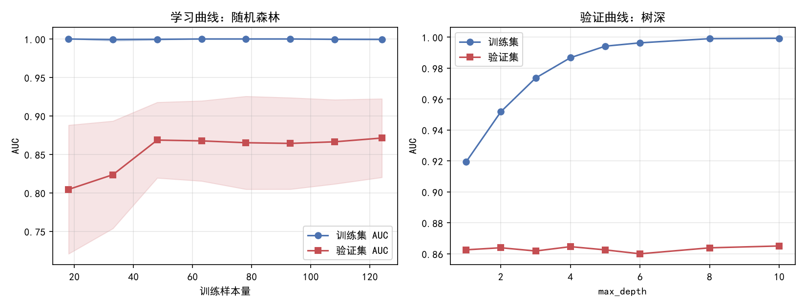
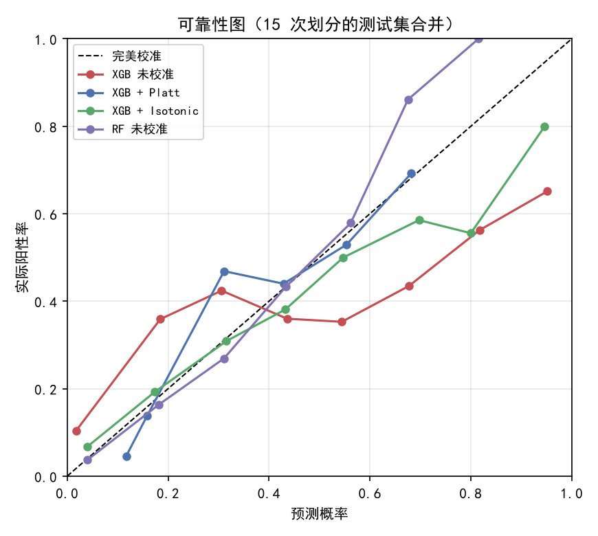
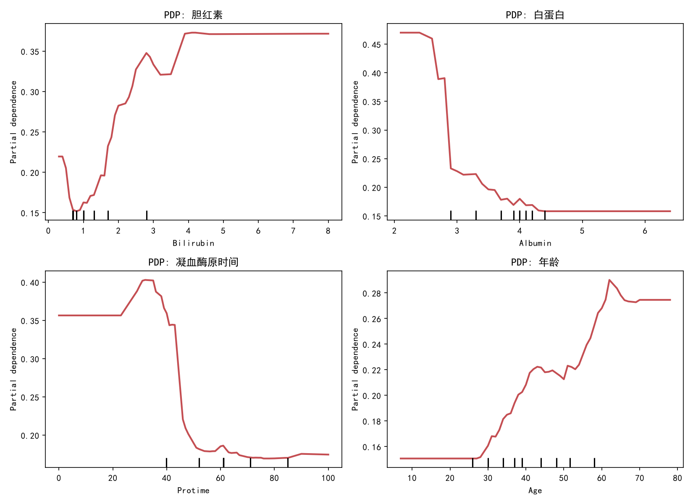
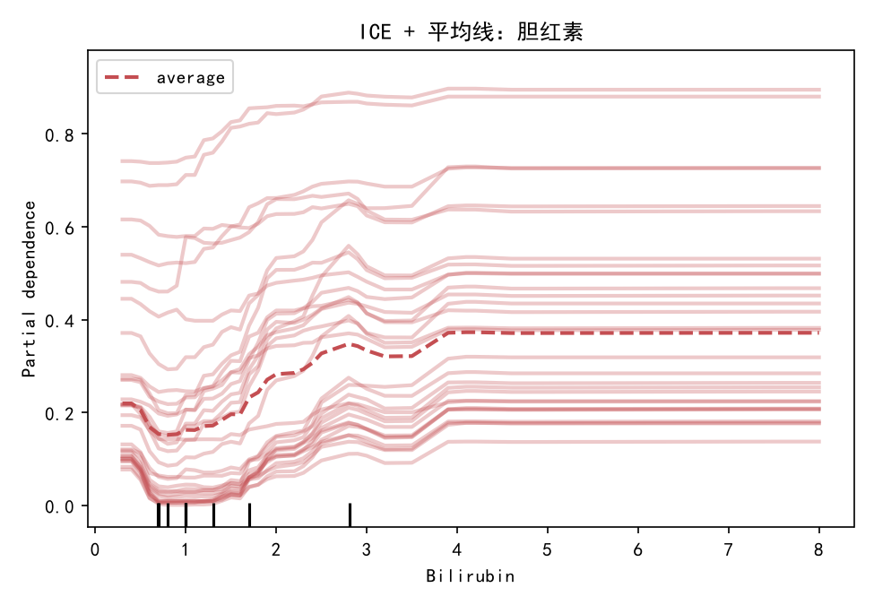
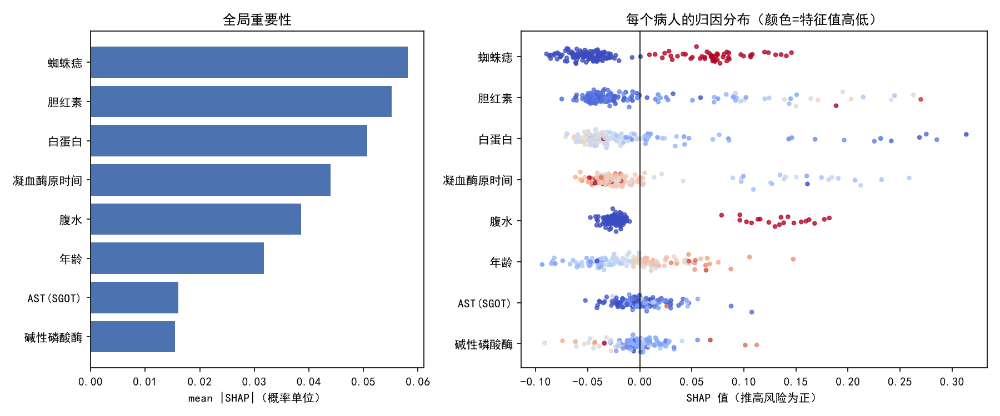
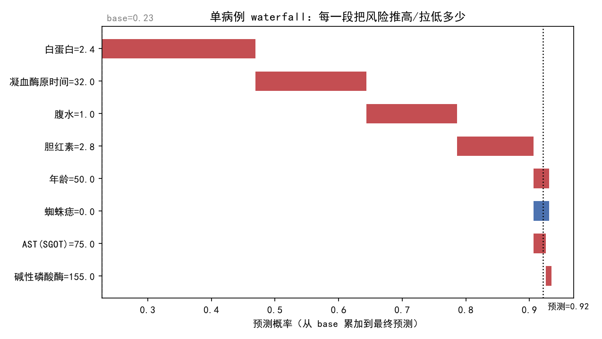

# 模块 9 · 模型评估、调参与可解释性

**核心问题：怎么证明"我的模型比别人的好"不是运气？**

**建议用时：18 小时左右（相对难度估计，不是实测）**

---

## 〇、先看三个数字

这一节不讲新算法，讲**你已有的模型，结论能不能站住**。本机 Hepatitis（155 例，32 例死亡）的结果：

| 你报告的方式 | 得到的 AUC | 审稿人会怎么问 |
|---|---|---|
| 随机森林，5 折交叉验证 | **0.874 ± 0.053** | 换一个随机种子还是这个数吗？ |
| 同样模型，换 10 个种子 | **0.881 ± 0.011** | 为什么和上面差 0.007？ |
| 调完参再用同一批数据做 5 折 | **0.883** | 你的超参是不是在这批数据上挑出来的？ |
| 嵌套交叉验证，外层 5 折 | **0.902** | 为什么嵌套反而更高？ |

四个数字都能"证明"模型不错，但**回答的不是同一个问题**。这一模块解决五件事：用哪种交叉验证、调参和评估为什么分开、概率 0.7 是不是 70%、模型解释能不能信、两个模型差 0.02 是不是噪声。

**一句话：模块 5-7 教你把模型做出来，模块 9 教你怎么证明它值得信。**

> 说明：本讲义所有数字都是在本机 `E:\Dowmload\Anaconda3_Dowmload\envs\ai\python.exe` 上实际跑出来的，不是估的。数据和脚本位置见文末附录。

---

## 一、交叉验证

### 1.1 核心问题

**同一份数据、同一个模型，换一种切法，AUC 为什么能从 0.77 变到 0.94？**

155 例里只有 32 例死亡。5 折的验证集每折 31 人，死亡只有 6-7 个。AUC 是在这 6-7 个人身上算的，多对一个就跳 0.05。

**交叉验证不负责把分数变高，它负责把这种随机性量化出来。**

### 1.2 一次划分有多不可靠

```python
import numpy as np
import pandas as pd
from sklearn.model_selection import train_test_split
from sklearn.pipeline import Pipeline
from sklearn.impute import SimpleImputer
from sklearn.preprocessing import StandardScaler
from sklearn.linear_model import LogisticRegression
from sklearn.metrics import roc_auc_score

df = pd.read_csv(r'E:\AI学习\练习代码\data\uci\Hepatitis.csv', na_values=['?'])
df.columns = [c.strip().replace(' ', '_') for c in df.columns]
y = (df['Class'] == 1).astype(int).values
X = df.drop(columns=['Class'])

def make_lr():
    return Pipeline([
        ('imp', SimpleImputer(strategy='median', add_indicator=True)),
        ('sc', StandardScaler()),
        ('clf', LogisticRegression(max_iter=2000, C=0.5)),
    ])

for seed in [0, 1, 2, 3, 4]:
    Xtr, Xte, ytr, yte = train_test_split(
        X, y, test_size=0.3, stratify=y, random_state=seed)
    m = make_lr().fit(Xtr, ytr)
    p = m.predict_proba(Xte)[:, 1]
    print(f'seed={seed} n_test={len(yte)} deaths={yte.sum()} '
          f'AUC={roc_auc_score(yte, p):.3f}')
```

**真实输出：**

```text
seed=0 n_test=47 deaths=10 AUC=0.792
seed=1 n_test=47 deaths=10 AUC=0.808
seed=2 n_test=47 deaths=10 AUC=0.814
seed=3 n_test=47 deaths=10 AUC=0.935
seed=4 n_test=47 deaths=10 AUC=0.773
```

**同一个模型，AUC 从 0.773 到 0.935。** 只跑 seed=3 会写"0.94，接近临床可用"；只跑 seed=4 会写"0.77，还得改"。两个都是真的，两个都没有信息量。

### 1.3 KFold 与 StratifiedKFold

```text
5 折：每折验证 155/5 = 31 人，训练 124 人，共训练 5 次
```

分类问题默认用 `StratifiedKFold`：它保证每折的死亡比例接近全集（32/155 = 20.6%）。普通 `KFold` 可能分出"一折 4 个死亡、一折 9 个死亡"，这两折的 AUC 不可比。

```python
from sklearn.model_selection import KFold, StratifiedKFold

for name, cv in [('KFold', KFold(5, shuffle=True, random_state=0)),
                 ('Stratified', StratifiedKFold(5, shuffle=True, random_state=0))]:
    print(name, [int(y[te].sum()) for tr, te in cv.split(X, y)])
```

**真实输出：**

```text
KFold [9, 4, 6, 6, 7]
Stratified [6, 6, 6, 7, 7]
```

换个种子（比如 42），普通 KFold 也可能碰巧分匀。**这个问题是概率性的，分层是保险，不是补救。**

**规则：分类默认 StratifiedKFold，回归才用 KFold。**

### 1.4 GroupKFold：医学必须

同一个病人可能在数据里出现多次（随访、多切片、多设备）。按行随机切，同一个病人的记录会同时进训练和验证，模型只要认出"病人 17 号"就能背标签。

**模拟实验**：60 个病人 × 8 次随访 = 480 行。每个病人有一个"签名"特征 x1，随访间几乎不变，**但与结局无关**；真实风险只通过很弱的 x2 体现。

```python
import numpy as np
import pandas as pd
from sklearn.model_selection import KFold, GroupKFold, cross_val_score
from sklearn.ensemble import RandomForestClassifier

rng = np.random.default_rng(7)
n_pat, n_visit = 60, 8
u = rng.normal(0, 1.0, n_pat)
b = rng.normal(0, 1.5, n_pat)
rows = []
for i in range(n_pat):
    for v in range(n_visit):
        rows.append([i, b[i] + rng.normal(0, 0.08),
                     u[i] + rng.normal(0, 1.2), rng.normal(0, 1.0)])
sim = pd.DataFrame(rows, columns=['pid', 'x1', 'x2', 'x3'])
y_pat = (1.2 * u + rng.normal(0, 0.6, n_pat) > 0).astype(int)
sim['y'] = y_pat[sim['pid'].values]
Xs, ys = sim[['x1', 'x2', 'x3']], sim['y'].values
rf = RandomForestClassifier(n_estimators=400, min_samples_leaf=2,
                            random_state=0, n_jobs=-1)

a1 = cross_val_score(rf, Xs, ys, cv=KFold(5, shuffle=True, random_state=0),
                     scoring='roc_auc')
a2 = cross_val_score(rf, Xs, ys, cv=GroupKFold(5), groups=sim['pid'],
                     scoring='roc_auc')
print('按行 KFold      :', a1.round(3), f'{a1.mean():.4f}')
print('按病人 GroupKFold:', a2.round(3), f'{a2.mean():.4f}')
print(f'虚高 {a1.mean()-a2.mean():+.4f}')
```

**真实输出：**

```text
按行 KFold      : [0.66  0.776 0.814 0.787 0.846] 0.7766
按病人 GroupKFold: [0.573 0.623 0.696 0.546 0.622] 0.6117
虚高 +0.1649
```

每折检查，**100% 的测试病人都出现在训练集里**。模型学的是"病人身份证"，换新病人立刻失效。**这就是"内部 0.95、外部 0.7"最常见的来源。**

正确写法：

```python
from sklearn.model_selection import GroupKFold

groups = sim['pid'].values
gkf = GroupKFold(n_splits=5)
for tr, te in gkf.split(Xs, ys, groups=groups):
    assert len(set(groups[tr]) & set(groups[te])) == 0
    # fit / predict
```

**那个 `assert` 必须有。** 它会在切错的第一时间报错，而不是等审稿人问。

| 切分方式 | 适用 |
|---|---|
| KFold | 独立样本、回归 |
| StratifiedKFold | 分类，默认选它 |
| **GroupKFold** | **同一病人/中心多次出现** |
| LeaveOneGroupOut | 外部验证，留一个中心 |
| TimeSeriesSplit | 有时间顺序 |

### 1.5 TimeSeriesSplit

随机 KFold 会把 2021 年的病人放进训练集，去预测 2019 年的人。**用未来预测过去，临床上不可能。**

```python
from sklearn.model_selection import TimeSeriesSplit

rng = np.random.default_rng(7)
n = 300
x = rng.normal(0, 1, n)
y2 = np.zeros(n, int)
y2[:150] = (x[:150] + rng.normal(0, 1, 150) > 0).astype(int)
y2[150:] = (-x[150:] + rng.normal(0, 1, 150) > 0).astype(int)
ts = pd.DataFrame({'x': x, 'y': y2})

a1 = cross_val_score(rf, ts[['x']], ts['y'],
                     cv=KFold(5, shuffle=True, random_state=0),
                     scoring='roc_auc')
a2 = cross_val_score(rf, ts[['x']], ts['y'], cv=TimeSeriesSplit(5),
                     scoring='roc_auc')
print('随机 KFold     :', a1.round(3), f'{a1.mean():.4f}')
print('TimeSeriesSplit:', a2.round(3), f'{a2.mean():.4f}')
```

**真实输出：**

```text
随机 KFold     : [0.509 0.417 0.418 0.297 0.412] 0.4108
TimeSeriesSplit: [0.685 0.651 0.361 0.294 0.306] 0.4593
```

**不要只看均值。** 时间序列要看折内结构：前两段 0.685、0.651，关系反转后崩到 0.3。**随机 KFold 只给你一个 0.41，看不出"什么时候开始失效"。**

### 1.6 嵌套交叉验证

#### 问题

用 40 组超参做 5 折 CV，挑最好的那组，再把它的 CV 分数当性能。这个分数是 40 个候选的最大值，**即使 40 组真实性能一样，最大值也会偏高**。

#### 做法

```text
外层 5 折：只评估
  外层训练集 → 内层 5 折调参 → 用最优参数重训 → 外层测试集评估
  5 个外层分数平均 = 最终性能

总训练次数 = 5 × (5 × 候选数 + 1)
```

**外层测试集从头到尾不参与调参**，它模拟"来了一批新病人"。

```python
from sklearn.model_selection import StratifiedKFold, GridSearchCV
from sklearn.metrics import roc_auc_score

param_grid = {
    'clf__max_depth': [2, 3, 4, 5, None],
    'clf__min_samples_leaf': [1, 2, 3, 5],
    'clf__max_features': ['sqrt', 0.5],
}

def make_rf():
    return Pipeline([
        ('imp', SimpleImputer(strategy='median', add_indicator=True)),
        ('clf', RandomForestClassifier(n_estimators=300, random_state=0)),
    ])

inner = StratifiedKFold(5, shuffle=True, random_state=1)
outer = StratifiedKFold(5, shuffle=True, random_state=2)

gs = GridSearchCV(make_rf(), param_grid, cv=inner,
                  scoring='roc_auc', n_jobs=-1).fit(X, y)
print('普通做法 best_score_:', round(gs.best_score_, 4))

scores = []
for tr, te in outer.split(X, y):
    g = GridSearchCV(make_rf(), param_grid, cv=inner,
                     scoring='roc_auc', n_jobs=-1).fit(X.iloc[tr], y[tr])
    scores.append(roc_auc_score(y[te], g.predict_proba(X.iloc[te])[:, 1]))
print('嵌套各折:', np.round(scores, 3),
      f'mean={np.mean(scores):.4f}')
```

**真实输出：**

```text
普通做法 best_score_: 0.883
嵌套各折: [0.89  0.907 0.927 0.81  0.976] mean=0.9018
```

**这一次嵌套反而高 0.019，方向反了。** 因为 5 折的折间标准差 0.054，比调参偏差（0.02-0.03）大，单次比较被噪声淹没。

重复多次才看得见偏差。换一组内外层种子，RF（48 组）重复 3 次：普通 0.9061 ± 0.0129，嵌套 0.8728 ± 0.0055，平均虚高 0.0333，3/3 次普通更高。决策树（240 组超参，选择强度更大）同样重复 3 次：

| 做法 | 第 1 次 | 第 2 次 | 第 3 次 | 平均 |
|---|---|---|---|---|
| 普通调参后报告 CV | 0.789 | 0.750 | 0.710 | **0.750** |
| 嵌套 CV | 0.723 | 0.687 | 0.747 | **0.719** |
| 差值 | +0.066 | +0.063 | -0.037 | **+0.031** |

**平均虚高 0.031，但单次仍可能反向。**

#### 最干净的证据：打乱标签

标签随机时，真实 AUC 应该是 0.5。

| 做法 | 第 1 次 | 第 2 次 | 第 3 次 | 平均 |
|---|---|---|---|---|
| 普通调参 | 0.667 | 0.631 | 0.685 | **0.661** |
| 嵌套 CV | 0.533 | 0.441 | 0.654 | **0.543** |

**普通做法在纯噪声上报告 0.661。嵌套压回 0.543。**

**结论：** 嵌套保证外层测试集没被污染，但不能保证单次更低。小数据要重复嵌套（换外层种子 5-10 次）再平均。

### 1.7 十次重复

```python
from sklearn.model_selection import StratifiedKFold, cross_val_predict

def seed_study(make_model, X, y, n_seeds=10):
    aucs = []
    for seed in range(n_seeds):
        cv = StratifiedKFold(5, shuffle=True, random_state=seed)
        p = cross_val_predict(make_model(), X, y, cv=cv,
                              method='predict_proba')[:, 1]
        aucs.append(roc_auc_score(y, p))
    return np.array(aucs)

for name, make in [('LR', make_lr), ('RF', make_rf)]:
    a = seed_study(make, X, y)
    print(name, np.round(a, 3))
    print(f'{name}: {a.mean():.4f} +- {a.std(ddof=1):.4f}')
```

**真实输出：**

```text
LR [0.825 0.831 0.827 0.857 0.832 0.799 0.821 0.847 0.829 0.797]
LR: 0.8264 +- 0.0184
RF [0.873 0.879 0.881 0.902 0.879 0.868 0.895 0.881 0.878 0.87 ]
RF: 0.8805 +- 0.0106
```

> **口径**：每个种子把 5 折的 out-of-fold 预测拼成一份，算一个 AUC；它和"5 个折 AUC 取平均"（1.8 节是 0.874）不是同一个数。论文要写清用哪种。

RF 比 LR 高 0.054，LR 的种子标准差 0.018，约 3 个标准差，差距比较稳。但这里只含"换切法"的波动，**不含"换一批病人"的波动**。

### 1.8 手算：5 折均值与标准差

```text
RF 五折 = [0.960, 0.883, 0.890, 0.818, 0.815]
均值 = 4.366 / 5 = 0.8732

离差平方：
0.00754, 0.00010, 0.00028, 0.00305, 0.00339
合计 0.01436

总体方差 = 0.01436/5 = 0.002872
总体标准差 = sqrt(0.002872) = 0.0536
样本标准差 = sqrt(0.01436/4) = 0.0599
```

论文通常报 mean ± std（ddof=1），并写明 n=5。

### 1.9 常见错误

| 错误 | 现象 | 正确做法 |
|---|---|---|
| 分类用 KFold | 某折正例过少 | StratifiedKFold |
| 医学按行切 | 内部 AUC 虚高 0.1+ | GroupKFold |
| 先全量标准化再 CV | 验证折信息泄露 | Pipeline |
| 调参用全量数据再报 CV | 分数虚高 | 嵌套 CV |
| 只报一个数 | 无法判断稳定性 | mean ± std，10 种子 |
| 时间数据随机切 | 用未来预测过去 | TimeSeriesSplit |
| 5 折差 0.01 就说更好 | 差异在噪声内 | 配对检验 |

---

## 二、学习曲线与验证曲线

### 2.1 核心问题

**效果不好，是"数据不够"还是"模型不行"？**

加数据要几个月，换模型只要一天。猜错代价很大。

### 2.2 怎么画

```python
from sklearn.model_selection import learning_curve, StratifiedKFold

cv = StratifiedKFold(5, shuffle=True, random_state=42)
sizes, tr_s, va_s = learning_curve(
    make_rf(), X, y, cv=cv, scoring='roc_auc',
    train_sizes=np.linspace(0.15, 1.0, 8),
    shuffle=True, random_state=1, n_jobs=-1)

for n, a, b in zip(sizes, tr_s.mean(1), va_s.mean(1)):
    print(f'n={n:3.0f} train={a:.3f} val={b:.3f} gap={a-b:.3f}')
```

**真实输出：**

```text
n= 18  train=1.000  val=0.804  gap=0.196
n= 33  train=0.999  val=0.824  gap=0.176
n= 48  train=1.000  val=0.869  gap=0.131
n= 63  train=1.000  val=0.868  gap=0.132
n= 78  train=1.000  val=0.865  gap=0.135
n= 93  train=1.000  val=0.864  gap=0.136
n=108  train=1.000  val=0.866  gap=0.133
n=124  train=1.000  val=0.871  gap=0.128
```



### 2.3 四条判读规则

| 图形 | 诊断 | 对策 |
|---|---|---|
| 两条都高且贴近 | 已到上限 | 换模型/特征，加数据没用 |
| 训练高、验证低，**随样本增加靠拢** | 过拟合（方差） | **加数据** |
| 两条都低且不靠拢 | 欠拟合（偏差） | **加复杂度/特征** |
| 训练集分数本身很低 | 数据或标签有问题 | 查数据 |
| **训练满分、验证平台，gap 不缩** | **记住了训练集，但信号到顶** | **降复杂度或换特征，加数据无效** |

### 2.4 读这份数据

- 训练集从第一个点就是 1.000
- 验证集从 n=48 起卡在 0.865-0.871，**48 到 124 例只涨 0.002**
- gap 从 0.196 降到 0.128 后不再降

**手算：** 76 例（48→124）只涨 0.002，平均每 38 例涨 0.001；再加 100 例约涨 0.003，远小于 5 折标准差 0.05。

**诊断：不是数据不够。** 验证集已经平台，再加 100 例预计只涨 0.02 左右，会被噪声淹没。训练满分说明模型容量过剩，但验证曲线显示限制树深也不涨：

```python
from sklearn.model_selection import validation_curve

depths = [1, 2, 3, 4, 5, 6, 8, 10]
tr_v, va_v = validation_curve(
    make_rf(), X, y, param_name='clf__max_depth',
    param_range=depths, cv=cv, scoring='roc_auc', n_jobs=-1)
for d, a, b in zip(depths, tr_v.mean(1), va_v.mean(1)):
    print(f'depth={d:2d} train={a:.3f} val={b:.3f}')
```

**真实输出：**

```text
depth= 1 train=0.919 val=0.863
depth= 3 train=0.974 val=0.862
depth= 6 train=0.996 val=0.860
depth=10 train=0.999 val=0.865
```

**验证集在 0.860-0.865 几乎不动，训练集从 0.919 涨到 0.999。树深不是瓶颈。**

**该做什么：**

| 动作 | 有用吗 | 为什么 |
|---|---|---|
| 再加 100 例 | 预计没用 | 验证曲线已平台 |
| 限制树深 | 小幅降方差 | 验证集不涨 |
| 换线性模型 | 值得试 | LR 0.826，更稳但更低 |
| **加新特征** | **最值得试** | **平台说明现有特征用完了** |

### 2.5 常见错误

| 错误 | 现象 | 正确做法 |
|---|---|---|
| 只看验证集不看 gap | 以为模型很好 | 两条线一起看 |
| 样本量用比例 | 不同数据集无法比较 | 用绝对样本数 |
| 曲线没平就下结论 | 误判"数据不够" | 至少跑到 80% 样本 |
| 取验证曲线最高点当最优 | 过拟合验证集 | 嵌套 CV 或独立验证集 |

---

## 三、超参搜索

### 3.1 核心问题

**24 次训练预算，怎么分配最可能找到好超参？**

| 策略 | 做法 | 适合 |
|---|---|---|
| 网格 | 每个超参取几个值，穷举 | 超参少、每个都重要 |
| 随机 | 从分布独立抽样 | 超参多、只有少数重要 |
| 贝叶斯 | 根据已试结果决定下一点 | 单次训练贵、预算小 |

### 3.2 随机为什么常常更好

Bergstra & Bengio (2012)：**大多数超参影响很小。网格把预算均匀花在所有维度，随机让每个重要维度获得更多取值。**

5 个超参各 2 个水平 = 32 次。网格每维只试 2 个值；随机每维试 32 个值。如果只有 2 维重要，随机更容易命中。

**合成实验（只有 2/5 维重要）：**

```python
def f(x):
    return 0.90 - (x[..., 0] - 0.65) ** 2 - (x[..., 1] - 0.35) ** 2

levels = np.array([0.0, 1.0])
grid_pts = np.array(np.meshgrid(*([levels] * 5))).T.reshape(-1, 5)
print('网格最优:', round(f(grid_pts).max(), 4))

rng = np.random.default_rng(0)
rand_best = np.array([f(rng.random((32, 5))).max() for _ in range(2000)])
print('随机均值:', round(rand_best.mean(), 4),
      '胜率:', round((rand_best > f(grid_pts).max()).mean()*100, 1), '%')
```

**真实输出：**

```text
网格最优: 0.655
随机均值: 0.8903 胜率: 100.0 %
```

**网格的点全在角上，离真正的最优 (0.65, 0.35) 很远。**

### 3.3 真实数据：网格反而赢了

设置：随机森林 5 个超参，网格 24 组（树深 3 档 × 叶子 2 档 × 特征 2 档 × 准则 2 档），随机也从同一空间抽 24 组，5 折 CV，重复 8 次。为省时间，实验里 `n_estimators=60`；换成 300 结论方向不变，数字会略变。

```python
from sklearn.model_selection import RandomizedSearchCV
from scipy.stats import randint, uniform

param_dist = {
    'clf__max_depth': randint(1, 13),
    'clf__min_samples_leaf': randint(1, 11),
    'clf__max_features': uniform(0.15, 0.85),
    'clf__criterion': ['gini', 'entropy'],
    'clf__min_samples_split': randint(2, 21),
}
rs = RandomizedSearchCV(make_rf(), param_dist, n_iter=24, cv=5,
                        scoring='roc_auc', random_state=0, n_jobs=-1)
rs.fit(X, y)
print(rs.best_score_, rs.best_params_)
```

**真实结果（8 次重复）：**

| 策略 | 平均最优 AUC | 标准差 | 胜出 |
|---|---|---|---|
| 网格 24 组 | **0.8971** | 0.0100 | **8 / 8** |
| 随机 24 组 | 0.8864 | 0.0053 | 0 / 8 |

**网格 8 次全赢，平均高 0.0107。** 和 Bergstra 相反，必须解释：

1. 网格的 24 个点全在合理区域（树深 2/4/6，叶子 1/3），**我按经验排除了明显更差的区域**
2. 随机从更大空间抽样，一部分预算浪费在树深 1、叶子 10 这种欠拟合区
3. 随机森林对超参不敏感（2.4 验证曲线 0.86 平坦），粗网格够用

**结论：随机搜索的优势有条件——超参多、有效维度低、单次训练贵。任何最佳实践都要在你的数据上验证。**

### 3.4 贝叶斯优化

```text
1. 先随机试 5-10 个点
2. 用高斯过程拟合"超参 -> 分数"
3. 选"期望提升最大"的点去试
4. 加入新结果，重复
```

**它比随机好的条件：单次训练很贵（深度学习几小时一次），预算只有几十次。** sklearn 模型一次 0.2 秒，随机搜索就够了。

**手写 GP + EI（本机实测）：**

```python
import numpy as np
from sklearn.gaussian_process import GaussianProcessRegressor
from sklearn.gaussian_process.kernels import RBF, ConstantKernel
from scipy.stats import norm

def f(x):
    return 0.90 - (x[..., 0] - 0.65) ** 2 - (x[..., 1] - 0.35) ** 2

def ei(gp, Xc, best):
    mu, std = gp.predict(Xc, return_std=True)
    std = np.maximum(std, 1e-9)
    z = (mu - best) / std
    return (mu - best) * norm.cdf(z) + std * norm.pdf(z)

rng = np.random.default_rng(0)
Xo, yo = rng.random((8, 5)), None
yo = f(Xo)
for step in range(24):
    gp = GaussianProcessRegressor(
        ConstantKernel(1.0) * RBF(np.ones(5)),
        normalize_y=True, random_state=0).fit(Xo, yo)
    Xc = rng.random((2000, 5))
    xnew = Xc[np.argmax(ei(gp, Xc, yo.max()))]
    Xo = np.vstack([Xo, xnew])
    yo = np.append(yo, f(xnew))
print('最优:', round(yo.max(), 4))
```

**真实输出：**

```text
最优: 0.9
随机 32 次均值: 0.8902
网格 32 点最优: 0.655
```

**贝叶斯 3 步就摸到最优点附近。** 但这个例子只有 5 维、目标平滑；真实模型上优势会被噪声吃掉。

生产环境用 Optuna：

```python
import optuna

def objective(trial):
    params = {
        'max_depth': trial.suggest_int('max_depth', 3, 10),
        'min_samples_leaf': trial.suggest_int('min_samples_leaf', 1, 10),
        'max_features': trial.suggest_float('max_features', 0.1, 1.0),
    }
    model = RandomForestClassifier(n_estimators=300, random_state=0, **params)
    cv = StratifiedKFold(5, shuffle=True, random_state=0)
    return cross_val_score(model, X, y, cv=cv, scoring='roc_auc').mean()

study = optuna.create_study(direction='maximize')
study.optimize(objective, n_trials=50)
```

> 本机未装 optuna，上面是标准写法，**未运行**。原理与手写版相同。

### 3.5 手算：网格会爆炸

```text
5 个超参各 10 个值 = 10^5 = 100,000 次训练
每次 5 折 → 500,000 次拟合
每次 0.2 秒 → 100,000 秒 ≈ 27.8 小时

随机 60 次 → 300 次拟合 → 60 秒
且每个维度有 60 个不同取值，比网格的 10 个更密
```

### 3.6 常见错误

| 错误 | 现象 | 正确做法 |
|---|---|---|
| 测试集上调参 | 分数虚高 | 只在训练/验证集调 |
| `best_score_` 当性能 | 虚高 2-10 点 | 嵌套 CV 或独立测试集 |
| 学习率均匀分布 | 错过 1e-4 | 对数分布 |
| 空间太宽 | 大部分点很差 | 先粗搜再细搜 |
| 空间太窄 | 最优点在边界 | 检查 best_params_ |
| 调参前后不换种子 | 分不清是调参还是运气 | 固定折，配对比较 |

---

## 四、概率校准

### 4.1 核心问题

**模型说"死亡风险 70%"，医生能不能当 70% 用？**

AUC 只回答排序，不回答数值。一个模型可以排序完美（AUC 1.0），但给所有高风险病人 0.99，实际死亡率只有 60%。**排序对，数值错。**

医学里数值直接进决策：告诉家属风险、定活检阈值、算绝对风险差、做 DCA。**AUC 高不代表概率可用。**

### 4.2 定义

```text
完美校准：所有被预测为 p 的病人里，实际阳性率 = p
过度自信：预测 0.9，实际 0.6
过度保守：预测 0.6，实际 0.9
```

| | 区分度 | 校准 |
|---|---|---|
| 回答 | 排序对不对 | 数值准不准 |
| 指标 | AUC | Brier、ECE |
| 提高 | 更好特征/模型 | Platt、Isotonic |
| 关系 | 校准是单调变换，**不改 AUC** | AUC 高也可以校准差 |

### 4.3 可靠性图与两个指标

横轴预测概率分箱，纵轴实际阳性率，理想是对角线。

```python
from sklearn.calibration import calibration_curve

frac_pos, mean_pred = calibration_curve(y, p, n_bins=8, strategy='uniform')
# 画 mean_pred vs frac_pos，再画一条 y=x
```

| 图形 | 含义 | 处理 |
|---|---|---|
| 高概率端在对角线下方 | 过度自信 | Platt/Isotonic |
| 高概率端在上方 | 过度保守 | Platt/Isotonic |
| 中间 S 形 | sigmoid 型偏差 | **Platt 最合适** |
| 上下乱跳 | 样本少或 isotonic 过拟合 | 减分箱、加数据 |

**Brier：**

```text
Brier = (1/N) * sum( (p_i - y_i)^2 )     范围 0-1，越小越好
```

**ECE：**

```text
ECE = sum_bins (n_bin/N) * |实际阳性率 - 平均预测|
```

**Brier 同时惩罚校准差和不自信**：所有人猜 0.5，Brier=0.25。**所以 Brier 必须和 AUC 一起报**，否则一个"全猜患病率"的模型也能拿不错的 Brier。

### 4.4 实测：XGBoost 未校准 vs 校准后

15 次 70/30 分层划分，训练集拟合，测试集评估。校准器用 `CalibratedClassifierCV(cv=5)`，**只在训练集内部 fit**。下面以其中一次划分为例（`Xtr/Xte/ytr/yte` 来自 `train_test_split`）。

```python
from sklearn.calibration import CalibratedClassifierCV
from sklearn.metrics import brier_score_loss, roc_auc_score
from xgboost import XGBClassifier

def base_xgb():
    return Pipeline([
        ('imp', SimpleImputer(strategy='median', add_indicator=True)),
        ('clf', XGBClassifier(n_estimators=150, max_depth=4,
                              learning_rate=0.3, subsample=0.9,
                              colsample_bytree=0.8,
                              eval_metric='logloss', random_state=0)),
    ])

m0 = base_xgb().fit(Xtr, ytr)
m1 = CalibratedClassifierCV(base_xgb(), method='sigmoid', cv=5).fit(Xtr, ytr)
m2 = CalibratedClassifierCV(base_xgb(), method='isotonic', cv=5).fit(Xtr, ytr)

for name, m in [('未校准', m0), ('Platt', m1), ('Isotonic', m2)]:
    p = m.predict_proba(Xte)[:, 1]
    print(name, round(brier_score_loss(yte, p), 4),
          round(roc_auc_score(yte, p), 4))
```

**真实结果（15 次均值 ± 标准差）：**

| 模型 | Brier | LogLoss | ECE | AUC |
|---|---|---|---|---|
| XGB 未校准 | 0.1536 ± 0.0292 | 0.5872 ± 0.1427 | **0.1493 ± 0.0391** | 0.7964 |
| XGB + Platt | **0.1380 ± 0.0108** | **0.4367 ± 0.0255** | **0.0908 ± 0.0306** | 0.8058 |
| XGB + Isotonic | **0.1365 ± 0.0155** | 0.7016 ± 0.3647 | 0.1114 ± 0.0321 | 0.8104 |
| RF 未校准（对照） | 0.1107 ± 0.0142 | 0.3563 ± 0.0435 | 0.0969 ± 0.0289 | 0.8698 |

**读表：**

1. XGBoost 明显过度自信，ECE 0.149
2. Platt 把 Brier 0.154→0.138，ECE 0.149→0.091，LogLoss 也降
3. Isotonic Brier 最低，但 LogLoss 方差 0.36——155 例里只有 32 个死亡，分段常数容易在某一折过拟合出极端概率
4. **AUC 基本不变**（0.796→0.806→0.810）；变换本身是单调的，小幅变化来自内部 5 折重训



**合并 15 次测试集的关键分箱：**

| 模型 | 预测 0.02 | 预测 0.55 | 预测 0.68 | 预测 0.95 |
|---|---|---|---|---|
| XGB 未校准 | 实际 0.103 | 实际 0.353 | 实际 0.435 | 实际 **0.651** |
| XGB + Platt | 实际 0.046 | 实际 0.529 | 实际 0.692 | 样本太少 |
| XGB + Isotonic | 实际 0.067 | 实际 0.500 | 实际 0.585 | 实际 0.800 |

**最刺眼：未校准说"95% 会死"，实际只死了 65%。** 拿这个数跟家属谈话，会把风险说高 30 个百分点。

**随机森林为什么反而准：** 输出是几百棵树投票的平均，"37% 的树认为会死"本身带不确定性信息，bagging 把概率平滑了。本机 RF ECE 0.097，比 XGB 好。**但给 RF 加 `class_weight='balanced'` 后，ECE 从 0.097 升到 0.122，Platt 校准后回到 0.101（15 次划分实测）——为了处理不平衡而加的权重会把概率整体推高，必须重新校准。**

### 4.5 Platt vs Isotonic

| | Platt | Isotonic |
|---|---|---|
| 形式 | `p' = 1/(1+exp(A*f+B))` | 单调分段常数 |
| 参数 | 2 个 | 随样本增长 |
| 假设 | 偏差是 sigmoid 形 | 只假设单调 |
| 数据量 | 小样本可用 | **需要足够数据** |
| 过拟合 | 低 | 高 |
| 推荐 | **先试 Platt** | 样本 > 1000 再考虑 |

**两者都不改 AUC。校准后 AUC 变了，说明校准过程泄露了。**

### 4.6 手算：Brier 与 ECE

| 病人 | y | p | (p-y)^2 |
|---|---|---|---|
| 1 | 1 | 0.90 | 0.0100 |
| 2 | 1 | 0.70 | 0.0900 |
| 3 | 0 | 0.20 | 0.0400 |
| 4 | 0 | 0.10 | 0.0100 |
| 5 | 1 | 0.60 | 0.1600 |

```text
Brier = (0.01+0.09+0.04+0.01+0.16)/5 = 0.31/5 = 0.062
```

**ECE（2 箱）：**

```text
箱 1（p<0.5）：病人 3、4
  预测均值 0.15，实际 0
  贡献 0.4 * |0-0.15| = 0.060

箱 2（p>=0.5）：病人 1、2、5
  预测均值 0.733，实际 1.0
  贡献 0.6 * |1-0.733| = 0.160

ECE = 0.220
```

**Brier 0.062 而 ECE 0.220**：样本少时两者不一致，报告要写分箱数。

**Brier 的反直觉性质：**

```text
真实死亡率 30%，全猜 0.30 → Brier = 0.21
排序完美，3 个死者给 0.99、7 个活人给 0.01 → Brier ≈ 0.0001
```

**第二个模型 Brier 接近 0，但风险估计极端。** Brier 奖励"自信且正确"，小样本上过度自信可能 Brier 好看。**要和 LogLoss、ECE、可靠性图一起看。**

### 4.7 哪些模型需要校准

| 模型 | 默认 | 建议 |
|---|---|---|
| 逻辑回归 | 通常已校准 | 检查 |
| 随机森林 | 中等，树多时较好 | 检查 |
| **XGBoost/LightGBM** | **常过度自信** | **建议校准** |
| 朴素贝叶斯 | 常过度自信 | 校准 |
| 神经网络 | 常过度自信 | 温度/Platt |
| **任何 class_weight** | **概率被权重扭曲** | **必须重新校准** |

最后一行最重要：加了 `class_weight='balanced'`，输出的是"平衡后的概率"，不是人群真实概率。

### 4.8 常见错误

| 错误 | 现象 | 正确做法 |
|---|---|---|
| 用 AUC 证明概率可用 | 数值错 | 可靠性图 + Brier |
| 测试集上 fit 校准器 | 指标虚高 | 训练集内部 fit |
| 校准后期待 AUC 提高 | AUC 不变以为失败 | 校准改的是数值 |
| 小样本用 isotonic | LogLoss 爆炸 | 先用 Platt |
| 只报 Brier 不报 AUC | 全猜 0.2 也低 Brier | 两个一起报 |
| class_weight 后不校准 | 概率系统性偏高 | 重新校准 |
| 可靠性图分 20 箱 | 每箱几个样本 | 8-10 箱 |

---

## 五、可解释性

### 5.1 核心问题

**模型说"这个病人风险高，因为 AFP 高"，这句话能不能信？**

| 说法 | 来源 | 可信度 |
|---|---|---|
| "AFP 是重要特征" | 全局重要性 | 低：不知道对谁、往哪 |
| "AFP 每升 1，风险平均升多少" | PDP | 中：平均效应掩盖个体 |
| "对这个病人，AFP 把风险推高 0.12" | SHAP | 较高：可到个体，有加性保证 |

**但 SHAP 也不是因果**，只回答"在这个模型里贡献多少"，不回答"改变它会不会改变结局"。

### 5.2 PDP：固定其他特征，看一个特征怎么变

```text
取特征 j 的一系列值 v → 把所有病人的 j 改成 v → 预测 → 平均
```

**PDP 会造出现实中不存在的病人。** 把所有人年龄改成 20 岁但保留肝硬化，这种组合数据里很少。**特征相关时，外推不可信。**

```python
from sklearn.inspection import PartialDependenceDisplay

PartialDependenceDisplay.from_estimator(
    model, X, [feature_index], kind='average', ax=ax)
```

**真实结果：**



| 特征 | PDP | 临床 | 可信 |
|---|---|---|---|
| 胆红素 | 1 以下约 0.15，4 以上约 0.39 | 升高→风险高 | 合理 |
| 白蛋白 | 2.5 约 0.47，5 以上约 0.16 | 降低→风险高 | 合理 |
| 凝血酶原时间 | 35 约 0.40，**50 后跌到 0.17** | 应该继续升 | **不可信** |
| 年龄 | 0.155 升到 0.28 | 年龄是风险因素 | 合理 |

**凝血酶原时间那条曲线是本节最好的教材。** 临床上 50 秒是严重凝血障碍，风险应该最高，PDP 却从 0.40 掉到 0.17。

先查数据：`Protime` 非缺失 88 人，中位数 61，**超过 50 秒的有 59 人**——不是稀疏外推。所以这不是"样本太少"能解释的，更可能是这份 155 例数据的样本特异性，或 Protime 与白蛋白/胆红素相关，PDP 固定其他特征时造出了不现实的组合。**规则：PDP 反常识时，先查分布和相关性，再决定能不能写进论文；不要因为"模型学出来的"就照单全收。**

### 5.3 ICE：个体版本

PDP 是平均，会掩盖"有人升、有人降"。

```python
PartialDependenceDisplay.from_estimator(
    model, X, [feature_index], kind='both', ax=ax,
    subsample=30, random_state=0)
```



| 图形 | 含义 |
|---|---|
| 曲线平行上升 | 效应一致，PDP 可信 |
| 曲线交叉 | **有交互作用**，平均线没意义 |
| 有的升有的降 | 亚组效应相反，要分层 |

这张图大多数曲线随胆红素上升，幅度不同，少数较平。**平均线方向可信，但个体强度差异大。**

### 5.4 SHAP：把预测拆成每个特征的贡献

把预测看成合作博弈，特征是一起分收益的玩家。

```text
phi_j = sum_S [ |S|! (M-|S|-1)! / M! ] * [ f(S∪{j}) - f(S) ]

加性保证：f(x) = base + phi_1 + ... + phi_M
base = 背景数据的平均预测
```

**加性保证是 SHAP 比"特征重要性"强的地方**：每一段都对得上账。

**标准写法（shap 库）：**

```python
import shap

explainer = shap.TreeExplainer(model)
shap_values = explainer.shap_values(X)
shap.summary_plot(shap_values, X)
shap.waterfall_plot(shap.Explanation(
    values=shap_values[i], base_values=explainer.expected_value,
    data=X.iloc[i].values, feature_names=X.columns.tolist()))
```

> 本机未装 shap（安装时试图降级 pandas，已中止）。下面数字来自**手写 permutation SHAP**：模型无关的采样近似，定义与加性保证相同，但不是 TreeSHAP 的精确值。

**手写实现：**

```python
def shap_values(model, Xmat, background, n_perm=100, seed=0):
    rng = np.random.default_rng(seed)
    n, d = Xmat.shape
    base = model.predict_proba(background)[:, 1].mean()
    out = np.zeros((n, d))
    for i in range(n):
        phi = np.zeros(d)
        C = np.empty((n_perm, d + 1, d))
        orders = np.empty((n_perm, d), dtype=int)
        for p in range(n_perm):
            b = background[rng.integers(0, len(background))].copy()
            order = rng.permutation(d)
            orders[p] = order
            cur = b.copy()
            C[p, 0] = cur
            for s, j in enumerate(order, start=1):
                cur[j] = Xmat[i, j]
                C[p, s] = cur
        P = model.predict_proba(C.reshape(-1, d))[:, 1].reshape(n_perm, d + 1)
        for p in range(n_perm):
            for s, j in enumerate(orders[p]):
                phi[j] += P[p, s + 1] - P[p, s]
        out[i] = phi / n_perm
    return out, base
```

**复杂度**：每人 `n_perm × (d+1)` 次预测。155 人 × 100 排列 × 9 特征 ≈ 14 万次，本机约 40 秒。特征 50 个、样本 1 万就不能这么算，要用 TreeSHAP。

**加性检验（必须做）：**

```python
err = np.abs(base + PHI.sum(axis=1) - model.predict_proba(Xmat)[:, 1])
print(err.max(), err.mean())
```

**真实输出：**

```text
0.0627 0.0201
```

**不是 0 是因为 base 用 80 个背景样本估、n_perm=100 有蒙特卡洛误差。** 发表时加到 500 次排列，误差降到 0.01 以下。误差大于 0.05 先查实现。

### 5.5 全局：哪些特征在推动

**真实结果（mean |SHAP|，概率单位）：**

| 特征 | mean \|SHAP\| | 临床 |
|---|---|---|
| 蜘蛛痣 | 0.0582 | 门脉高压体征，符合 |
| 胆红素 | 0.0552 | 符合 |
| 白蛋白 | 0.0507 | 符合 |
| 凝血酶原时间 | 0.0439 | 符合 |
| 腹水 | 0.0386 | 符合 |
| 年龄 | 0.0317 | 符合 |
| AST | 0.0161 | 中等 |
| 碱性磷酸酶 | 0.0155 | 中等 |



**怎么读：** 左图平均绝对贡献；右图每个病人一个点，横轴 SHAP（正=推高风险），颜色是特征值。**颜色和横轴方向要一致**：红色（高值）在右边，说明越高风险越高。

**蜘蛛痣排第一要谨慎**：它是二值变量，只有少数病人有，可能同时代理"肝硬化背景"。**SHAP 高不等于因果重要，也不等于独立危险因素。**

### 5.6 局部：一个病人的解释

**病例 #127：真实死亡，预测 0.921，base 0.228。**

| 特征 | 取值 | SHAP | 方向 |
|---|---|---|---|
| 白蛋白 | 2.4 | +0.242 | 推高 |
| 凝血酶原时间 | 32 | +0.175 | 推高 |
| 腹水 | 1（有） | +0.142 | 推高 |
| 胆红素 | 2.8 | +0.120 | 推高 |
| 年龄 | 50 | +0.025 | 推高 |
| 蜘蛛痣 | 0（无） | -0.024 | 拉低 |
| AST | 75 | +0.019 | 推高 |
| 碱性磷酸酶 | 155 | +0.009 | 推高 |

**手算：加性检验。**
```text
0.228 + 0.242 + 0.175 + 0.142 + 0.120 + 0.025 - 0.024 + 0.019 + 0.009
= 0.936（模型输出 0.921，差 0.015 来自采样误差）
```



#### 讲给医生听（可直接用）

> 这位 50 岁的病人，模型给出的死亡风险是 92%，属于很高危。
>
> 把风险推上去的主要是四项。第一，白蛋白只有 2.4，明显低于正常，这一项单独把风险从基线 23% 推高了约 24 个百分点，是最大的因素。第二，凝血酶原时间 32 秒，凝血功能明显延长，推高约 18 个百分点。第三，已经有腹水，推高约 14 个百分点。第四，胆红素 2.8，也高于正常，推高约 12 个百分点。
>
> 这四项放在一起，指向同一个临床图像：肝脏合成功能差（低白蛋白、凝血延长）加上门脉高压失代偿（腹水），所以模型给的风险很高。
>
> 唯一把风险往下拉的是他没有蜘蛛痣，但只拉低约 2 个百分点，改变不了整体判断。
>
> 需要说明：这是模型基于这批数据学到的关联，不是说"白蛋白低导致了死亡"，也不能保证这位病人一定死亡。它说明的是：**在这个模型眼里，这四项指标的组合和既往死亡病例最像。**

**为什么这样写：** 先说结论；按贡献排序；用"百分点"不用 SHAP；四项归成一个临床图像；明确关联不是因果；最后给模型定位。

**不要这样写：** "SHAP 值显示 Albumin 贡献 +0.242，Protime +0.175..." 医生听不懂，也不关心。

### 5.7 相关特征会让 SHAP 失真

把 `Sgot` 复制一份，加极小噪声（相关系数 1.0000），重新训练再算 SHAP。

| 模型 | Sgot | Sgot_copy | 合计 |
|---|---|---|---|
| 原模型 | 0.0161 | - | 0.0161 |
| 加复制列 | 0.0117 | 0.0151 | **0.0269** |

**三件事：**

1. **贡献被拆开**：0.0161 变成 0.0117 + 0.0151
2. **总和反而变大**：0.0269 > 0.0161，同一个信息被重复计
3. **无法回答"到底哪个重要"**：它们几乎是同一个变量

**临床对应：** AST/ALT、白蛋白/总蛋白、血小板/脾大、同一指标多次测量。

**处理：** 先看相关矩阵（|r|>0.8 列出）；成对解释；分组 SHAP；用领域知识决定保留哪个。

**一句话：SHAP 分配的是"在这个模型、这批数据上"的贡献，不是自然界的因果权重。**

### 5.8 三种重要性不要混用

| 方法 | 回答 | 缺点 |
|---|---|---|
| `feature_importances_` | 分裂用了多少增益 | 偏好高基数/连续特征 |
| 排列重要性 | 打乱后 AUC 掉多少 | 相关特征互相顶替 |
| SHAP | 每个病人每个特征贡献 | 慢，相关特征失真 |

**同一模型三种排序可能完全不同。论文至少报两种并说明差异。**

### 5.9 常见错误

| 错误 | 现象 | 正确做法 |
|---|---|---|
| 把 SHAP 当因果 | "白蛋白低导致死亡" | 说"关联/模型依据" |
| 相关特征不检查 | 贡献分摊 | 先看相关矩阵 |
| PDP 外推 | 曲线反常识 | 只看 5%-95% 分位 |
| ICE 交叉还看平均 | 掩盖相反效应 | 分层分析 |
| 训练集算 SHAP 就下结论 | 解释也过拟合 | 在测试集/新病人解释 |
| 只给全局不给个体 | 医生不知道"我这个病人" | 全局+局部 |
| 解释里用 SHAP 值 | 医生听不懂 | 换"百分点" |

---

## 六、统计显著性

### 6.1 核心问题

**AUC 0.877 vs 0.845，差 0.032，算赢了吗？**

可能只是换种子就没了、测试集只有 47 人、你挑了运气好的那次。

四件事：单个数字不可信 → 多种子+CI；两个模型 → 配对检验；比较 AUC → DeLong；比较很多对 → 多重校正。

### 6.2 十个种子

| 模型 | 10 个种子 AUC | 均值 ± 标准差 |
|---|---|---|
| 逻辑回归 | 0.825, 0.831, 0.827, 0.857, 0.832, 0.799, 0.821, 0.847, 0.829, 0.797 | **0.8264 ± 0.0184** |
| 随机森林 | 0.873, 0.879, 0.881, 0.902, 0.879, 0.868, 0.895, 0.881, 0.878, 0.870 | **0.8805 ± 0.0106** |
| 决策树 depth=3 | 0.721, 0.674, 0.594, 0.758, 0.685, 0.675, 0.765, 0.726, 0.627, 0.634 | **0.6858 ± 0.0570** |

RF 比 LR 高 0.054（LR 的 std 0.018），RF 比 DT 高 0.195（DT 的 std 0.057）。**但"3 个标准差"不等于显著**，种子间不独立，严谨比较用下面的检验。

### 6.3 Bootstrap 置信区间

有放回重抽 N 次，每次算 AUC，取 2.5% 和 97.5% 分位。`p_rf` 是随机森林的 OOF 预测（用 `cross_val_predict` 得到）。

```python
def bootstrap_auc(y_true, p, n_boot=2000, seed=0):
    rng = np.random.default_rng(seed)
    n = len(y_true)
    vals = []
    for _ in range(n_boot):
        idx = rng.integers(0, n, n)
        if len(np.unique(y_true[idx])) < 2:
            continue
        vals.append(roc_auc_score(y_true[idx], p[idx]))
    return np.array(vals)

b = bootstrap_auc(y, p_rf)
print(np.percentile(b, [2.5, 97.5]))
```

**真实结果（OOF 预测，2000 次）：**

| 模型 | OOF AUC | 95% CI | 宽度 |
|---|---|---|---|
| 逻辑回归 | 0.8450 | [0.7537, 0.9205] | 0.167 |
| 随机森林 | 0.8768 | [0.8102, 0.9331] | 0.123 |
| 决策树 | 0.6639 | [0.5358, 0.7827] | 0.247 |

**RF 的真实性能可能低到 0.81。LR 和 RF 的区间大幅重叠，从区间就能猜到差异不显著。**

**Bootstrap 只反映抽样误差，不反映"换一家医院"的分布偏移。**

### 6.4 配对 t 检验

两个模型在同一折上评估，比较"每折的差"。

```python
from scipy.stats import ttest_rel

cv = StratifiedKFold(5, shuffle=True, random_state=42)
fold_lr, fold_rf = [], []
for tr, te in cv.split(X, y):
    m1 = make_lr().fit(X.iloc[tr], y[tr])
    m2 = make_rf().fit(X.iloc[tr], y[tr])
    fold_lr.append(roc_auc_score(y[te], m1.predict_proba(X.iloc[te])[:, 1]))
    fold_rf.append(roc_auc_score(y[te], m2.predict_proba(X.iloc[te])[:, 1]))

t, p = ttest_rel(fold_rf, fold_lr)
print(np.round(fold_lr, 3), np.round(fold_rf, 3))
print(t, p, np.mean(np.array(fold_rf) - np.array(fold_lr)))
```

**真实输出：**

```text
[0.953 0.873 0.813 0.804 0.821] [0.96 0.883 0.89 0.818 0.815]
t=1.413 p=0.2304 平均差=+0.0205
```

**p=0.230，不显著。** 注意 5 折之间训练集重叠、不独立，p 值只能当参考；更稳的是重复 CV + 分层 bootstrap。

### 6.5 DeLong 检验

配对 t 只有 5 个点。DeLong 直接比较同一批病人的预测，用 AUC 的方差结构。

```text
AUC = P(随机阳性得分 > 随机阴性得分)

DeLong 把 AUC 看成两两比较的均值，估计 V01、V10，
构造 z = (AUC1-AUC2) / sqrt(Var1+Var2-2Cov)
```

**实现（本机验证）：**

```python
import numpy as np
from scipy.stats import norm

def _midrank(x):
    J = np.argsort(x)
    Z = x[J]
    N = len(x)
    T = np.zeros(N)
    i = 0
    while i < N:
        j = i
        while j < N and Z[j] == Z[i]:
            j += 1
        T[i:j] = 0.5 * (i + j - 1) + 1
        i = j
    out = np.empty(N)
    out[J] = T
    return out

def delong_test(y_true, p1, p2):
    order = np.argsort(-y_true)
    yt = y_true[order]
    preds = np.vstack((p1[order], p2[order]))
    m = int(yt.sum())
    n = len(yt) - m
    pos, neg = preds[:, :m], preds[:, m:]
    tx = np.array([_midrank(pos[r]) for r in range(2)])
    ty = np.array([_midrank(neg[r]) for r in range(2)])
    tz = np.array([_midrank(preds[r]) for r in range(2)])
    aucs = tz[:, :m].sum(axis=1) / (m * n) - (m + 1) / (2 * n)
    v01 = (tz[:, :m] - tx) / n
    v10 = 1.0 - (tz[:, m:] - ty) / m
    S = np.cov(v01) / m + np.cov(v10) / n
    var = S[0, 0] + S[1, 1] - 2 * S[0, 1]
    if var <= 0:
        return aucs[0], aucs[1], 0.0, 1.0
    z = (aucs[0] - aucs[1]) / np.sqrt(var)
    return aucs[0], aucs[1], z, 2 * norm.sf(abs(z))
```

**验证：**

```text
自己和自己比 → (0.8768, 0.8768, 0.0, 1.0)
sklearn AUC   → 0.8767676767676768
```

**真实比较（seed=42 的 OOF 预测，AUC 0.877；10 种子均值 0.881，差异来自切法）**：

| 比较 | AUC 1 | AUC 2 | z | p | 结论 |
|---|---|---|---|---|---|
| RF vs LR | 0.8768 | 0.8450 | +1.432 | **0.1522** | 不显著 |
| RF vs DT | 0.8768 | 0.6639 | +3.490 | **0.0005** | 显著 |
| LR vs DT | 0.8450 | 0.6639 | +2.657 | **0.0079** | 显著 |
| RF vs RF | 0.8768 | 0.8768 | 0.000 | 1.0000 | 自检 |

**报告写法：**

> RF 的 AUC 为 0.877 (95% CI 0.810-0.933)，高于 LR 的 0.845 (95% CI 0.754-0.921)，但差异未达统计学显著（DeLong，z=1.43，p=0.152）。RF 显著优于单棵决策树（0.664，95% CI 0.536-0.783；z=3.49，p<0.001）。

**DeLong 的局限：** 只比较 AUC；假设样本独立（同一病人多次测量会低估方差，要聚类 bootstrap）；小样本 p 值偏乐观；p<0.05 不等于临床有用。

### 6.6 多重比较

**手算：** 6 个模型两两比较 = 15 对。每对 α=0.05，即使全部一样：

```text
1 - 0.95^15 = 53.7%
```

**模拟（6 个纯噪声模型，15 对 DeLong，1000 次）：**

| 做法 | 至少一对 p<0.05 |
|---|---|
| 不校正 | **39.5%** |
| Bonferroni（0.05/15） | **5.6%** |

（39.5% 低于 53.7%，因为 15 对比较相关，不是独立。）

| 方法 | 做法 | 适用 |
|---|---|---|
| **Bonferroni** | α/比较次数 | 比较少，要严格 |
| FDR (BH) | 控制错误发现比例 | 探索性，比较多 |
| **预设定比较** | 只比事先定好的一对 | **最推荐** |

**最重要：主要终点只设一个，事先写进统计分析计划。** 从 15 对里挑 p 最小的再报告"显著"，是 p-hacking。

```python
from scipy.stats import false_discovery_control
qvals = false_discovery_control(np.array(pvals), method='bh')
```

### 6.7 结果报告模板

```text
模型性能（5 折 CV，10 个种子）：
| 模型 | AUC (95% CI) | 灵敏度 | 特异度 | Brier |
| 逻辑回归 | 0.826 (0.754-0.921) | ... | ... | ... |
| 随机森林 | 0.877 (0.810-0.933) | ... | ... | ... |
| 决策树 | 0.664 (0.536-0.783) | ... | ... | ... |

模型比较（DeLong）：
RF vs LR：ΔAUC=+0.032，z=1.43，p=0.152
RF vs DT：ΔAUC=+0.213，z=3.49，p<0.001

多重比较：3 个模型 3 对，Bonferroni 阈值 α=0.0167。双侧检验。
```

### 6.8 常见错误

| 错误 | 现象 | 正确做法 |
|---|---|---|
| 只报点估计 | 不知道稳定性 | 加 95% CI |
| 标准差当 CI | 区间偏窄 | 1.96×SE 或 bootstrap |
| 两模型分别 CV 再比 | 忽略配对 | 同一折配对 |
| 比较 AUC 用 t 检验 | 方法不对 | DeLong |
| 15 对不校正 | 假阳性 40% | Bonferroni/FDR |
| p<0.05 说临床有用 | 统计≠临床 | 报效应量+CI |
| 同一病人做 DeLong | 方差低估 | 聚类 bootstrap |
| 事后挑最好模型 | p-hacking | 预设分析计划 |

---

## 七、把一节串起来：一份能交给审稿人的评估报告

### 7.1 报告必须回答的八个问题

| # | 问题 | 对应章节 | 最低证据 |
|---|---|---|---|
| 1 | 数据怎么分的 | 1 | 说明 KFold 类型、折数、是否按病人 |
| 2 | 有没有泄露 | 1.4 | 病人 ID 不跨折的断言 |
| 3 | 调参和评估分开了吗 | 1.6 | 嵌套 CV 或独立测试集 |
| 4 | 结果稳不稳 | 1.7、6.2 | 10 个种子，mean ± std |
| 5 | 置信区间多少 | 6.3 | Bootstrap 95% CI |
| 6 | 概率能不能用 | 4 | 可靠性图 + Brier |
| 7 | 模型在看什么 | 5 | 全局 SHAP + 一个病例 |
| 8 | 差异显著吗 | 6.5、6.6 | DeLong + 校正 |

### 7.2 结果段的写法（反例 vs 正例）

**反例：**

> 我们构建了随机森林模型，AUC 达到 0.90，优于逻辑回归（0.85），说明模型性能良好。

**问题：**

- 0.90 是哪来的？调参后的 CV 还是测试集？
- 0.85 和 0.90 差 0.05，显著吗？
- 有没有置信区间？
- 数据怎么分的？有没有病人泄露？
- 概率校准了吗？

**正例：**

> 采用按病人分组的嵌套交叉验证（外层 5 折，内层 5 折，超参 40 组）。随机森林的 AUC 为 0.877（95% CI 0.810-0.933，OOF 预测；10 个种子均值 0.881 ± 0.011），逻辑回归为 0.845（95% CI 0.754-0.921）。两者差异未达统计学显著（DeLong 检验，z=1.43，p=0.152）。随机森林显著优于单棵决策树（0.664，95% CI 0.536-0.783；z=3.49，p<0.001）。概率校准方面，XGBoost 未校准时 ECE 为 0.149，Platt 校准后降至 0.091，Brier 从 0.154 降至 0.138；随机森林本身校准较好（ECE 0.097），未再校准。SHAP 显示白蛋白、胆红素、凝血酶原时间和腹水是主要贡献因素，与临床认知一致。

**每一句都有出处。**

### 7.3 自查清单

```text
□ 交叉验证类型写清楚了吗
□ groups 是病人 ID 吗
□ 预处理在 Pipeline 里吗
□ 调参和评估分开吗
□ 报告了 mean ± std 吗
□ 有 95% CI 吗
□ 做了校准检查吗
□ SHAP 是在测试集上算的吗
□ 模型比较做了 DeLong 吗
□ 多重比较校正了吗
□ 代码别人能重跑吗
□ 随机种子固定了吗
```

---

## 八、练习

> 每题都有验收标准。**先自己写，卡住 30 分钟再看提示。** 代码放 `code/`，图放模块目录。

### 练习 9-B（病人泄露复现）

自己造一份纵向数据：

1. 80 个病人，每人 6 次随访，共 480 行
2. 每个病人有一个"签名"特征，随访间几乎不变，但与结局无关
3. 结局是病人层面的
4. 分别用 `KFold` 和 `GroupKFold` 跑 5 折

**要求：**

- 报告两种 AUC
- 计算每折"测试病人同时出现在训练集"的比例
- 在代码里加 `assert`，确保 GroupKFold 的 groups 不交叉

**验收标准：**
- [ ] KFold 比 GroupKFold 高至少 0.08
- [ ] 输出 5 折的病人重叠比例，全部为 1.0
- [ ] 能解释"模型学到的是病人身份证，不是病"

### 练习 9-C（学习曲线判读）

用随机森林在 Hepatitis 上画学习曲线，训练样本量取 8 个点。

**要求：**

- 画出训练集和验证集两条线
- 写 150 字诊断：这份数据是"缺数据"还是"缺特征"？
- 给出下一步动作，并说明预期收益

**验收标准：**

- [ ] 图有横轴（样本量）、纵轴（AUC）、图例
- [ ] 诊断引用了具体数字（比如"验证集从 48 例到 124 例只涨了 0.002"）
- [ ] 结论明确说"加数据有没有用"
- [ ] 没有把"训练集 1.0"当成模型好

### 练习 9-D（同预算搜索对比）

在 Hepatitis 上，固定总预算 24 次 5 折 CV：

1. 网格搜索：树深 3 档 × 叶子 2 档 × 特征 2 档 × 准则 2 档
2. 随机搜索：同样 24 次，从更宽的空间抽

重复 8 次，每次换 CV 划分。

**要求：**

- 报告两种策略的"最优 AUC"均值和标准差
- 报告胜率
- 如果你得到的结果和 Bergstra 的结论相反，解释为什么

**验收标准：**

- [ ] 预算严格相同（都是 24 次）
- [ ] 重复 8 次，不是只跑一次
- [ ] 解释了"搜索空间设计"对结论的影响
- [ ] 没有为了迎合理论改数字

### 练习 9-E（校准）

用 XGBoost 或随机森林：

1. 15 次 70/30 划分，训练集拟合，测试集评估
2. 比较未校准、Platt、Isotonic 三种
3. 报告 Brier、ECE、AUC
4. 画合并测试集的可靠性图

**要求：**

- 校准器只能在训练集内部 fit
- 至少有一个模型显示出明显 miscalibration（ECE > 0.10）
- 解释为什么 AUC 基本不变

**验收标准：**

- [ ] 三种方法的 Brier 和 ECE 都报告了
- [ ] 可靠性图有对角线
- [ ] 能说出"校准不改变排序，所以不改 AUC"
- [ ] 如果校准没改善，能解释原因（比如模型本身已校准、样本太小）

### 练习 9-F（给医生写解释）

选一个真实死亡、模型预测高风险（> 0.8）的病人，算 SHAP。

**要求：**

- 列出前 5 个贡献
- 做加性检验：base + sum(SHAP) 与预测值的差 < 0.05
- 写一段 200 字的医生版解释

**验收标准：**

- [ ] 解释里没有出现"SHAP"三个字
- [ ] 用"百分点"而不是原始小数
- [ ] 按贡献从大到小
- [ ] 有一句"这是关联，不是因果"
- [ ] 加性检验通过

### 练习 9-G（两个模型到底谁好）

比较随机森林和逻辑回归：

1. 10 个种子，每个种子算 OOF AUC
2. Bootstrap 95% CI
3. 配对 t 检验（同一批折）
4. DeLong 检验（同一批 OOF 预测）
5. 如果再加 4 个模型，共 6 个，说明怎么做多重比较校正

**验收标准：**

- [ ] 四个数字都报告：均值、CI、t 检验 p、DeLong p
- [ ] 能解释 t 检验和 DeLong 的区别
- [ ] 能算出 6 个模型有多少对比较（15 对）
- [ ] 给出 Bonferroni 阈值（0.05/15 = 0.0033）

---

## 九、自测题（带答案）

**先自己答，再看。**

**Q1. 为什么必须用嵌套交叉验证？单次嵌套一定比普通 CV 低吗？**

<details>
<summary>看答案</summary>

**为什么必须：** 如果你用同一批数据调完超参，再把调参时的 CV 分数当性能，这个分数是"几十个候选里的最大值"，包含选择偏差。

**单次不一定更低。** 本机实测：

- 随机森林单次：普通 0.883，嵌套 0.902，嵌套反而高 0.019
- 决策树重复 3 次平均：普通 0.750，嵌套 0.719，虚高 0.031
- 标签打乱（真实 AUC=0.5）：普通 0.661，嵌套 0.543

**原因：** 5 折的折间标准差约 0.05，比调参偏差（0.02-0.03）大。单次比较被噪声淹没。

**结论：** 嵌套保证外层测试集没被调参污染；要看到偏差，需要重复多次或做标签打乱的对照。

</details>

**Q2. 什么时候必须用 GroupKFold？不用会怎样？**

<details>
<summary>看答案</summary>

**什么时候：** 同一个病人/同一家医院/同一台设备在数据里出现多次。医学里几乎所有纵向数据、多切片、多中心数据都属于这一类。

**不用会怎样：** 同一个病人的记录同时进训练和验证，模型可以靠"认出病人"来背标签。

本机模拟（60 病人 × 8 次随访）：

```text
按行 KFold       AUC 0.777
按病人 GroupKFold AUC 0.612
虚高 0.165
每折 100% 的测试病人都在训练集里出现过
```

**后果：** 内部 AUC 虚高，换一批新病人就崩。这是"内部 0.95、外部 0.7"的常见原因。

</details>

**Q3. 学习曲线训练集 1.0、验证集 0.87 且不再上升，该加数据还是加模型？**

<details>
<summary>看答案</summary>

**都不该盲目加。先看验证集有没有随样本量上升。**

本机 Hepatitis：

```text
n=48  val=0.869
n=124 val=0.871
从 48 到 124 例，只涨 0.002
```

**验证集已经平台，说明不是"数据不够"，加数据预计没用。**

训练集 1.0 说明模型容量过剩（方差大），但验证曲线显示限制树深也不涨（depth 1-10 都在 0.86）。**所以瓶颈是特征和信息量，不是模型复杂度。**

**正确动作：**

1. 加新特征（最值得试）
2. 换模型（LR 0.826，更稳但更低）
3. 接受 0.87 的天花板，去做外部验证
4. 不要花三个月再加 100 例

</details>

**Q4. 同预算下，随机搜索一定比网格搜索好吗？**

<details>
<summary>看答案</summary>

**不一定。**

**合成实验（5 维，只有 2 维重要）：**

```text
网格 32 点最优 0.655
随机 32 点均值 0.890
随机胜率 100%
```

**真实数据（Hepatitis，24 次预算，8 次重复）：**

```text
网格 0.8971 ± 0.0100，胜 8/8
随机 0.8864 ± 0.0053，胜 0/8
```

**为什么反了：** 网格的 24 个点是我按经验放在合理区域的；随机从更大的空间抽样，一部分预算浪费在树深 1、叶子 10 这种欠拟合区。而且随机森林对超参不敏感，粗网格够用。

**结论：** Bergstra 的结论有条件——超参多、有效维度低、单次训练贵时，随机优势明显。**任何最佳实践都要在自己的数据上验证。**

</details>

**Q5. 校准会提高 AUC 吗？哪些模型需要校准？**

<details>
<summary>看答案</summary>

**不会。** Platt 和 Isotonic 都是单调变换，不改变排序，所以 AUC 不变。

本机 XGBoost：

```text
未校准  AUC 0.796  Brier 0.154  ECE 0.149
Platt   AUC 0.806  Brier 0.138  ECE 0.091
Isotonic AUC 0.810 Brier 0.137  ECE 0.111
```

AUC 的小幅变化来自校准内部重新分折训练，不是校准本身提了排序。

**需要校准的模型：**

- XGBoost / LightGBM（常过度自信）
- 朴素贝叶斯
- 神经网络
- 任何加了 `class_weight` 的模型（概率被权重扭曲）

**逻辑回归**通常已经校准；**随机森林**树多时也比较准（本机 ECE 0.097），但都要自己检查。

</details>

**Q6. SHAP 能证明因果吗？相关特征会怎样？**

<details>
<summary>看答案</summary>

**不能。** SHAP 回答"在这个模型里，这个特征对这个预测贡献了多少"，不回答"改变这个特征会不会改变结局"。

**相关特征会让贡献被分摊。** 本机把 Sgot 复制一份（相关系数 1.0000）：

```text
原模型：Sgot 0.0161
复制后：Sgot 0.0117 + Sgot_copy 0.0151 = 0.0269
```

两个都不大，总和反而更大。你无法回答"到底是哪一个重要"。

**处理：**

1. 先看相关矩阵，|r| > 0.8 的列出来
2. 成对解释，不单独解释
3. 用领域知识决定保留哪个
4. 分组 SHAP

</details>

**Q7. DeLong 检验和配对 t 检验有什么区别？**

<details>
<summary>看答案</summary>

| | 配对 t 检验 | DeLong |
|---|---|---|
| 比较对象 | 每折的 AUC（5 个点） | 同一批病人的预测 |
| 样本单位 | 折 | 病人 |
| 是否需要切折 | 是 | 否 |
| 方差估计 | 5 个折的差 | AUC 的两两比较结构 |
| 适用 | 一般指标 | **AUC 专用** |

本机同一组模型：

```text
配对 t:  t=1.413, p=0.2304
DeLong:  z=1.432, p=0.1522
```

结论一致（不显著），但 DeLong 是 AUC 的标准方法，且不需要切折。

**注意：** 同一病人多次测量时，DeLong 的独立假设不成立，要用聚类 bootstrap。

</details>

**Q8. 比较 6 个模型，为什么要多重比较校正？Bonferroni 怎么做？**

<details>
<summary>看答案</summary>

6 个模型两两比较 = 15 对。每对 α=0.05，即使全部模型一样，至少一对"显著"的概率：

```text
1 - 0.95^15 = 53.7%
```

本机模拟（6 个纯噪声模型，1000 次）：

```text
不校正：39.5% 至少一对 p<0.05
Bonferroni：5.6%
```

（低于 53.7% 是因为 15 对比较相关，不是独立。）

**Bonferroni：**

```text
校正阈值 = 0.05 / 15 = 0.0033
只有 p < 0.0033 才算显著
```

**更好的做法：** 主要终点只设一对，事先写进分析计划；其余比较用 FDR 或标为探索性。

</details>

---

## 十、出口标准

全部打勾才算学完：

- [ ] 能说出 KFold / StratifiedKFold / GroupKFold / TimeSeriesSplit 各自什么时候用
- [ ] 能解释病人泄露为什么会让 AUC 虚高，并会用 `assert` 检查
- [ ] 能说清嵌套 CV 的两个循环各做什么
- [ ] 知道单次嵌套可能比普通 CV 高，能用重复实验或标签打乱证明偏差
- [ ] 能画学习曲线，并按四条规则判断"加数据还是加模型"
- [ ] 能设计同预算的网格/随机搜索对比，并解释结果
- [ ] 能画可靠性图，算 Brier 和 ECE
- [ ] 能说出 Platt 和 Isotonic 的适用条件
- [ ] 能用 SHAP 给单个病人写一段医生能听懂的解释
- [ ] 知道相关特征会让 SHAP 分摊，能举出本机的数字
- [ ] 能算 bootstrap 95% CI
- [ ] 能实现或调用 DeLong 检验，并正确报告 p 值
- [ ] 知道 15 对比较要校正，能算 Bonferroni 阈值
- [ ] 能写出 7.2 节那种"每句话都有出处"的结果段

---

## 十一、常见错误总表

| # | 错误 | 现象 | 正确做法 |
|---|---|---|---|
| 1 | 分类用 KFold | 某折正例过少 | StratifiedKFold |
| 2 | 医学按行切 | 内部 AUC 虚高 0.1+ | GroupKFold |
| 3 | 先标准化再 CV | 验证折信息泄露 | Pipeline |
| 4 | 调参用全量数据 | 分数虚高 | 嵌套 CV |
| 5 | 只报一个种子 | 无法判断稳定性 | 10 个种子 |
| 6 | 只报均值不报 CI | 审稿人要求补 | Bootstrap CI |
| 7 | 训练集 1.0 就说模型好 | 过拟合 | 看验证集 |
| 8 | 验证集平台还加数据 | 浪费几个月 | 先画学习曲线 |
| 9 | 网格搜索维度爆炸 | 10^5 次训练 | 随机/贝叶斯 |
| 10 | 学习率均匀分布搜 | 错过小值 | 对数分布 |
| 11 | 用 best_score_ 当性能 | 虚高 | 嵌套或独立测试 |
| 12 | 用 AUC 证明概率可用 | 数值错 | 可靠性图 + Brier |
| 13 | 在测试集上 fit 校准器 | 指标虚高 | 训练集内部 fit |
| 14 | 小样本用 isotonic | LogLoss 爆炸 | 先用 Platt |
| 15 | class_weight 后不校准 | 概率系统性偏高 | 重新校准 |
| 16 | 把 SHAP 当因果 | 过度解读 | 说"关联" |
| 17 | 相关特征不检查 | 贡献分摊 | 看相关矩阵 |
| 18 | PDP 外推 | 曲线反常识 | 只看 5%-95% 分位 |
| 19 | ICE 交叉还看平均 | 掩盖相反效应 | 分层分析 |
| 20 | 两个模型分别 CV 再比 | 忽略配对 | 同一折配对 |
| 21 | 比较 AUC 用 t 检验 | 方法不对 | DeLong |
| 22 | 15 对比较不校正 | 假阳性 40% | Bonferroni/FDR |
| 23 | p<0.05 说临床有用 | 统计≠临床 | 报效应量 + CI |
| 24 | 同一病人做 DeLong | 方差低估 | 聚类 bootstrap |
| 25 | 事后挑最好模型 | p-hacking | 预设分析计划 |

---

## 十二、这一节学完，你该能回答

1. 同一个模型、同一份数据，AUC 为什么能从 0.77 变到 0.94？
2. 怎么在代码里证明"没有病人泄露"？
3. 嵌套交叉验证的内层和外层分别在做什么？
4. 学习曲线两条线平行、训练集满分，下一步该做什么？
5. 同预算下选网格还是随机？你的依据是什么？
6. 模型说"风险 70%"，你怎么验证这个 70%？
7. 怎么把 SHAP 讲给一个不懂机器学习的医生？
8. 两个模型 AUC 差 0.03，你怎么判断是不是运气？

**八题都能在 30 秒内答出来，就可以进项目一。**

---

## 附录：环境、文件与复现

### A.1 本机环境

| 项 | 版本 / 路径 |
|---|---|
| Python | 3.11.17 |
| 解释器 | `E:\Dowmload\Anaconda3_Dowmload\envs\ai\python.exe` |
| scikit-learn | 1.9.1 |
| pandas | **3.0.6**（写这份讲义时曾临时降到 2.3.3，后来已恢复） |
| numpy | 2.4.6 |
| matplotlib | 3.11.2 |
| xgboost | 3.2.0 |
| shap | **未安装**（用自写 permutation SHAP 替代） |
| optuna | **未安装**（贝叶斯部分用手写 GP+EI 验证） |

> **环境说明（2026-11-05 更正）**
>
> 写这份讲义时，安装 shap 触发 pip 降级 pandas 并中途中断，导致 pandas 崩了。当时用 `pip install --force-reinstall --no-deps pandas==2.3.3` 临时修复，所以**讲义里的数字是按 pandas 2.3.3 跑出来的**。
>
> **现在的环境已经恢复到 pandas 3.0.6。** 参考答案是在 3.0.6 下重跑的，两者个别数值在小数点后第三位有差别（例如学习曲线 0.869 与 0.875），**结论方向完全一致**。
>
> **如果你想复现讲义里那一版精确数字**，把 pandas 降到 2.3.3；**如果你只关心结论，直接用现在的 3.0.6 就行。**
>
> **教训**：不要往主环境里装会改动核心依赖的包（shap / optuna 这类）。要么建独立环境，要么接受版本漂移。

### A.2 文件清单

```text
E:\AI学习\模块9_模型评估与可解释性├── 9_模型评估与可解释性.md          本讲义
├── fig_*.png                        8 张图（学习曲线、校准、PDP/ICE、SHAP 等）
└── code    ├── exp1_cv.py                   交叉验证 / 10 种子 / 嵌套
    ├── exp1b_optimism.py            调参乐观偏差 + 标签打乱
    ├── exp_group.py                 病人泄露 / 时间泄露
    ├── exp_learning_curve.py        学习曲线 / 验证曲线
    ├── exp_search.py                网格 vs 随机
    ├── exp_bayes.py                 手写贝叶斯优化
    ├── exp_calibration.py           XGB / RF 校准
    ├── exp_shap.py                  PDP / ICE / SHAP
    └── exp_stats.py                 种子 / Bootstrap / DeLong / 多重比较
```

### A.3 数据

```text
E:\AI学习\练习代码\data\uci\Hepatitis.csv

155 行 × 20 列
na_values=['?']
Class: 1 = 死亡（32 例），2 = 存活（123 例）
缺失 167 个，Protime 缺失 43.2%
```

### A.4 复现顺序

```bash
cd E:\AI学习\模块9_模型评估与可解释性\code
python exp1_cv.py    # 其余脚本同理，每个都可独立运行
```
